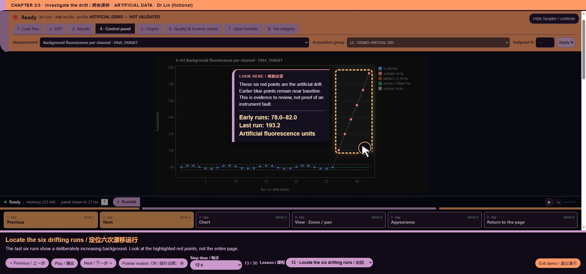

# core/biorad/zpcr_manual_endpoint.js — function reference

## C08921 · zpcrEndpointMetrics

- Ownership: MISSY first-party
- Module: core/biorad/zpcr_manual_endpoint.js, line 31; script 11, script line 882
- Form: FunctionDeclaration; parameters: `run, n`
- AST classification: `new_named`
- R1 entry status: `observed_in_passing_scenario`
- Passing scenario observations: formats, evidence-keyboard
- R2 clean contract evidence: No separately linked clean contract assertion for this function
- Code SHA-256: `2548f5a7d5f95fb2e355f1a0038930d833914b0e4b15e235084d192ad4f5aa8d`
- [Complete exact function source](https://github.com/mihaiionitabio-alt/zpcrweb/blob/missy-public-offline-2026-10-20/documentation/releases/2026-10-31-full-wiki/code/functions/C08921.js)

```javascript
function zpcrEndpointMetrics(run,n){

 const m={},z=run.zpcr;if(!Number.isInteger(n)||n<1||n>999)throw Error('Endpoint N must be an integer from 1 to 999');

 for(const step of new Set(z.reads.map(r=>r.step))){const all=z.reads.filter(r=>r.step===step);if(all.length<n)continue;const reads=all.slice(-n);

 for(let c=0;c<all[0].channels;c++)for(let p=0;p<96;p++){

 const ys=reads.map(r=>ZPCR.zpcrWellMean(r,c,Math.floor(p/12),p%12));if(!ys.every(Number.isFinite))continue;

 const q=ZPCR.zpcrStats(ys),v='Step '+step+' · Raw channel '+(c+1)+' · '+String.fromCharCode(65+Math.floor(p/12))+(p%12+1)+' · last '+n+' reads';

 (m.z_endpoint_mean||(m.z_endpoint_mean={}))[v]=q.mean;(m.z_endpoint_span||(m.z_endpoint_span={}))[v]=Math.max(...ys)-Math.min(...ys);

 }}return m;

}
```

## C08922 · <callback@886:39>

- Ownership: MISSY first-party
- Module: core/biorad/zpcr_manual_endpoint.js, line 35; script 11, script line 886
- Form: ArrowFunctionExpression; parameters: `r`
- AST classification: `new_or_changed_anonymous`
- R1 entry status: `observed_in_passing_scenario`
- Passing scenario observations: formats, evidence-keyboard
- R2 clean contract evidence: No separately linked clean contract assertion for this function
- Code SHA-256: `55758bc6f305f05ef52c13af33b70a57ac2433310f5aa5834425444dece92932`
- [Complete exact function source](https://github.com/mihaiionitabio-alt/zpcrweb/blob/missy-public-offline-2026-10-20/documentation/releases/2026-10-31-full-wiki/code/functions/C08922.js)

```javascript
r=>r.step
```

## C08923 · <callback@886:77>

- Ownership: MISSY first-party
- Module: core/biorad/zpcr_manual_endpoint.js, line 35; script 11, script line 886
- Form: ArrowFunctionExpression; parameters: `r`
- AST classification: `new_or_changed_anonymous`
- R1 entry status: `observed_in_passing_scenario`
- Passing scenario observations: formats, evidence-keyboard
- R2 clean contract evidence: No separately linked clean contract assertion for this function
- Code SHA-256: `87a6d6f7e0cc26b3438465151989895278e7be142d5da475c19b2a241180b504`
- [Complete exact function source](https://github.com/mihaiionitabio-alt/zpcrweb/blob/missy-public-offline-2026-10-20/documentation/releases/2026-10-31-full-wiki/code/functions/C08923.js)

```javascript
r=>r.step===step
```

## C08924 · <callback@890:20>

- Ownership: MISSY first-party
- Module: core/biorad/zpcr_manual_endpoint.js, line 39; script 11, script line 890
- Form: ArrowFunctionExpression; parameters: `r`
- AST classification: `new_or_changed_anonymous`
- R1 entry status: `observed_in_passing_scenario`
- Passing scenario observations: formats, evidence-keyboard
- R2 clean contract evidence: No separately linked clean contract assertion for this function
- Code SHA-256: `ac31b8cf138cddd5aa869da8ab838d525e97374aeb29e7dde7415cd10a1ead3c`
- [Complete exact function source](https://github.com/mihaiionitabio-alt/zpcrweb/blob/missy-public-offline-2026-10-20/documentation/releases/2026-10-31-full-wiki/code/functions/C08924.js)

```javascript
r=>ZPCR.zpcrWellMean(r,c,Math.floor(p/12),p%12)
```

## C08925 · <callback@900:72>

- Ownership: MISSY first-party
- Module: core/biorad/zpcr_manual_endpoint.js, line 49; script 11, script line 900
- Form: ArrowFunctionExpression; parameters: `next`
- AST classification: `new_or_changed_anonymous`
- R1 entry status: `observed_in_passing_scenario`
- Passing scenario observations: voice-demo, formats, training, chart-focus, guided-tour, evidence-keyboard
- R2 clean contract evidence: No separately linked clean contract assertion for this function
- Code SHA-256: `9715954f9f1c2d3a21fe795219579a775e53ab296ad190e1274f8fb99bfdad8b`
- [Complete exact function source](https://github.com/mihaiionitabio-alt/zpcrweb/blob/missy-public-offline-2026-10-20/documentation/releases/2026-10-31-full-wiki/code/functions/C08925.js)

```javascript
next => function(run){const m=next(run);if(run.zpcr)Object.assign(m,zpcrEndpointMetrics(run,ZPCR_ENDPOINT_N));return m;}
```

## C08926 · <callback@900:80>

- Ownership: MISSY first-party
- Module: core/biorad/zpcr_manual_endpoint.js, line 49; script 11, script line 900
- Form: FunctionExpression; parameters: `run`
- AST classification: `new_or_changed_anonymous`
- R1 entry status: `observed_in_passing_scenario`
- Passing scenario observations: voice-demo, formats, training, chart-focus, guided-tour, evidence-keyboard
- R2 clean contract evidence: No separately linked clean contract assertion for this function
- Code SHA-256: `40749ad5a488f857295ab6708c353201256d4a9baeb09320fd772fa154810447`
- [Complete exact function source](https://github.com/mihaiionitabio-alt/zpcrweb/blob/missy-public-offline-2026-10-20/documentation/releases/2026-10-31-full-wiki/code/functions/C08926.js)

```javascript
function(run){const m=next(run);if(run.zpcr)Object.assign(m,zpcrEndpointMetrics(run,ZPCR_ENDPOINT_N));return m;}
```

## C08927 · zpcrSetEndpointNBase

- Ownership: MISSY first-party
- Module: core/biorad/zpcr_manual_endpoint.js, line 57; script 11, script line 908
- Form: FunctionDeclaration; parameters: `n`
- AST classification: `new_named`
- R1 entry status: `not_observed_in_passing_scenario`
- Passing scenario observations: No passing R1 instrumented scenario observation
- R2 clean contract evidence: No separately linked clean contract assertion for this function
- Code SHA-256: `a81dbec6683cbf2fec9dd518029b90170ba9badc2cdcc6df66e5e5d8c3412060`
- [Complete exact function source](https://github.com/mihaiionitabio-alt/zpcrweb/blob/missy-public-offline-2026-10-20/documentation/releases/2026-10-31-full-wiki/code/functions/C08927.js)

```javascript
function zpcrSetEndpointNBase(n){n=Number(n);if(!Number.isInteger(n)||n<1||n>999)throw Error('Endpoint N must be an integer from 1 to 999');ZPCR_ENDPOINT_N=n;for(const r of RUNS.filter(r=>r.zpcr))delete r.ccStatic;for(const id of ['cc:z_endpoint_mean','cc:z_endpoint_span']){const o=SEL_STATE.options[id];if(o?.variant){const v=decodeURIComponent(o.variant).replace(/last \d+ reads$/,'last '+n+' reads');o.variant=encodeURIComponent(v);}}if(['z_endpoint_mean','z_endpoint_span'].includes(CC_STATE.open))CC_STATE.variant=String(CC_STATE.variant||'').replace(/last \d+ reads$/,'last '+n+' reads');document.querySelectorAll('input[aria-label="ZPCR endpoint N"]').forEach(e=>e.value=n);CC_STATE.cache=null;markDirty('panel');if(MG.open){mgRefresh();mgRender();}}
```

## C08928 · <callback@908:185>

- Ownership: MISSY first-party
- Module: core/biorad/zpcr_manual_endpoint.js, line 57; script 11, script line 908
- Form: ArrowFunctionExpression; parameters: `r`
- AST classification: `new_or_changed_anonymous`
- R1 entry status: `not_observed_in_passing_scenario`
- Passing scenario observations: No passing R1 instrumented scenario observation
- R2 clean contract evidence: No separately linked clean contract assertion for this function
- Code SHA-256: `12d4f64662b9033a92a9e691f35892324ccd6e8aba3f65fa08c078403672037c`
- [Complete exact function source](https://github.com/mihaiionitabio-alt/zpcrweb/blob/missy-public-offline-2026-10-20/documentation/releases/2026-10-31-full-wiki/code/functions/C08928.js)

```javascript
r=>r.zpcr
```

## C08929 · <callback@908:668>

- Ownership: MISSY first-party
- Module: core/biorad/zpcr_manual_endpoint.js, line 57; script 11, script line 908
- Form: ArrowFunctionExpression; parameters: `e`
- AST classification: `new_or_changed_anonymous`
- R1 entry status: `not_observed_in_passing_scenario`
- Passing scenario observations: No passing R1 instrumented scenario observation
- R2 clean contract evidence: No separately linked clean contract assertion for this function
- Code SHA-256: `a4a4cb5eea52d90da0d78548b8d06a81c044c3a995ad5e15ec14b72c1e67d943`
- [Complete exact function source](https://github.com/mihaiionitabio-alt/zpcrweb/blob/missy-public-offline-2026-10-20/documentation/releases/2026-10-31-full-wiki/code/functions/C08929.js)

```javascript
e=>e.value=n
```

## C08930 · zpcrSetEndpointN

- Ownership: MISSY first-party
- Module: core/biorad/zpcr_manual_endpoint.js, line 59; script 11, script line 910
- Form: FunctionDeclaration; parameters: `...args`
- AST classification: `new_named`
- R1 entry status: `not_observed_in_passing_scenario`
- Passing scenario observations: No passing R1 instrumented scenario observation
- R2 clean contract evidence: No separately linked clean contract assertion for this function
- Code SHA-256: `e5d31d102ac241c69748e028d3c83cba4b66a730dbb739ce2ff4b650d23a8c94`
- [Complete exact function source](https://github.com/mihaiionitabio-alt/zpcrweb/blob/missy-public-offline-2026-10-20/documentation/releases/2026-10-31-full-wiki/code/functions/C08930.js)

```javascript
function zpcrSetEndpointN(...args){return MISSY_HOOKS.invoke("zpcrSetEndpointN",this,args,zpcrSetEndpointNBase);}
```

## C08931 · zpcrEndpointControls

- Ownership: MISSY first-party
- Module: core/biorad/zpcr_manual_endpoint.js, line 63; script 11, script line 914
- Form: FunctionDeclaration; parameters: ``
- AST classification: `new_named`
- R1 entry status: `not_observed_in_passing_scenario`
- Passing scenario observations: No passing R1 instrumented scenario observation
- R2 clean contract evidence: No separately linked clean contract assertion for this function
- Code SHA-256: `7126361bd937fa6e758b33ec9c491a41ceaceefb7f4acf0a5ce23c5bfd5bcd93`
- [Complete exact function source](https://github.com/mihaiionitabio-alt/zpcrweb/blob/missy-public-offline-2026-10-20/documentation/releases/2026-10-31-full-wiki/code/functions/C08931.js)

```javascript
function zpcrEndpointControls(){const box=document.createElement('div');box.className='notice';const label=document.createElement('label');label.textContent='Raw endpoint · last N reads ';const input=document.createElement('input');input.type='number';input.min='1';input.max='999';input.value=ZPCR_ENDPOINT_N;input.setAttribute('aria-label','ZPCR endpoint N');input.style.width='90px';label.append(input);const b=document.createElement('button');b.textContent='Apply endpoint window';b.onclick=()=>{try{zpcrSetEndpointN(input.value);if(typeof astRender==='function'&&document.getElementById('ast-list')?.offsetParent)astRender();if(typeof mgRefresh==='function')mgRefresh();}catch(e){input.setCustomValidity(e.message);input.reportValidity();}};input.oninput=()=>input.setCustomValidity('');box.append(label,b);return box;}
```

## C08932 · b.onclick

- Ownership: MISSY first-party
- Module: core/biorad/zpcr_manual_endpoint.js, line 63; script 11, script line 914
- Form: ArrowFunctionExpression; parameters: ``
- AST classification: `ambiguous_name_match`
- R1 entry status: `not_observed_in_passing_scenario`
- Passing scenario observations: No passing R1 instrumented scenario observation
- R2 clean contract evidence: No separately linked clean contract assertion for this function
- Code SHA-256: `04667c87d1d0c38c1a95be0959d750cb1666f152e5c9330cf650f7f99b61145a`
- [Complete exact function source](https://github.com/mihaiionitabio-alt/zpcrweb/blob/missy-public-offline-2026-10-20/documentation/releases/2026-10-31-full-wiki/code/functions/C08932.js)

```javascript
()=>{try{zpcrSetEndpointN(input.value);if(typeof astRender==='function'&&document.getElementById('ast-list')?.offsetParent)astRender();if(typeof mgRefresh==='function')mgRefresh();}catch(e){input.setCustomValidity(e.message);input.reportValidity();}}
```

## C08933 · input.oninput

- Ownership: MISSY first-party
- Module: core/biorad/zpcr_manual_endpoint.js, line 63; script 11, script line 914
- Form: ArrowFunctionExpression; parameters: ``
- AST classification: `new_named`
- R1 entry status: `not_observed_in_passing_scenario`
- Passing scenario observations: No passing R1 instrumented scenario observation
- R2 clean contract evidence: No separately linked clean contract assertion for this function
- Code SHA-256: `227c1d38855a00d737429b1d1f009f9f5af00c5b2b0c3b0ae59008ef2e43fb57`
- [Complete exact function source](https://github.com/mihaiionitabio-alt/zpcrweb/blob/missy-public-offline-2026-10-20/documentation/releases/2026-10-31-full-wiki/code/functions/C08933.js)

```javascript
()=>input.setCustomValidity('')
```

## C08934 · <callback@916:73>

- Ownership: MISSY first-party
- Module: core/biorad/zpcr_manual_endpoint.js, line 65; script 11, script line 916
- Form: ArrowFunctionExpression; parameters: `next`
- AST classification: `new_or_changed_anonymous`
- R1 entry status: `not_observed_in_passing_scenario`
- Passing scenario observations: No passing R1 instrumented scenario observation
- R2 clean contract evidence: No separately linked clean contract assertion for this function
- Code SHA-256: `8eca304a8977c43aa52444fd396b30da3fbdb644739512ce4b7cee5a1ba3f189`
- [Complete exact function source](https://github.com/mihaiionitabio-alt/zpcrweb/blob/missy-public-offline-2026-10-20/documentation/releases/2026-10-31-full-wiki/code/functions/C08934.js)

```javascript
next => function(){next();if(!RUNS.some(r=>r.zpcr))return;const notes=document.createElement('details');notes.innerHTML='<summary>Raw data · manual notes</summary><ul>'+ZPCR_MANUAL_NOTES.map(t=>'<li>'+esc(t)+'</li>').join('')+'</ul>';zpcrPanel.prepend(notes,zpcrEndpointControls());}
```

## C08935 · <callback@916:81>

- Ownership: MISSY first-party
- Module: core/biorad/zpcr_manual_endpoint.js, line 65; script 11, script line 916
- Form: FunctionExpression; parameters: ``
- AST classification: `new_or_changed_anonymous`
- R1 entry status: `not_observed_in_passing_scenario`
- Passing scenario observations: No passing R1 instrumented scenario observation
- R2 clean contract evidence: No separately linked clean contract assertion for this function
- Code SHA-256: `cbfb7e0b478ee40939606d15dc08bdfd847472f6c47ea16f5fa4dee99beef2f9`
- [Complete exact function source](https://github.com/mihaiionitabio-alt/zpcrweb/blob/missy-public-offline-2026-10-20/documentation/releases/2026-10-31-full-wiki/code/functions/C08935.js)

```javascript
function(){next();if(!RUNS.some(r=>r.zpcr))return;const notes=document.createElement('details');notes.innerHTML='<summary>Raw data · manual notes</summary><ul>'+ZPCR_MANUAL_NOTES.map(t=>'<li>'+esc(t)+'</li>').join('')+'</ul>';zpcrPanel.prepend(notes,zpcrEndpointControls());}
```

## C08936 · <callback@916:113>

- Ownership: MISSY first-party
- Module: core/biorad/zpcr_manual_endpoint.js, line 65; script 11, script line 916
- Form: ArrowFunctionExpression; parameters: `r`
- AST classification: `new_or_changed_anonymous`
- R1 entry status: `not_observed_in_passing_scenario`
- Passing scenario observations: No passing R1 instrumented scenario observation
- R2 clean contract evidence: No separately linked clean contract assertion for this function
- Code SHA-256: `12d4f64662b9033a92a9e691f35892324ccd6e8aba3f65fa08c078403672037c`
- [Complete exact function source](https://github.com/mihaiionitabio-alt/zpcrweb/blob/missy-public-offline-2026-10-20/documentation/releases/2026-10-31-full-wiki/code/functions/C08936.js)

```javascript
r=>r.zpcr
```

## C08937 · <callback@916:264>

- Ownership: MISSY first-party
- Module: core/biorad/zpcr_manual_endpoint.js, line 65; script 11, script line 916
- Form: ArrowFunctionExpression; parameters: `t`
- AST classification: `new_or_changed_anonymous`
- R1 entry status: `not_observed_in_passing_scenario`
- Passing scenario observations: No passing R1 instrumented scenario observation
- R2 clean contract evidence: No separately linked clean contract assertion for this function
- Code SHA-256: `cc8aa84b341da30d6e6ac325e6e6fb038cc244acf15f88cd79e7dfea024feb4f`
- [Complete exact function source](https://github.com/mihaiionitabio-alt/zpcrweb/blob/missy-public-offline-2026-10-20/documentation/releases/2026-10-31-full-wiki/code/functions/C08937.js)

```javascript
t=>'<li>'+esc(t)+'</li>'
```

## C08938 · <callback@918:73>

- Ownership: MISSY first-party
- Module: core/biorad/zpcr_manual_endpoint.js, line 67; script 11, script line 918
- Form: ArrowFunctionExpression; parameters: `next`
- AST classification: `new_or_changed_anonymous`
- R1 entry status: `observed_in_passing_scenario`
- Passing scenario observations: voice-demo, training, guided-tour
- R2 clean contract evidence: No separately linked clean contract assertion for this function
- Code SHA-256: `4e4717ce625e8735a37bfc8238156a6366e95ffd47ea5aa427d1c70f0c57e752`
- [Complete exact function source](https://github.com/mihaiionitabio-alt/zpcrweb/blob/missy-public-offline-2026-10-20/documentation/releases/2026-10-31-full-wiki/code/functions/C08938.js)

```javascript
next => function(){next();if(RUNS.some(r=>r.zpcr))astEl('ast-list').prepend(zpcrEndpointControls());}
```

## C08939 · <callback@918:81>

- Ownership: MISSY first-party
- Module: core/biorad/zpcr_manual_endpoint.js, line 67; script 11, script line 918
- Form: FunctionExpression; parameters: ``
- AST classification: `new_or_changed_anonymous`
- R1 entry status: `observed_in_passing_scenario`
- Passing scenario observations: voice-demo, training, guided-tour
- R2 clean contract evidence: No separately linked clean contract assertion for this function
- Code SHA-256: `7fabab7624310d2ef27868691f043968577ae52545801e322b291e77aefbd9a1`
- [Complete exact function source](https://github.com/mihaiionitabio-alt/zpcrweb/blob/missy-public-offline-2026-10-20/documentation/releases/2026-10-31-full-wiki/code/functions/C08939.js)

```javascript
function(){next();if(RUNS.some(r=>r.zpcr))astEl('ast-list').prepend(zpcrEndpointControls());}
```

## C08940 · <callback@918:112>

- Ownership: MISSY first-party
- Module: core/biorad/zpcr_manual_endpoint.js, line 67; script 11, script line 918
- Form: ArrowFunctionExpression; parameters: `r`
- AST classification: `new_or_changed_anonymous`
- R1 entry status: `observed_in_passing_scenario`
- Passing scenario observations: voice-demo, training, guided-tour
- R2 clean contract evidence: No separately linked clean contract assertion for this function
- Code SHA-256: `12d4f64662b9033a92a9e691f35892324ccd6e8aba3f65fa08c078403672037c`
- [Complete exact function source](https://github.com/mihaiionitabio-alt/zpcrweb/blob/missy-public-offline-2026-10-20/documentation/releases/2026-10-31-full-wiki/code/functions/C08940.js)

```javascript
r=>r.zpcr
```

## C08941 · <callback@920:70>

- Ownership: MISSY first-party
- Module: core/biorad/zpcr_manual_endpoint.js, line 69; script 11, script line 920
- Form: ArrowFunctionExpression; parameters: `next`
- AST classification: `new_or_changed_anonymous`
- R1 entry status: `observed_in_passing_scenario`
- Passing scenario observations: voice-demo, training, voice-state, voice-bargein, command-finish, chart-focus, guided-tour
- R2 clean contract evidence: No separately linked clean contract assertion for this function
- Code SHA-256: `d8a7b7aac0720c7e9bbe53c218b79c8eaca00ee39d250a2db38ecf30a7983c94`
- [Complete exact function source](https://github.com/mihaiionitabio-alt/zpcrweb/blob/missy-public-offline-2026-10-20/documentation/releases/2026-10-31-full-wiki/code/functions/C08941.js)

```javascript
next => function(){next();const nav=document.getElementById('mg-nav');nav.querySelector('#zpcr-console-endpoint')?.remove();if(RUNS.some(r=>r.zpcr)){const c=zpcrEndpointControls();c.id='zpcr-console-endpoint';nav.append(c);}}
```

## C08942 · <callback@920:78>

- Ownership: MISSY first-party
- Module: core/biorad/zpcr_manual_endpoint.js, line 69; script 11, script line 920
- Form: FunctionExpression; parameters: ``
- AST classification: `new_or_changed_anonymous`
- R1 entry status: `observed_in_passing_scenario`
- Passing scenario observations: voice-demo, training, voice-state, voice-bargein, command-finish, chart-focus, guided-tour
- R2 clean contract evidence: No separately linked clean contract assertion for this function
- Code SHA-256: `e9178786e56820fd7c3b90967f632abd64b40c38b52839569b7017503f94c149`
- [Complete exact function source](https://github.com/mihaiionitabio-alt/zpcrweb/blob/missy-public-offline-2026-10-20/documentation/releases/2026-10-31-full-wiki/code/functions/C08942.js)

```javascript
function(){next();const nav=document.getElementById('mg-nav');nav.querySelector('#zpcr-console-endpoint')?.remove();if(RUNS.some(r=>r.zpcr)){const c=zpcrEndpointControls();c.id='zpcr-console-endpoint';nav.append(c);}}
```

## C08943 · <callback@920:207>

- Ownership: MISSY first-party
- Module: core/biorad/zpcr_manual_endpoint.js, line 69; script 11, script line 920
- Form: ArrowFunctionExpression; parameters: `r`
- AST classification: `new_or_changed_anonymous`
- R1 entry status: `observed_in_passing_scenario`
- Passing scenario observations: voice-demo, training, chart-focus, guided-tour
- R2 clean contract evidence: No separately linked clean contract assertion for this function
- Code SHA-256: `12d4f64662b9033a92a9e691f35892324ccd6e8aba3f65fa08c078403672037c`
- [Complete exact function source](https://github.com/mihaiionitabio-alt/zpcrweb/blob/missy-public-offline-2026-10-20/documentation/releases/2026-10-31-full-wiki/code/functions/C08943.js)

```javascript
r=>r.zpcr
```

## C08944 · <callback@922:71>

- Ownership: MISSY first-party
- Module: core/biorad/zpcr_manual_endpoint.js, line 71; script 11, script line 922
- Form: ArrowFunctionExpression; parameters: `next`
- AST classification: `new_or_changed_anonymous`
- R1 entry status: `not_observed_in_passing_scenario`
- Passing scenario observations: No passing R1 instrumented scenario observation
- R2 clean contract evidence: No separately linked clean contract assertion for this function
- Code SHA-256: `9551c665a41627e1c9d25dfdda6381e3f6de6db74a2cc36eed3f813e719c9709`
- [Complete exact function source](https://github.com/mihaiionitabio-alt/zpcrweb/blob/missy-public-offline-2026-10-20/documentation/releases/2026-10-31-full-wiki/code/functions/C08944.js)

```javascript
next => async function(raw){const match=String(raw).trim().match(/^zpcr endpoint (\d+)$/i);if(match){zpcrSetEndpointN(match[1]);cmdPrint('• Endpoint window: last '+ZPCR_ENDPOINT_N+' reads.','ok');return;}if(/^zpcr notes$/i.test(String(raw).trim())){ZPCR_MANUAL_NOTES.forEach(t=>cmdPrint('• '+t));return;}return next(raw);}
```

## C08945 · <callback@922:79>

- Ownership: MISSY first-party
- Module: core/biorad/zpcr_manual_endpoint.js, line 71; script 11, script line 922
- Form: FunctionExpression; parameters: `raw`
- AST classification: `new_or_changed_anonymous`
- R1 entry status: `not_observed_in_passing_scenario`
- Passing scenario observations: No passing R1 instrumented scenario observation
- R2 clean contract evidence: No separately linked clean contract assertion for this function
- Code SHA-256: `d6a93c661b41fe94ff7866dbbd986e7147006629d65944c771dee13b6583aa13`
- [Complete exact function source](https://github.com/mihaiionitabio-alt/zpcrweb/blob/missy-public-offline-2026-10-20/documentation/releases/2026-10-31-full-wiki/code/functions/C08945.js)

```javascript
async function(raw){const match=String(raw).trim().match(/^zpcr endpoint (\d+)$/i);if(match){zpcrSetEndpointN(match[1]);cmdPrint('• Endpoint window: last '+ZPCR_ENDPOINT_N+' reads.','ok');return;}if(/^zpcr notes$/i.test(String(raw).trim())){ZPCR_MANUAL_NOTES.forEach(t=>cmdPrint('• '+t));return;}return next(raw);}
```

## C08946 · <callback@922:346>

- Ownership: MISSY first-party
- Module: core/biorad/zpcr_manual_endpoint.js, line 71; script 11, script line 922
- Form: ArrowFunctionExpression; parameters: `t`
- AST classification: `new_or_changed_anonymous`
- R1 entry status: `not_observed_in_passing_scenario`
- Passing scenario observations: No passing R1 instrumented scenario observation
- R2 clean contract evidence: No separately linked clean contract assertion for this function
- Code SHA-256: `6bbff866102db8fa7d78c478278e96b525289649d08c2a4f85b4385401f003aa`
- [Complete exact function source](https://github.com/mihaiionitabio-alt/zpcrweb/blob/missy-public-offline-2026-10-20/documentation/releases/2026-10-31-full-wiki/code/functions/C08946.js)

```javascript
t=>cmdPrint('• '+t)
```

## C08947 · <callback@926:80>

- Ownership: MISSY first-party
- Module: core/biorad/zpcr_manual_endpoint.js, line 75; script 11, script line 926
- Form: ArrowFunctionExpression; parameters: `next`
- AST classification: `new_or_changed_anonymous`
- R1 entry status: `not_observed_in_passing_scenario`
- Passing scenario observations: No passing R1 instrumented scenario observation
- R2 clean contract evidence: No separately linked clean contract assertion for this function
- Code SHA-256: `db379046210378fe7cdd2561d11e1832f0c203fb586b28db7d4619121e89ff04`
- [Complete exact function source](https://github.com/mihaiionitabio-alt/zpcrweb/blob/missy-public-offline-2026-10-20/documentation/releases/2026-10-31-full-wiki/code/functions/C08947.js)

```javascript
next => function(){return '# Raw endpoint window\nzpcr endpoint '+ZPCR_ENDPOINT_N+'\n'+next();}
```

## C08948 · <callback@926:88>

- Ownership: MISSY first-party
- Module: core/biorad/zpcr_manual_endpoint.js, line 75; script 11, script line 926
- Form: FunctionExpression; parameters: ``
- AST classification: `new_or_changed_anonymous`
- R1 entry status: `not_observed_in_passing_scenario`
- Passing scenario observations: No passing R1 instrumented scenario observation
- R2 clean contract evidence: No separately linked clean contract assertion for this function
- Code SHA-256: `77b67904a28177bd64605ed0bec8339d55ae0210ee4ca276d10711e3458b08f5`
- [Complete exact function source](https://github.com/mihaiionitabio-alt/zpcrweb/blob/missy-public-offline-2026-10-20/documentation/releases/2026-10-31-full-wiki/code/functions/C08948.js)

```javascript
function(){return '# Raw endpoint window\nzpcr endpoint '+ZPCR_ENDPOINT_N+'\n'+next();}
```

## C08949 · <callback@928:77>

- Ownership: MISSY first-party
- Module: core/biorad/zpcr_manual_endpoint.js, line 77; script 11, script line 928
- Form: ArrowFunctionExpression; parameters: `next`
- AST classification: `new_or_changed_anonymous`
- R1 entry status: `observed_in_passing_scenario`
- Passing scenario observations: voice-demo, formats, training, guided-tour, precision, evidence-keyboard
- R2 clean contract evidence: No separately linked clean contract assertion for this function
- Code SHA-256: `9f1d681c135d6728b834ef426015f445a4db92007a3e05bca24dff774b032437`
- [Complete exact function source](https://github.com/mihaiionitabio-alt/zpcrweb/blob/missy-public-offline-2026-10-20/documentation/releases/2026-10-31-full-wiki/code/functions/C08949.js)

```javascript
next => function(){return next().map(x=>x.id.startsWith('cc:z_')?{...x,note:'• '+ZPCR_MANUAL_NOTES.slice(0,8).join('\n• ')+'\n• '+CC_BY_ID[x.id.slice(3)].code+' · '+CC_BY_ID[x.id.slice(3)].title+'\n• Matching protocol / firmware / window required.\n• Descriptive values; no vendor acceptance limits.'}:x);}
```

## C08950 · <callback@928:85>

- Ownership: MISSY first-party
- Module: core/biorad/zpcr_manual_endpoint.js, line 77; script 11, script line 928
- Form: FunctionExpression; parameters: ``
- AST classification: `new_or_changed_anonymous`
- R1 entry status: `observed_in_passing_scenario`
- Passing scenario observations: voice-demo, formats, training, guided-tour, precision, evidence-keyboard
- R2 clean contract evidence: No separately linked clean contract assertion for this function
- Code SHA-256: `36939201dffbd90603be7c89cf044c4020362ca12c32cd74d13bb8388bc91dec`
- [Complete exact function source](https://github.com/mihaiionitabio-alt/zpcrweb/blob/missy-public-offline-2026-10-20/documentation/releases/2026-10-31-full-wiki/code/functions/C08950.js)

```javascript
function(){return next().map(x=>x.id.startsWith('cc:z_')?{...x,note:'• '+ZPCR_MANUAL_NOTES.slice(0,8).join('\n• ')+'\n• '+CC_BY_ID[x.id.slice(3)].code+' · '+CC_BY_ID[x.id.slice(3)].title+'\n• Matching protocol / firmware / window required.\n• Descriptive values; no vendor acceptance limits.'}:x);}
```

## C08951 · <callback@928:114>

- Ownership: MISSY first-party
- Module: core/biorad/zpcr_manual_endpoint.js, line 77; script 11, script line 928
- Form: ArrowFunctionExpression; parameters: `x`
- AST classification: `new_or_changed_anonymous`
- R1 entry status: `observed_in_passing_scenario`
- Passing scenario observations: voice-demo, formats, training, guided-tour, precision, evidence-keyboard
- R2 clean contract evidence: No separately linked clean contract assertion for this function
- Code SHA-256: `6c3704ca961a4f26dc2c1a59924f3a55ec90dfdc5ebdd8b578daf2fee4c53a94`
- [Complete exact function source](https://github.com/mihaiionitabio-alt/zpcrweb/blob/missy-public-offline-2026-10-20/documentation/releases/2026-10-31-full-wiki/code/functions/C08951.js)

```javascript
x=>x.id.startsWith('cc:z_')?{...x,note:'• '+ZPCR_MANUAL_NOTES.slice(0,8).join('\n• ')+'\n• '+CC_BY_ID[x.id.slice(3)].code+' · '+CC_BY_ID[x.id.slice(3)].title+'\n• Matching protocol / firmware / window required.\n• Descriptive values; no vendor acceptance limits.'}:x
```

## C08952 · <callback@930:76>

- Ownership: MISSY first-party
- Module: core/biorad/zpcr_manual_endpoint.js, line 79; script 11, script line 930
- Form: ArrowFunctionExpression; parameters: `next`
- AST classification: `new_or_changed_anonymous`
- R1 entry status: `observed_in_passing_scenario`
- Passing scenario observations: voice-demo, formats, training, guided-tour, precision, evidence-keyboard
- R2 clean contract evidence: No separately linked clean contract assertion for this function
- Code SHA-256: `436488d7250836a63b47695fef56eb25f40c1796dfd3c3465003a80e8ebf2fa4`
- [Complete exact function source](https://github.com/mihaiionitabio-alt/zpcrweb/blob/missy-public-offline-2026-10-20/documentation/releases/2026-10-31-full-wiki/code/functions/C08952.js)

```javascript
next => function(){return next().map(x=>x.id==='data:zpcr_sources'?{...x,note:'• '+ZPCR_MANUAL_NOTES.join('\n• ')+'\n'+zpcrInventoryRows().map(r=>'• File: '+r.file+'\n• Source SHA-256: '+r.source_sha256+'\n• Acquisition SHA-256: '+r.acquisition_sha256+'\n• '+r.status).join('\n')}:x);}
```

## C08953 · <callback@930:84>

- Ownership: MISSY first-party
- Module: core/biorad/zpcr_manual_endpoint.js, line 79; script 11, script line 930
- Form: FunctionExpression; parameters: ``
- AST classification: `new_or_changed_anonymous`
- R1 entry status: `observed_in_passing_scenario`
- Passing scenario observations: voice-demo, formats, training, guided-tour, precision, evidence-keyboard
- R2 clean contract evidence: No separately linked clean contract assertion for this function
- Code SHA-256: `6853f5531947bdae3d4226816ccf29fb918fd4d26ba9e99f43bce0735c521add`
- [Complete exact function source](https://github.com/mihaiionitabio-alt/zpcrweb/blob/missy-public-offline-2026-10-20/documentation/releases/2026-10-31-full-wiki/code/functions/C08953.js)

```javascript
function(){return next().map(x=>x.id==='data:zpcr_sources'?{...x,note:'• '+ZPCR_MANUAL_NOTES.join('\n• ')+'\n'+zpcrInventoryRows().map(r=>'• File: '+r.file+'\n• Source SHA-256: '+r.source_sha256+'\n• Acquisition SHA-256: '+r.acquisition_sha256+'\n• '+r.status).join('\n')}:x);}
```

## C08954 · <callback@930:113>

- Ownership: MISSY first-party
- Module: core/biorad/zpcr_manual_endpoint.js, line 79; script 11, script line 930
- Form: ArrowFunctionExpression; parameters: `x`
- AST classification: `new_or_changed_anonymous`
- R1 entry status: `observed_in_passing_scenario`
- Passing scenario observations: voice-demo, formats, training, guided-tour, precision, evidence-keyboard
- R2 clean contract evidence: No separately linked clean contract assertion for this function
- Code SHA-256: `be7ce1515a0cee15e5e85e37b6f27df5ebb5f33846d75cf438022594e21e29e3`
- [Complete exact function source](https://github.com/mihaiionitabio-alt/zpcrweb/blob/missy-public-offline-2026-10-20/documentation/releases/2026-10-31-full-wiki/code/functions/C08954.js)

```javascript
x=>x.id==='data:zpcr_sources'?{...x,note:'• '+ZPCR_MANUAL_NOTES.join('\n• ')+'\n'+zpcrInventoryRows().map(r=>'• File: '+r.file+'\n• Source SHA-256: '+r.source_sha256+'\n• Acquisition SHA-256: '+r.acquisition_sha256+'\n• '+r.status).join('\n')}:x
```

## C08955 · <callback@930:219>

- Ownership: MISSY first-party
- Module: core/biorad/zpcr_manual_endpoint.js, line 79; script 11, script line 930
- Form: ArrowFunctionExpression; parameters: `r`
- AST classification: `new_or_changed_anonymous`
- R1 entry status: `observed_in_passing_scenario`
- Passing scenario observations: evidence-keyboard
- R2 clean contract evidence: No separately linked clean contract assertion for this function
- Code SHA-256: `855efeb99a53fdad1b801de3caad56d7c837cb3f007cee2020701e38ba8de1d0`
- [Complete exact function source](https://github.com/mihaiionitabio-alt/zpcrweb/blob/missy-public-offline-2026-10-20/documentation/releases/2026-10-31-full-wiki/code/functions/C08955.js)

```javascript
r=>'• File: '+r.file+'\n• Source SHA-256: '+r.source_sha256+'\n• Acquisition SHA-256: '+r.acquisition_sha256+'\n• '+r.status
```

## C08956 · <callback@932:89>

- Ownership: MISSY first-party
- Module: core/biorad/zpcr_manual_endpoint.js, line 81; script 11, script line 932
- Form: ArrowFunctionExpression; parameters: `next`
- AST classification: `new_or_changed_anonymous`
- R1 entry status: `not_observed_in_passing_scenario`
- Passing scenario observations: No passing R1 instrumented scenario observation
- R2 clean contract evidence: No separately linked clean contract assertion for this function
- Code SHA-256: `45d7797533860739e09e9b50309b5994958d919956692890a9e5b6f84ce601ae`
- [Complete exact function source](https://github.com/mihaiionitabio-alt/zpcrweb/blob/missy-public-offline-2026-10-20/documentation/releases/2026-10-31-full-wiki/code/functions/C08956.js)

```javascript
next => function(){const items=next();return items.map(x=>x.kind==='chart'?{...x,state:'• '+ZPCR_MANUAL_NOTES.slice(0,7).join('\n• ')}:x);}
```

## C08957 · <callback@932:97>

- Ownership: MISSY first-party
- Module: core/biorad/zpcr_manual_endpoint.js, line 81; script 11, script line 932
- Form: FunctionExpression; parameters: ``
- AST classification: `new_or_changed_anonymous`
- R1 entry status: `not_observed_in_passing_scenario`
- Passing scenario observations: No passing R1 instrumented scenario observation
- R2 clean contract evidence: No separately linked clean contract assertion for this function
- Code SHA-256: `68489b5b844f735a277f73192aaf7ae8fa9dc978e40cdfae03b3cb5b8865b991`
- [Complete exact function source](https://github.com/mihaiionitabio-alt/zpcrweb/blob/missy-public-offline-2026-10-20/documentation/releases/2026-10-31-full-wiki/code/functions/C08957.js)

```javascript
function(){const items=next();return items.map(x=>x.kind==='chart'?{...x,state:'• '+ZPCR_MANUAL_NOTES.slice(0,7).join('\n• ')}:x);}
```

## C08958 · <callback@932:144>

- Ownership: MISSY first-party
- Module: core/biorad/zpcr_manual_endpoint.js, line 81; script 11, script line 932
- Form: ArrowFunctionExpression; parameters: `x`
- AST classification: `new_or_changed_anonymous`
- R1 entry status: `not_observed_in_passing_scenario`
- Passing scenario observations: No passing R1 instrumented scenario observation
- R2 clean contract evidence: No separately linked clean contract assertion for this function
- Code SHA-256: `719d3f9083aef783b45ac87bd7996027737586b48edfc3c312b55d2f30503ddc`
- [Complete exact function source](https://github.com/mihaiionitabio-alt/zpcrweb/blob/missy-public-offline-2026-10-20/documentation/releases/2026-10-31-full-wiki/code/functions/C08958.js)

```javascript
x=>x.kind==='chart'?{...x,state:'• '+ZPCR_MANUAL_NOTES.slice(0,7).join('\n• ')}:x
```

## C08959 · <callback@938:78>

- Ownership: MISSY first-party
- Module: core/biorad/zpcr_manual_endpoint.js, line 87; script 11, script line 938
- Form: ArrowFunctionExpression; parameters: `next`
- AST classification: `new_or_changed_anonymous`
- R1 entry status: `observed_in_passing_scenario`
- Passing scenario observations: voice-demo, training, guided-tour
- R2 clean contract evidence: No separately linked clean contract assertion for this function
- Code SHA-256: `ab6ae5a7608f7d9d51328c423f5abe4bde7dc2441c24f3e399dbd1b18db948fd`
- [Complete exact function source](https://github.com/mihaiionitabio-alt/zpcrweb/blob/missy-public-offline-2026-10-20/documentation/releases/2026-10-31-full-wiki/code/functions/C08959.js)

```javascript
next => async function(){zpcrReportLogo=await svgToJpeg(missySvg(true),3);return next();}
```

## C08960 · <callback@938:86>

- Ownership: MISSY first-party
- Module: core/biorad/zpcr_manual_endpoint.js, line 87; script 11, script line 938
- Form: FunctionExpression; parameters: ``
- AST classification: `new_or_changed_anonymous`
- R1 entry status: `observed_in_passing_scenario`
- Passing scenario observations: voice-demo, training, guided-tour
- R2 clean contract evidence: No separately linked clean contract assertion for this function
- Code SHA-256: `4bd321f672204cf59d15eec787c7deac9594fd3215d27d202c54aba5e083a33c`
- [Complete exact function source](https://github.com/mihaiionitabio-alt/zpcrweb/blob/missy-public-offline-2026-10-20/documentation/releases/2026-10-31-full-wiki/code/functions/C08960.js)

```javascript
async function(){zpcrReportLogo=await svgToJpeg(missySvg(true),3);return next();}
```

## C08961 · <callback@940:54>

- Ownership: MISSY first-party
- Module: core/biorad/zpcr_manual_endpoint.js, line 89; script 11, script line 940
- Form: ArrowFunctionExpression; parameters: `next`
- AST classification: `new_or_changed_anonymous`
- R1 entry status: `observed_in_passing_scenario`
- Passing scenario observations: voice-demo, training, guided-tour
- R2 clean contract evidence: No separately linked clean contract assertion for this function
- Code SHA-256: `21c929f30c2b90d18b1c0580070e08391b789bf4698be16df3cba5f95ebb01bc`
- [Complete exact function source](https://github.com/mihaiionitabio-alt/zpcrweb/blob/missy-public-offline-2026-10-20/documentation/releases/2026-10-31-full-wiki/code/functions/C08961.js)

```javascript
next=>function(){

 const style=next();

 return {...style,wrapTitle:true,colour:bold=>bold?[.06,.18,.30]:[.15,.19,.24],

 header(d,text){if(zpcrReportLogo){const j=zpcrReportLogo;d.image(j.bytes,120,40,j.w,j.h);}else text('MISSY  |  RUO  |  NOT VALIDATED',10,true,0,[.06,.18,.30]);d.rule();d.gap(5);},

 paragraphLines(s){if(String(s).includes('ZPCR hardware fields are decoded')||String(s).includes('The page recomputes nothing.'))s='• Research Use Only.\n• Not validated for clinical or instrument qualification decisions.\n• Does not replace vendor QC certification or laboratory validation.';return String(s).split('\n').map(line=>line.replace(/^• /,'- '));}};

}
```

## C08962 · <callback@940:60>

- Ownership: MISSY first-party
- Module: core/biorad/zpcr_manual_endpoint.js, line 89; script 11, script line 940
- Form: FunctionExpression; parameters: ``
- AST classification: `new_or_changed_anonymous`
- R1 entry status: `observed_in_passing_scenario`
- Passing scenario observations: voice-demo, training, guided-tour
- R2 clean contract evidence: No separately linked clean contract assertion for this function
- Code SHA-256: `00067f810af3bad75306e56dad68f430dc6fcc68c360ad1e68ae16c514136b2c`
- [Complete exact function source](https://github.com/mihaiionitabio-alt/zpcrweb/blob/missy-public-offline-2026-10-20/documentation/releases/2026-10-31-full-wiki/code/functions/C08962.js)

```javascript
function(){

 const style=next();

 return {...style,wrapTitle:true,colour:bold=>bold?[.06,.18,.30]:[.15,.19,.24],

 header(d,text){if(zpcrReportLogo){const j=zpcrReportLogo;d.image(j.bytes,120,40,j.w,j.h);}else text('MISSY  |  RUO  |  NOT VALIDATED',10,true,0,[.06,.18,.30]);d.rule();d.gap(5);},

 paragraphLines(s){if(String(s).includes('ZPCR hardware fields are decoded')||String(s).includes('The page recomputes nothing.'))s='• Research Use Only.\n• Not validated for clinical or instrument qualification decisions.\n• Does not replace vendor QC certification or laboratory validation.';return String(s).split('\n').map(line=>line.replace(/^• /,'- '));}};

}
```

## C08963 · colour

- Ownership: MISSY first-party
- Module: core/biorad/zpcr_manual_endpoint.js, line 93; script 11, script line 944
- Form: ArrowFunctionExpression; parameters: `bold`
- AST classification: `ambiguous_name_match`
- R1 entry status: `observed_in_passing_scenario`
- Passing scenario observations: voice-demo, training, guided-tour
- R2 clean contract evidence: No separately linked clean contract assertion for this function
- Code SHA-256: `6ce661001b2ac6bca02b7b64a548778d9cdf8eb379094739d6094230e9c15a4b`
- [Complete exact function source](https://github.com/mihaiionitabio-alt/zpcrweb/blob/missy-public-offline-2026-10-20/documentation/releases/2026-10-31-full-wiki/code/functions/C08963.js)

```javascript
bold=>bold?[.06,.18,.30]:[.15,.19,.24]
```

## C08964 · header

- Ownership: MISSY first-party
- Module: core/biorad/zpcr_manual_endpoint.js, line 95; script 11, script line 946
- Form: FunctionExpression; parameters: `d, text`
- AST classification: `new_named`
- R1 entry status: `observed_in_passing_scenario`
- Passing scenario observations: voice-demo, training, guided-tour
- R2 clean contract evidence: No separately linked clean contract assertion for this function
- Code SHA-256: `016246f656e16f6f0f81e5912084547c7914ef999f721f8e42e69a658c9334bc`
- [Complete exact function source](https://github.com/mihaiionitabio-alt/zpcrweb/blob/missy-public-offline-2026-10-20/documentation/releases/2026-10-31-full-wiki/code/functions/C08964.js)

```javascript
(d,text){if(zpcrReportLogo){const j=zpcrReportLogo;d.image(j.bytes,120,40,j.w,j.h);}else text('MISSY  |  RUO  |  NOT VALIDATED',10,true,0,[.06,.18,.30]);d.rule();d.gap(5);}
```

## C08965 · paragraphLines

- Ownership: MISSY first-party
- Module: core/biorad/zpcr_manual_endpoint.js, line 97; script 11, script line 948
- Form: FunctionExpression; parameters: `s`
- AST classification: `new_named`
- R1 entry status: `observed_in_passing_scenario`
- Passing scenario observations: voice-demo, training, guided-tour
- R2 clean contract evidence: No separately linked clean contract assertion for this function
- Code SHA-256: `781b177ec7d702b57b71ae9d0ebbde1b7305ad13f6c7e69a2e61db16151ca95b`
- [Complete exact function source](https://github.com/mihaiionitabio-alt/zpcrweb/blob/missy-public-offline-2026-10-20/documentation/releases/2026-10-31-full-wiki/code/functions/C08965.js)

```javascript
(s){if(String(s).includes('ZPCR hardware fields are decoded')||String(s).includes('The page recomputes nothing.'))s='• Research Use Only.\n• Not validated for clinical or instrument qualification decisions.\n• Does not replace vendor QC certification or laboratory validation.';return String(s).split('\n').map(line=>line.replace(/^• /,'- '));}
```

## C08966 · <callback@948:326>

- Ownership: MISSY first-party
- Module: core/biorad/zpcr_manual_endpoint.js, line 97; script 11, script line 948
- Form: ArrowFunctionExpression; parameters: `line`
- AST classification: `new_or_changed_anonymous`
- R1 entry status: `observed_in_passing_scenario`
- Passing scenario observations: voice-demo, training, guided-tour
- R2 clean contract evidence: No separately linked clean contract assertion for this function
- Code SHA-256: `0b1f1f641f1de365dae08831ec142d284d7638571e6a0d5910a2f59d87df63b9`
- [Complete exact function source](https://github.com/mihaiionitabio-alt/zpcrweb/blob/missy-public-offline-2026-10-20/documentation/releases/2026-10-31-full-wiki/code/functions/C08966.js)

```javascript
line=>line.replace(/^• /,'- ')
```

[Wiki home](/p/zpcrweb/wiki/Home/)

## Illustrated interface context

Chart user-interface context. Synthetic RDML does not demonstrate native Bio-Rad decoding. This is UI context, not proof of function-level correctness.



*Representative webpage view for core/biorad/zpcr_manual_endpoint.js*

[Complete illustrated workflow and source mapping](https://github.com/mihaiionitabio-alt/zpcrweb/blob/missy-public-offline-2026-10-20/documentation/releases/2026-11-01-illustrated-wiki/pages/FunctionScreenshots.md)
