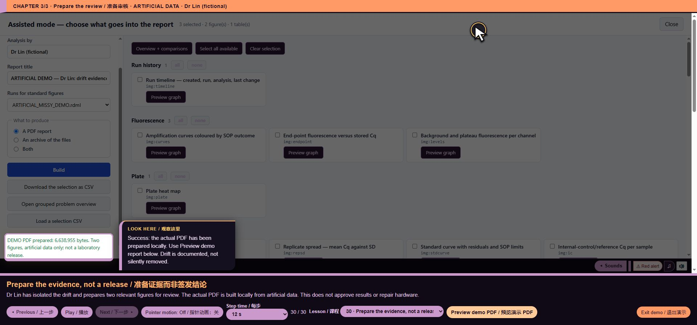

# core/biorad/zpcr_modes_reports.js — function reference

## C08796 · zpcrChartContext

- Ownership: MISSY first-party
- Module: core/biorad/zpcr_modes_reports.js, line 3; script 11, script line 753
- Form: FunctionDeclaration; parameters: `id`
- AST classification: `new_named`
- R1 entry status: `not_observed_in_passing_scenario`
- Passing scenario observations: No passing R1 instrumented scenario observation
- R2 clean contract evidence: No separately linked clean contract assertion for this function
- Code SHA-256: `d06f2300d7b33517314a6ce7623ddbb9f700169a1f94ecfe01e0c29969162927`
- [Complete exact function source](https://github.com/mihaiionitabio-alt/zpcrweb/blob/missy-public-offline-2026-10-20/documentation/releases/2026-10-31-full-wiki/code/functions/C08796.js)

```javascript
function zpcrChartContext(id){
 const def=CC_BY_ID[id.slice(3)],o=SEL_STATE.options[id]||{},decode=v=>{try{return decodeURIComponent(v||'');}catch(e){throw Error('Invalid encoded chart selector');}},insts=ccInstruments().filter(i=>i.platform==='CFX');
 const key=decode(o.instrument)|| (insts.some(i=>i.key===CC_STATE.instrument)?CC_STATE.instrument:insts[0]?.key);
 if(!key||!insts.some(i=>i.key===key))throw Error('Load ZPCR history for the requested instrument');
 const protocol=decode(o.protocol),rows=ccAllRows().filter(r=>r.instrument===key&&(!protocol||r.protocol===protocol)).sort((a,b)=>(a.date||0)-(b.date||0));
 let hours=0;rows.forEach(r=>{r.hours=hours;hours+=(r.m.run_minutes||0)/60;});
 const variants=ccVariants(def,rows),variant=decode(o.variant)||variants[0];if(!variant||!variants.includes(variant))throw Error('No data for this acquisition-step/channel variant');
 return {def,o,key,protocol,rows,variant};
}
```

## C08797 · decode

- Ownership: MISSY first-party
- Module: core/biorad/zpcr_modes_reports.js, line 4; script 11, script line 754
- Form: ArrowFunctionExpression; parameters: `v`
- AST classification: `new_named`
- R1 entry status: `not_observed_in_passing_scenario`
- Passing scenario observations: No passing R1 instrumented scenario observation
- R2 clean contract evidence: No separately linked clean contract assertion for this function
- Code SHA-256: `a19ea8562e9a3cfb442d4dda3afc7add76236f8fb082326c7346315f96296835`
- [Complete exact function source](https://github.com/mihaiionitabio-alt/zpcrweb/blob/missy-public-offline-2026-10-20/documentation/releases/2026-10-31-full-wiki/code/functions/C08797.js)

```javascript
v=>{try{return decodeURIComponent(v||'');}catch(e){throw Error('Invalid encoded chart selector');}}
```

## C08798 · <callback@754:197>

- Ownership: MISSY first-party
- Module: core/biorad/zpcr_modes_reports.js, line 4; script 11, script line 754
- Form: ArrowFunctionExpression; parameters: `i`
- AST classification: `new_or_changed_anonymous`
- R1 entry status: `not_observed_in_passing_scenario`
- Passing scenario observations: No passing R1 instrumented scenario observation
- R2 clean contract evidence: No separately linked clean contract assertion for this function
- Code SHA-256: `2d084890f5d53b689edcd9de8595f99ab616d6351f2dee832f2532a6405984fd`
- [Complete exact function source](https://github.com/mihaiionitabio-alt/zpcrweb/blob/missy-public-offline-2026-10-20/documentation/releases/2026-10-31-full-wiki/code/functions/C08798.js)

```javascript
i=>i.platform==='CFX'
```

## C08799 · <callback@755:46>

- Ownership: MISSY first-party
- Module: core/biorad/zpcr_modes_reports.js, line 5; script 11, script line 755
- Form: ArrowFunctionExpression; parameters: `i`
- AST classification: `current_matching_baseline_ast`
- R1 entry status: `not_observed_in_passing_scenario`
- Passing scenario observations: No passing R1 instrumented scenario observation
- R2 clean contract evidence: No separately linked clean contract assertion for this function
- Code SHA-256: `04c042f1607beb28d4526cadd13011f6734ddfc524cee7a2c6bf41eec9b7205f`
- [Complete exact function source](https://github.com/mihaiionitabio-alt/zpcrweb/blob/missy-public-offline-2026-10-20/documentation/releases/2026-10-31-full-wiki/code/functions/C08799.js)

```javascript
i=>i.key===CC_STATE.instrument
```

## C08800 · <callback@756:22>

- Ownership: MISSY first-party
- Module: core/biorad/zpcr_modes_reports.js, line 6; script 11, script line 756
- Form: ArrowFunctionExpression; parameters: `i`
- AST classification: `new_or_changed_anonymous`
- R1 entry status: `not_observed_in_passing_scenario`
- Passing scenario observations: No passing R1 instrumented scenario observation
- R2 clean contract evidence: No separately linked clean contract assertion for this function
- Code SHA-256: `949f7671f78f27c76d6f03e23c59571b9be0995ca41c7105548f56ce3842b962`
- [Complete exact function source](https://github.com/mihaiionitabio-alt/zpcrweb/blob/missy-public-offline-2026-10-20/documentation/releases/2026-10-31-full-wiki/code/functions/C08800.js)

```javascript
i=>i.key===key
```

## C08801 · <callback@757:59>

- Ownership: MISSY first-party
- Module: core/biorad/zpcr_modes_reports.js, line 7; script 11, script line 757
- Form: ArrowFunctionExpression; parameters: `r`
- AST classification: `new_or_changed_anonymous`
- R1 entry status: `not_observed_in_passing_scenario`
- Passing scenario observations: No passing R1 instrumented scenario observation
- R2 clean contract evidence: No separately linked clean contract assertion for this function
- Code SHA-256: `24fc99ba24196e4f9520984f10bb2d559fcc3480c0caa666d43a3e1b8b209ab1`
- [Complete exact function source](https://github.com/mihaiionitabio-alt/zpcrweb/blob/missy-public-offline-2026-10-20/documentation/releases/2026-10-31-full-wiki/code/functions/C08801.js)

```javascript
r=>r.instrument===key&&(!protocol||r.protocol===protocol)
```

## C08802 · <callback@757:123>

- Ownership: MISSY first-party
- Module: core/biorad/zpcr_modes_reports.js, line 7; script 11, script line 757
- Form: ArrowFunctionExpression; parameters: `a, b`
- AST classification: `current_matching_baseline_ast`
- R1 entry status: `not_observed_in_passing_scenario`
- Passing scenario observations: No passing R1 instrumented scenario observation
- R2 clean contract evidence: No separately linked clean contract assertion for this function
- Code SHA-256: `621603bfba2febe59e70529b3d645e1ddd0be52e9550df6a266b4ed6c50045ee`
- [Complete exact function source](https://github.com/mihaiionitabio-alt/zpcrweb/blob/missy-public-offline-2026-10-20/documentation/releases/2026-10-31-full-wiki/code/functions/C08802.js)

```javascript
(a,b)=>(a.date||0)-(b.date||0)
```

## C08803 · <callback@758:26>

- Ownership: MISSY first-party
- Module: core/biorad/zpcr_modes_reports.js, line 8; script 11, script line 758
- Form: ArrowFunctionExpression; parameters: `r`
- AST classification: `new_or_changed_anonymous`
- R1 entry status: `not_observed_in_passing_scenario`
- Passing scenario observations: No passing R1 instrumented scenario observation
- R2 clean contract evidence: No separately linked clean contract assertion for this function
- Code SHA-256: `02765764f814bd9ad4a722e27b13d0c0b6b3cb5dd81754b8420d2483d2ecdfe7`
- [Complete exact function source](https://github.com/mihaiionitabio-alt/zpcrweb/blob/missy-public-offline-2026-10-20/documentation/releases/2026-10-31-full-wiki/code/functions/C08803.js)

```javascript
r=>{r.hours=hours;hours+=(r.m.run_minutes||0)/60;}
```

## C08804 · <callback@762:56>

- Ownership: MISSY first-party
- Module: core/biorad/zpcr_modes_reports.js, line 12; script 11, script line 762
- Form: ArrowFunctionExpression; parameters: `next`
- AST classification: `new_or_changed_anonymous`
- R1 entry status: `observed_in_passing_scenario`
- Passing scenario observations: voice-demo, formats, training, guided-tour, precision, evidence-keyboard
- R2 clean contract evidence: No separately linked clean contract assertion for this function
- Code SHA-256: `b24de568f7363671763931b76a41b160ba75f3d7f264827e05e8aa55b415b6a2`
- [Complete exact function source](https://github.com/mihaiionitabio-alt/zpcrweb/blob/missy-public-offline-2026-10-20/documentation/releases/2026-10-31-full-wiki/code/functions/C08804.js)

```javascript
next=>function(){return next().map(item=>{if(!item.id.startsWith('cc:z_'))return item;
 return {...item,group:'ZPCR control charts · '+CC_BY_ID[item.id.slice(3)].group,note:CC_BY_ID[item.id.slice(3)].reading+' Instrument, protocol and variant can be selected in Assisted mode or with percent-encoded command options.',ready:()=>{try{return zpcrChartContext(item.id).rows.length>0;}catch(e){return false;}},figure:()=>{
 const {def,o,key,rows,variant}=zpcrChartContext(item.id),old=(SOP.controlCharts||{})[def.id],cfg={...o};delete cfg.instrument;delete cfg.protocol;delete cfg.variant;
 try{SOP.controlCharts=SOP.controlCharts||{};SOP.controlCharts[def.id]={...(old||{}),...cfg};const res=ccCompute(def,rows,variant);return {svg:ccChartSvg(res,`${def.code} ${def.title} · ${key} · ${variant}`),rows:ccChartRows(def,res,variant)};}
 finally{if(old===undefined)delete SOP.controlCharts[def.id];else SOP.controlCharts[def.id]=old;}
 }};});}
```

## C08805 · <callback@762:62>

- Ownership: MISSY first-party
- Module: core/biorad/zpcr_modes_reports.js, line 12; script 11, script line 762
- Form: FunctionExpression; parameters: ``
- AST classification: `new_or_changed_anonymous`
- R1 entry status: `observed_in_passing_scenario`
- Passing scenario observations: voice-demo, formats, training, guided-tour, precision, evidence-keyboard
- R2 clean contract evidence: No separately linked clean contract assertion for this function
- Code SHA-256: `9dbb07d190eae5a0a8cc0ae1c2a6bd8d6693e303f6d43bef7a85672805002a01`
- [Complete exact function source](https://github.com/mihaiionitabio-alt/zpcrweb/blob/missy-public-offline-2026-10-20/documentation/releases/2026-10-31-full-wiki/code/functions/C08805.js)

```javascript
function(){return next().map(item=>{if(!item.id.startsWith('cc:z_'))return item;
 return {...item,group:'ZPCR control charts · '+CC_BY_ID[item.id.slice(3)].group,note:CC_BY_ID[item.id.slice(3)].reading+' Instrument, protocol and variant can be selected in Assisted mode or with percent-encoded command options.',ready:()=>{try{return zpcrChartContext(item.id).rows.length>0;}catch(e){return false;}},figure:()=>{
 const {def,o,key,rows,variant}=zpcrChartContext(item.id),old=(SOP.controlCharts||{})[def.id],cfg={...o};delete cfg.instrument;delete cfg.protocol;delete cfg.variant;
 try{SOP.controlCharts=SOP.controlCharts||{};SOP.controlCharts[def.id]={...(old||{}),...cfg};const res=ccCompute(def,rows,variant);return {svg:ccChartSvg(res,`${def.code} ${def.title} · ${key} · ${variant}`),rows:ccChartRows(def,res,variant)};}
 finally{if(old===undefined)delete SOP.controlCharts[def.id];else SOP.controlCharts[def.id]=old;}
 }};});}
```

## C08806 · <callback@762:91>

- Ownership: MISSY first-party
- Module: core/biorad/zpcr_modes_reports.js, line 12; script 11, script line 762
- Form: ArrowFunctionExpression; parameters: `item`
- AST classification: `new_or_changed_anonymous`
- R1 entry status: `observed_in_passing_scenario`
- Passing scenario observations: voice-demo, formats, training, guided-tour, precision, evidence-keyboard
- R2 clean contract evidence: No separately linked clean contract assertion for this function
- Code SHA-256: `caac9b3963cb65a514a12a34d20252bd138ebcd43e146cfd2bea1296f8889a01`
- [Complete exact function source](https://github.com/mihaiionitabio-alt/zpcrweb/blob/missy-public-offline-2026-10-20/documentation/releases/2026-10-31-full-wiki/code/functions/C08806.js)

```javascript
item=>{if(!item.id.startsWith('cc:z_'))return item;
 return {...item,group:'ZPCR control charts · '+CC_BY_ID[item.id.slice(3)].group,note:CC_BY_ID[item.id.slice(3)].reading+' Instrument, protocol and variant can be selected in Assisted mode or with percent-encoded command options.',ready:()=>{try{return zpcrChartContext(item.id).rows.length>0;}catch(e){return false;}},figure:()=>{
 const {def,o,key,rows,variant}=zpcrChartContext(item.id),old=(SOP.controlCharts||{})[def.id],cfg={...o};delete cfg.instrument;delete cfg.protocol;delete cfg.variant;
 try{SOP.controlCharts=SOP.controlCharts||{};SOP.controlCharts[def.id]={...(old||{}),...cfg};const res=ccCompute(def,rows,variant);return {svg:ccChartSvg(res,`${def.code} ${def.title} · ${key} · ${variant}`),rows:ccChartRows(def,res,variant)};}
 finally{if(old===undefined)delete SOP.controlCharts[def.id];else SOP.controlCharts[def.id]=old;}
 }};}
```

## C08807 · ready

- Ownership: MISSY first-party
- Module: core/biorad/zpcr_modes_reports.js, line 13; script 11, script line 763
- Form: ArrowFunctionExpression; parameters: ``
- AST classification: `ambiguous_name_match`
- R1 entry status: `not_observed_in_passing_scenario`
- Passing scenario observations: No passing R1 instrumented scenario observation
- R2 clean contract evidence: No separately linked clean contract assertion for this function
- Code SHA-256: `351cf07a552e7a4bcc3f036d1f49c0101fa8659b6397abe589923e16ab3965b9`
- [Complete exact function source](https://github.com/mihaiionitabio-alt/zpcrweb/blob/missy-public-offline-2026-10-20/documentation/releases/2026-10-31-full-wiki/code/functions/C08807.js)

```javascript
()=>{try{return zpcrChartContext(item.id).rows.length>0;}catch(e){return false;}}
```

## C08808 · figure

- Ownership: MISSY first-party
- Module: core/biorad/zpcr_modes_reports.js, line 13; script 11, script line 763
- Form: ArrowFunctionExpression; parameters: ``
- AST classification: `ambiguous_name_match`
- R1 entry status: `not_observed_in_passing_scenario`
- Passing scenario observations: No passing R1 instrumented scenario observation
- R2 clean contract evidence: No separately linked clean contract assertion for this function
- Code SHA-256: `903d5e65283e687515a5359d825567663fb9acbc3a00381fe83cf7c8322264d0`
- [Complete exact function source](https://github.com/mihaiionitabio-alt/zpcrweb/blob/missy-public-offline-2026-10-20/documentation/releases/2026-10-31-full-wiki/code/functions/C08808.js)

```javascript
()=>{
 const {def,o,key,rows,variant}=zpcrChartContext(item.id),old=(SOP.controlCharts||{})[def.id],cfg={...o};delete cfg.instrument;delete cfg.protocol;delete cfg.variant;
 try{SOP.controlCharts=SOP.controlCharts||{};SOP.controlCharts[def.id]={...(old||{}),...cfg};const res=ccCompute(def,rows,variant);return {svg:ccChartSvg(res,`${def.code} ${def.title} · ${key} · ${variant}`),rows:ccChartRows(def,res,variant)};}
 finally{if(old===undefined)delete SOP.controlCharts[def.id];else SOP.controlCharts[def.id]=old;}
 }
```

## C08809 · <callback@768:56>

- Ownership: MISSY first-party
- Module: core/biorad/zpcr_modes_reports.js, line 18; script 11, script line 768
- Form: ArrowFunctionExpression; parameters: `next`
- AST classification: `new_or_changed_anonymous`
- R1 entry status: `not_observed_in_passing_scenario`
- Passing scenario observations: No passing R1 instrumented scenario observation
- R2 clean contract evidence: No separately linked clean contract assertion for this function
- Code SHA-256: `f2925f47805d291b613e62633fc2f4d2fcf15962bc709b1795988b23e3f02764`
- [Complete exact function source](https://github.com/mihaiionitabio-alt/zpcrweb/blob/missy-public-offline-2026-10-20/documentation/releases/2026-10-31-full-wiki/code/functions/C08809.js)

```javascript
next=>function(id,key){return id.startsWith('cc:z_')&&['instrument','protocol','variant'].includes(key)?'text':next(id,key);}
```

## C08810 · <callback@768:62>

- Ownership: MISSY first-party
- Module: core/biorad/zpcr_modes_reports.js, line 18; script 11, script line 768
- Form: FunctionExpression; parameters: `id, key`
- AST classification: `new_or_changed_anonymous`
- R1 entry status: `not_observed_in_passing_scenario`
- Passing scenario observations: No passing R1 instrumented scenario observation
- R2 clean contract evidence: No separately linked clean contract assertion for this function
- Code SHA-256: `6783f727cfc38f09849685d3fcac07f8316cb8b8f7d455af9f61ce1fcee1e121`
- [Complete exact function source](https://github.com/mihaiionitabio-alt/zpcrweb/blob/missy-public-offline-2026-10-20/documentation/releases/2026-10-31-full-wiki/code/functions/C08810.js)

```javascript
function(id,key){return id.startsWith('cc:z_')&&['instrument','protocol','variant'].includes(key)?'text':next(id,key);}
```

## C08811 · zpcrInventoryRowsBase

- Ownership: MISSY first-party
- Module: core/biorad/zpcr_modes_reports.js, line 19; script 11, script line 769
- Form: FunctionDeclaration; parameters: ``
- AST classification: `new_named`
- R1 entry status: `not_observed_in_passing_scenario`
- Passing scenario observations: No passing R1 instrumented scenario observation
- R2 clean contract evidence: No separately linked clean contract assertion for this function
- Code SHA-256: `c4ea4d9063e7fdaabdc2921fedffaf3995fe5b8bfcca8857d944e2f99156186f`
- [Complete exact function source](https://github.com/mihaiionitabio-alt/zpcrweb/blob/missy-public-offline-2026-10-20/documentation/releases/2026-10-31-full-wiki/code/functions/C08811.js)

```javascript
function zpcrInventoryRowsBase(){return ccAllRows().filter(r=>r.platform==='CFX').map(r=>({file:r.file,instrument:r.instrument,date:Number.isFinite(r.date)?new Date(r.date).toISOString():'Unknown',source_sha256:r.key,protocol:r.protocol,firmware:r.firmware,status:'Raw hardware monitoring; not vendor QC certification'}));}
```

## C08812 · <callback@769:59>

- Ownership: MISSY first-party
- Module: core/biorad/zpcr_modes_reports.js, line 19; script 11, script line 769
- Form: ArrowFunctionExpression; parameters: `r`
- AST classification: `new_or_changed_anonymous`
- R1 entry status: `not_observed_in_passing_scenario`
- Passing scenario observations: No passing R1 instrumented scenario observation
- R2 clean contract evidence: No separately linked clean contract assertion for this function
- Code SHA-256: `9079a3afbed5c184b4850d3503173a1a4e91e284393b09db2d8eca50f389f915`
- [Complete exact function source](https://github.com/mihaiionitabio-alt/zpcrweb/blob/missy-public-offline-2026-10-20/documentation/releases/2026-10-31-full-wiki/code/functions/C08812.js)

```javascript
r=>r.platform==='CFX'
```

## C08813 · <callback@769:86>

- Ownership: MISSY first-party
- Module: core/biorad/zpcr_modes_reports.js, line 19; script 11, script line 769
- Form: ArrowFunctionExpression; parameters: `r`
- AST classification: `new_or_changed_anonymous`
- R1 entry status: `not_observed_in_passing_scenario`
- Passing scenario observations: No passing R1 instrumented scenario observation
- R2 clean contract evidence: No separately linked clean contract assertion for this function
- Code SHA-256: `328236f6c09e9a1b4c975048c0528c0a2b350c0c6f6533edd7f1e184f2131aee`
- [Complete exact function source](https://github.com/mihaiionitabio-alt/zpcrweb/blob/missy-public-offline-2026-10-20/documentation/releases/2026-10-31-full-wiki/code/functions/C08813.js)

```javascript
r=>({file:r.file,instrument:r.instrument,date:Number.isFinite(r.date)?new Date(r.date).toISOString():'Unknown',source_sha256:r.key,protocol:r.protocol,firmware:r.firmware,status:'Raw hardware monitoring; not vendor QC certification'})
```

## C08814 · zpcrInventoryRows

- Ownership: MISSY first-party
- Module: core/biorad/zpcr_modes_reports.js, line 20; script 11, script line 770
- Form: FunctionDeclaration; parameters: `...args`
- AST classification: `new_named`
- R1 entry status: `observed_in_passing_scenario`
- Passing scenario observations: voice-demo, formats, training, guided-tour, precision, evidence-keyboard
- R2 clean contract evidence: No separately linked clean contract assertion for this function
- Code SHA-256: `fbfdafe9c4edcba38fb7c5677e861823fb1c500aae66bf88f24d582b399edcac`
- [Complete exact function source](https://github.com/mihaiionitabio-alt/zpcrweb/blob/missy-public-offline-2026-10-20/documentation/releases/2026-10-31-full-wiki/code/functions/C08814.js)

```javascript
function zpcrInventoryRows(...args){return MISSY_HOOKS.invoke('zpcrInventoryRows',this,args,zpcrInventoryRowsBase);}
```

## C08815 · <callback@771:54>

- Ownership: MISSY first-party
- Module: core/biorad/zpcr_modes_reports.js, line 21; script 11, script line 771
- Form: ArrowFunctionExpression; parameters: `next`
- AST classification: `new_or_changed_anonymous`
- R1 entry status: `observed_in_passing_scenario`
- Passing scenario observations: voice-demo, formats, training, guided-tour, precision, evidence-keyboard
- R2 clean contract evidence: No separately linked clean contract assertion for this function
- Code SHA-256: `2ea7b3b54b86b85b281bf62451e64652dae02c8d8a662e01f7fd83563efb4d01`
- [Complete exact function source](https://github.com/mihaiionitabio-alt/zpcrweb/blob/missy-public-offline-2026-10-20/documentation/releases/2026-10-31-full-wiki/code/functions/C08815.js)

```javascript
next=>function(){const rows=zpcrInventoryRows;return next().concat({id:'data:zpcr_sources',kind:'data',group:'ZPCR provenance',title:'ZPCR source files and hardware-method provenance',note:'Sources: '+rows().map(r=>r.file+' SHA-256 '+r.source_sha256).join('; ')+' Sources represented in the loaded/imported CFX history. Statistics, drift and chart limits are derived by MISSY from raw hardware fields; no vendor acceptance specifications, dye correction, Cq or Tm are supplied.',ready:()=>rows().length>0,rows,file:'zpcr_sources.csv',text:()=>csvOf(rows())});}
```

## C08816 · <callback@771:60>

- Ownership: MISSY first-party
- Module: core/biorad/zpcr_modes_reports.js, line 21; script 11, script line 771
- Form: FunctionExpression; parameters: ``
- AST classification: `new_or_changed_anonymous`
- R1 entry status: `observed_in_passing_scenario`
- Passing scenario observations: voice-demo, formats, training, guided-tour, precision, evidence-keyboard
- R2 clean contract evidence: No separately linked clean contract assertion for this function
- Code SHA-256: `a1c20c57621b864d71a214dce8c938685e989e67fe45a4402dc05f4c261bc845`
- [Complete exact function source](https://github.com/mihaiionitabio-alt/zpcrweb/blob/missy-public-offline-2026-10-20/documentation/releases/2026-10-31-full-wiki/code/functions/C08816.js)

```javascript
function(){const rows=zpcrInventoryRows;return next().concat({id:'data:zpcr_sources',kind:'data',group:'ZPCR provenance',title:'ZPCR source files and hardware-method provenance',note:'Sources: '+rows().map(r=>r.file+' SHA-256 '+r.source_sha256).join('; ')+' Sources represented in the loaded/imported CFX history. Statistics, drift and chart limits are derived by MISSY from raw hardware fields; no vendor acceptance specifications, dye correction, Cq or Tm are supplied.',ready:()=>rows().length>0,rows,file:'zpcr_sources.csv',text:()=>csvOf(rows())});}
```

## C08817 · <callback@771:266>

- Ownership: MISSY first-party
- Module: core/biorad/zpcr_modes_reports.js, line 21; script 11, script line 771
- Form: ArrowFunctionExpression; parameters: `r`
- AST classification: `new_or_changed_anonymous`
- R1 entry status: `observed_in_passing_scenario`
- Passing scenario observations: evidence-keyboard
- R2 clean contract evidence: No separately linked clean contract assertion for this function
- Code SHA-256: `1b39a969f2a50034a4eb239d9ee9a1f2179fe7bfd00830cc02af1f8a345a0e8e`
- [Complete exact function source](https://github.com/mihaiionitabio-alt/zpcrweb/blob/missy-public-offline-2026-10-20/documentation/releases/2026-10-31-full-wiki/code/functions/C08817.js)

```javascript
r=>r.file+' SHA-256 '+r.source_sha256
```

## C08818 · ready

- Ownership: MISSY first-party
- Module: core/biorad/zpcr_modes_reports.js, line 21; script 11, script line 771
- Form: ArrowFunctionExpression; parameters: ``
- AST classification: `ambiguous_name_match`
- R1 entry status: `not_observed_in_passing_scenario`
- Passing scenario observations: No passing R1 instrumented scenario observation
- R2 clean contract evidence: No separately linked clean contract assertion for this function
- Code SHA-256: `2e3815a7bb4eb10fdb17f6ece77b9624bb18bef7fa2240429dd1f7c5b34dcb97`
- [Complete exact function source](https://github.com/mihaiionitabio-alt/zpcrweb/blob/missy-public-offline-2026-10-20/documentation/releases/2026-10-31-full-wiki/code/functions/C08818.js)

```javascript
()=>rows().length>0
```

## C08819 · text

- Ownership: MISSY first-party
- Module: core/biorad/zpcr_modes_reports.js, line 21; script 11, script line 771
- Form: ArrowFunctionExpression; parameters: ``
- AST classification: `ambiguous_name_match`
- R1 entry status: `not_observed_in_passing_scenario`
- Passing scenario observations: No passing R1 instrumented scenario observation
- R2 clean contract evidence: No separately linked clean contract assertion for this function
- Code SHA-256: `0853b8a64711799f11ec1c036dc84f5554cd0211250330203634a7c65d345ad0`
- [Complete exact function source](https://github.com/mihaiionitabio-alt/zpcrweb/blob/missy-public-offline-2026-10-20/documentation/releases/2026-10-31-full-wiki/code/functions/C08819.js)

```javascript
()=>csvOf(rows())
```

## C08820 · <callback@772:52>

- Ownership: MISSY first-party
- Module: core/biorad/zpcr_modes_reports.js, line 22; script 11, script line 772
- Form: ArrowFunctionExpression; parameters: `next`
- AST classification: `new_or_changed_anonymous`
- R1 entry status: `observed_in_passing_scenario`
- Passing scenario observations: voice-demo, training, guided-tour
- R2 clean contract evidence: No separately linked clean contract assertion for this function
- Code SHA-256: `a6d2afd8e486766b4551c67e2497aa748c985167aba3cba6eaec1e4a9d172674`
- [Complete exact function source](https://github.com/mihaiionitabio-alt/zpcrweb/blob/missy-public-offline-2026-10-20/documentation/releases/2026-10-31-full-wiki/code/functions/C08820.js)

```javascript
next=>function(){const chosen=next();if(chosen.some(x=>x.id.startsWith('cc:z_'))&&!chosen.some(x=>x.id==='data:zpcr_sources'))chosen.push(selItem('data:zpcr_sources'));return chosen;}
```

## C08821 · <callback@772:58>

- Ownership: MISSY first-party
- Module: core/biorad/zpcr_modes_reports.js, line 22; script 11, script line 772
- Form: FunctionExpression; parameters: ``
- AST classification: `new_or_changed_anonymous`
- R1 entry status: `observed_in_passing_scenario`
- Passing scenario observations: voice-demo, training, guided-tour
- R2 clean contract evidence: No separately linked clean contract assertion for this function
- Code SHA-256: `30686250c9f0677cc36ef88cadd18783500f658ba695277881fd4a0fa8108846`
- [Complete exact function source](https://github.com/mihaiionitabio-alt/zpcrweb/blob/missy-public-offline-2026-10-20/documentation/releases/2026-10-31-full-wiki/code/functions/C08821.js)

```javascript
function(){const chosen=next();if(chosen.some(x=>x.id.startsWith('cc:z_'))&&!chosen.some(x=>x.id==='data:zpcr_sources'))chosen.push(selItem('data:zpcr_sources'));return chosen;}
```

## C08822 · <callback@772:104>

- Ownership: MISSY first-party
- Module: core/biorad/zpcr_modes_reports.js, line 22; script 11, script line 772
- Form: ArrowFunctionExpression; parameters: `x`
- AST classification: `new_or_changed_anonymous`
- R1 entry status: `observed_in_passing_scenario`
- Passing scenario observations: voice-demo, training, guided-tour
- R2 clean contract evidence: No separately linked clean contract assertion for this function
- Code SHA-256: `e67708a8ff24aaa4e0add5b3f050662e3e33b46a73974c58e759ef2a8775e9ab`
- [Complete exact function source](https://github.com/mihaiionitabio-alt/zpcrweb/blob/missy-public-offline-2026-10-20/documentation/releases/2026-10-31-full-wiki/code/functions/C08822.js)

```javascript
x=>x.id.startsWith('cc:z_')
```

## C08823 · <callback@772:147>

- Ownership: MISSY first-party
- Module: core/biorad/zpcr_modes_reports.js, line 22; script 11, script line 772
- Form: ArrowFunctionExpression; parameters: `x`
- AST classification: `new_or_changed_anonymous`
- R1 entry status: `not_observed_in_passing_scenario`
- Passing scenario observations: No passing R1 instrumented scenario observation
- R2 clean contract evidence: No separately linked clean contract assertion for this function
- Code SHA-256: `84881e574aeee757bbc39e95872eadf5e7d49f1c36a73e2a19efd52c25e64a1d`
- [Complete exact function source](https://github.com/mihaiionitabio-alt/zpcrweb/blob/missy-public-offline-2026-10-20/documentation/releases/2026-10-31-full-wiki/code/functions/C08823.js)

```javascript
x=>x.id==='data:zpcr_sources'
```

## C08824 · zpcrChooseInstrument

- Ownership: MISSY first-party
- Module: core/biorad/zpcr_modes_reports.js, line 23; script 11, script line 773
- Form: FunctionDeclaration; parameters: ``
- AST classification: `new_named`
- R1 entry status: `not_observed_in_passing_scenario`
- Passing scenario observations: No passing R1 instrumented scenario observation
- R2 clean contract evidence: No separately linked clean contract assertion for this function
- Code SHA-256: `30cba4b53e6e6b573e325af6313da6d3b555f04ede2d4b49059f3b71e2bdb6dd`
- [Complete exact function source](https://github.com/mihaiionitabio-alt/zpcrweb/blob/missy-public-offline-2026-10-20/documentation/releases/2026-10-31-full-wiki/code/functions/C08824.js)

```javascript
function zpcrChooseInstrument(){const insts=ccInstruments().filter(i=>i.platform==='CFX');if(!insts.length)return false;if(!insts.some(i=>i.key===CC_STATE.instrument)){CC_STATE.instrument=insts[0].key;CC_STATE.protocol='';}return true;}
```

## C08825 · <callback@773:67>

- Ownership: MISSY first-party
- Module: core/biorad/zpcr_modes_reports.js, line 23; script 11, script line 773
- Form: ArrowFunctionExpression; parameters: `i`
- AST classification: `new_or_changed_anonymous`
- R1 entry status: `not_observed_in_passing_scenario`
- Passing scenario observations: No passing R1 instrumented scenario observation
- R2 clean contract evidence: No separately linked clean contract assertion for this function
- Code SHA-256: `2d084890f5d53b689edcd9de8595f99ab616d6351f2dee832f2532a6405984fd`
- [Complete exact function source](https://github.com/mihaiionitabio-alt/zpcrweb/blob/missy-public-offline-2026-10-20/documentation/releases/2026-10-31-full-wiki/code/functions/C08825.js)

```javascript
i=>i.platform==='CFX'
```

## C08826 · <callback@773:135>

- Ownership: MISSY first-party
- Module: core/biorad/zpcr_modes_reports.js, line 23; script 11, script line 773
- Form: ArrowFunctionExpression; parameters: `i`
- AST classification: `current_matching_baseline_ast`
- R1 entry status: `not_observed_in_passing_scenario`
- Passing scenario observations: No passing R1 instrumented scenario observation
- R2 clean contract evidence: No separately linked clean contract assertion for this function
- Code SHA-256: `04c042f1607beb28d4526cadd13011f6734ddfc524cee7a2c6bf41eec9b7205f`
- [Complete exact function source](https://github.com/mihaiionitabio-alt/zpcrweb/blob/missy-public-offline-2026-10-20/documentation/releases/2026-10-31-full-wiki/code/functions/C08826.js)

```javascript
i=>i.key===CC_STATE.instrument
```

## C08827 · <callback@774:100>

- Ownership: MISSY first-party
- Module: core/biorad/zpcr_modes_reports.js, line 24; script 11, script line 774
- Form: ArrowFunctionExpression; parameters: ``
- AST classification: `new_or_changed_anonymous`
- R1 entry status: `not_observed_in_passing_scenario`
- Passing scenario observations: No passing R1 instrumented scenario observation
- R2 clean contract evidence: No separately linked clean contract assertion for this function
- Code SHA-256: `1be9c89d13ae3a4ade56e26dd8c78a2f135502939c010cec55c5bbb4eaac484c`
- [Complete exact function source](https://github.com/mihaiionitabio-alt/zpcrweb/blob/missy-public-offline-2026-10-20/documentation/releases/2026-10-31-full-wiki/code/functions/C08827.js)

```javascript
()=>zpcrChooseInstrument()?mgPanelItems(true):[]
```

## C08828 · zpcrConsoleButton.onclick

- Ownership: MISSY first-party
- Module: core/biorad/zpcr_modes_reports.js, line 25; script 11, script line 775
- Form: ArrowFunctionExpression; parameters: ``
- AST classification: `new_named`
- R1 entry status: `not_observed_in_passing_scenario`
- Passing scenario observations: No passing R1 instrumented scenario observation
- R2 clean contract evidence: No separately linked clean contract assertion for this function
- Code SHA-256: `aaf55172217509eb665100cc862f8713c5225ffd36ad895de89fc2733415f31d`
- [Complete exact function source](https://github.com/mihaiionitabio-alt/zpcrweb/blob/missy-public-offline-2026-10-20/documentation/releases/2026-10-31-full-wiki/code/functions/C08828.js)

```javascript
()=>{if(!zpcrChooseInstrument())return;MG.scope='zpcrcharts';MG.filter='';mgRefresh();MG.at=0;MG.chart=false;mgRender();}
```

## C08829 · <callback@776:43>

- Ownership: MISSY first-party
- Module: core/biorad/zpcr_modes_reports.js, line 26; script 11, script line 776
- Form: ArrowFunctionExpression; parameters: `next`
- AST classification: `new_or_changed_anonymous`
- R1 entry status: `observed_in_passing_scenario`
- Passing scenario observations: voice-demo, training, voice-state, voice-bargein, command-finish, chart-focus, guided-tour
- R2 clean contract evidence: No separately linked clean contract assertion for this function
- Code SHA-256: `edf4b7c9c9442bb7a2411dadbb698a7f0cb3b3516ffca79ae21b8a8e9f4893cc`
- [Complete exact function source](https://github.com/mihaiionitabio-alt/zpcrweb/blob/missy-public-offline-2026-10-20/documentation/releases/2026-10-31-full-wiki/code/functions/C08829.js)

```javascript
next=>function(){next();if(RUNS.length&&RUNS.every(r=>r.zpcr)){MG.scope='zpcrcharts';mgRefresh();MG.at=0;mgRender();}}
```

## C08830 · <callback@776:49>

- Ownership: MISSY first-party
- Module: core/biorad/zpcr_modes_reports.js, line 26; script 11, script line 776
- Form: FunctionExpression; parameters: ``
- AST classification: `new_or_changed_anonymous`
- R1 entry status: `observed_in_passing_scenario`
- Passing scenario observations: voice-demo, training, voice-state, voice-bargein, command-finish, chart-focus, guided-tour
- R2 clean contract evidence: No separately linked clean contract assertion for this function
- Code SHA-256: `b25942a144b6e86da8cbe060f85a76ddf39d7602cbfe2e6883758b46ce359d6e`
- [Complete exact function source](https://github.com/mihaiionitabio-alt/zpcrweb/blob/missy-public-offline-2026-10-20/documentation/releases/2026-10-31-full-wiki/code/functions/C08830.js)

```javascript
function(){next();if(RUNS.length&&RUNS.every(r=>r.zpcr)){MG.scope='zpcrcharts';mgRefresh();MG.at=0;mgRender();}}
```

## C08831 · <callback@776:94>

- Ownership: MISSY first-party
- Module: core/biorad/zpcr_modes_reports.js, line 26; script 11, script line 776
- Form: ArrowFunctionExpression; parameters: `r`
- AST classification: `new_or_changed_anonymous`
- R1 entry status: `observed_in_passing_scenario`
- Passing scenario observations: voice-demo, training, chart-focus, guided-tour
- R2 clean contract evidence: No separately linked clean contract assertion for this function
- Code SHA-256: `12d4f64662b9033a92a9e691f35892324ccd6e8aba3f65fa08c078403672037c`
- [Complete exact function source](https://github.com/mihaiionitabio-alt/zpcrweb/blob/missy-public-offline-2026-10-20/documentation/releases/2026-10-31-full-wiki/code/functions/C08831.js)

```javascript
r=>r.zpcr
```

## C08832 · zpcrReportScriptBase

- Ownership: MISSY first-party
- Module: core/biorad/zpcr_modes_reports.js, line 27; script 11, script line 777
- Form: FunctionDeclaration; parameters: ``
- AST classification: `new_named`
- R1 entry status: `not_observed_in_passing_scenario`
- Passing scenario observations: No passing R1 instrumented scenario observation
- R2 clean contract evidence: No separately linked clean contract assertion for this function
- Code SHA-256: `95611e4883819ed8018ecd2a45cc4e353241fc25cb502cdb8d0d281cf3944544`
- [Complete exact function source](https://github.com/mihaiionitabio-alt/zpcrweb/blob/missy-public-offline-2026-10-20/documentation/releases/2026-10-31-full-wiki/code/functions/C08832.js)

```javascript
function zpcrReportScriptBase(){const items=selChartItems().filter(x=>x.id.startsWith('cc:z_')&&x.ready()),lines=['# ZPCR hardware monitoring report','lab '+(sopLabName()||'Laboratory name'),'analyst '+(sopAnalystName()||'Analyst name'),'title ZPCR hardware monitoring','clear'];for(const x of items){const c=zpcrChartContext(x.id);lines.push('select '+x.id+' instrument='+encodeURIComponent(c.key)+' variant='+encodeURIComponent(c.variant)+' type=i x=date');}lines.push('select data:zpcr_sources','# Review the selection, then run: pdf ZPCR_hardware_report','selection');return lines.join('\n');}
```

## C08833 · <callback@777:67>

- Ownership: MISSY first-party
- Module: core/biorad/zpcr_modes_reports.js, line 27; script 11, script line 777
- Form: ArrowFunctionExpression; parameters: `x`
- AST classification: `new_or_changed_anonymous`
- R1 entry status: `not_observed_in_passing_scenario`
- Passing scenario observations: No passing R1 instrumented scenario observation
- R2 clean contract evidence: No separately linked clean contract assertion for this function
- Code SHA-256: `cded022a7cda80ae072eb72511060b7298b9ba15a109476c1045fda98dd64362`
- [Complete exact function source](https://github.com/mihaiionitabio-alt/zpcrweb/blob/missy-public-offline-2026-10-20/documentation/releases/2026-10-31-full-wiki/code/functions/C08833.js)

```javascript
x=>x.id.startsWith('cc:z_')&&x.ready()
```

## C08834 · zpcrReportScript

- Ownership: MISSY first-party
- Module: core/biorad/zpcr_modes_reports.js, line 28; script 11, script line 778
- Form: FunctionDeclaration; parameters: `...args`
- AST classification: `new_named`
- R1 entry status: `not_observed_in_passing_scenario`
- Passing scenario observations: No passing R1 instrumented scenario observation
- R2 clean contract evidence: No separately linked clean contract assertion for this function
- Code SHA-256: `a9b5aef97051b0e87c464fb1a12427e9c9f91633de8177de922750cf45faecc5`
- [Complete exact function source](https://github.com/mihaiionitabio-alt/zpcrweb/blob/missy-public-offline-2026-10-20/documentation/releases/2026-10-31-full-wiki/code/functions/C08834.js)

```javascript
function zpcrReportScript(...args){return MISSY_HOOKS.invoke('zpcrReportScript',this,args,zpcrReportScriptBase);}
```

## C08835 · <callback@779:45>

- Ownership: MISSY first-party
- Module: core/biorad/zpcr_modes_reports.js, line 29; script 11, script line 779
- Form: ArrowFunctionExpression; parameters: `next`
- AST classification: `new_or_changed_anonymous`
- R1 entry status: `not_observed_in_passing_scenario`
- Passing scenario observations: No passing R1 instrumented scenario observation
- R2 clean contract evidence: No separately linked clean contract assertion for this function
- Code SHA-256: `e3f7c4e61fc7b3b8ff9691fe2e3f2f97809cafb0f09f1d5e8795b62218ec192d`
- [Complete exact function source](https://github.com/mihaiionitabio-alt/zpcrweb/blob/missy-public-offline-2026-10-20/documentation/releases/2026-10-31-full-wiki/code/functions/C08835.js)

```javascript
next=>async function(raw){if(/^zpcr\s+script$/i.test(String(raw).trim())){cmdScriptToggle(true);cmdEl('cmd-script').value=zpcrReportScript();cmdPrint('ZPCR script loaded. Edit instrument/variant options and laboratory fields before running.','ok');return;}if(/^zpcr\s+console$/i.test(String(raw).trim())){if(!zpcrChooseInstrument())throw Error('Load ZPCR files first');cmdClose();mgOpen();MG.scope='zpcrcharts';mgRefresh();mgRender();return;}return next(raw);}
```

## C08836 · <callback@779:51>

- Ownership: MISSY first-party
- Module: core/biorad/zpcr_modes_reports.js, line 29; script 11, script line 779
- Form: FunctionExpression; parameters: `raw`
- AST classification: `new_or_changed_anonymous`
- R1 entry status: `not_observed_in_passing_scenario`
- Passing scenario observations: No passing R1 instrumented scenario observation
- R2 clean contract evidence: No separately linked clean contract assertion for this function
- Code SHA-256: `4cfc621befeb3fed1189443137544a4ba1ca264fe67528d7cd6d51e9c984da13`
- [Complete exact function source](https://github.com/mihaiionitabio-alt/zpcrweb/blob/missy-public-offline-2026-10-20/documentation/releases/2026-10-31-full-wiki/code/functions/C08836.js)

```javascript
async function(raw){if(/^zpcr\s+script$/i.test(String(raw).trim())){cmdScriptToggle(true);cmdEl('cmd-script').value=zpcrReportScript();cmdPrint('ZPCR script loaded. Edit instrument/variant options and laboratory fields before running.','ok');return;}if(/^zpcr\s+console$/i.test(String(raw).trim())){if(!zpcrChooseInstrument())throw Error('Load ZPCR files first');cmdClose();mgOpen();MG.scope='zpcrcharts';mgRefresh();mgRender();return;}return next(raw);}
```

## C08837 · <callback@781:50>

- Ownership: MISSY first-party
- Module: core/biorad/zpcr_modes_reports.js, line 31; script 11, script line 781
- Form: ArrowFunctionExpression; parameters: ``
- AST classification: `new_or_changed_anonymous`
- R1 entry status: `not_observed_in_passing_scenario`
- Passing scenario observations: No passing R1 instrumented scenario observation
- R2 clean contract evidence: No separately linked clean contract assertion for this function
- Code SHA-256: `6e6ca50812578341894c125269ccd8d96d068e632a26434e2be810e5141b52c8`
- [Complete exact function source](https://github.com/mihaiionitabio-alt/zpcrweb/blob/missy-public-offline-2026-10-20/documentation/releases/2026-10-31-full-wiki/code/functions/C08837.js)

```javascript
()=>cmdExec('zpcr script')
```

## C08838 · <callback@781:100>

- Ownership: MISSY first-party
- Module: core/biorad/zpcr_modes_reports.js, line 31; script 11, script line 781
- Form: ArrowFunctionExpression; parameters: ``
- AST classification: `new_or_changed_anonymous`
- R1 entry status: `not_observed_in_passing_scenario`
- Passing scenario observations: No passing R1 instrumented scenario observation
- R2 clean contract evidence: No separately linked clean contract assertion for this function
- Code SHA-256: `7ec05a60b0f7bde08827157943a7004ba02beb8a9294e484a76cd3cdb05c66ab`
- [Complete exact function source](https://github.com/mihaiionitabio-alt/zpcrweb/blob/missy-public-offline-2026-10-20/documentation/releases/2026-10-31-full-wiki/code/functions/C08838.js)

```javascript
()=>cmdExec('zpcr console')
```

## C08839 · <callback@782:49>

- Ownership: MISSY first-party
- Module: core/biorad/zpcr_modes_reports.js, line 32; script 11, script line 782
- Form: ArrowFunctionExpression; parameters: `next`
- AST classification: `new_or_changed_anonymous`
- R1 entry status: `observed_in_passing_scenario`
- Passing scenario observations: voice-demo, training, guided-tour
- R2 clean contract evidence: No separately linked clean contract assertion for this function
- Code SHA-256: `26f5b5c67c7aa51dd04a9ed769a4b1e086c823dc6a598790dec308c3e4c1bb13`
- [Complete exact function source](https://github.com/mihaiionitabio-alt/zpcrweb/blob/missy-public-offline-2026-10-20/documentation/releases/2026-10-31-full-wiki/code/functions/C08839.js)

```javascript
next=>function(){next();for(const label of astEl('ast-list').querySelectorAll('label.ast-item')){const id=label.querySelector('input')?.dataset.id;if(!id?.startsWith('cc:z_'))continue;const controls=document.createElement('div');controls.style.cssText='grid-column:1/-1;display:flex;gap:5px;flex-wrap:wrap';const o=SEL_STATE.options[id]||(SEL_STATE.options[id]={});
 const add=(key,title,options)=>{const l=document.createElement('label');l.textContent=title+' ';const s=document.createElement('select');s.setAttribute('aria-label',id+' '+key);options.forEach(([v,t])=>s.add(new Option(t,v)));let current=o[key];try{current=decodeURIComponent(current||'');}catch(e){}if(options.some(([v])=>v===current))s.value=current;s.onclick=e=>e.stopPropagation();s.onchange=e=>{e.stopPropagation();o[key]=encodeURIComponent(s.value);if(key==='instrument'||key==='protocol'){delete o.variant;astRender();}};l.append(s);controls.append(l);return s;};
 const insts=ccInstruments().filter(i=>i.platform==='CFX');if(!insts.length)continue;const inst=add('instrument','Instrument',insts.map(i=>[i.key,i.key]));o.instrument=encodeURIComponent(inst.value);const rows=ccAllRows().filter(r=>r.instrument===inst.value),protos=[...new Set(rows.map(r=>r.protocol))];const proto=add('protocol','Protocol',[['','All protocols (limits withheld if mixed)'],...protos.map(x=>[x,x])]);o.protocol=encodeURIComponent(proto.value);const subset=rows.filter(r=>!proto.value||r.protocol===proto.value),vs=ccVariants(CC_BY_ID[id.slice(3)],subset);const variant=add('variant','Step / channel',vs.map(v=>[v,v]));if(variant.value)o.variant=encodeURIComponent(variant.value);add('type','Chart type',[['i','Individuals'],['ewma','EWMA'],['cusum','CUSUM'],['trend','Trend']]);add('x','X axis',[['order','Run order'],['date','Date']]);label.append(controls);
 }}
```

## C08840 · <callback@782:55>

- Ownership: MISSY first-party
- Module: core/biorad/zpcr_modes_reports.js, line 32; script 11, script line 782
- Form: FunctionExpression; parameters: ``
- AST classification: `new_or_changed_anonymous`
- R1 entry status: `observed_in_passing_scenario`
- Passing scenario observations: voice-demo, training, guided-tour
- R2 clean contract evidence: No separately linked clean contract assertion for this function
- Code SHA-256: `cf3ea6d94b8ccbed044b7a2e2cfd9f211a349ffdbd007e6d35e1f7112897a956`
- [Complete exact function source](https://github.com/mihaiionitabio-alt/zpcrweb/blob/missy-public-offline-2026-10-20/documentation/releases/2026-10-31-full-wiki/code/functions/C08840.js)

```javascript
function(){next();for(const label of astEl('ast-list').querySelectorAll('label.ast-item')){const id=label.querySelector('input')?.dataset.id;if(!id?.startsWith('cc:z_'))continue;const controls=document.createElement('div');controls.style.cssText='grid-column:1/-1;display:flex;gap:5px;flex-wrap:wrap';const o=SEL_STATE.options[id]||(SEL_STATE.options[id]={});
 const add=(key,title,options)=>{const l=document.createElement('label');l.textContent=title+' ';const s=document.createElement('select');s.setAttribute('aria-label',id+' '+key);options.forEach(([v,t])=>s.add(new Option(t,v)));let current=o[key];try{current=decodeURIComponent(current||'');}catch(e){}if(options.some(([v])=>v===current))s.value=current;s.onclick=e=>e.stopPropagation();s.onchange=e=>{e.stopPropagation();o[key]=encodeURIComponent(s.value);if(key==='instrument'||key==='protocol'){delete o.variant;astRender();}};l.append(s);controls.append(l);return s;};
 const insts=ccInstruments().filter(i=>i.platform==='CFX');if(!insts.length)continue;const inst=add('instrument','Instrument',insts.map(i=>[i.key,i.key]));o.instrument=encodeURIComponent(inst.value);const rows=ccAllRows().filter(r=>r.instrument===inst.value),protos=[...new Set(rows.map(r=>r.protocol))];const proto=add('protocol','Protocol',[['','All protocols (limits withheld if mixed)'],...protos.map(x=>[x,x])]);o.protocol=encodeURIComponent(proto.value);const subset=rows.filter(r=>!proto.value||r.protocol===proto.value),vs=ccVariants(CC_BY_ID[id.slice(3)],subset);const variant=add('variant','Step / channel',vs.map(v=>[v,v]));if(variant.value)o.variant=encodeURIComponent(variant.value);add('type','Chart type',[['i','Individuals'],['ewma','EWMA'],['cusum','CUSUM'],['trend','Trend']]);add('x','X axis',[['order','Run order'],['date','Date']]);label.append(controls);
 }}
```

## C08841 · add

- Ownership: MISSY first-party
- Module: core/biorad/zpcr_modes_reports.js, line 33; script 11, script line 783
- Form: ArrowFunctionExpression; parameters: `key, title, options`
- AST classification: `ambiguous_name_match`
- R1 entry status: `not_observed_in_passing_scenario`
- Passing scenario observations: No passing R1 instrumented scenario observation
- R2 clean contract evidence: No separately linked clean contract assertion for this function
- Code SHA-256: `bbe416bd1c46af055f27eebb4b7153e7b97318ff88202439b04cb4bad15626b2`
- [Complete exact function source](https://github.com/mihaiionitabio-alt/zpcrweb/blob/missy-public-offline-2026-10-20/documentation/releases/2026-10-31-full-wiki/code/functions/C08841.js)

```javascript
(key,title,options)=>{const l=document.createElement('label');l.textContent=title+' ';const s=document.createElement('select');s.setAttribute('aria-label',id+' '+key);options.forEach(([v,t])=>s.add(new Option(t,v)));let current=o[key];try{current=decodeURIComponent(current||'');}catch(e){}if(options.some(([v])=>v===current))s.value=current;s.onclick=e=>e.stopPropagation();s.onchange=e=>{e.stopPropagation();o[key]=encodeURIComponent(s.value);if(key==='instrument'||key==='protocol'){delete o.variant;astRender();}};l.append(s);controls.append(l);return s;}
```

## C08842 · <callback@783:194>

- Ownership: MISSY first-party
- Module: core/biorad/zpcr_modes_reports.js, line 33; script 11, script line 783
- Form: ArrowFunctionExpression; parameters: `[v,t]`
- AST classification: `new_or_changed_anonymous`
- R1 entry status: `not_observed_in_passing_scenario`
- Passing scenario observations: No passing R1 instrumented scenario observation
- R2 clean contract evidence: No separately linked clean contract assertion for this function
- Code SHA-256: `756caaf63f64945bbd1675b2ae77732166462ed08703d5423d1b2169e64ed5fa`
- [Complete exact function source](https://github.com/mihaiionitabio-alt/zpcrweb/blob/missy-public-offline-2026-10-20/documentation/releases/2026-10-31-full-wiki/code/functions/C08842.js)

```javascript
([v,t])=>s.add(new Option(t,v))
```

## C08843 · <callback@783:317>

- Ownership: MISSY first-party
- Module: core/biorad/zpcr_modes_reports.js, line 33; script 11, script line 783
- Form: ArrowFunctionExpression; parameters: `[v]`
- AST classification: `new_or_changed_anonymous`
- R1 entry status: `not_observed_in_passing_scenario`
- Passing scenario observations: No passing R1 instrumented scenario observation
- R2 clean contract evidence: No separately linked clean contract assertion for this function
- Code SHA-256: `c3668db5868ffaf9cd579dd9e7a756f348982b3cbc185d4191438ee8e410cfc9`
- [Complete exact function source](https://github.com/mihaiionitabio-alt/zpcrweb/blob/missy-public-offline-2026-10-20/documentation/releases/2026-10-31-full-wiki/code/functions/C08843.js)

```javascript
([v])=>v===current
```

## C08844 · s.onclick

- Ownership: MISSY first-party
- Module: core/biorad/zpcr_modes_reports.js, line 33; script 11, script line 783
- Form: ArrowFunctionExpression; parameters: `e`
- AST classification: `new_named`
- R1 entry status: `not_observed_in_passing_scenario`
- Passing scenario observations: No passing R1 instrumented scenario observation
- R2 clean contract evidence: No separately linked clean contract assertion for this function
- Code SHA-256: `00bb38d4167a862cfc178006c1dbcf185e901a8fa24eb9444cd12e474c6641f2`
- [Complete exact function source](https://github.com/mihaiionitabio-alt/zpcrweb/blob/missy-public-offline-2026-10-20/documentation/releases/2026-10-31-full-wiki/code/functions/C08844.js)

```javascript
e=>e.stopPropagation()
```

## C08845 · s.onchange

- Ownership: MISSY first-party
- Module: core/biorad/zpcr_modes_reports.js, line 33; script 11, script line 783
- Form: ArrowFunctionExpression; parameters: `e`
- AST classification: `new_named`
- R1 entry status: `not_observed_in_passing_scenario`
- Passing scenario observations: No passing R1 instrumented scenario observation
- R2 clean contract evidence: No separately linked clean contract assertion for this function
- Code SHA-256: `7b8cf70865a39292c9a48e6a4926086c0c47b638d61e9f5fe0cde0a1da37c8c6`
- [Complete exact function source](https://github.com/mihaiionitabio-alt/zpcrweb/blob/missy-public-offline-2026-10-20/documentation/releases/2026-10-31-full-wiki/code/functions/C08845.js)

```javascript
e=>{e.stopPropagation();o[key]=encodeURIComponent(s.value);if(key==='instrument'||key==='protocol'){delete o.variant;astRender();}}
```

## C08846 · <callback@784:36>

- Ownership: MISSY first-party
- Module: core/biorad/zpcr_modes_reports.js, line 34; script 11, script line 784
- Form: ArrowFunctionExpression; parameters: `i`
- AST classification: `new_or_changed_anonymous`
- R1 entry status: `not_observed_in_passing_scenario`
- Passing scenario observations: No passing R1 instrumented scenario observation
- R2 clean contract evidence: No separately linked clean contract assertion for this function
- Code SHA-256: `2d084890f5d53b689edcd9de8595f99ab616d6351f2dee832f2532a6405984fd`
- [Complete exact function source](https://github.com/mihaiionitabio-alt/zpcrweb/blob/missy-public-offline-2026-10-20/documentation/releases/2026-10-31-full-wiki/code/functions/C08846.js)

```javascript
i=>i.platform==='CFX'
```

## C08847 · <callback@784:136>

- Ownership: MISSY first-party
- Module: core/biorad/zpcr_modes_reports.js, line 34; script 11, script line 784
- Form: ArrowFunctionExpression; parameters: `i`
- AST classification: `new_or_changed_anonymous`
- R1 entry status: `not_observed_in_passing_scenario`
- Passing scenario observations: No passing R1 instrumented scenario observation
- R2 clean contract evidence: No separately linked clean contract assertion for this function
- Code SHA-256: `c1b00c84cc5c46d0284903a875a026d61c6e883f8e351da6df54f0e0b084d30f`
- [Complete exact function source](https://github.com/mihaiionitabio-alt/zpcrweb/blob/missy-public-offline-2026-10-20/documentation/releases/2026-10-31-full-wiki/code/functions/C08847.js)

```javascript
i=>[i.key,i.key]
```

## C08848 · <callback@784:229>

- Ownership: MISSY first-party
- Module: core/biorad/zpcr_modes_reports.js, line 34; script 11, script line 784
- Form: ArrowFunctionExpression; parameters: `r`
- AST classification: `new_or_changed_anonymous`
- R1 entry status: `not_observed_in_passing_scenario`
- Passing scenario observations: No passing R1 instrumented scenario observation
- R2 clean contract evidence: No separately linked clean contract assertion for this function
- Code SHA-256: `6e6ac05616f88c355a2025af387a278dc978b24073ab2e82075d5a201f5d0057`
- [Complete exact function source](https://github.com/mihaiionitabio-alt/zpcrweb/blob/missy-public-offline-2026-10-20/documentation/releases/2026-10-31-full-wiki/code/functions/C08848.js)

```javascript
r=>r.instrument===inst.value
```

## C08849 · <callback@784:287>

- Ownership: MISSY first-party
- Module: core/biorad/zpcr_modes_reports.js, line 34; script 11, script line 784
- Form: ArrowFunctionExpression; parameters: `r`
- AST classification: `new_or_changed_anonymous`
- R1 entry status: `not_observed_in_passing_scenario`
- Passing scenario observations: No passing R1 instrumented scenario observation
- R2 clean contract evidence: No separately linked clean contract assertion for this function
- Code SHA-256: `526ea43095b9810ef8f76d8fe810f354180097cda71edfc9a0d548867f353729`
- [Complete exact function source](https://github.com/mihaiionitabio-alt/zpcrweb/blob/missy-public-offline-2026-10-20/documentation/releases/2026-10-31-full-wiki/code/functions/C08849.js)

```javascript
r=>r.protocol
```

[Wiki home](/p/zpcrweb/wiki/Home/)

## Illustrated interface context

Report preparation in the webpage; not a PDF screenshot. This is UI context, not proof of function-level correctness.



*Representative webpage view for core/biorad/zpcr_modes_reports.js*

[Complete illustrated workflow and source mapping](https://github.com/mihaiionitabio-alt/zpcrweb/blob/missy-public-offline-2026-10-20/documentation/releases/2026-11-01-illustrated-wiki/pages/FunctionScreenshots.md)
