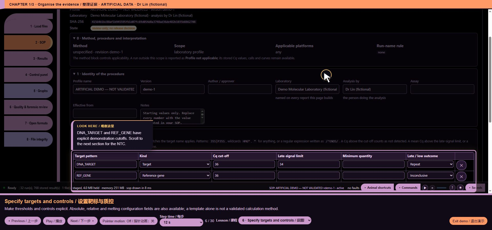

# core/mara_results.js — function reference

## C09972 · maraEvidence

- Ownership: MISSY first-party
- Module: core/mara_results.js, line 3; script 11, script line 2394
- Form: FunctionDeclaration; parameters: `run`
- AST classification: `new_named`
- R1 entry status: `not_observed_in_passing_scenario`
- Passing scenario observations: No passing R1 instrumented scenario observation
- R2 clean contract evidence: No separately linked clean contract assertion for this function
- Code SHA-256: `e3882838c2606576453202aba4996b47a2190793cda904cddf5a4e00c1fe936b`
- [Complete exact function source](https://github.com/mihaiionitabio-alt/zpcrweb/blob/missy-public-offline-2026-10-20/documentation/releases/2026-10-31-full-wiki/code/functions/C09972.js)

```javascript
function maraEvidence(run){
 const original=SS_EXPORT_CONTEXT.get(run)?.original;if(original)return maraEvidence(original);
 let all=MARA_EVIDENCE.get(run);if(!all){all=new Map();MARA_EVIDENCE.set(run,all);}
 const key=sopHash();if(!all.has(key))all.set(key,{context:{},reactions:{}});return all.get(key);
}
```

## C09973 · maraWellID

- Ownership: MISSY first-party
- Module: core/mara_results.js, line 8; script 11, script line 2399
- Form: FunctionDeclaration; parameters: `w, i`
- AST classification: `new_named`
- R1 entry status: `not_observed_in_passing_scenario`
- Passing scenario observations: No passing R1 instrumented scenario observation
- R2 clean contract evidence: No separately linked clean contract assertion for this function
- Code SHA-256: `395a3cc17d72127d117c53a88d02557fc3468d562153235723df9de8336d6839`
- [Complete exact function source](https://github.com/mihaiionitabio-alt/zpcrweb/blob/missy-public-offline-2026-10-20/documentation/releases/2026-10-31-full-wiki/code/functions/C09973.js)

```javascript
function maraWellID(w,i){return JSON.stringify([w.analysisUid||w.analysis||'',w.target||'',w.pos??w.well??i,w.channel||'']);}
```

## C09974 · maraControlMatches

- Ownership: MISSY first-party
- Module: core/mara_results.js, line 9; script 11, script line 2400
- Form: FunctionDeclaration; parameters: `c, w, p`
- AST classification: `new_named`
- R1 entry status: `not_observed_in_passing_scenario`
- Passing scenario observations: No passing R1 instrumented scenario observation
- R2 clean contract evidence: No separately linked clean contract assertion for this function
- Code SHA-256: `17c000e98ea431eca9f6cdfe6ef506a72737865f0e5f3a179dcc171f581e4fd3`
- [Complete exact function source](https://github.com/mihaiionitabio-alt/zpcrweb/blob/missy-public-offline-2026-10-20/documentation/releases/2026-10-31-full-wiki/code/functions/C09974.js)

```javascript
function maraControlMatches(c,w,p){
 if(sopMatcher(c.match)(String(c.matchBy==='role'?w.role||'':w.sample||'')))return true;
 const primary=(p.analyticalRole==='identification'&&c.id==='pos-qual-qc')||((p.analyticalRole==='quantification'||p.method.standard_number===16)&&c.id==='pos-quant-qc');
 if(!primary)return false;
 const event=p.control_identity?.event,pct=p.analyticalRole==='quantification'?p.calibrator?.certified_content_percent:p.method.standard_number===16?p.comparison?.control_content_percent:p.control_identity?.positive_percent;
 if(!event||pct===''||pct==null)return false;
 const escape=s=>String(s).replace(/[.*+?^${}()|[\]\\]/g,'\\$&');
 return new RegExp('^'+escape(event)+'(?:\\s+|\\s*·\\s*)'+escape(pct)+'\\s*%$','i').test(String(w.sample||''));
}
```

## C09975 · escape

- Ownership: MISSY first-party
- Module: core/mara_results.js, line 15; script 11, script line 2406
- Form: ArrowFunctionExpression; parameters: `s`
- AST classification: `new_named`
- R1 entry status: `not_observed_in_passing_scenario`
- Passing scenario observations: No passing R1 instrumented scenario observation
- R2 clean contract evidence: No separately linked clean contract assertion for this function
- Code SHA-256: `a9dcb086f04db846ccdfa08bacf93419ae8358d763b4bed1b1e2e6ba0c02a242`
- [Complete exact function source](https://github.com/mihaiionitabio-alt/zpcrweb/blob/missy-public-offline-2026-10-20/documentation/releases/2026-10-31-full-wiki/code/functions/C09975.js)

```javascript
s=>String(s).replace(/[.*+?^${}()|[\]\\]/g,'\\$&')
```

## C09976 · maraInput

- Ownership: MISSY first-party
- Module: core/mara_results.js, line 18; script 11, script line 2409
- Form: FunctionDeclaration; parameters: `run, p=SOP, evidence=maraEvidence(run)`
- AST classification: `new_named`
- R1 entry status: `not_observed_in_passing_scenario`
- Passing scenario observations: No passing R1 instrumented scenario observation
- R2 clean contract evidence: No separately linked clean contract assertion for this function
- Code SHA-256: `b3f75f01c13b537e54e9241ff796d8cd19882e1affc1260aae4244a2a3ef94b4`
- [Complete exact function source](https://github.com/mihaiionitabio-alt/zpcrweb/blob/missy-public-offline-2026-10-20/documentation/releases/2026-10-31-full-wiki/code/functions/C09976.js)

```javascript
function maraInput(run,p=SOP,evidence=maraEvidence(run)){
 const exportContext=SS_EXPORT_CONTEXT.get(run);
 const rapid=p.method.standard_number===17;
 const refName=p.method.reference_genes?.[0]?.target||'';
 const refSpec=p.targets.find(t=>t.kind==='reference'&&t.match&&sopMatcher(t.match)(refName));
 const reference=refName;
 const selected=rapid?(p.method.selected_assays||[]):[p.method.selected_event].filter(Boolean);
 const specs=selected.map(name=>({name,spec:p.targets.find(t=>t.kind==='target'&&(t.match===name||sopMatcher(t.match)(name)))}));
 const matchAssay=w=>{const t=String(w.target||w.analysis||'');if(refName&&(t.toLowerCase()===refName.toLowerCase()||refSpec&&sopMatcher(refSpec.match)(t)))return reference;return specs.find(x=>x.name===t||x.spec&&sopMatcher(x.spec.match)(t))?.name||'';};
 const all=ssWells(run),records=[];
 for(const [i,shown] of all.entries()){
  const w=exportContext?.rows.get(shown)||shown;
  const assay=matchAssay(w);if(!assay)continue;
  const id=maraWellID(w,i),e=evidence.reactions[id]||{};
  const matched=p.controls.filter(c=>c.id!=='cal-lowest'&&maraControlMatches(c,w,p));
  const kinds=new Set(matched.map(c=>/pos-quant/.test(c.id)?'quantitative':/pos-qual/.test(c.id)?'positive':/blank/.test(c.id)?'blank':/^neg/.test(c.id)?'negative':'unknown'));
  let role=kinds.size===1?[...kinds][0]:kinds.size>1?'ambiguous':'sample';
  if(e.kind==='calibrator'||role==='sample'&&(w.role==='Standard'||w.instrRole==='Standard'))role='calibrator';
  let sampleGroup=w.sample||'',subsample='',mappingError=false;
  if(role==='sample'&&!rapid){
   try{const pattern=p.sample_id?.pattern,re=pattern?new RegExp(pattern,(p.sample_id.flags||'i').replace(/[gy]/g,'')):null,m=re?.exec(String(w.sample||''));
    if(!m?.groups?.sample||!m.groups.subsample)mappingError=true;else{sampleGroup=m.groups.sample;subsample=m.groups.subsample;}
   }catch{mappingError=true;}
  }
  records.push({id,physicalId:JSON.stringify([w.pos??w.well??i,assay]),source:shown,originalSource:w,assay,role,sample:String(w.sample||''),sampleGroup,subsample,mappingError,cq:sopCq(w),curve:e.curve||'unknown',copies:e.copies,level:e.level||'',pair:e.pair||'',omitted:sopOmitted(w)});
 }
 return {records,context:{...evidence.context,reference,assays:selected,selectionPending:SAMPLE_SELECTION.pending,complete:!run.isTemplate&&(!run.eds||run.eds.exp?.runState==='COMPLETE')}};
}
```

## C09977 · <callback@2413:30>

- Ownership: MISSY first-party
- Module: core/mara_results.js, line 22; script 11, script line 2413
- Form: ArrowFunctionExpression; parameters: `t`
- AST classification: `new_or_changed_anonymous`
- R1 entry status: `not_observed_in_passing_scenario`
- Passing scenario observations: No passing R1 instrumented scenario observation
- R2 clean contract evidence: No separately linked clean contract assertion for this function
- Code SHA-256: `8b1a2aadb830942cbb274348f59d9889f3c8ec9283e99bb206631993b73b570b`
- [Complete exact function source](https://github.com/mihaiionitabio-alt/zpcrweb/blob/missy-public-offline-2026-10-20/documentation/releases/2026-10-31-full-wiki/code/functions/C09977.js)

```javascript
t=>t.kind==='reference'&&t.match&&sopMatcher(t.match)(refName)
```

## C09978 · <callback@2416:26>

- Ownership: MISSY first-party
- Module: core/mara_results.js, line 25; script 11, script line 2416
- Form: ArrowFunctionExpression; parameters: `name`
- AST classification: `new_or_changed_anonymous`
- R1 entry status: `not_observed_in_passing_scenario`
- Passing scenario observations: No passing R1 instrumented scenario observation
- R2 clean contract evidence: No separately linked clean contract assertion for this function
- Code SHA-256: `fe4c23cdf75dddbac546c88ae36267ae7c7bbc9ba932d3843eacfe4d1c1e1820`
- [Complete exact function source](https://github.com/mihaiionitabio-alt/zpcrweb/blob/missy-public-offline-2026-10-20/documentation/releases/2026-10-31-full-wiki/code/functions/C09978.js)

```javascript
name=>({name,spec:p.targets.find(t=>t.kind==='target'&&(t.match===name||sopMatcher(t.match)(name)))})
```

## C09979 · <callback@2416:59>

- Ownership: MISSY first-party
- Module: core/mara_results.js, line 25; script 11, script line 2416
- Form: ArrowFunctionExpression; parameters: `t`
- AST classification: `new_or_changed_anonymous`
- R1 entry status: `not_observed_in_passing_scenario`
- Passing scenario observations: No passing R1 instrumented scenario observation
- R2 clean contract evidence: No separately linked clean contract assertion for this function
- Code SHA-256: `e9890efaf3b5c53f70e9ad3db981d220eca3620827d96e07c2ab91b8e8a5e829`
- [Complete exact function source](https://github.com/mihaiionitabio-alt/zpcrweb/blob/missy-public-offline-2026-10-20/documentation/releases/2026-10-31-full-wiki/code/functions/C09979.js)

```javascript
t=>t.kind==='target'&&(t.match===name||sopMatcher(t.match)(name))
```

## C09980 · matchAssay

- Ownership: MISSY first-party
- Module: core/mara_results.js, line 26; script 11, script line 2417
- Form: ArrowFunctionExpression; parameters: `w`
- AST classification: `new_named`
- R1 entry status: `not_observed_in_passing_scenario`
- Passing scenario observations: No passing R1 instrumented scenario observation
- R2 clean contract evidence: No separately linked clean contract assertion for this function
- Code SHA-256: `e0cc7531f9f7838a4eaa15e92054837a8e65c0f4683890ce9846ec9fc23eb652`
- [Complete exact function source](https://github.com/mihaiionitabio-alt/zpcrweb/blob/missy-public-offline-2026-10-20/documentation/releases/2026-10-31-full-wiki/code/functions/C09980.js)

```javascript
w=>{const t=String(w.target||w.analysis||'');if(refName&&(t.toLowerCase()===refName.toLowerCase()||refSpec&&sopMatcher(refSpec.match)(t)))return reference;return specs.find(x=>x.name===t||x.spec&&sopMatcher(x.spec.match)(t))?.name||'';}
```

## C09981 · <callback@2417:191>

- Ownership: MISSY first-party
- Module: core/mara_results.js, line 26; script 11, script line 2417
- Form: ArrowFunctionExpression; parameters: `x`
- AST classification: `new_or_changed_anonymous`
- R1 entry status: `not_observed_in_passing_scenario`
- Passing scenario observations: No passing R1 instrumented scenario observation
- R2 clean contract evidence: No separately linked clean contract assertion for this function
- Code SHA-256: `08463886b4754f63107d0da8c6596d95c9246639c13f7c85eabee361f5d0225b`
- [Complete exact function source](https://github.com/mihaiionitabio-alt/zpcrweb/blob/missy-public-offline-2026-10-20/documentation/releases/2026-10-31-full-wiki/code/functions/C09981.js)

```javascript
x=>x.name===t||x.spec&&sopMatcher(x.spec.match)(t)
```

## C09982 · <callback@2423:34>

- Ownership: MISSY first-party
- Module: core/mara_results.js, line 32; script 11, script line 2423
- Form: ArrowFunctionExpression; parameters: `c`
- AST classification: `new_or_changed_anonymous`
- R1 entry status: `not_observed_in_passing_scenario`
- Passing scenario observations: No passing R1 instrumented scenario observation
- R2 clean contract evidence: No separately linked clean contract assertion for this function
- Code SHA-256: `f5d6b80b18c7b152bb91604a6e723c9446dbc33fed33f77983bb7a0aa49ea9ea`
- [Complete exact function source](https://github.com/mihaiionitabio-alt/zpcrweb/blob/missy-public-offline-2026-10-20/documentation/releases/2026-10-31-full-wiki/code/functions/C09982.js)

```javascript
c=>c.id!=='cal-lowest'&&maraControlMatches(c,w,p)
```

## C09983 · <callback@2424:34>

- Ownership: MISSY first-party
- Module: core/mara_results.js, line 33; script 11, script line 2424
- Form: ArrowFunctionExpression; parameters: `c`
- AST classification: `new_or_changed_anonymous`
- R1 entry status: `not_observed_in_passing_scenario`
- Passing scenario observations: No passing R1 instrumented scenario observation
- R2 clean contract evidence: No separately linked clean contract assertion for this function
- Code SHA-256: `8032d928ced3cf6d4e92eba89e256a0c13905f850b9481119b85b23e27597813`
- [Complete exact function source](https://github.com/mihaiionitabio-alt/zpcrweb/blob/missy-public-offline-2026-10-20/documentation/releases/2026-10-31-full-wiki/code/functions/C09983.js)

```javascript
c=>/pos-quant/.test(c.id)?'quantitative':/pos-qual/.test(c.id)?'positive':/blank/.test(c.id)?'blank':/^neg/.test(c.id)?'negative':'unknown'
```

## C09984 · maraMessage

- Ownership: MISSY first-party
- Module: core/mara_results.js, line 58; script 11, script line 2449
- Form: FunctionDeclaration; parameters: `code`
- AST classification: `new_named`
- R1 entry status: `not_observed_in_passing_scenario`
- Passing scenario observations: No passing R1 instrumented scenario observation
- R2 clean contract evidence: No separately linked clean contract assertion for this function
- Code SHA-256: `771406d5ff35f7d50b0fb87df0ff6f2dfa2d1a84ed71e8481be7189609d378ed`
- [Complete exact function source](https://github.com/mihaiionitabio-alt/zpcrweb/blob/missy-public-offline-2026-10-20/documentation/releases/2026-10-31-full-wiki/code/functions/C09984.js)

```javascript
function maraMessage(code){const [key,...tail]=String(code).split(':'),pair=MARA_MESSAGES[key];return (pair?pair[UI_LANG==='zh'?1:0]:key)+(tail.length?' · '+tail.join(':'):'');}
```

## C09985 · maraDecisionText

- Ownership: MISSY first-party
- Module: core/mara_results.js, line 59; script 11, script line 2450
- Form: FunctionDeclaration; parameters: `d`
- AST classification: `new_named`
- R1 entry status: `not_observed_in_passing_scenario`
- Passing scenario observations: No passing R1 instrumented scenario observation
- R2 clean contract evidence: No separately linked clean contract assertion for this function
- Code SHA-256: `81b31cef7cf90842b687f064aaf0b7288d435767a86c89c595932e483bf7ba1e`
- [Complete exact function source](https://github.com/mihaiionitabio-alt/zpcrweb/blob/missy-public-offline-2026-10-20/documentation/releases/2026-10-31-full-wiki/code/functions/C09985.js)

```javascript
function maraDecisionText(d){
 let text=maraMessage(d.code);
 if(d.code==='majority')text+=' · '+d.values.positive_subsamples+'/3 · '+ui(d.outcome==='Positive'?'Detected':'Not detected');
 if(d.code==='quantified')text+=' · C = '+d.values.text+'; k = '+d.values.coverage_factor+'; '+ui(d.values.uncertainty_basis==='laboratory'?'Laboratory uncertainty model':'Standard uncertainty model');
 if(Number.isFinite(d.values.delta_delta_ct)&&!d.values.comparison_outcome)text+=' · ΔCt = '+d.values.delta_ct.toFixed(4)+'; ΔCt (QC) = '+d.values.control_delta_ct.toFixed(4)+'; ΔΔCt = '+d.values.delta_delta_ct.toFixed(4)+'; '+ui('Control content')+' = '+d.values.control_content_percent+' %';
 if(d.failures?.length)text+=': '+d.failures.map(maraMessage).join('; ');
 if(d.values.comparison_outcome)text+='; '+maraMessage(d.values.comparison_outcome)+(Number.isFinite(d.values.delta_delta_ct)?' · ΔCt = '+d.values.delta_ct.toFixed(4)+'; ΔCt (QC) = '+d.values.control_delta_ct.toFixed(4)+'; ΔΔCt = '+d.values.delta_delta_ct.toFixed(4):'');
 return text;
}
```

## C09986 · maraApplicability

- Ownership: MISSY first-party
- Module: core/mara_results.js, line 68; script 11, script line 2459
- Form: FunctionDeclaration; parameters: `run, p=SOP`
- AST classification: `new_named`
- R1 entry status: `not_observed_in_passing_scenario`
- Passing scenario observations: No passing R1 instrumented scenario observation
- R2 clean contract evidence: No separately linked clean contract assertion for this function
- Code SHA-256: `d5982851a0265697eecbaba87aac5ce2959141529652805a2715c1cf44816fa0`
- [Complete exact function source](https://github.com/mihaiionitabio-alt/zpcrweb/blob/missy-public-offline-2026-10-20/documentation/releases/2026-10-31-full-wiki/code/functions/C09986.js)

```javascript
function maraApplicability(run,p=SOP){
 const original=SS_EXPORT_CONTEXT.get(run)?.original||run;
 const selected=p.method.standard_number===17?p.method.selected_assays||[]:[p.method.selected_event].filter(Boolean);
 const specs=selected.map(name=>({name,spec:p.targets.find(t=>t.kind==='target'&&(t.match===name||sopMatcher(t.match)(name)))}));
 const declared=new Set((original.wells||[]).map(w=>w.target||w.targetName).filter(Boolean));
 for(const a of original.analyses||[])for(const key of ['target','targetName','shortName'])if(a[key])declared.add(a[key]);
 for(const well of Object.values(original.plate||{}))for(const ch of Object.values(well.channels||{}))if(ch.targetName)declared.add(ch.targetName);
 const matches=[...declared].some(target=>specs.some(x=>x.name===target||x.spec&&sopMatcher(x.spec.match)(target)));
 const reason=!selected.length?ui('Select the event or screening panel before applying this profile'):!matches?ui('Selected profile target is not declared in this experiment'):'';
 return {applicable:!reason,reason,expected:selected.join(', '),observed:[...declared].join(', ')};
}
```

## C09987 · <callback@2462:26>

- Ownership: MISSY first-party
- Module: core/mara_results.js, line 71; script 11, script line 2462
- Form: ArrowFunctionExpression; parameters: `name`
- AST classification: `new_or_changed_anonymous`
- R1 entry status: `not_observed_in_passing_scenario`
- Passing scenario observations: No passing R1 instrumented scenario observation
- R2 clean contract evidence: No separately linked clean contract assertion for this function
- Code SHA-256: `fe4c23cdf75dddbac546c88ae36267ae7c7bbc9ba932d3843eacfe4d1c1e1820`
- [Complete exact function source](https://github.com/mihaiionitabio-alt/zpcrweb/blob/missy-public-offline-2026-10-20/documentation/releases/2026-10-31-full-wiki/code/functions/C09987.js)

```javascript
name=>({name,spec:p.targets.find(t=>t.kind==='target'&&(t.match===name||sopMatcher(t.match)(name)))})
```

## C09988 · <callback@2462:59>

- Ownership: MISSY first-party
- Module: core/mara_results.js, line 71; script 11, script line 2462
- Form: ArrowFunctionExpression; parameters: `t`
- AST classification: `new_or_changed_anonymous`
- R1 entry status: `not_observed_in_passing_scenario`
- Passing scenario observations: No passing R1 instrumented scenario observation
- R2 clean contract evidence: No separately linked clean contract assertion for this function
- Code SHA-256: `e9890efaf3b5c53f70e9ad3db981d220eca3620827d96e07c2ab91b8e8a5e829`
- [Complete exact function source](https://github.com/mihaiionitabio-alt/zpcrweb/blob/missy-public-offline-2026-10-20/documentation/releases/2026-10-31-full-wiki/code/functions/C09988.js)

```javascript
t=>t.kind==='target'&&(t.match===name||sopMatcher(t.match)(name))
```

## C09989 · <callback@2463:49>

- Ownership: MISSY first-party
- Module: core/mara_results.js, line 72; script 11, script line 2463
- Form: ArrowFunctionExpression; parameters: `w`
- AST classification: `new_or_changed_anonymous`
- R1 entry status: `not_observed_in_passing_scenario`
- Passing scenario observations: No passing R1 instrumented scenario observation
- R2 clean contract evidence: No separately linked clean contract assertion for this function
- Code SHA-256: `076220dcd9ea4fa266170abef17de3af24d1e90eeb09e786ac7f849aecdbba91`
- [Complete exact function source](https://github.com/mihaiionitabio-alt/zpcrweb/blob/missy-public-offline-2026-10-20/documentation/releases/2026-10-31-full-wiki/code/functions/C09989.js)

```javascript
w=>w.target||w.targetName
```

## C09990 · <callback@2466:34>

- Ownership: MISSY first-party
- Module: core/mara_results.js, line 75; script 11, script line 2466
- Form: ArrowFunctionExpression; parameters: `target`
- AST classification: `new_or_changed_anonymous`
- R1 entry status: `not_observed_in_passing_scenario`
- Passing scenario observations: No passing R1 instrumented scenario observation
- R2 clean contract evidence: No separately linked clean contract assertion for this function
- Code SHA-256: `60f195fa2493b2e39316585b5f1299e87aeb110f0c93c1b6f2952ded0c5ad225`
- [Complete exact function source](https://github.com/mihaiionitabio-alt/zpcrweb/blob/missy-public-offline-2026-10-20/documentation/releases/2026-10-31-full-wiki/code/functions/C09990.js)

```javascript
target=>specs.some(x=>x.name===target||x.spec&&sopMatcher(x.spec.match)(target))
```

## C09991 · <callback@2466:53>

- Ownership: MISSY first-party
- Module: core/mara_results.js, line 75; script 11, script line 2466
- Form: ArrowFunctionExpression; parameters: `x`
- AST classification: `new_or_changed_anonymous`
- R1 entry status: `not_observed_in_passing_scenario`
- Passing scenario observations: No passing R1 instrumented scenario observation
- R2 clean contract evidence: No separately linked clean contract assertion for this function
- Code SHA-256: `87a3ae6e2ba60bd60e263a48c4b458476dff9989f4eef247970b4323c39606f0`
- [Complete exact function source](https://github.com/mihaiionitabio-alt/zpcrweb/blob/missy-public-offline-2026-10-20/documentation/releases/2026-10-31-full-wiki/code/functions/C09991.js)

```javascript
x=>x.name===target||x.spec&&sopMatcher(x.spec.match)(target)
```

## C09992 · maraEvaluateRun

- Ownership: MISSY first-party
- Module: core/mara_results.js, line 80; script 11, script line 2471
- Form: FunctionDeclaration; parameters: `run, ri`
- AST classification: `new_named`
- R1 entry status: `not_observed_in_passing_scenario`
- Passing scenario observations: No passing R1 instrumented scenario observation
- R2 clean contract evidence: No separately linked clean contract assertion for this function
- Code SHA-256: `3dc740d5dd0ec02ed3109592c5bced58efc59c675351eb2e74806a6a7f9be4c0`
- [Complete exact function source](https://github.com/mihaiionitabio-alt/zpcrweb/blob/missy-public-offline-2026-10-20/documentation/releases/2026-10-31-full-wiki/code/functions/C09992.js)

```javascript
function maraEvaluateRun(run,ri){
 const applicability=maraApplicability(run);
 if(!applicability.applicable)return {run,ri,rows:[],criteria:[{criterion:ui('Method applicability'),action:'unresolved',status:'n/a',evidence:applicability.reason+'; '+applicability.expected}],rejected:[],reviewed:[],status:'Profile not applicable — '+applicability.reason,times:runTimes(run),icMedian:NaN,applicability};
 const input=maraInput(run),calc=MARA_ENGINE.evaluate(SOP,input.records,input.context),rows=[];
 const makeRow=(rs,sample,target,outcome,reason,values={},ctrl=null)=>{
  const exporting=!!SS_EXPORT_CONTEXT.get(run);if(exporting)sample=ctrl?exportName(sample):maraExportSample(sample,rs.map(r=>r.originalSource||r.source));
  const ws=rs.map(r=>r.source),used=rs.filter(r=>!r.omitted),qs=used.map(r=>Number(r.cq)).filter(Number.isFinite),det=used.filter(r=>MARA_ENGINE.signal(r)===true);
  const spec={kind:ctrl?'control':'target',match:target,cqMax:36},o=SOP.outcomes[outcome]||{};
  return {run,ri,key:sample+'||'+target,sample,target,exporting,originalWells:rs.map(r=>r.originalSource||r.source),role:ctrl?'Control':'Sample',wells:ws,used:used.map(r=>r.source),spec,ctrl,n:used.length,omitted:rs.length-used.length,det:det.length,above:qs.filter(x=>x>36).length,cqMax:36,cqMean:mean(qs),cqSd:sd(qs),conc:values.content_percent??NaN,outcome,label:ui(o.label||outcome),colour:o.colour||'#94a3b8',reason,report:reason+(SOP.reviewOnly?'; '+ui('Review only — no release decision'):''),rule:SOP.method.id,methodValues:values,methodCalculated:true};
 };
 for(const d of calc.decisions)rows.push(makeRow(d.reactions.filter(r=>r.assay===d.target),d.sample,d.target,d.outcome,maraDecisionText(d),d.values));
 const references=byKey(input.records.filter(r=>r.role==='sample'&&r.assay===input.context.reference),r=>r.sampleGroup||r.sample);
 for(const [sample,rs] of references){const valid=rs.some(r=>!r.omitted)&&rs.filter(r=>!r.omitted).every(r=>MARA_ENGINE.signal(r)===true),r=makeRow(rs,sample,input.context.reference,valid?'Control pass':'Invalid',valid?ui('Crop reference accepted'):maraMessage('reference_failed'));r.spec.kind='reference';rows.push(r);}
 const controls=byKey(input.records.filter(r=>r.role!=='sample'),r=>r.sample+'||'+r.assay);
 for(const rs of controls.values()){
    const r=rs[0],related=calc.checks.filter(c=>c.code.endsWith(':'+r.assay)&&c.code.startsWith(r.role==='quantitative'?'quantitative':r.role)),out=r.role==='calibrator'?'Standard':related.length&&related.every(c=>c.pass)?'Control pass':'Control fail';
  rows.push(makeRow(rs,r.sample,r.assay,out,ui(out),{}, {name:r.role,id:r.role}));
 }
 const checkLabels={supported_method:['Supported method','支持的方法'],method_verified:['Method and reaction protocol verified','已核实检测方法及反应程序'],sequence_verified:['KJ1003 junction sequence verified','已核实 KJ1003 连接区序列'],dna_basis_verified:['GGK2 DNA basis resolved','已确认 GGK2 DNA 依据'],assay_selection:['Event/panel and crop reference selected','已选择转化体或筛查组合及作物内标准基因'],selection_applied:['Sample selection applied','已应用样品选择'],run_complete:['Completed experimental run','已完成的实验运行'],unique_reactions:['Unique reaction identities','唯一反应标识'],rapid_workflow:['Rapid-PCR workflow verified','已核实快速 PCR 流程'],same_plate:['Same run and plate verified','已确认同次运行及同一反应板'],calibration_range:['CRM dilution range and DNA inputs verified','已核实 CRM 稀释范围及 DNA 加样量'],copy_units:['CRM assignments in copies','CRM 以拷贝数赋值']};
 Object.assign(checkLabels,{control_mapping:['Unambiguous control mapping','明确的质控品映射'],positive_control_content:['Positive control event and assigned content','阳性质控品转化体及赋值含量'],threshold_control:['Threshold-matched quantitative control','与阈值匹配的阳性定量质控品']});
 const criteria=calc.checks.map(c=>({criterion:checkLabels[c.code]?.[UI_LANG==='zh'?1:0]||maraMessage(c.code),action:'reject',status:c.pass?'pass':'fail',evidence:maraEvidenceDetail(c.detail)}));
 if(SOP.reviewOnly)criteria.push({criterion:ui('Review only — no release decision'),action:'review',status:'review',evidence:ui('Automatic calculations are provisional until laboratory approval')});
 const rejected=criteria.filter(c=>c.status==='fail'),reviewed=criteria.filter(c=>c.status==='review');
 return {run,ri,rows,criteria,rejected,reviewed,status:rejected.length?'Rejected':reviewed.length?'Accepted with review':'Accepted',times:runTimes(run),icMedian:NaN,methodCalculation:calc};
}
```

## C09993 · makeRow

- Ownership: MISSY first-party
- Module: core/mara_results.js, line 84; script 11, script line 2475
- Form: ArrowFunctionExpression; parameters: `rs, sample, target, outcome, reason, values={}, ctrl=null`
- AST classification: `new_named`
- R1 entry status: `not_observed_in_passing_scenario`
- Passing scenario observations: No passing R1 instrumented scenario observation
- R2 clean contract evidence: No separately linked clean contract assertion for this function
- Code SHA-256: `00fdb4bf9aa6c3ecb2e02da3446fc27e15545ed82fdde97682a8259b367de1d0`
- [Complete exact function source](https://github.com/mihaiionitabio-alt/zpcrweb/blob/missy-public-offline-2026-10-20/documentation/releases/2026-10-31-full-wiki/code/functions/C09993.js)

```javascript
(rs,sample,target,outcome,reason,values={},ctrl=null)=>{
  const exporting=!!SS_EXPORT_CONTEXT.get(run);if(exporting)sample=ctrl?exportName(sample):maraExportSample(sample,rs.map(r=>r.originalSource||r.source));
  const ws=rs.map(r=>r.source),used=rs.filter(r=>!r.omitted),qs=used.map(r=>Number(r.cq)).filter(Number.isFinite),det=used.filter(r=>MARA_ENGINE.signal(r)===true);
  const spec={kind:ctrl?'control':'target',match:target,cqMax:36},o=SOP.outcomes[outcome]||{};
  return {run,ri,key:sample+'||'+target,sample,target,exporting,originalWells:rs.map(r=>r.originalSource||r.source),role:ctrl?'Control':'Sample',wells:ws,used:used.map(r=>r.source),spec,ctrl,n:used.length,omitted:rs.length-used.length,det:det.length,above:qs.filter(x=>x>36).length,cqMax:36,cqMean:mean(qs),cqSd:sd(qs),conc:values.content_percent??NaN,outcome,label:ui(o.label||outcome),colour:o.colour||'#94a3b8',reason,report:reason+(SOP.reviewOnly?'; '+ui('Review only — no release decision'):''),rule:SOP.method.id,methodValues:values,methodCalculated:true};
 }
```

## C09994 · <callback@2476:122>

- Ownership: MISSY first-party
- Module: core/mara_results.js, line 85; script 11, script line 2476
- Form: ArrowFunctionExpression; parameters: `r`
- AST classification: `new_or_changed_anonymous`
- R1 entry status: `not_observed_in_passing_scenario`
- Passing scenario observations: No passing R1 instrumented scenario observation
- R2 clean contract evidence: No separately linked clean contract assertion for this function
- Code SHA-256: `a34954f8dfb243e139fca37618053085936fab60199bdc0208b943f85ffafae1`
- [Complete exact function source](https://github.com/mihaiionitabio-alt/zpcrweb/blob/missy-public-offline-2026-10-20/documentation/releases/2026-10-31-full-wiki/code/functions/C09994.js)

```javascript
r=>r.originalSource||r.source
```

## C09995 · <callback@2477:18>

- Ownership: MISSY first-party
- Module: core/mara_results.js, line 86; script 11, script line 2477
- Form: ArrowFunctionExpression; parameters: `r`
- AST classification: `new_or_changed_anonymous`
- R1 entry status: `not_observed_in_passing_scenario`
- Passing scenario observations: No passing R1 instrumented scenario observation
- R2 clean contract evidence: No separately linked clean contract assertion for this function
- Code SHA-256: `e85840ea97fc2d3a676d1fc5538d48acf3ba3dbb2910dd91948d09dc241e33f5`
- [Complete exact function source](https://github.com/mihaiionitabio-alt/zpcrweb/blob/missy-public-offline-2026-10-20/documentation/releases/2026-10-31-full-wiki/code/functions/C09995.js)

```javascript
r=>r.source
```

## C09996 · <callback@2477:46>

- Ownership: MISSY first-party
- Module: core/mara_results.js, line 86; script 11, script line 2477
- Form: ArrowFunctionExpression; parameters: `r`
- AST classification: `new_or_changed_anonymous`
- R1 entry status: `not_observed_in_passing_scenario`
- Passing scenario observations: No passing R1 instrumented scenario observation
- R2 clean contract evidence: No separately linked clean contract assertion for this function
- Code SHA-256: `9c04f343e5d064fab9f82d542aba5c58e1ec87ee53571858dd2127e66bb218cb`
- [Complete exact function source](https://github.com/mihaiionitabio-alt/zpcrweb/blob/missy-public-offline-2026-10-20/documentation/releases/2026-10-31-full-wiki/code/functions/C09996.js)

```javascript
r=>!r.omitted
```

## C09997 · <callback@2477:73>

- Ownership: MISSY first-party
- Module: core/mara_results.js, line 86; script 11, script line 2477
- Form: ArrowFunctionExpression; parameters: `r`
- AST classification: `current_matching_baseline_ast`
- R1 entry status: `not_observed_in_passing_scenario`
- Passing scenario observations: No passing R1 instrumented scenario observation
- R2 clean contract evidence: No separately linked clean contract assertion for this function
- Code SHA-256: `e01e2fef962147578a71ca2128a104986a5f9cca6166e4b6958d4e609b34cd2c`
- [Complete exact function source](https://github.com/mihaiionitabio-alt/zpcrweb/blob/missy-public-offline-2026-10-20/documentation/releases/2026-10-31-full-wiki/code/functions/C09997.js)

```javascript
r=>Number(r.cq)
```

## C09998 · <callback@2477:130>

- Ownership: MISSY first-party
- Module: core/mara_results.js, line 86; script 11, script line 2477
- Form: ArrowFunctionExpression; parameters: `r`
- AST classification: `new_or_changed_anonymous`
- R1 entry status: `not_observed_in_passing_scenario`
- Passing scenario observations: No passing R1 instrumented scenario observation
- R2 clean contract evidence: No separately linked clean contract assertion for this function
- Code SHA-256: `901c3d80decd46e2cd88d68e4ac6d3b7c7315e44bb34f2a9b243d6b36a9a793a`
- [Complete exact function source](https://github.com/mihaiionitabio-alt/zpcrweb/blob/missy-public-offline-2026-10-20/documentation/releases/2026-10-31-full-wiki/code/functions/C09998.js)

```javascript
r=>MARA_ENGINE.signal(r)===true
```

## C09999 · <callback@2479:85>

- Ownership: MISSY first-party
- Module: core/mara_results.js, line 88; script 11, script line 2479
- Form: ArrowFunctionExpression; parameters: `r`
- AST classification: `new_or_changed_anonymous`
- R1 entry status: `not_observed_in_passing_scenario`
- Passing scenario observations: No passing R1 instrumented scenario observation
- R2 clean contract evidence: No separately linked clean contract assertion for this function
- Code SHA-256: `a34954f8dfb243e139fca37618053085936fab60199bdc0208b943f85ffafae1`
- [Complete exact function source](https://github.com/mihaiionitabio-alt/zpcrweb/blob/missy-public-offline-2026-10-20/documentation/releases/2026-10-31-full-wiki/code/functions/C09999.js)

```javascript
r=>r.originalSource||r.source
```

## C10000 · <callback@2479:168>

- Ownership: MISSY first-party
- Module: core/mara_results.js, line 88; script 11, script line 2479
- Form: ArrowFunctionExpression; parameters: `r`
- AST classification: `new_or_changed_anonymous`
- R1 entry status: `not_observed_in_passing_scenario`
- Passing scenario observations: No passing R1 instrumented scenario observation
- R2 clean contract evidence: No separately linked clean contract assertion for this function
- Code SHA-256: `e85840ea97fc2d3a676d1fc5538d48acf3ba3dbb2910dd91948d09dc241e33f5`
- [Complete exact function source](https://github.com/mihaiionitabio-alt/zpcrweb/blob/missy-public-offline-2026-10-20/documentation/releases/2026-10-31-full-wiki/code/functions/C10000.js)

```javascript
r=>r.source
```

## C10001 · <callback@2479:266>

- Ownership: MISSY first-party
- Module: core/mara_results.js, line 88; script 11, script line 2479
- Form: ArrowFunctionExpression; parameters: `x`
- AST classification: `new_or_changed_anonymous`
- R1 entry status: `not_observed_in_passing_scenario`
- Passing scenario observations: No passing R1 instrumented scenario observation
- R2 clean contract evidence: No separately linked clean contract assertion for this function
- Code SHA-256: `0138076a243e4664a0c886c750362f7363346f6caca269d5435fd27c4c4bffd3`
- [Complete exact function source](https://github.com/mihaiionitabio-alt/zpcrweb/blob/missy-public-offline-2026-10-20/documentation/releases/2026-10-31-full-wiki/code/functions/C10001.js)

```javascript
x=>x>36
```

## C10002 · <callback@2481:68>

- Ownership: MISSY first-party
- Module: core/mara_results.js, line 90; script 11, script line 2481
- Form: ArrowFunctionExpression; parameters: `r`
- AST classification: `new_or_changed_anonymous`
- R1 entry status: `not_observed_in_passing_scenario`
- Passing scenario observations: No passing R1 instrumented scenario observation
- R2 clean contract evidence: No separately linked clean contract assertion for this function
- Code SHA-256: `656bbadc6014e413b9fcc1f07850b8e5e26bcc1b69db6e8131b28e105d694100`
- [Complete exact function source](https://github.com/mihaiionitabio-alt/zpcrweb/blob/missy-public-offline-2026-10-20/documentation/releases/2026-10-31-full-wiki/code/functions/C10002.js)

```javascript
r=>r.assay===d.target
```

## C10003 · <callback@2482:45>

- Ownership: MISSY first-party
- Module: core/mara_results.js, line 91; script 11, script line 2482
- Form: ArrowFunctionExpression; parameters: `r`
- AST classification: `new_or_changed_anonymous`
- R1 entry status: `not_observed_in_passing_scenario`
- Passing scenario observations: No passing R1 instrumented scenario observation
- R2 clean contract evidence: No separately linked clean contract assertion for this function
- Code SHA-256: `34f3eee3bab35c492fbcc7ad8de5c9db206c0533539934f735f15e4ba3e1981b`
- [Complete exact function source](https://github.com/mihaiionitabio-alt/zpcrweb/blob/missy-public-offline-2026-10-20/documentation/releases/2026-10-31-full-wiki/code/functions/C10003.js)

```javascript
r=>r.role==='sample'&&r.assay===input.context.reference
```

## C10004 · <callback@2482:102>

- Ownership: MISSY first-party
- Module: core/mara_results.js, line 91; script 11, script line 2482
- Form: ArrowFunctionExpression; parameters: `r`
- AST classification: `new_or_changed_anonymous`
- R1 entry status: `not_observed_in_passing_scenario`
- Passing scenario observations: No passing R1 instrumented scenario observation
- R2 clean contract evidence: No separately linked clean contract assertion for this function
- Code SHA-256: `682fca4bd2bbf901be5279f4b1c9572f836479dba6f9ee2cae66d3da989fd892`
- [Complete exact function source](https://github.com/mihaiionitabio-alt/zpcrweb/blob/missy-public-offline-2026-10-20/documentation/releases/2026-10-31-full-wiki/code/functions/C10004.js)

```javascript
r=>r.sampleGroup||r.sample
```

## C10005 · <callback@2483:58>

- Ownership: MISSY first-party
- Module: core/mara_results.js, line 92; script 11, script line 2483
- Form: ArrowFunctionExpression; parameters: `r`
- AST classification: `new_or_changed_anonymous`
- R1 entry status: `not_observed_in_passing_scenario`
- Passing scenario observations: No passing R1 instrumented scenario observation
- R2 clean contract evidence: No separately linked clean contract assertion for this function
- Code SHA-256: `9c04f343e5d064fab9f82d542aba5c58e1ec87ee53571858dd2127e66bb218cb`
- [Complete exact function source](https://github.com/mihaiionitabio-alt/zpcrweb/blob/missy-public-offline-2026-10-20/documentation/releases/2026-10-31-full-wiki/code/functions/C10005.js)

```javascript
r=>!r.omitted
```

## C10006 · <callback@2483:84>

- Ownership: MISSY first-party
- Module: core/mara_results.js, line 92; script 11, script line 2483
- Form: ArrowFunctionExpression; parameters: `r`
- AST classification: `new_or_changed_anonymous`
- R1 entry status: `not_observed_in_passing_scenario`
- Passing scenario observations: No passing R1 instrumented scenario observation
- R2 clean contract evidence: No separately linked clean contract assertion for this function
- Code SHA-256: `9c04f343e5d064fab9f82d542aba5c58e1ec87ee53571858dd2127e66bb218cb`
- [Complete exact function source](https://github.com/mihaiionitabio-alt/zpcrweb/blob/missy-public-offline-2026-10-20/documentation/releases/2026-10-31-full-wiki/code/functions/C10006.js)

```javascript
r=>!r.omitted
```

## C10007 · <callback@2483:105>

- Ownership: MISSY first-party
- Module: core/mara_results.js, line 92; script 11, script line 2483
- Form: ArrowFunctionExpression; parameters: `r`
- AST classification: `new_or_changed_anonymous`
- R1 entry status: `not_observed_in_passing_scenario`
- Passing scenario observations: No passing R1 instrumented scenario observation
- R2 clean contract evidence: No separately linked clean contract assertion for this function
- Code SHA-256: `901c3d80decd46e2cd88d68e4ac6d3b7c7315e44bb34f2a9b243d6b36a9a793a`
- [Complete exact function source](https://github.com/mihaiionitabio-alt/zpcrweb/blob/missy-public-offline-2026-10-20/documentation/releases/2026-10-31-full-wiki/code/functions/C10007.js)

```javascript
r=>MARA_ENGINE.signal(r)===true
```

## C10008 · <callback@2484:43>

- Ownership: MISSY first-party
- Module: core/mara_results.js, line 93; script 11, script line 2484
- Form: ArrowFunctionExpression; parameters: `r`
- AST classification: `new_or_changed_anonymous`
- R1 entry status: `not_observed_in_passing_scenario`
- Passing scenario observations: No passing R1 instrumented scenario observation
- R2 clean contract evidence: No separately linked clean contract assertion for this function
- Code SHA-256: `57a0a3ec32fc0e11232b4682f59591e676ce51fea4fe88a82121eec179e10a10`
- [Complete exact function source](https://github.com/mihaiionitabio-alt/zpcrweb/blob/missy-public-offline-2026-10-20/documentation/releases/2026-10-31-full-wiki/code/functions/C10008.js)

```javascript
r=>r.role!=='sample'
```

## C10009 · <callback@2484:65>

- Ownership: MISSY first-party
- Module: core/mara_results.js, line 93; script 11, script line 2484
- Form: ArrowFunctionExpression; parameters: `r`
- AST classification: `new_or_changed_anonymous`
- R1 entry status: `not_observed_in_passing_scenario`
- Passing scenario observations: No passing R1 instrumented scenario observation
- R2 clean contract evidence: No separately linked clean contract assertion for this function
- Code SHA-256: `34bcd6e50298810df3260b36216dabeb5635f60c2af38ca39ce875eefe995144`
- [Complete exact function source](https://github.com/mihaiionitabio-alt/zpcrweb/blob/missy-public-offline-2026-10-20/documentation/releases/2026-10-31-full-wiki/code/functions/C10009.js)

```javascript
r=>r.sample+'||'+r.assay
```

## C10010 · <callback@2486:45>

- Ownership: MISSY first-party
- Module: core/mara_results.js, line 95; script 11, script line 2486
- Form: ArrowFunctionExpression; parameters: `c`
- AST classification: `new_or_changed_anonymous`
- R1 entry status: `not_observed_in_passing_scenario`
- Passing scenario observations: No passing R1 instrumented scenario observation
- R2 clean contract evidence: No separately linked clean contract assertion for this function
- Code SHA-256: `3b839b59ed98ada166a2669bf539d2db7a82fff6675c969b5b62725a0a2ae211`
- [Complete exact function source](https://github.com/mihaiionitabio-alt/zpcrweb/blob/missy-public-offline-2026-10-20/documentation/releases/2026-10-31-full-wiki/code/functions/C10010.js)

```javascript
c=>c.code.endsWith(':'+r.assay)&&c.code.startsWith(r.role==='quantitative'?'quantitative':r.role)
```

## C10011 · <callback@2486:211>

- Ownership: MISSY first-party
- Module: core/mara_results.js, line 95; script 11, script line 2486
- Form: ArrowFunctionExpression; parameters: `c`
- AST classification: `new_or_changed_anonymous`
- R1 entry status: `not_observed_in_passing_scenario`
- Passing scenario observations: No passing R1 instrumented scenario observation
- R2 clean contract evidence: No separately linked clean contract assertion for this function
- Code SHA-256: `3800d45e889c9648c52b773405b68e101bea21afc7d7df82dec2c02153cba39b`
- [Complete exact function source](https://github.com/mihaiionitabio-alt/zpcrweb/blob/missy-public-offline-2026-10-20/documentation/releases/2026-10-31-full-wiki/code/functions/C10011.js)

```javascript
c=>c.pass
```

## C10012 · <callback@2491:32>

- Ownership: MISSY first-party
- Module: core/mara_results.js, line 100; script 11, script line 2491
- Form: ArrowFunctionExpression; parameters: `c`
- AST classification: `new_or_changed_anonymous`
- R1 entry status: `not_observed_in_passing_scenario`
- Passing scenario observations: No passing R1 instrumented scenario observation
- R2 clean contract evidence: No separately linked clean contract assertion for this function
- Code SHA-256: `6b81e7d935ef18439736f237166af6587f38c6bd7d02a0facd3d19832cddbac2`
- [Complete exact function source](https://github.com/mihaiionitabio-alt/zpcrweb/blob/missy-public-offline-2026-10-20/documentation/releases/2026-10-31-full-wiki/code/functions/C10012.js)

```javascript
c=>({criterion:checkLabels[c.code]?.[UI_LANG==='zh'?1:0]||maraMessage(c.code),action:'reject',status:c.pass?'pass':'fail',evidence:maraEvidenceDetail(c.detail)})
```

## C10013 · <callback@2493:32>

- Ownership: MISSY first-party
- Module: core/mara_results.js, line 102; script 11, script line 2493
- Form: ArrowFunctionExpression; parameters: `c`
- AST classification: `current_matching_baseline_ast`
- R1 entry status: `not_observed_in_passing_scenario`
- Passing scenario observations: No passing R1 instrumented scenario observation
- R2 clean contract evidence: No separately linked clean contract assertion for this function
- Code SHA-256: `b457227840e5ee9be92e70bcf103176eea08dcf84a136cd5e9bc25e61f6586cc`
- [Complete exact function source](https://github.com/mihaiionitabio-alt/zpcrweb/blob/missy-public-offline-2026-10-20/documentation/releases/2026-10-31-full-wiki/code/functions/C10013.js)

```javascript
c=>c.status==='fail'
```

## C10014 · <callback@2493:79>

- Ownership: MISSY first-party
- Module: core/mara_results.js, line 102; script 11, script line 2493
- Form: ArrowFunctionExpression; parameters: `c`
- AST classification: `current_matching_baseline_ast`
- R1 entry status: `not_observed_in_passing_scenario`
- Passing scenario observations: No passing R1 instrumented scenario observation
- R2 clean contract evidence: No separately linked clean contract assertion for this function
- Code SHA-256: `a2ed79c3bbe6eb0565e138539cb5b98c9d93c2cfa109c2f2e3c288af169831b6`
- [Complete exact function source](https://github.com/mihaiionitabio-alt/zpcrweb/blob/missy-public-offline-2026-10-20/documentation/releases/2026-10-31-full-wiki/code/functions/C10014.js)

```javascript
c=>c.status==='review'
```

## C10015 · maraExportSample

- Ownership: MISSY first-party
- Module: core/mara_results.js, line 105; script 11, script line 2496
- Form: FunctionDeclaration; parameters: `sample, wells`
- AST classification: `new_named`
- R1 entry status: `not_observed_in_passing_scenario`
- Passing scenario observations: No passing R1 instrumented scenario observation
- R2 clean contract evidence: No separately linked clean contract assertion for this function
- Code SHA-256: `7127e6174e26140491df43ffa6652ed0d66a73deb7bec6e2f52096766982075d`
- [Complete exact function source](https://github.com/mihaiionitabio-alt/zpcrweb/blob/missy-public-offline-2026-10-20/documentation/releases/2026-10-31-full-wiki/code/functions/C10015.js)

```javascript
function maraExportSample(sample,wells){if(!pseudoOn())return sample;const known=pseudonymMap().get(sample);return known||'G-'+exportName(wells[0]?.sample||'');}
```

## C10016 · <callback@2498:68>

- Ownership: MISSY first-party
- Module: core/mara_results.js, line 107; script 11, script line 2498
- Form: ArrowFunctionExpression; parameters: `next`
- AST classification: `new_or_changed_anonymous`
- R1 entry status: `observed_in_passing_scenario`
- Passing scenario observations: voice-demo, formats, training, guided-tour, precision, evidence-keyboard
- R2 clean contract evidence: No separately linked clean contract assertion for this function
- Code SHA-256: `9f84d87f1cf5ef2d8b2c955c157d60cd6cb9b451f0f76682b9bdee7c4442ead5`
- [Complete exact function source](https://github.com/mihaiionitabio-alt/zpcrweb/blob/missy-public-offline-2026-10-20/documentation/releases/2026-10-31-full-wiki/code/functions/C10016.js)

```javascript
next=>function(filterRun,forExport){
 if(!maraProfileActive())return next(filterRun,forExport);
 const name=s=>forExport?exportName(s):s;
 return sopEvaluateAll().filter(e=>filterRun==null||filterRun===''||String(e.ri)===String(filterRun)).flatMap(e=>e.rows.map(r=>({experiment:runName(e.run),run_status:e.status,sample:forExport&&!r.exporting?maraExportSample(r.sample,r.originalWells):r.sample,source_sample_names:uniq(r.originalWells.map(w=>name(w.sample))).join(' | '),target:r.target,role:r.role,kind:r.ctrl?'control':r.spec.kind,wells:r.wells.map(w=>w.well).join(' '),replicates:r.n,detected:r.det,omitted:r.omitted,cq_mean:Number.isFinite(r.cqMean)?r.cqMean:'',cq_sd:Number.isFinite(r.cqSd)?r.cqSd:'',cq_cutoff:36,quantity:r.methodValues.content_percent??'',expanded_uncertainty:r.methodValues.U??'',uncertainty_basis:r.methodValues.uncertainty_basis||'',coverage_factor:r.methodValues.coverage_factor??'',subsample_ratios:r.methodValues.subsample_ratios?.join(' | ')||'',rsd_percent:r.methodValues.rsd_percent??'',delta_ct:r.methodValues.delta_ct??'',control_delta_ct:r.methodValues.control_delta_ct??'',delta_delta_ct:r.methodValues.delta_delta_ct??'',comparison_outcome:r.methodValues.comparison_outcome??'',outcome:r.outcome,label:r.label,reason:r.reason,report:r.report,rule:r.rule,provisional:!!SOP.reviewOnly,stored_calls:uniq(r.wells.map(w=>w.call)).join(' | '),...sopMeta()})));
}
```

## C10017 · <callback@2498:74>

- Ownership: MISSY first-party
- Module: core/mara_results.js, line 107; script 11, script line 2498
- Form: FunctionExpression; parameters: `filterRun, forExport`
- AST classification: `new_or_changed_anonymous`
- R1 entry status: `observed_in_passing_scenario`
- Passing scenario observations: voice-demo, formats, training, guided-tour, precision, evidence-keyboard
- R2 clean contract evidence: No separately linked clean contract assertion for this function
- Code SHA-256: `ff3c4feb1fd324c0ef472dcd4041b283d4930f407e60388b29c84e511c0495c3`
- [Complete exact function source](https://github.com/mihaiionitabio-alt/zpcrweb/blob/missy-public-offline-2026-10-20/documentation/releases/2026-10-31-full-wiki/code/functions/C10017.js)

```javascript
function(filterRun,forExport){
 if(!maraProfileActive())return next(filterRun,forExport);
 const name=s=>forExport?exportName(s):s;
 return sopEvaluateAll().filter(e=>filterRun==null||filterRun===''||String(e.ri)===String(filterRun)).flatMap(e=>e.rows.map(r=>({experiment:runName(e.run),run_status:e.status,sample:forExport&&!r.exporting?maraExportSample(r.sample,r.originalWells):r.sample,source_sample_names:uniq(r.originalWells.map(w=>name(w.sample))).join(' | '),target:r.target,role:r.role,kind:r.ctrl?'control':r.spec.kind,wells:r.wells.map(w=>w.well).join(' '),replicates:r.n,detected:r.det,omitted:r.omitted,cq_mean:Number.isFinite(r.cqMean)?r.cqMean:'',cq_sd:Number.isFinite(r.cqSd)?r.cqSd:'',cq_cutoff:36,quantity:r.methodValues.content_percent??'',expanded_uncertainty:r.methodValues.U??'',uncertainty_basis:r.methodValues.uncertainty_basis||'',coverage_factor:r.methodValues.coverage_factor??'',subsample_ratios:r.methodValues.subsample_ratios?.join(' | ')||'',rsd_percent:r.methodValues.rsd_percent??'',delta_ct:r.methodValues.delta_ct??'',control_delta_ct:r.methodValues.control_delta_ct??'',delta_delta_ct:r.methodValues.delta_delta_ct??'',comparison_outcome:r.methodValues.comparison_outcome??'',outcome:r.outcome,label:r.label,reason:r.reason,report:r.report,rule:r.rule,provisional:!!SOP.reviewOnly,stored_calls:uniq(r.wells.map(w=>w.call)).join(' | '),...sopMeta()})));
}
```

## C10018 · name

- Ownership: MISSY first-party
- Module: core/mara_results.js, line 109; script 11, script line 2500
- Form: ArrowFunctionExpression; parameters: `s`
- AST classification: `current_matching_baseline_ast`
- R1 entry status: `not_observed_in_passing_scenario`
- Passing scenario observations: No passing R1 instrumented scenario observation
- R2 clean contract evidence: No separately linked clean contract assertion for this function
- Code SHA-256: `489a132729eb0935cb1dee81eeb64d8deb1d571cebf3be7dd9a54635baa13edd`
- [Complete exact function source](https://github.com/mihaiionitabio-alt/zpcrweb/blob/missy-public-offline-2026-10-20/documentation/releases/2026-10-31-full-wiki/code/functions/C10018.js)

```javascript
s=>forExport?exportName(s):s
```

## C10019 · <callback@2501:32>

- Ownership: MISSY first-party
- Module: core/mara_results.js, line 110; script 11, script line 2501
- Form: ArrowFunctionExpression; parameters: `e`
- AST classification: `current_matching_baseline_ast`
- R1 entry status: `not_observed_in_passing_scenario`
- Passing scenario observations: No passing R1 instrumented scenario observation
- R2 clean contract evidence: No separately linked clean contract assertion for this function
- Code SHA-256: `ab34c327bc6f2f49db52fc8d2651dbe61dae08aadc93899d79ec4fa805e3efbc`
- [Complete exact function source](https://github.com/mihaiionitabio-alt/zpcrweb/blob/missy-public-offline-2026-10-20/documentation/releases/2026-10-31-full-wiki/code/functions/C10019.js)

```javascript
e=>filterRun==null||filterRun===''||String(e.ri)===String(filterRun)
```

## C10020 · <callback@2501:110>

- Ownership: MISSY first-party
- Module: core/mara_results.js, line 110; script 11, script line 2501
- Form: ArrowFunctionExpression; parameters: `e`
- AST classification: `new_or_changed_anonymous`
- R1 entry status: `not_observed_in_passing_scenario`
- Passing scenario observations: No passing R1 instrumented scenario observation
- R2 clean contract evidence: No separately linked clean contract assertion for this function
- Code SHA-256: `7082241ceaaa15f13e6c711b87ea6e46d1598e5d4ab77d302a084f58f9c3794c`
- [Complete exact function source](https://github.com/mihaiionitabio-alt/zpcrweb/blob/missy-public-offline-2026-10-20/documentation/releases/2026-10-31-full-wiki/code/functions/C10020.js)

```javascript
e=>e.rows.map(r=>({experiment:runName(e.run),run_status:e.status,sample:forExport&&!r.exporting?maraExportSample(r.sample,r.originalWells):r.sample,source_sample_names:uniq(r.originalWells.map(w=>name(w.sample))).join(' | '),target:r.target,role:r.role,kind:r.ctrl?'control':r.spec.kind,wells:r.wells.map(w=>w.well).join(' '),replicates:r.n,detected:r.det,omitted:r.omitted,cq_mean:Number.isFinite(r.cqMean)?r.cqMean:'',cq_sd:Number.isFinite(r.cqSd)?r.cqSd:'',cq_cutoff:36,quantity:r.methodValues.content_percent??'',expanded_uncertainty:r.methodValues.U??'',uncertainty_basis:r.methodValues.uncertainty_basis||'',coverage_factor:r.methodValues.coverage_factor??'',subsample_ratios:r.methodValues.subsample_ratios?.join(' | ')||'',rsd_percent:r.methodValues.rsd_percent??'',delta_ct:r.methodValues.delta_ct??'',control_delta_ct:r.methodValues.control_delta_ct??'',delta_delta_ct:r.methodValues.delta_delta_ct??'',comparison_outcome:r.methodValues.comparison_outcome??'',outcome:r.outcome,label:r.label,reason:r.reason,report:r.report,rule:r.rule,provisional:!!SOP.reviewOnly,stored_calls:uniq(r.wells.map(w=>w.call)).join(' | '),...sopMeta()}))
```

[Wiki home](/p/zpcrweb/wiki/Home/)

## Illustrated interface context

SOP editor context. Artificial demo rules are not MARA validation evidence. This is UI context, not proof of function-level correctness.



*Representative webpage view for core/mara_results.js*

[Complete illustrated workflow and source mapping](https://github.com/mihaiionitabio-alt/zpcrweb/blob/missy-public-offline-2026-10-20/documentation/releases/2026-11-01-illustrated-wiki/pages/FunctionScreenshots.md)
