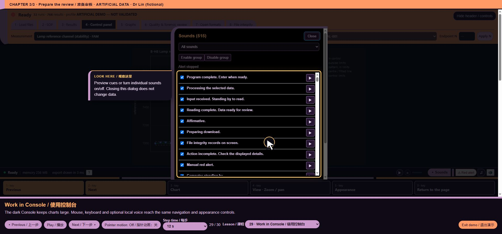

# core/ui/console_voice.js — function reference

## C10316 · mount

- Ownership: MISSY first-party
- Module: core/ui/console_voice.js, line 292; script 11, script line 3160
- Form: FunctionDeclaration; parameters: ``
- AST classification: `new_named`
- R1 entry status: `observed_in_passing_scenario`
- Passing scenario observations: voice-demo, formats, training, voice-routing, voice-state, ack-queue, clarification, voice-bargein, command-finish, chart-focus, guided-tour, precision, quantstudio, evidence-keyboard
- R2 clean contract evidence: No separately linked clean contract assertion for this function
- Code SHA-256: `7e0d033b7f957ce7480c10e92544140cffb220ca5e5780af31aeaf9dda076bbe`
- [Complete exact function source](https://github.com/mihaiionitabio-alt/zpcrweb/blob/missy-public-offline-2026-10-20/documentation/releases/2026-10-31-full-wiki/code/functions/C10316.js)

```javascript
function mount(){const host=document.querySelector('#statusbar .sb-right'),consoleBar=document.getElementById('mg-statusbar');if(!host||!consoleBar)return;
  panel=document.createElement('details');panel.id='missy-console-voice';panel.setAttribute('data-i18n-skip','');const summary=document.createElement('summary');panel.append(summary);
  const settings=document.createElement('div');settings.className='missy-voice-settings';
  setupButton=document.createElement('button');setupButton.type='button';setupButton.onclick=setup;settings.append(setupButton);
  const durationLabel=document.createElement('label'),durationText=document.createElement('span');durationInput=document.createElement('input');durationInput.type='number';durationInput.min=String(5/60);durationInput.max='60';durationInput.step='any';durationInput.value='10';durationInput.id='missy-voice-minutes';
  try{const raw=localStorage.getItem(durationKey),saved=raw===null?Number(localStorage.getItem('missy_voice_seconds_v1'))*1000:Number(raw);if(Number.isInteger(saved)&&saved>=5000&&saved<=3600000)appliedMs=saved;}catch{}durationInput.value=String(appliedMs/60000);
  confirmButton=document.createElement('button');confirmButton.type='button';confirmButton.textContent='✓';confirmButton.onclick=()=>{const n=milliseconds();if(n===null){durationInput.reportValidity();return;}appliedMs=n;try{localStorage.setItem(durationKey,String(n));}catch{}controls();say('Saved','已保存');};durationInput.addEventListener('input',controls);durationLabel.append(durationText,durationInput,confirmButton);settings.append(durationLabel);
  capabilityNote=document.createElement('p');capabilityNote.id='missy-voice-capability';capabilityNote.setAttribute('role','status');capabilityNote.setAttribute('aria-live','polite');settings.append(capabilityNote);
  status=document.createElement('p');status.setAttribute('role','status');status.setAttribute('aria-live','polite');settings.append(status);panel.append(settings);host.append(panel);
  const controlsBox=document.createElement('div');controlsBox.id='missy-console-voice-controls';controlsBox.setAttribute('data-i18n-skip','');
  startButton=document.createElement('button');startButton.type='button';startButton.onclick=start;stopButton=document.createElement('button');stopButton.type='button';stopButton.onclick=stop;
  runtimeStatus=document.createElement('span');runtimeStatus.setAttribute('role','status');runtimeStatus.setAttribute('aria-live','polite');level=document.createElement('span');level.id='missy-voice-level';level.setAttribute('role','meter');level.setAttribute('aria-valuemin','0');level.setAttribute('aria-valuemax','100');level.setAttribute('aria-valuenow','0');level.append(document.createElement('i'));controlsBox.append(startButton,stopButton,level,runtimeStatus);host.append(controlsBox);
  const labels=()=>{summary.textContent='🎙';summary.setAttribute('aria-label',t('English voice setup','英语语音设置'));summary.title=t('English voice setup','英语语音设置');setupButton.textContent='↓ English';setupButton.setAttribute('aria-label',t('Setup English (one-time download)','设置英语（首次下载）'));setupButton.title=t('Setup English (one-time download)','设置英语（首次下载）');durationText.textContent=t('min','分钟');durationInput.setAttribute('aria-label',t('Listening time (minutes)','聆听时间（分钟）'));confirmButton.setAttribute('aria-label',t('Confirm listening time','确认聆听时间'));confirmButton.title=t('Confirm listening time','确认聆听时间');startButton.textContent='▶';stopButton.textContent='■';startButton.setAttribute('aria-label',t('Start voice','启动语音'));stopButton.setAttribute('aria-label',t('Stop voice','停止语音'));startButton.title=t('Start voice','启动语音');stopButton.title=t('Stop voice','停止语音');level.setAttribute('aria-label',t('Microphone level','麦克风电平'));};
  labels();controls();say('Off','已关闭');void probe();
  mountQuestions();
  document.addEventListener('click',e=>{if(e.target.closest?.('#missy-red-alert')){pendingAlertDrill=drillMode;setTimeout(()=>{pendingAlertDrill=null;},0);shipRecord('manual-alert-button',window.MISSY_COMPUTER_SOUND?.alerting?'stop requested':'start requested');}},true);
  shipLabels();let lastManualState=!!window.MISSY_COMPUTER_SOUND?.alerting;const manualAlert=document.getElementById('missy-red-alert');if(manualAlert)new MutationObserver(()=>{const state=!!window.MISSY_COMPUTER_SOUND?.alerting;if(state!==lastManualState){lastManualState=state;shipRecord('manual-alert-state',state?'active':'stopped',pendingAlertDrill===null?drillMode:pendingAlertDrill);pendingAlertDrill=null;}shipLabels();}).observe(manualAlert,{attributes:true,attributeFilter:['aria-pressed']});
  const themeButton=document.createElement('button');themeButton.type='button';themeButton.id='missy-chart-theme';themeButton.title='Chart background / 图表背景';themeButton.onclick=()=>setScreenChartTheme(document.documentElement.dataset.chartTheme==='dark'?'light':'dark');host.append(themeButton);
  let theme='dark';try{theme=localStorage.getItem('missy_screen_chart_theme_v1')||'dark';}catch{}setScreenChartTheme(theme);
  const screenStyle=document.createElement('style');screenStyle.textContent=`
  .missy-interest{outline:2px solid #ffb454!important;outline-offset:4px;animation:missy-interest-pulse 1.25s ease-in-out 4}
  .missy-interest-point{stroke:#ffb454!important;stroke-width:3!important;animation:missy-interest-pulse 1.25s ease-in-out 4}
  @keyframes missy-interest-pulse{0%,100%{outline-color:#ffb454}50%{outline-color:#cc99cc}}
  @media(prefers-reduced-motion:reduce){.missy-interest,.missy-interest-point{animation:none!important}}
  #missy-console-voice-controls{display:inline-flex;align-items:center;gap:5px}
  html[data-chart-theme="dark"] #g-chart>svg,html[data-chart-theme="dark"] #cc-chart>svg,html[data-chart-theme="dark"] #g-chart .ix-plot,html[data-chart-theme="dark"] #cc-chart .ix-plot{filter:invert(.9) hue-rotate(180deg) contrast(1.05)}
  html[data-chart-theme="dark"] #g-chart,html[data-chart-theme="dark"] #cc-chart{background:#0b111b}
  html[data-chart-theme="light"] #g-chart,html[data-chart-theme="light"] #cc-chart{background:white}
  `;document.head.append(screenStyle);
  // Add visible voice numbers to selector labels only; renderer and export titles stay intact.
  const detail=document.getElementById('cc-detail');if(detail)new MutationObserver(()=>{if(detail.querySelector('[data-voice-chart-number]'))return;const n=chartList().findIndex(c=>c.control&&c.id===CC_STATE.open)+1;if(!n||detail.hidden)return;const label=document.createElement('p');label.dataset.voiceChartNumber='';label.textContent=t('Voice: Computer, show chart ','语音：Computer, show chart ')+n;detail.prepend(label);}).observe(detail,{childList:true});
  const graphSelect=document.getElementById('g-graph');if(graphSelect)new MutationObserver(numberChartLabels).observe(graphSelect,{childList:true,subtree:true});numberChartLabels();
  new MutationObserver(()=>{labels();controls();keys();}).observe(document.body,{attributes:true,attributeFilter:['class']});
 }
```

## C10317 · confirmButton.onclick

- Ownership: MISSY first-party
- Module: core/ui/console_voice.js, line 298; script 11, script line 3166
- Form: ArrowFunctionExpression; parameters: ``
- AST classification: `new_named`
- R1 entry status: `not_observed_in_passing_scenario`
- Passing scenario observations: No passing R1 instrumented scenario observation
- R2 clean contract evidence: No separately linked clean contract assertion for this function
- Code SHA-256: `9aa631a351bb6851f9004bbdb7a98577edb482d60c2c74ffcda367b550366509`
- [Complete exact function source](https://github.com/mihaiionitabio-alt/zpcrweb/blob/missy-public-offline-2026-10-20/documentation/releases/2026-10-31-full-wiki/code/functions/C10317.js)

```javascript
()=>{const n=milliseconds();if(n===null){durationInput.reportValidity();return;}appliedMs=n;try{localStorage.setItem(durationKey,String(n));}catch{}controls();say('Saved','已保存');}
```

## C10318 · labels

- Ownership: MISSY first-party
- Module: core/ui/console_voice.js, line 304; script 11, script line 3172
- Form: ArrowFunctionExpression; parameters: ``
- AST classification: `new_named`
- R1 entry status: `observed_in_passing_scenario`
- Passing scenario observations: voice-demo, formats, training, voice-routing, voice-state, ack-queue, clarification, voice-bargein, command-finish, chart-focus, guided-tour, precision, quantstudio, evidence-keyboard
- R2 clean contract evidence: No separately linked clean contract assertion for this function
- Code SHA-256: `973d8316653e83ea54c4ec0b02473dacaa1b7460a8f6b27d5785d8ea4583a37b`
- [Complete exact function source](https://github.com/mihaiionitabio-alt/zpcrweb/blob/missy-public-offline-2026-10-20/documentation/releases/2026-10-31-full-wiki/code/functions/C10318.js)

```javascript
()=>{summary.textContent='🎙';summary.setAttribute('aria-label',t('English voice setup','英语语音设置'));summary.title=t('English voice setup','英语语音设置');setupButton.textContent='↓ English';setupButton.setAttribute('aria-label',t('Setup English (one-time download)','设置英语（首次下载）'));setupButton.title=t('Setup English (one-time download)','设置英语（首次下载）');durationText.textContent=t('min','分钟');durationInput.setAttribute('aria-label',t('Listening time (minutes)','聆听时间（分钟）'));confirmButton.setAttribute('aria-label',t('Confirm listening time','确认聆听时间'));confirmButton.title=t('Confirm listening time','确认聆听时间');startButton.textContent='▶';stopButton.textContent='■';startButton.setAttribute('aria-label',t('Start voice','启动语音'));stopButton.setAttribute('aria-label',t('Stop voice','停止语音'));startButton.title=t('Start voice','启动语音');stopButton.title=t('Stop voice','停止语音');level.setAttribute('aria-label',t('Microphone level','麦克风电平'));}
```

## C10319 · <callback@3175:36>

- Ownership: MISSY first-party
- Module: core/ui/console_voice.js, line 307; script 11, script line 3175
- Form: ArrowFunctionExpression; parameters: `e`
- AST classification: `new_or_changed_anonymous`
- R1 entry status: `observed_in_passing_scenario`
- Passing scenario observations: voice-demo, formats, training, voice-routing, voice-state, ack-queue, clarification, voice-bargein, command-finish, chart-focus, guided-tour, precision, evidence-keyboard
- R2 clean contract evidence: No separately linked clean contract assertion for this function
- Code SHA-256: `e11f79694af31e6ce17eea250634fd5973d2662e6e0d49c32ac86cea00337206`
- [Complete exact function source](https://github.com/mihaiionitabio-alt/zpcrweb/blob/missy-public-offline-2026-10-20/documentation/releases/2026-10-31-full-wiki/code/functions/C10319.js)

```javascript
e=>{if(e.target.closest?.('#missy-red-alert')){pendingAlertDrill=drillMode;setTimeout(()=>{pendingAlertDrill=null;},0);shipRecord('manual-alert-button',window.MISSY_COMPUTER_SOUND?.alerting?'stop requested':'start requested');}}
```

## C10320 · <callback@3175:122>

- Ownership: MISSY first-party
- Module: core/ui/console_voice.js, line 307; script 11, script line 3175
- Form: ArrowFunctionExpression; parameters: ``
- AST classification: `new_or_changed_anonymous`
- R1 entry status: `observed_in_passing_scenario`
- Passing scenario observations: voice-demo, guided-tour
- R2 clean contract evidence: No separately linked clean contract assertion for this function
- Code SHA-256: `cef278e3c6dad8f79dbe042394e9c0974696c3ddec7f410c27d636b950a3938f`
- [Complete exact function source](https://github.com/mihaiionitabio-alt/zpcrweb/blob/missy-public-offline-2026-10-20/documentation/releases/2026-10-31-full-wiki/code/functions/C10320.js)

```javascript
()=>{pendingAlertDrill=null;}
```

## C10321 · <callback@3176:172>

- Ownership: MISSY first-party
- Module: core/ui/console_voice.js, line 308; script 11, script line 3176
- Form: ArrowFunctionExpression; parameters: ``
- AST classification: `new_or_changed_anonymous`
- R1 entry status: `observed_in_passing_scenario`
- Passing scenario observations: voice-demo, formats, training, voice-routing, voice-state, ack-queue, clarification, voice-bargein, command-finish, chart-focus, guided-tour, precision, quantstudio, evidence-keyboard
- R2 clean contract evidence: No separately linked clean contract assertion for this function
- Code SHA-256: `bf53f42c9d10bdef3dd625ce45a2249f1e4c4ed0d7d29dda1ef75df6bc8cb275`
- [Complete exact function source](https://github.com/mihaiionitabio-alt/zpcrweb/blob/missy-public-offline-2026-10-20/documentation/releases/2026-10-31-full-wiki/code/functions/C10321.js)

```javascript
()=>{const state=!!window.MISSY_COMPUTER_SOUND?.alerting;if(state!==lastManualState){lastManualState=state;shipRecord('manual-alert-state',state?'active':'stopped',pendingAlertDrill===null?drillMode:pendingAlertDrill);pendingAlertDrill=null;}shipLabels();}
```

## C10322 · themeButton.onclick

- Ownership: MISSY first-party
- Module: core/ui/console_voice.js, line 309; script 11, script line 3177
- Form: ArrowFunctionExpression; parameters: ``
- AST classification: `new_named`
- R1 entry status: `not_observed_in_passing_scenario`
- Passing scenario observations: No passing R1 instrumented scenario observation
- R2 clean contract evidence: No separately linked clean contract assertion for this function
- Code SHA-256: `7584ac7a474177716c41d71d244c8fe6853348cafb771d369694a8dd687a6c14`
- [Complete exact function source](https://github.com/mihaiionitabio-alt/zpcrweb/blob/missy-public-offline-2026-10-20/documentation/releases/2026-10-31-full-wiki/code/functions/C10322.js)

```javascript
()=>setScreenChartTheme(document.documentElement.dataset.chartTheme==='dark'?'light':'dark')
```

## C10323 · <callback@3190:83>

- Ownership: MISSY first-party
- Module: core/ui/console_voice.js, line 322; script 11, script line 3190
- Form: ArrowFunctionExpression; parameters: ``
- AST classification: `new_or_changed_anonymous`
- R1 entry status: `not_observed_in_passing_scenario`
- Passing scenario observations: No passing R1 instrumented scenario observation
- R2 clean contract evidence: No separately linked clean contract assertion for this function
- Code SHA-256: `de638605abba13e3f6e56d34be057106201ee5ab2540982b826735b7c56bfe15`
- [Complete exact function source](https://github.com/mihaiionitabio-alt/zpcrweb/blob/missy-public-offline-2026-10-20/documentation/releases/2026-10-31-full-wiki/code/functions/C10323.js)

```javascript
()=>{if(detail.querySelector('[data-voice-chart-number]'))return;const n=chartList().findIndex(c=>c.control&&c.id===CC_STATE.open)+1;if(!n||detail.hidden)return;const label=document.createElement('p');label.dataset.voiceChartNumber='';label.textContent=t('Voice: Computer, show chart ','语音：Computer, show chart ')+n;detail.prepend(label);}
```

## C10324 · <callback@3190:178>

- Ownership: MISSY first-party
- Module: core/ui/console_voice.js, line 322; script 11, script line 3190
- Form: ArrowFunctionExpression; parameters: `c`
- AST classification: `new_or_changed_anonymous`
- R1 entry status: `not_observed_in_passing_scenario`
- Passing scenario observations: No passing R1 instrumented scenario observation
- R2 clean contract evidence: No separately linked clean contract assertion for this function
- Code SHA-256: `9d600c078a1e2d2a0f521aadfdded7148a66e2f28dcfdc7f6eefcb5067845d28`
- [Complete exact function source](https://github.com/mihaiionitabio-alt/zpcrweb/blob/missy-public-offline-2026-10-20/documentation/releases/2026-10-31-full-wiki/code/functions/C10324.js)

```javascript
c=>c.control&&c.id===CC_STATE.open
```

## C10325 · <callback@3192:23>

- Ownership: MISSY first-party
- Module: core/ui/console_voice.js, line 324; script 11, script line 3192
- Form: ArrowFunctionExpression; parameters: ``
- AST classification: `new_or_changed_anonymous`
- R1 entry status: `observed_in_passing_scenario`
- Passing scenario observations: voice-demo, training, clarification, chart-focus, guided-tour, precision, evidence-keyboard
- R2 clean contract evidence: No separately linked clean contract assertion for this function
- Code SHA-256: `c7396fe3e9c263c69811aff91eea5396ce3e998a0a9bddc05f03dddfd6b69f60`
- [Complete exact function source](https://github.com/mihaiionitabio-alt/zpcrweb/blob/missy-public-offline-2026-10-20/documentation/releases/2026-10-31-full-wiki/code/functions/C10325.js)

```javascript
()=>{labels();controls();keys();}
```

## C10326 · <callback@3194:67>

- Ownership: MISSY first-party
- Module: core/ui/console_voice.js, line 326; script 11, script line 3194
- Form: ArrowFunctionExpression; parameters: `next`
- AST classification: `new_or_changed_anonymous`
- R1 entry status: `observed_in_passing_scenario`
- Passing scenario observations: voice-demo, training, voice-state, voice-bargein, command-finish, chart-focus, guided-tour
- R2 clean contract evidence: No separately linked clean contract assertion for this function
- Code SHA-256: `f2af969cd19182a3fa1d0f9b07f7337a0a2ce3cfe49899f3774e1f74de8555a2`
- [Complete exact function source](https://github.com/mihaiionitabio-alt/zpcrweb/blob/missy-public-offline-2026-10-20/documentation/releases/2026-10-31-full-wiki/code/functions/C10326.js)

```javascript
next=>function(...args){const result=next(...args);if(MG.open&&panel&&!window.MISSY_SETUP?.isOpen)panel.open=false;placeControls();controls();keys();return result;}
```

## C10327 · <callback@3194:73>

- Ownership: MISSY first-party
- Module: core/ui/console_voice.js, line 326; script 11, script line 3194
- Form: FunctionExpression; parameters: `...args`
- AST classification: `new_or_changed_anonymous`
- R1 entry status: `observed_in_passing_scenario`
- Passing scenario observations: voice-demo, training, voice-state, voice-bargein, command-finish, chart-focus, guided-tour
- R2 clean contract evidence: No separately linked clean contract assertion for this function
- Code SHA-256: `5ed3c64f81a887a9edf2879bf8afa2572bcc97171ce1231aba92404650dffd28`
- [Complete exact function source](https://github.com/mihaiionitabio-alt/zpcrweb/blob/missy-public-offline-2026-10-20/documentation/releases/2026-10-31-full-wiki/code/functions/C10327.js)

```javascript
function(...args){const result=next(...args);if(MG.open&&panel&&!window.MISSY_SETUP?.isOpen)panel.open=false;placeControls();controls();keys();return result;}
```

## C10328 · <callback@3195:61>

- Ownership: MISSY first-party
- Module: core/ui/console_voice.js, line 327; script 11, script line 3195
- Form: ArrowFunctionExpression; parameters: `next`
- AST classification: `new_or_changed_anonymous`
- R1 entry status: `observed_in_passing_scenario`
- Passing scenario observations: voice-demo, formats, training, voice-routing, voice-state, ack-queue, clarification, voice-bargein, command-finish, chart-focus, guided-tour, precision, evidence-keyboard
- R2 clean contract evidence: No separately linked clean contract assertion for this function
- Code SHA-256: `3c51129693de858b88814a817a73bcf4ec90e372bbd3f0788ebfacd2d7362680`
- [Complete exact function source](https://github.com/mihaiionitabio-alt/zpcrweb/blob/missy-public-offline-2026-10-20/documentation/releases/2026-10-31-full-wiki/code/functions/C10328.js)

```javascript
next=>function(...args){const result=next(...args);placeControls();controls();return result;}
```

## C10329 · <callback@3195:67>

- Ownership: MISSY first-party
- Module: core/ui/console_voice.js, line 327; script 11, script line 3195
- Form: FunctionExpression; parameters: `...args`
- AST classification: `new_or_changed_anonymous`
- R1 entry status: `observed_in_passing_scenario`
- Passing scenario observations: voice-demo, formats, training, voice-routing, voice-state, ack-queue, clarification, voice-bargein, command-finish, chart-focus, guided-tour, precision, evidence-keyboard
- R2 clean contract evidence: No separately linked clean contract assertion for this function
- Code SHA-256: `443df279975e60f762d08164da42af1e53431dc5b3abfb1a4aa5a582b07076d3`
- [Complete exact function source](https://github.com/mihaiionitabio-alt/zpcrweb/blob/missy-public-offline-2026-10-20/documentation/releases/2026-10-31-full-wiki/code/functions/C10329.js)

```javascript
function(...args){const result=next(...args);placeControls();controls();return result;}
```

## C10330 · <callback@3196:46>

- Ownership: MISSY first-party
- Module: core/ui/console_voice.js, line 328; script 11, script line 3196
- Form: ArrowFunctionExpression; parameters: ``
- AST classification: `new_or_changed_anonymous`
- R1 entry status: `not_observed_in_passing_scenario`
- Passing scenario observations: No passing R1 instrumented scenario observation
- R2 clean contract evidence: No separately linked clean contract assertion for this function
- Code SHA-256: `9ec296708b5dc6c537df8c219f1a31f111b025d8fa46ea4541256a0ea7a5b6ff`
- [Complete exact function source](https://github.com/mihaiionitabio-alt/zpcrweb/blob/missy-public-offline-2026-10-20/documentation/releases/2026-10-31-full-wiki/code/functions/C10330.js)

```javascript
()=>{if(document.hidden)stop();}
```

## C10331 · limitedResponse

- Ownership: MISSY first-party
- Module: core/ui/console_voice.js, line 330; script 11, script line 3198
- Form: FunctionExpression; parameters: ``
- AST classification: `new_named`
- R1 entry status: `observed_in_passing_scenario`
- Passing scenario observations: voice-demo, chart-focus
- R2 clean contract evidence: No separately linked clean contract assertion for this function
- Code SHA-256: `50283bf60717b0e458bbb396eef29305ab597ecd13d16a087ad1a126e6fe9072`
- [Complete exact function source](https://github.com/mihaiionitabio-alt/zpcrweb/blob/missy-public-offline-2026-10-20/documentation/releases/2026-10-31-full-wiki/code/functions/C10331.js)

```javascript
(){return {...limited}}
```

## C10332 · interfaceLog

- Ownership: MISSY first-party
- Module: core/ui/console_voice.js, line 330; script 11, script line 3198
- Form: FunctionExpression; parameters: ``
- AST classification: `new_named`
- R1 entry status: `not_observed_in_passing_scenario`
- Passing scenario observations: No passing R1 instrumented scenario observation
- R2 clean contract evidence: No separately linked clean contract assertion for this function
- Code SHA-256: `04b722c59831f2b9019dde345b11889c64d687dfff7dc79a804287d93cdcefa2`
- [Complete exact function source](https://github.com/mihaiionitabio-alt/zpcrweb/blob/missy-public-offline-2026-10-20/documentation/releases/2026-10-31-full-wiki/code/functions/C10332.js)

```javascript
(){return shipEvents.map(e=>({...e}))}
```

## C10333 · <callback@3198:189>

- Ownership: MISSY first-party
- Module: core/ui/console_voice.js, line 330; script 11, script line 3198
- Form: ArrowFunctionExpression; parameters: `e`
- AST classification: `new_or_changed_anonymous`
- R1 entry status: `not_observed_in_passing_scenario`
- Passing scenario observations: No passing R1 instrumented scenario observation
- R2 clean contract evidence: No separately linked clean contract assertion for this function
- Code SHA-256: `3896744e5ceb002a2774b1e357fe36427371e77b44abce4fe1c187893d95d424`
- [Complete exact function source](https://github.com/mihaiionitabio-alt/zpcrweb/blob/missy-public-offline-2026-10-20/documentation/releases/2026-10-31-full-wiki/code/functions/C10333.js)

```javascript
e=>({...e})
```

## C10334 · drill

- Ownership: MISSY first-party
- Module: core/ui/console_voice.js, line 330; script 11, script line 3198
- Form: FunctionExpression; parameters: ``
- AST classification: `new_named`
- R1 entry status: `not_observed_in_passing_scenario`
- Passing scenario observations: No passing R1 instrumented scenario observation
- R2 clean contract evidence: No separately linked clean contract assertion for this function
- Code SHA-256: `b4d41c9d9dbee01e007d7c572a12e8e5e6cd8e50377b65140cd9ede69ad4dce5`
- [Complete exact function source](https://github.com/mihaiionitabio-alt/zpcrweb/blob/missy-public-offline-2026-10-20/documentation/releases/2026-10-31-full-wiki/code/functions/C10334.js)

```javascript
(){return drillMode}
```

## C10335 · pairRegistry

- Ownership: MISSY first-party
- Module: core/ui/console_voice.js, line 330; script 11, script line 3198
- Form: FunctionExpression; parameters: ``
- AST classification: `new_named`
- R1 entry status: `observed_in_passing_scenario`
- Passing scenario observations: voice-routing
- R2 clean contract evidence: No separately linked clean contract assertion for this function
- Code SHA-256: `4ccada806f079e20d9d30a3c8ac05b75e096e0da2dbc5bf933d48fde79537343`
- [Complete exact function source](https://github.com/mihaiionitabio-alt/zpcrweb/blob/missy-public-offline-2026-10-20/documentation/releases/2026-10-31-full-wiki/code/functions/C10335.js)

```javascript
(){return voicePairRegistry.map(r=>({...r,intent:interpret('Computer '+r.phrase)}))}
```

## C10336 · <callback@3198:281>

- Ownership: MISSY first-party
- Module: core/ui/console_voice.js, line 330; script 11, script line 3198
- Form: ArrowFunctionExpression; parameters: `r`
- AST classification: `new_or_changed_anonymous`
- R1 entry status: `observed_in_passing_scenario`
- Passing scenario observations: voice-routing
- R2 clean contract evidence: No separately linked clean contract assertion for this function
- Code SHA-256: `fbdb73cd407b12a2af9539c0909ef16e8ce3bfe397ddd89b5ed1f6c52a0c960f`
- [Complete exact function source](https://github.com/mihaiionitabio-alt/zpcrweb/blob/missy-public-offline-2026-10-20/documentation/releases/2026-10-31-full-wiki/code/functions/C10336.js)

```javascript
r=>({...r,intent:interpret('Computer '+r.phrase)})
```

## C10337 · statusFindings

- Ownership: MISSY first-party
- Module: core/ui/console_voice.js, line 330; script 11, script line 3198
- Form: FunctionExpression; parameters: ``
- AST classification: `new_named`
- R1 entry status: `not_observed_in_passing_scenario`
- Passing scenario observations: No passing R1 instrumented scenario observation
- R2 clean contract evidence: No separately linked clean contract assertion for this function
- Code SHA-256: `4d1728340d44f6eb3eebb66e63c5f97be005724e23b4eb7efab942161c039379`
- [Complete exact function source](https://github.com/mihaiionitabio-alt/zpcrweb/blob/missy-public-offline-2026-10-20/documentation/releases/2026-10-31-full-wiki/code/functions/C10337.js)

```javascript
(){return statusFindings().map(f=>({...f}))}
```

## C10338 · <callback@3198:383>

- Ownership: MISSY first-party
- Module: core/ui/console_voice.js, line 330; script 11, script line 3198
- Form: ArrowFunctionExpression; parameters: `f`
- AST classification: `new_or_changed_anonymous`
- R1 entry status: `not_observed_in_passing_scenario`
- Passing scenario observations: No passing R1 instrumented scenario observation
- R2 clean contract evidence: No separately linked clean contract assertion for this function
- Code SHA-256: `c0ae104059b39dd166b017f7b38ef2c55dfa6e6c4b535d4ba186ac46c004c3dd`
- [Complete exact function source](https://github.com/mihaiionitabio-alt/zpcrweb/blob/missy-public-offline-2026-10-20/documentation/releases/2026-10-31-full-wiki/code/functions/C10338.js)

```javascript
f=>({...f})
```

## C10339 · capability

- Ownership: MISSY first-party
- Module: core/ui/console_voice.js, line 330; script 11, script line 3198
- Form: FunctionExpression; parameters: ``
- AST classification: `new_named`
- R1 entry status: `not_observed_in_passing_scenario`
- Passing scenario observations: No passing R1 instrumented scenario observation
- R2 clean contract evidence: No separately linked clean contract assertion for this function
- Code SHA-256: `335cf531175b3d611ad4ff99e1abe3cd6aa18d62c5cbed51d241e552ddd97854`
- [Complete exact function source](https://github.com/mihaiionitabio-alt/zpcrweb/blob/missy-public-offline-2026-10-20/documentation/releases/2026-10-31-full-wiki/code/functions/C10339.js)

```javascript
(){return capability}
```

## C10340 · listening

- Ownership: MISSY first-party
- Module: core/ui/console_voice.js, line 330; script 11, script line 3198
- Form: FunctionExpression; parameters: ``
- AST classification: `new_named`
- R1 entry status: `observed_in_passing_scenario`
- Passing scenario observations: ack-queue, clarification, voice-bargein, command-finish
- R2 clean contract evidence: No separately linked clean contract assertion for this function
- Code SHA-256: `91d52239087ef51c3209c6b623ba87cf60859f687360387ce56b739064d78521`
- [Complete exact function source](https://github.com/mihaiionitabio-alt/zpcrweb/blob/missy-public-offline-2026-10-20/documentation/releases/2026-10-31-full-wiki/code/functions/C10340.js)

```javascript
(){return listening}
```

## C10341 · busy

- Ownership: MISSY first-party
- Module: core/ui/console_voice.js, line 330; script 11, script line 3198
- Form: FunctionExpression; parameters: ``
- AST classification: `new_named`
- R1 entry status: `not_observed_in_passing_scenario`
- Passing scenario observations: No passing R1 instrumented scenario observation
- R2 clean contract evidence: No separately linked clean contract assertion for this function
- Code SHA-256: `3bb384bb3deb023583eb26efb3ece1992ddb12c9f55f2b9c72fc9921f3ed20f5`
- [Complete exact function source](https://github.com/mihaiionitabio-alt/zpcrweb/blob/missy-public-offline-2026-10-20/documentation/releases/2026-10-31-full-wiki/code/functions/C10341.js)

```javascript
(){return busy}
```

[Wiki home](/p/zpcrweb/wiki/Home/)

## Illustrated interface context

Voice navigation and Console presentation; dynamic answers are documented in the dialogue page. This is UI context, not proof of function-level correctness.



*Representative webpage view for core/ui/console_voice.js*

[Complete illustrated workflow and source mapping](https://github.com/mihaiionitabio-alt/zpcrweb/blob/missy-public-offline-2026-10-20/documentation/releases/2026-11-01-illustrated-wiki/pages/FunctionScreenshots.md)
