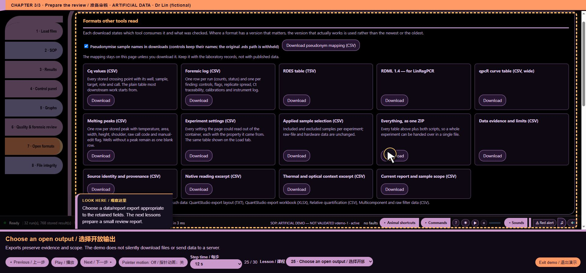

# core/ui/export_dictionary.js — function reference

## C10538 · <callback@3681:31>

- Ownership: MISSY first-party
- Module: core/ui/export_dictionary.js, line 2; script 11, script line 3681
- Form: ArrowFunctionExpression; parameters: ``
- AST classification: `new_or_changed_anonymous`
- R1 entry status: `observed_in_passing_scenario`
- Passing scenario observations: voice-demo, formats, training, voice-routing, voice-state, ack-queue, clarification, voice-bargein, command-finish, chart-focus, guided-tour, precision, quantstudio, evidence-keyboard
- R2 clean contract evidence: No separately linked clean contract assertion for this function
- Code SHA-256: `173adaa25290658ae29ea55bc60a667c103f03a93fb54cb4ea429f2967791a82`
- [Complete exact function source](https://github.com/mihaiionitabio-alt/zpcrweb/blob/missy-public-offline-2026-10-20/documentation/releases/2026-10-31-full-wiki/code/functions/C10538.js)

```javascript
()=>{
 const definitions=[{"filename":"data_evidence_limits.csv","header_variants":[["evidence_view","filename","evidence_item","evidence_state","evidence_detail","evidence_code","status_code"]],"fields":[{"key":"evidence_view","description":{"en":"One-based decoded-view order in the current loaded collection; not a persistent ID.","zh":"当前已加载集合中的解码视图序号，从1开始；不是持久标识。"}},{"key":"filename","description":{"en":"Literal source filename; not a unique acquisition identity.","zh":"源文件名称原文；不是唯一采集标识。"}},{"key":"evidence_item","description":{"en":"Human-readable item label. CSV uses the existing unlocalized row function; report labels may be translated.","zh":"供人阅读的项目标签。CSV采用已有的未本地化行函数；报告标签可被翻译。"}},{"key":"evidence_state","description":{"en":"Descriptive availability/state text. Not a new sample call, QC gate or release verdict.","zh":"提供情况或状态的描述文本。不属于新的样本判定、质控门限或发布结论。"}},{"key":"evidence_detail","description":{"en":"Existing descriptive detail, including literal source values where retained; no new decoding.","zh":"已有描述性详情，可包含保留的源值原文；不进行新的解码。"}},{"key":"evidence_code","description":{"en":"Machine item key from the existing evidence module; preserved literally.","zh":"已有证据模块中的机器项目键；保留原文。"}},{"key":"status_code","description":{"en":"Existing machine availability key; interpret within this export, not as a biological result.","zh":"已有的机器提供情况键；仅在本导出内解释，不作为生物学结果。"}}]},{"filename":"source_identity_provenance.csv","header_variants":[["provenance_view","filename","provenance_item","provenance_state","provenance_value","provenance_method","provenance_code","method_code","status_code"]],"fields":[{"key":"provenance_view","description":{"en":"One-based decoded-view order in the current loaded collection; not a persistent ID.","zh":"当前已加载集合中的解码视图序号，从1开始；不是持久标识。"}},{"key":"filename","description":{"en":"Literal source filename; not a unique acquisition identity.","zh":"源文件名称原文；不是唯一采集标识。"}},{"key":"provenance_item","description":{"en":"Human-readable item label. CSV uses the existing unlocalized row function; report labels may be translated.","zh":"供人阅读的项目标签。CSV采用已有的未本地化行函数；报告标签可被翻译。"}},{"key":"provenance_state","description":{"en":"Descriptive availability/state text. Not a new sample call, QC gate or release verdict.","zh":"提供情况或状态的描述文本。不属于新的样本判定、质控门限或发布结论。"}},{"key":"provenance_value","description":{"en":"Displayed existing identity, hash, flag or count. Hash methods/scopes must be read with provenance_method.","zh":"显示已有标识、哈希、标志或计数。哈希算法与范围必须结合provenance_method读取。"}},{"key":"provenance_method","description":{"en":"Description of the existing evidence basis; not authentication or a newly computed checksum.","zh":"已有证据依据的说明；不代表身份认证或新计算的校验和。"}},{"key":"provenance_code","description":{"en":"Machine item key from the existing evidence module; preserved literally.","zh":"已有证据模块中的机器项目键；保留原文。"}},{"key":"method_code","description":{"en":"Machine key for the explanatory basis; not an algorithm revision or conformance status.","zh":"说明依据的机器键；不是算法修订号或符合性状态。"}},{"key":"status_code","description":{"en":"Existing machine availability key; interpret within this export, not as a biological result.","zh":"已有的机器提供情况键；仅在本导出内解释，不作为生物学结果。"}}]},{"filename":"native_reading_excerpt.csv","header_variants":[["native_view","filename","inspection_scope","native_component","native_value","native_state","native_basis"],["native_view","filename","inspection_scope","native_component","native_value","native_state","native_basis","component_code","source_array","source_index","read_number","channel_number","physical_row","physical_column","role_code"]],"fields":[{"key":"native_view","description":{"en":"One-based decoded-view order in the current loaded collection; not a persistent ID.","zh":"当前已加载集合中的解码视图序号，从1开始；不是持久标识。"}},{"key":"filename","description":{"en":"Literal source filename; not a unique acquisition identity.","zh":"源文件名称原文；不是唯一采集标识。"}},{"key":"inspection_scope","description":{"en":"Description of the selected native read/channel/physical position or its unavailability.","zh":"所选原生读取、通道、物理位置或其不可用情况的描述。"}},{"key":"native_component","description":{"en":"Stored component label, or an availability label. PCRD components can remain opaque.","zh":"保存的组分标签或提供情况标签。PCRD组分可能保持未解释状态。"}},{"key":"native_value","description":{"en":"String of an existing decoded numeric component, including signed zero/nonfinite tokens; empty when unavailable. Not original bits or calibrated units.","zh":"已有解码数值组分的字符串，包括带符号零或非有限标记；不可用时为空。不代表原始位值或校准单位。"}},{"key":"native_state","description":{"en":"Descriptive availability/state text. Not a new sample call, QC gate or release verdict.","zh":"提供情况或状态的描述文本。不属于新的样本判定、质控门限或发布结论。"}},{"key":"native_basis","description":{"en":"Existing array reference plus excerpt limitation; not a full acquisition export.","zh":"已有数组引用与摘录限制；不是完整采集导出。"}},{"key":"component_code","description":{"en":"Verified ZPCR statistic key or opaque PCRD native component key; do not infer semantics from tuple width.","zh":"已确认的ZPCR统计量键或未解释的PCRD原生组分键；不能按元组宽度推断含义。"}},{"key":"source_array","description":{"en":"Literal decoded array name used by the inspector.","zh":"检查器使用的解码数组名称原文。"}},{"key":"source_index","description":{"en":"Zero-based element index in source_array; not a sample or well identifier.","zh":"source_array中从0开始的元素索引；不是样本或孔位标识。"}},{"key":"read_number","description":{"en":"One-based inspector coordinate in the decoded native layout; not a remapped sample identity.","zh":"解码原生布局中从1开始的检查器坐标；不是重新映射的样本标识。"}},{"key":"channel_number","description":{"en":"One-based inspector coordinate in the decoded native layout; not a remapped sample identity.","zh":"解码原生布局中从1开始的检查器坐标；不是重新映射的样本标识。"}},{"key":"physical_row","description":{"en":"One-based inspector coordinate in the decoded native layout; not a remapped sample identity.","zh":"解码原生布局中从1开始的检查器坐标；不是重新映射的样本标识。"}},{"key":"physical_column","description":{"en":"One-based inspector coordinate in the decoded native layout; not a remapped sample identity.","zh":"解码原生布局中从1开始的检查器坐标；不是重新映射的样本标识。"}},{"key":"role_code","description":{"en":"Existing layout-derived sample_grid/reference_grid/unknown role; not a biological control assignment.","zh":"依据已有布局得到的sample_grid、reference_grid或unknown角色；不是生物学对照分配。"}}]},{"filename":"instrument_context_excerpt.csv","header_variants":[["context_view","filename","context_scope","context_field","context_value","context_basis","context_state","field_code","basis_code","source_path"]],"fields":[{"key":"context_view","description":{"en":"One-based decoded-view order in the current loaded collection; not a persistent ID.","zh":"当前已加载集合中的解码视图序号，从1开始；不是持久标识。"}},{"key":"filename","description":{"en":"Literal source filename; not a unique acquisition identity.","zh":"源文件名称原文；不是唯一采集标识。"}},{"key":"context_scope","description":{"en":"Existing excerpt record/read/channel description and retained decoded field reference.","zh":"已有摘录记录、读取或通道说明及保留的解码字段引用。"}},{"key":"context_field","description":{"en":"Human-readable context field label, possibly with the retained channel/filter suffix.","zh":"供人阅读的背景字段标签，可能带有保留的通道或滤光片后缀。"}},{"key":"context_value","description":{"en":"Existing decoded scalar as text; the state/basis distinguish missing, opaque, parser-derived and measured/setpoint evidence.","zh":"已有解码标量的文本；状态与依据用于区分缺失、未解释、解析器派生以及实测或设定值证据。"}},{"key":"context_basis","description":{"en":"Explanation of retained source basis, units/coverage limits and any existing parser derivation; no correction applied.","zh":"保留源依据、单位或覆盖限制及已有解析器派生的说明；不应用校正。"}},{"key":"context_state","description":{"en":"Descriptive availability/state text. Not a new sample call, QC gate or release verdict.","zh":"提供情况或状态的描述文本。不属于新的样本判定、质控门限或发布结论。"}},{"key":"field_code","description":{"en":"Machine item key from the existing evidence module; preserved literally.","zh":"已有证据模块中的机器项目键；保留原文。"}},{"key":"basis_code","description":{"en":"Machine key for the explanatory basis; not an algorithm revision or conformance status.","zh":"说明依据的机器键；不是算法修订号或符合性状态。"}},{"key":"source_path","description":{"en":"Literal path within the decoded object, not an original filesystem path.","zh":"解码对象内部路径原文，不是原始文件系统路径。"}}]},{"filename":"current_scope_snapshot.csv","header_variants":[["filename","scope_item","scope_value","scope_state","scope_basis","scope_code"]],"fields":[{"key":"filename","description":{"en":"Literal source filename; not a unique acquisition identity.","zh":"源文件名称原文；不是唯一采集标识。"}},{"key":"scope_item","description":{"en":"Human-readable item label. CSV uses the existing unlocalized row function; report labels may be translated.","zh":"供人阅读的项目标签。CSV采用已有的未本地化行函数；报告标签可被翻译。"}},{"key":"scope_value","description":{"en":"Current configuration scalar or formatted record-count text. Empty/unavailable is not zero. Counts are records, not unique samples or valid outcomes.","zh":"当前配置标量或格式化记录计数文本。空值或不可用不等于零。计数为记录数，不是独立样本数或有效结果数。"}},{"key":"scope_state","description":{"en":"Descriptive availability/state text. Not a new sample call, QC gate or release verdict.","zh":"提供情况或状态的描述文本。不属于新的样本判定、质控门限或发布结论。"}},{"key":"scope_basis","description":{"en":"Existing explanation of configuration/mask/source scope; not authenticated audit history.","zh":"已有配置、掩码或源范围的说明；不是经过身份认证的审计历史。"}},{"key":"scope_code","description":{"en":"Machine item key from the existing evidence module; preserved literally.","zh":"已有证据模块中的机器项目键；保留原文。"}}]},{"filename":"registered_readers.csv","header_variants":[["display_build","decoded_model_version","reader_id","adapter_version","extensions"]],"fields":[{"key":"display_build","description":{"en":"Current MISSY display version; not a vendor algorithm version or cryptographic file identity.","zh":"当前MISSY显示版本；不是厂商算法版本或文件加密身份标识。"}},{"key":"decoded_model_version","description":{"en":"Current internal reader-model version, not the native file schema version.","zh":"当前内部读取器模型版本，不是原生文件模式版本。"}},{"key":"reader_id","description":{"en":"Literal currently registered reader ID; not a manufacturer/instrument identity.","zh":"当前已注册读取器标识原文；不是厂商或仪器标识。"}},{"key":"adapter_version","description":{"en":"Literal registered adapter version declaration; not independently verified algorithm provenance.","zh":"已注册适配器版本声明原文；不是经过独立验证的算法溯源信息。"}},{"key":"extensions","description":{"en":"Registered extensions joined as text; does not prove support for every file variant. ZIP batch intake is separate.","zh":"作为文本连接的已注册扩展名；不能证明支持所有文件变体。ZIP批量加载单独处理。"}}]},{"filename":"registered_readers.csv","header_variants":[["display_build","decoded_model_version","reader_id","adapter_version","extensions"]],"fields":[{"key":"display_build","description":{"en":"Current display build, not producer software revision.","zh":"当前显示版本，不是生产商软件修订号。"}},{"key":"decoded_model_version","description":{"en":"Current decoded-model version, not source format version.","zh":"当前解码模型版本，不是源格式版本。"}},{"key":"reader_id","description":{"en":"Literal registered reader ID; not proof of support for every file variant.","zh":"已注册读取器标识原文；不能证明支持所有文件变体。"}},{"key":"adapter_version","description":{"en":"Declared adapter version, not vendor algorithm version or validation result.","zh":"声明的适配器版本，不是厂商算法版本或验证结果。"}},{"key":"extensions","description":{"en":"Comma-separated registered extensions. ZIP batch intake is separate; this does not declare MISSY package support.","zh":"以逗号分隔的已注册扩展名。ZIP批量加载另行处理；不表示支持MISSY数据包。"}}]},{"filename":"calibration_metadata_excerpt.csv","header_variants":[["calibration_view","filename","calibration_scope","calibration_record","calibration_field","calibration_value","calibration_state","source_path"]],"fields":[{"key":"calibration_view","description":{"en":"One-based decoded-view order; not a persistent calibration or run ID.","zh":"从1开始的解码视图序号；不是持久校准或运行标识。"}},{"key":"filename","description":{"en":"Literal source filename; not a unique acquisition identity.","zh":"源文件名称原文；不是唯一采集标识。"}},{"key":"calibration_scope","description":{"en":"Scope key: decoded, template or locked. Template metadata does not establish a completed run.","zh":"范围键：decoded、template或locked。模板元数据不能证明运行已完成。"}},{"key":"calibration_record","description":{"en":"One-based header index, empty for aggregate/availability rows. Only the first 20 headers are shown.","zh":"从1开始的头部索引；汇总或提供情况行为空。仅显示前20条头部记录。"}},{"key":"calibration_field","description":{"en":"Literal key: file, name, id, version, ts, exp, record_count, omitted_record_count or availability.","zh":"字段键原文：file、name、id、version、ts、exp、record_count、omitted_record_count或availability。"}},{"key":"calibration_value","description":{"en":"Existing scalar text. No date conversion or validity evaluation. Empty is not zero; read calibration_state. ts and exp retain source representation; units are unconfirmed.","zh":"已有标量文本。不转换日期也不评估有效性。空值不等于零；须结合calibration_state读取。ts与exp保留源表示形式，单位未确认。"}},{"key":"calibration_state","description":{"en":"Availability key: provided, empty, unavailable, native_nonfinite, count_only, not_exposed or locked. Not calibration acceptance.","zh":"提供情况键：provided、empty、unavailable、native_nonfinite、count_only、not_exposed或locked。不代表校准验收。"}},{"key":"source_path","description":{"en":"Literal decoded-model path, empty when not exposed. PCRD provides only a declared count here. No calibration coefficients or operator identities.","zh":"解码模型路径原文；未提供时为空。此处PCRD仅提供声明的计数。不含校准系数或操作者身份。"}}]}];
 const t=(en,zh)=>UI_LANG==='zh'?zh:en;
 let selected=0;
 function snapshot(){return {schema:'missy-evidence-export-dictionary/1',dictionary_version:2,display_build:typeof APP_VERSION==='undefined'?null:APP_VERSION,header_rule:{en:'Existing CSV serialization takes column keys from the first row; an empty row collection has no data header. Native excerpt headers depend on the first row availability. Scope count/view row-only properties are not CSV columns under this rule. This companion does not change serialization.',zh:'已有CSV序列化采用第一行的列键；空行集合没有数据表头。原生摘录表头取决于第一行的提供情况。依此规则，范围计数或视图的仅行属性不是CSV列。本配套说明不改变序列化。'},boundary:{en:'Descriptions of eight optional evidence exports only; not all MISSY exports, a complete acquisition package, a schema validator or a conformance verdict. CSV keys and filenames remain literal. Read each value with its state and basis.',zh:'仅说明八项可选证据导出；不涵盖全部MISSY导出，也不是完整采集数据包、模式验证器或符合性结论。CSV键与文件名称保留原文。读取数值时应结合其状态与依据。'},exports:JSON.parse(JSON.stringify(definitions))};}
 function render(){return MISSY_EVIDENCE_A11Y.refresh('missy-export-dictionary',renderContent);}
 function renderContent(){
  const host=document.getElementById('loadedcard');if(!host)return;let box=document.getElementById('missy-export-dictionary');
  if(!box){box=document.createElement('details');box.id='missy-export-dictionary';box.setAttribute('data-i18n-skip','');box.addEventListener('toggle',render);host.append(box);}
  const title=document.createElement('summary');title.textContent=t('Evidence export field dictionary (read only)','证据导出字段字典（只读）');MISSY_EVIDENCE_A11Y.reset(box,title);if(!box.open)return;
  const doc=snapshot(),lang=UI_LANG==='zh'?'zh':'en';for(const value of [doc.boundary[lang],doc.header_rule[lang]]){const p=document.createElement('p');p.textContent=value;box.append(p);}
  const label=document.createElement('label');label.textContent=t('Export: ','导出：');const select=document.createElement('select');select.setAttribute('aria-label',t('Evidence export','证据导出'));doc.exports.forEach((e,i)=>{const option=document.createElement('option');option.value=String(i);option.textContent=e.filename;select.append(option);});select.value=String(selected);select.onchange=()=>{selected=Number(select.value);render();};label.append(select);box.append(label);
  const table=document.createElement('table'),head=document.createElement('thead'),tr=document.createElement('tr');for(const name of [t('CSV field','CSV字段'),t('Meaning and limits','含义与界限')]){const th=document.createElement('th');th.scope='col';th.textContent=name;tr.append(th);}head.append(tr);table.append(head);const body=document.createElement('tbody');for(const field of doc.exports[selected].fields){const tr=document.createElement('tr');for(const text of [field.key,field.description[lang]]){const td=document.createElement('td');td.textContent=text;tr.append(td);}body.append(tr);}table.append(body);box.append(table);
  const button=document.createElement('button');button.type='button';button.textContent=t('Download field dictionary (JSON)','下载字段字典（JSON）');button.onclick=()=>download('evidence_export_dictionary.json',JSON.stringify(snapshot(),null,2),'application/json');box.append(button);
 }
 MISSY_HOOKS.use('showTab','export-dictionary/static-companion',267,next=>function(...args){const result=next(...args);render();return result;});
 const style=document.createElement('style');style.textContent='#missy-export-dictionary{margin-top:16px;border-top:1px solid #d8dee8;padding-top:10px}#missy-export-dictionary summary{cursor:pointer;font-weight:600}#missy-export-dictionary p{overflow-wrap:anywhere}#missy-export-dictionary select{max-width:100%}#missy-export-dictionary table{width:100%;table-layout:fixed;border-collapse:collapse;margin:10px 0}#missy-export-dictionary th,#missy-export-dictionary td{padding:6px;text-align:left;vertical-align:top;overflow-wrap:anywhere;border-bottom:1px solid #d8dee8}#missy-export-dictionary th:first-child{width:28%}#missy-export-dictionary button{max-width:100%;white-space:normal}';document.head.append(style);
 document.addEventListener('DOMContentLoaded',()=>{render();new MutationObserver(render).observe(document.body,{attributes:true,attributeFilter:['class']});});
 return Object.freeze({snapshot,render});
}
```

## C10539 · t

- Ownership: MISSY first-party
- Module: core/ui/export_dictionary.js, line 4; script 11, script line 3683
- Form: ArrowFunctionExpression; parameters: `en, zh`
- AST classification: `ambiguous_name_match`
- R1 entry status: `observed_in_passing_scenario`
- Passing scenario observations: voice-demo, formats, training, voice-routing, voice-state, ack-queue, clarification, voice-bargein, command-finish, chart-focus, guided-tour, precision, quantstudio, evidence-keyboard
- R2 clean contract evidence: No separately linked clean contract assertion for this function
- Code SHA-256: `57fe109157b63479c9f8652d14cc788e6cd7864c8445ea4034fa708c8cb76346`
- [Complete exact function source](https://github.com/mihaiionitabio-alt/zpcrweb/blob/missy-public-offline-2026-10-20/documentation/releases/2026-10-31-full-wiki/code/functions/C10539.js)

```javascript
(en,zh)=>UI_LANG==='zh'?zh:en
```

## C10540 · snapshot

- Ownership: MISSY first-party
- Module: core/ui/export_dictionary.js, line 6; script 11, script line 3685
- Form: FunctionDeclaration; parameters: ``
- AST classification: `new_named`
- R1 entry status: `observed_in_passing_scenario`
- Passing scenario observations: precision, evidence-keyboard
- R2 clean contract evidence: No separately linked clean contract assertion for this function
- Code SHA-256: `542fe6940bb473f1562f23bb812ea513281ccc7391476a5f308814b70c7fc9eb`
- [Complete exact function source](https://github.com/mihaiionitabio-alt/zpcrweb/blob/missy-public-offline-2026-10-20/documentation/releases/2026-10-31-full-wiki/code/functions/C10540.js)

```javascript
function snapshot(){return {schema:'missy-evidence-export-dictionary/1',dictionary_version:2,display_build:typeof APP_VERSION==='undefined'?null:APP_VERSION,header_rule:{en:'Existing CSV serialization takes column keys from the first row; an empty row collection has no data header. Native excerpt headers depend on the first row availability. Scope count/view row-only properties are not CSV columns under this rule. This companion does not change serialization.',zh:'已有CSV序列化采用第一行的列键；空行集合没有数据表头。原生摘录表头取决于第一行的提供情况。依此规则，范围计数或视图的仅行属性不是CSV列。本配套说明不改变序列化。'},boundary:{en:'Descriptions of eight optional evidence exports only; not all MISSY exports, a complete acquisition package, a schema validator or a conformance verdict. CSV keys and filenames remain literal. Read each value with its state and basis.',zh:'仅说明八项可选证据导出；不涵盖全部MISSY导出，也不是完整采集数据包、模式验证器或符合性结论。CSV键与文件名称保留原文。读取数值时应结合其状态与依据。'},exports:JSON.parse(JSON.stringify(definitions))};}
```

## C10541 · render

- Ownership: MISSY first-party
- Module: core/ui/export_dictionary.js, line 7; script 11, script line 3686
- Form: FunctionDeclaration; parameters: ``
- AST classification: `ambiguous_name_match`
- R1 entry status: `observed_in_passing_scenario`
- Passing scenario observations: voice-demo, formats, training, voice-routing, voice-state, ack-queue, clarification, voice-bargein, command-finish, chart-focus, guided-tour, precision, quantstudio, evidence-keyboard
- R2 clean contract evidence: No separately linked clean contract assertion for this function
- Code SHA-256: `eaef5aa5aabbaeda9b09b9227b64ec36155248d320c4024016652f04ea99bfdc`
- [Complete exact function source](https://github.com/mihaiionitabio-alt/zpcrweb/blob/missy-public-offline-2026-10-20/documentation/releases/2026-10-31-full-wiki/code/functions/C10541.js)

```javascript
function render(){return MISSY_EVIDENCE_A11Y.refresh('missy-export-dictionary',renderContent);}
```

## C10542 · renderContent

- Ownership: MISSY first-party
- Module: core/ui/export_dictionary.js, line 8; script 11, script line 3687
- Form: FunctionDeclaration; parameters: ``
- AST classification: `new_named`
- R1 entry status: `observed_in_passing_scenario`
- Passing scenario observations: voice-demo, formats, training, voice-routing, voice-state, ack-queue, clarification, voice-bargein, command-finish, chart-focus, guided-tour, precision, quantstudio, evidence-keyboard
- R2 clean contract evidence: No separately linked clean contract assertion for this function
- Code SHA-256: `0af0e20cfc39ca21a97ecb17b5b4939a74ea5d7718dcaec84797d629f9827fba`
- [Complete exact function source](https://github.com/mihaiionitabio-alt/zpcrweb/blob/missy-public-offline-2026-10-20/documentation/releases/2026-10-31-full-wiki/code/functions/C10542.js)

```javascript
function renderContent(){
  const host=document.getElementById('loadedcard');if(!host)return;let box=document.getElementById('missy-export-dictionary');
  if(!box){box=document.createElement('details');box.id='missy-export-dictionary';box.setAttribute('data-i18n-skip','');box.addEventListener('toggle',render);host.append(box);}
  const title=document.createElement('summary');title.textContent=t('Evidence export field dictionary (read only)','证据导出字段字典（只读）');MISSY_EVIDENCE_A11Y.reset(box,title);if(!box.open)return;
  const doc=snapshot(),lang=UI_LANG==='zh'?'zh':'en';for(const value of [doc.boundary[lang],doc.header_rule[lang]]){const p=document.createElement('p');p.textContent=value;box.append(p);}
  const label=document.createElement('label');label.textContent=t('Export: ','导出：');const select=document.createElement('select');select.setAttribute('aria-label',t('Evidence export','证据导出'));doc.exports.forEach((e,i)=>{const option=document.createElement('option');option.value=String(i);option.textContent=e.filename;select.append(option);});select.value=String(selected);select.onchange=()=>{selected=Number(select.value);render();};label.append(select);box.append(label);
  const table=document.createElement('table'),head=document.createElement('thead'),tr=document.createElement('tr');for(const name of [t('CSV field','CSV字段'),t('Meaning and limits','含义与界限')]){const th=document.createElement('th');th.scope='col';th.textContent=name;tr.append(th);}head.append(tr);table.append(head);const body=document.createElement('tbody');for(const field of doc.exports[selected].fields){const tr=document.createElement('tr');for(const text of [field.key,field.description[lang]]){const td=document.createElement('td');td.textContent=text;tr.append(td);}body.append(tr);}table.append(body);box.append(table);
  const button=document.createElement('button');button.type='button';button.textContent=t('Download field dictionary (JSON)','下载字段字典（JSON）');button.onclick=()=>download('evidence_export_dictionary.json',JSON.stringify(snapshot(),null,2),'application/json');box.append(button);
 }
```

## C10543 · <callback@3692:212>

- Ownership: MISSY first-party
- Module: core/ui/export_dictionary.js, line 13; script 11, script line 3692
- Form: ArrowFunctionExpression; parameters: `e, i`
- AST classification: `new_or_changed_anonymous`
- R1 entry status: `observed_in_passing_scenario`
- Passing scenario observations: evidence-keyboard
- R2 clean contract evidence: No separately linked clean contract assertion for this function
- Code SHA-256: `cf618790ac38dee18b47f6022eaba88df3b586c3128eec68787d26f8aa47bd7b`
- [Complete exact function source](https://github.com/mihaiionitabio-alt/zpcrweb/blob/missy-public-offline-2026-10-20/documentation/releases/2026-10-31-full-wiki/code/functions/C10543.js)

```javascript
(e,i)=>{const option=document.createElement('option');option.value=String(i);option.textContent=e.filename;select.append(option);}
```

## C10544 · select.onchange

- Ownership: MISSY first-party
- Module: core/ui/export_dictionary.js, line 13; script 11, script line 3692
- Form: ArrowFunctionExpression; parameters: ``
- AST classification: `ambiguous_name_match`
- R1 entry status: `observed_in_passing_scenario`
- Passing scenario observations: evidence-keyboard
- R2 clean contract evidence: No separately linked clean contract assertion for this function
- Code SHA-256: `0df2606fe0452f2e04aaef33a85f48d22e26c47de4197cfcac2fa23d636cc07d`
- [Complete exact function source](https://github.com/mihaiionitabio-alt/zpcrweb/blob/missy-public-offline-2026-10-20/documentation/releases/2026-10-31-full-wiki/code/functions/C10544.js)

```javascript
()=>{selected=Number(select.value);render();}
```

## C10545 · button.onclick

- Ownership: MISSY first-party
- Module: core/ui/export_dictionary.js, line 15; script 11, script line 3694
- Form: ArrowFunctionExpression; parameters: ``
- AST classification: `new_named`
- R1 entry status: `not_observed_in_passing_scenario`
- Passing scenario observations: No passing R1 instrumented scenario observation
- R2 clean contract evidence: No separately linked clean contract assertion for this function
- Code SHA-256: `925086a5396b162dae3c8ccb4d9315e67ec2d9f9b30a099bddc88551f615452c`
- [Complete exact function source](https://github.com/mihaiionitabio-alt/zpcrweb/blob/missy-public-offline-2026-10-20/documentation/releases/2026-10-31-full-wiki/code/functions/C10545.js)

```javascript
()=>download('evidence_export_dictionary.json',JSON.stringify(snapshot(),null,2),'application/json')
```

## C10546 · <callback@3696:68>

- Ownership: MISSY first-party
- Module: core/ui/export_dictionary.js, line 17; script 11, script line 3696
- Form: ArrowFunctionExpression; parameters: `next`
- AST classification: `new_or_changed_anonymous`
- R1 entry status: `observed_in_passing_scenario`
- Passing scenario observations: voice-demo, formats, training, voice-routing, clarification, chart-focus, guided-tour, precision, evidence-keyboard
- R2 clean contract evidence: No separately linked clean contract assertion for this function
- Code SHA-256: `56eb88a53fdd2ca50d94e1060947166b7945000f409408ace28b2292c42c3ba1`
- [Complete exact function source](https://github.com/mihaiionitabio-alt/zpcrweb/blob/missy-public-offline-2026-10-20/documentation/releases/2026-10-31-full-wiki/code/functions/C10546.js)

```javascript
next=>function(...args){const result=next(...args);render();return result;}
```

## C10547 · <callback@3696:74>

- Ownership: MISSY first-party
- Module: core/ui/export_dictionary.js, line 17; script 11, script line 3696
- Form: FunctionExpression; parameters: `...args`
- AST classification: `new_or_changed_anonymous`
- R1 entry status: `observed_in_passing_scenario`
- Passing scenario observations: voice-demo, formats, training, voice-routing, clarification, chart-focus, guided-tour, precision, evidence-keyboard
- R2 clean contract evidence: No separately linked clean contract assertion for this function
- Code SHA-256: `e49bb70518c4db559135a658d28ff9c562c80a436339bb44baee7a67f10340e5`
- [Complete exact function source](https://github.com/mihaiionitabio-alt/zpcrweb/blob/missy-public-offline-2026-10-20/documentation/releases/2026-10-31-full-wiki/code/functions/C10547.js)

```javascript
function(...args){const result=next(...args);render();return result;}
```

## C10548 · <callback@3698:46>

- Ownership: MISSY first-party
- Module: core/ui/export_dictionary.js, line 19; script 11, script line 3698
- Form: ArrowFunctionExpression; parameters: ``
- AST classification: `new_or_changed_anonymous`
- R1 entry status: `observed_in_passing_scenario`
- Passing scenario observations: voice-demo, formats, training, voice-routing, voice-state, ack-queue, clarification, voice-bargein, command-finish, chart-focus, guided-tour, precision, quantstudio, evidence-keyboard
- R2 clean contract evidence: No separately linked clean contract assertion for this function
- Code SHA-256: `9b4f2ecdf58b0b9a957867784faa3d28af28763ec4519bcdbfec1b948531076e`
- [Complete exact function source](https://github.com/mihaiionitabio-alt/zpcrweb/blob/missy-public-offline-2026-10-20/documentation/releases/2026-10-31-full-wiki/code/functions/C10548.js)

```javascript
()=>{render();new MutationObserver(render).observe(document.body,{attributes:true,attributeFilter:['class']});}
```

[Wiki home](/p/zpcrweb/wiki/Home/)

## Illustrated interface context

Export scope and available outputs. This is UI context, not proof of function-level correctness.



*Representative webpage view for core/ui/export_dictionary.js*

[Complete illustrated workflow and source mapping](https://github.com/mihaiionitabio-alt/zpcrweb/blob/missy-public-offline-2026-10-20/documentation/releases/2026-11-01-illustrated-wiki/pages/FunctionScreenshots.md)
