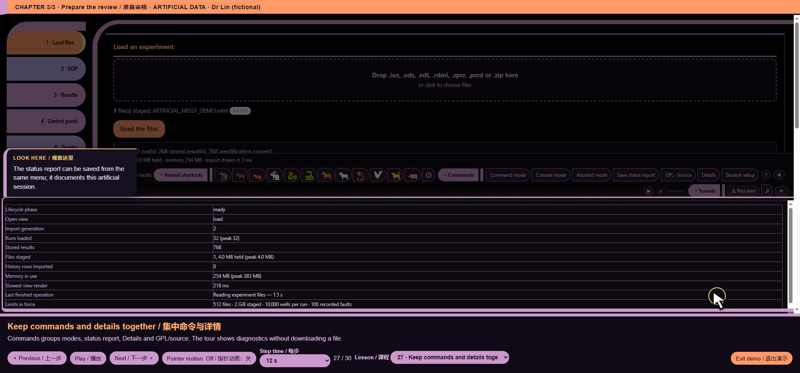

# core/ui/footer_command_menu.js — function reference

## C10632 · <callback@3809:1>

- Ownership: MISSY first-party
- Module: core/ui/footer_command_menu.js, line 2; script 11, script line 3809
- Form: ArrowFunctionExpression; parameters: ``
- AST classification: `new_or_changed_anonymous`
- R1 entry status: `observed_in_passing_scenario`
- Passing scenario observations: voice-demo, formats, training, voice-routing, voice-state, ack-queue, clarification, voice-bargein, command-finish, chart-focus, guided-tour, precision, quantstudio, evidence-keyboard
- R2 clean contract evidence: No separately linked clean contract assertion for this function
- Code SHA-256: `54846e5c122befa2e4a3576fad7e45dc11e17eadd4372a71dc17706c6b700f7c`
- [Complete exact function source](https://github.com/mihaiionitabio-alt/zpcrweb/blob/missy-public-offline-2026-10-20/documentation/releases/2026-10-31-full-wiki/code/functions/C10632.js)

```javascript
()=>{document.addEventListener('DOMContentLoaded',()=>{
 const bar=document.querySelector('#statusbar .sb-right');if(!bar||document.getElementById('missy-command-menu'))return;
 const ids=['sb-command','sb-console','sb-assist','sb-save','sb-license','sb-toggle'];
 const buttons=ids.map(id=>document.getElementById(id)).filter(Boolean);if(!buttons.length)return;
 const group=document.createElement('span');group.id='missy-command-menu';
 const toggle=document.createElement('button');toggle.id='missy-command-menu-toggle';toggle.type='button';toggle.setAttribute('aria-expanded','false');toggle.setAttribute('aria-controls','missy-command-menu-items');toggle.setAttribute('data-i18n-skip','');
 const items=document.createElement('span');items.id='missy-command-menu-items';items.hidden=true;items.setAttribute('role','group');
 const label=()=>{const name=document.body.classList.contains('lang-zh')?'命令':'Commands';toggle.textContent=(items.hidden?'▸ ':'◂ ')+name;items.setAttribute('aria-label',name);};
 const open=value=>{items.hidden=!value;toggle.setAttribute('aria-expanded',String(value));label();};
 toggle.onclick=()=>open(items.hidden);
 bar.insertBefore(group,buttons[0]);group.append(toggle,items);buttons.forEach(b=>items.append(b));
 group.addEventListener('keydown',e=>{if(e.key==='Escape'&&!items.hidden){e.preventDefault();e.stopPropagation();open(false);toggle.focus();}});
 new MutationObserver(label).observe(document.body,{attributes:true,attributeFilter:['class']});label();
 },{once:true});}
```

## C10633 · <callback@3809:51>

- Ownership: MISSY first-party
- Module: core/ui/footer_command_menu.js, line 2; script 11, script line 3809
- Form: ArrowFunctionExpression; parameters: ``
- AST classification: `new_or_changed_anonymous`
- R1 entry status: `observed_in_passing_scenario`
- Passing scenario observations: voice-demo, formats, training, voice-routing, voice-state, ack-queue, clarification, voice-bargein, command-finish, chart-focus, guided-tour, precision, quantstudio, evidence-keyboard
- R2 clean contract evidence: No separately linked clean contract assertion for this function
- Code SHA-256: `56ab5463462bef386d1b0797c3131757c5269fa5e187d0132ea79d0d2e40838f`
- [Complete exact function source](https://github.com/mihaiionitabio-alt/zpcrweb/blob/missy-public-offline-2026-10-20/documentation/releases/2026-10-31-full-wiki/code/functions/C10633.js)

```javascript
()=>{
 const bar=document.querySelector('#statusbar .sb-right');if(!bar||document.getElementById('missy-command-menu'))return;
 const ids=['sb-command','sb-console','sb-assist','sb-save','sb-license','sb-toggle'];
 const buttons=ids.map(id=>document.getElementById(id)).filter(Boolean);if(!buttons.length)return;
 const group=document.createElement('span');group.id='missy-command-menu';
 const toggle=document.createElement('button');toggle.id='missy-command-menu-toggle';toggle.type='button';toggle.setAttribute('aria-expanded','false');toggle.setAttribute('aria-controls','missy-command-menu-items');toggle.setAttribute('data-i18n-skip','');
 const items=document.createElement('span');items.id='missy-command-menu-items';items.hidden=true;items.setAttribute('role','group');
 const label=()=>{const name=document.body.classList.contains('lang-zh')?'命令':'Commands';toggle.textContent=(items.hidden?'▸ ':'◂ ')+name;items.setAttribute('aria-label',name);};
 const open=value=>{items.hidden=!value;toggle.setAttribute('aria-expanded',String(value));label();};
 toggle.onclick=()=>open(items.hidden);
 bar.insertBefore(group,buttons[0]);group.append(toggle,items);buttons.forEach(b=>items.append(b));
 group.addEventListener('keydown',e=>{if(e.key==='Escape'&&!items.hidden){e.preventDefault();e.stopPropagation();open(false);toggle.focus();}});
 new MutationObserver(label).observe(document.body,{attributes:true,attributeFilter:['class']});label();
 }
```

## C10634 · <callback@3812:23>

- Ownership: MISSY first-party
- Module: core/ui/footer_command_menu.js, line 5; script 11, script line 3812
- Form: ArrowFunctionExpression; parameters: `id`
- AST classification: `new_or_changed_anonymous`
- R1 entry status: `observed_in_passing_scenario`
- Passing scenario observations: voice-demo, formats, training, voice-routing, voice-state, ack-queue, clarification, voice-bargein, command-finish, chart-focus, guided-tour, precision, quantstudio, evidence-keyboard
- R2 clean contract evidence: No separately linked clean contract assertion for this function
- Code SHA-256: `e9c60052e571f76d0758a2ad448318e844a3beb0b71340231545d77cdea64474`
- [Complete exact function source](https://github.com/mihaiionitabio-alt/zpcrweb/blob/missy-public-offline-2026-10-20/documentation/releases/2026-10-31-full-wiki/code/functions/C10634.js)

```javascript
id=>document.getElementById(id)
```

## C10635 · label

- Ownership: MISSY first-party
- Module: core/ui/footer_command_menu.js, line 9; script 11, script line 3816
- Form: ArrowFunctionExpression; parameters: ``
- AST classification: `ambiguous_name_match`
- R1 entry status: `observed_in_passing_scenario`
- Passing scenario observations: voice-demo, formats, training, voice-routing, voice-state, ack-queue, clarification, voice-bargein, command-finish, chart-focus, guided-tour, precision, quantstudio, evidence-keyboard
- R2 clean contract evidence: No separately linked clean contract assertion for this function
- Code SHA-256: `2dedc299d356a40bf6f6848d255483fe3949743eba13af1074c6948eecdb1155`
- [Complete exact function source](https://github.com/mihaiionitabio-alt/zpcrweb/blob/missy-public-offline-2026-10-20/documentation/releases/2026-10-31-full-wiki/code/functions/C10635.js)

```javascript
()=>{const name=document.body.classList.contains('lang-zh')?'命令':'Commands';toggle.textContent=(items.hidden?'▸ ':'◂ ')+name;items.setAttribute('aria-label',name);}
```

## C10636 · open

- Ownership: MISSY first-party
- Module: core/ui/footer_command_menu.js, line 10; script 11, script line 3817
- Form: ArrowFunctionExpression; parameters: `value`
- AST classification: `new_named`
- R1 entry status: `observed_in_passing_scenario`
- Passing scenario observations: guided-tour
- R2 clean contract evidence: No separately linked clean contract assertion for this function
- Code SHA-256: `2afd4e56dc3a84c668ea71e68e6c0378ba86f17a0c7f594c8ab5c445f3820659`
- [Complete exact function source](https://github.com/mihaiionitabio-alt/zpcrweb/blob/missy-public-offline-2026-10-20/documentation/releases/2026-10-31-full-wiki/code/functions/C10636.js)

```javascript
value=>{items.hidden=!value;toggle.setAttribute('aria-expanded',String(value));label();}
```

## C10637 · toggle.onclick

- Ownership: MISSY first-party
- Module: core/ui/footer_command_menu.js, line 11; script 11, script line 3818
- Form: ArrowFunctionExpression; parameters: ``
- AST classification: `new_named`
- R1 entry status: `observed_in_passing_scenario`
- Passing scenario observations: guided-tour
- R2 clean contract evidence: No separately linked clean contract assertion for this function
- Code SHA-256: `cf3a1be9691e979bb65b1dafa195d42f17db8b32b32dd58ed0c7e1e58fb8392f`
- [Complete exact function source](https://github.com/mihaiionitabio-alt/zpcrweb/blob/missy-public-offline-2026-10-20/documentation/releases/2026-10-31-full-wiki/code/functions/C10637.js)

```javascript
()=>open(items.hidden)
```

## C10638 · <callback@3819:79>

- Ownership: MISSY first-party
- Module: core/ui/footer_command_menu.js, line 12; script 11, script line 3819
- Form: ArrowFunctionExpression; parameters: `b`
- AST classification: `new_or_changed_anonymous`
- R1 entry status: `observed_in_passing_scenario`
- Passing scenario observations: voice-demo, formats, training, voice-routing, voice-state, ack-queue, clarification, voice-bargein, command-finish, chart-focus, guided-tour, precision, quantstudio, evidence-keyboard
- R2 clean contract evidence: No separately linked clean contract assertion for this function
- Code SHA-256: `f098cab817b87fe8c2321800a7b3fc02de6c24fef72d7e2443f5f20a96abc81a`
- [Complete exact function source](https://github.com/mihaiionitabio-alt/zpcrweb/blob/missy-public-offline-2026-10-20/documentation/releases/2026-10-31-full-wiki/code/functions/C10638.js)

```javascript
b=>items.append(b)
```

## C10639 · <callback@3820:34>

- Ownership: MISSY first-party
- Module: core/ui/footer_command_menu.js, line 13; script 11, script line 3820
- Form: ArrowFunctionExpression; parameters: `e`
- AST classification: `new_or_changed_anonymous`
- R1 entry status: `not_observed_in_passing_scenario`
- Passing scenario observations: No passing R1 instrumented scenario observation
- R2 clean contract evidence: No separately linked clean contract assertion for this function
- Code SHA-256: `755f0ad824afa28459ab1a0ca259c9588a8c9525010a686d83bda26a11818f28`
- [Complete exact function source](https://github.com/mihaiionitabio-alt/zpcrweb/blob/missy-public-offline-2026-10-20/documentation/releases/2026-10-31-full-wiki/code/functions/C10639.js)

```javascript
e=>{if(e.key==='Escape'&&!items.hidden){e.preventDefault();e.stopPropagation();open(false);toggle.focus();}}
```

## C10640 · <callback@3824:1>

- Ownership: MISSY first-party
- Module: core/ui/footer_command_menu.js, line 17; script 11, script line 3824
- Form: ArrowFunctionExpression; parameters: ``
- AST classification: `new_or_changed_anonymous`
- R1 entry status: `observed_in_passing_scenario`
- Passing scenario observations: voice-demo, formats, training, voice-routing, voice-state, ack-queue, clarification, voice-bargein, command-finish, chart-focus, guided-tour, precision, quantstudio, evidence-keyboard
- R2 clean contract evidence: No separately linked clean contract assertion for this function
- Code SHA-256: `e0008e6402d434c1d9bb1f358c2b7cf2784b2ff9158eb42573e2829604c1fa38`
- [Complete exact function source](https://github.com/mihaiionitabio-alt/zpcrweb/blob/missy-public-offline-2026-10-20/documentation/releases/2026-10-31-full-wiki/code/functions/C10640.js)

```javascript
()=>{document.addEventListener('DOMContentLoaded',()=>{
 const bar=document.querySelector('#statusbar .sb-right'),friends=document.querySelector('.cute-friends'),profile=document.getElementById('console-profile');if(!bar||!friends)return;
 if(profile){profile.id='console-profile';bar.prepend(profile);}
 const group=document.createElement('span');group.id='missy-animal-menu';const toggle=document.createElement('button');toggle.id='missy-animal-menu-toggle';toggle.type='button';toggle.setAttribute('aria-controls','missy-animal-menu-items');toggle.setAttribute('aria-expanded','false');toggle.setAttribute('data-i18n-skip','');
 friends.id='missy-animal-menu-items';friends.hidden=true;friends.setAttribute('role','group');
 const label=()=>{const zh=document.body.classList.contains('lang-zh'),name=zh?'动物快捷方式':'Animal shortcuts';toggle.textContent=(friends.hidden?'▸ ':'◂ ')+name;friends.setAttribute('aria-label',name);};
 const open=value=>{friends.hidden=!value;toggle.setAttribute('aria-expanded',String(value));label();};toggle.onclick=()=>open(friends.hidden);group.append(toggle,friends);bar.insertBefore(group,document.getElementById('missy-command-menu'));
 group.addEventListener('keydown',e=>{if(e.key==='Escape'&&!friends.hidden){e.preventDefault();e.stopPropagation();open(false);toggle.focus();}});new MutationObserver(label).observe(document.body,{attributes:true,attributeFilter:['class']});label();
 },{once:true});}
```

## C10641 · <callback@3824:51>

- Ownership: MISSY first-party
- Module: core/ui/footer_command_menu.js, line 17; script 11, script line 3824
- Form: ArrowFunctionExpression; parameters: ``
- AST classification: `new_or_changed_anonymous`
- R1 entry status: `observed_in_passing_scenario`
- Passing scenario observations: voice-demo, formats, training, voice-routing, voice-state, ack-queue, clarification, voice-bargein, command-finish, chart-focus, guided-tour, precision, quantstudio, evidence-keyboard
- R2 clean contract evidence: No separately linked clean contract assertion for this function
- Code SHA-256: `8edcc5c1b38110a160b0b37400abe0b9c0de0fe376c7129f1b8f3611f561cfbc`
- [Complete exact function source](https://github.com/mihaiionitabio-alt/zpcrweb/blob/missy-public-offline-2026-10-20/documentation/releases/2026-10-31-full-wiki/code/functions/C10641.js)

```javascript
()=>{
 const bar=document.querySelector('#statusbar .sb-right'),friends=document.querySelector('.cute-friends'),profile=document.getElementById('console-profile');if(!bar||!friends)return;
 if(profile){profile.id='console-profile';bar.prepend(profile);}
 const group=document.createElement('span');group.id='missy-animal-menu';const toggle=document.createElement('button');toggle.id='missy-animal-menu-toggle';toggle.type='button';toggle.setAttribute('aria-controls','missy-animal-menu-items');toggle.setAttribute('aria-expanded','false');toggle.setAttribute('data-i18n-skip','');
 friends.id='missy-animal-menu-items';friends.hidden=true;friends.setAttribute('role','group');
 const label=()=>{const zh=document.body.classList.contains('lang-zh'),name=zh?'动物快捷方式':'Animal shortcuts';toggle.textContent=(friends.hidden?'▸ ':'◂ ')+name;friends.setAttribute('aria-label',name);};
 const open=value=>{friends.hidden=!value;toggle.setAttribute('aria-expanded',String(value));label();};toggle.onclick=()=>open(friends.hidden);group.append(toggle,friends);bar.insertBefore(group,document.getElementById('missy-command-menu'));
 group.addEventListener('keydown',e=>{if(e.key==='Escape'&&!friends.hidden){e.preventDefault();e.stopPropagation();open(false);toggle.focus();}});new MutationObserver(label).observe(document.body,{attributes:true,attributeFilter:['class']});label();
 }
```

## C10642 · label

- Ownership: MISSY first-party
- Module: core/ui/footer_command_menu.js, line 22; script 11, script line 3829
- Form: ArrowFunctionExpression; parameters: ``
- AST classification: `ambiguous_name_match`
- R1 entry status: `observed_in_passing_scenario`
- Passing scenario observations: voice-demo, formats, training, voice-routing, voice-state, ack-queue, clarification, voice-bargein, command-finish, chart-focus, guided-tour, precision, quantstudio, evidence-keyboard
- R2 clean contract evidence: No separately linked clean contract assertion for this function
- Code SHA-256: `87dce20ad703ad64fcfedda094c20400eefbb31a816afb503cca83ef1a32dd1a`
- [Complete exact function source](https://github.com/mihaiionitabio-alt/zpcrweb/blob/missy-public-offline-2026-10-20/documentation/releases/2026-10-31-full-wiki/code/functions/C10642.js)

```javascript
()=>{const zh=document.body.classList.contains('lang-zh'),name=zh?'动物快捷方式':'Animal shortcuts';toggle.textContent=(friends.hidden?'▸ ':'◂ ')+name;friends.setAttribute('aria-label',name);}
```

## C10643 · open

- Ownership: MISSY first-party
- Module: core/ui/footer_command_menu.js, line 23; script 11, script line 3830
- Form: ArrowFunctionExpression; parameters: `value`
- AST classification: `new_named`
- R1 entry status: `observed_in_passing_scenario`
- Passing scenario observations: voice-demo, guided-tour
- R2 clean contract evidence: No separately linked clean contract assertion for this function
- Code SHA-256: `3ad1d03a0674c201ef9e1266599af0c74d079ba1fde693d62b4ce4832023141f`
- [Complete exact function source](https://github.com/mihaiionitabio-alt/zpcrweb/blob/missy-public-offline-2026-10-20/documentation/releases/2026-10-31-full-wiki/code/functions/C10643.js)

```javascript
value=>{friends.hidden=!value;toggle.setAttribute('aria-expanded',String(value));label();}
```

## C10644 · toggle.onclick

- Ownership: MISSY first-party
- Module: core/ui/footer_command_menu.js, line 23; script 11, script line 3830
- Form: ArrowFunctionExpression; parameters: ``
- AST classification: `new_named`
- R1 entry status: `observed_in_passing_scenario`
- Passing scenario observations: voice-demo, guided-tour
- R2 clean contract evidence: No separately linked clean contract assertion for this function
- Code SHA-256: `345096c7a4cbe0f32bad0917555c01013105c3797e17407f6cd3ea2421fd3105`
- [Complete exact function source](https://github.com/mihaiionitabio-alt/zpcrweb/blob/missy-public-offline-2026-10-20/documentation/releases/2026-10-31-full-wiki/code/functions/C10644.js)

```javascript
()=>open(friends.hidden)
```

## C10645 · <callback@3831:34>

- Ownership: MISSY first-party
- Module: core/ui/footer_command_menu.js, line 24; script 11, script line 3831
- Form: ArrowFunctionExpression; parameters: `e`
- AST classification: `new_or_changed_anonymous`
- R1 entry status: `not_observed_in_passing_scenario`
- Passing scenario observations: No passing R1 instrumented scenario observation
- R2 clean contract evidence: No separately linked clean contract assertion for this function
- Code SHA-256: `08994b02c6fe3f5858e19e1846b9c24d0de9691753d6ea00525245470aec269a`
- [Complete exact function source](https://github.com/mihaiionitabio-alt/zpcrweb/blob/missy-public-offline-2026-10-20/documentation/releases/2026-10-31-full-wiki/code/functions/C10645.js)

```javascript
e=>{if(e.key==='Escape'&&!friends.hidden){e.preventDefault();e.stopPropagation();open(false);toggle.focus();}}
```

## C10646 · <callback@3834:1>

- Ownership: MISSY first-party
- Module: core/ui/footer_command_menu.js, line 27; script 11, script line 3834
- Form: ArrowFunctionExpression; parameters: ``
- AST classification: `new_or_changed_anonymous`
- R1 entry status: `observed_in_passing_scenario`
- Passing scenario observations: voice-demo, formats, training, voice-routing, voice-state, ack-queue, clarification, voice-bargein, command-finish, chart-focus, guided-tour, precision, quantstudio, evidence-keyboard
- R2 clean contract evidence: No separately linked clean contract assertion for this function
- Code SHA-256: `ad5d347c4440673d98478b7267d69d51053b29a393dbb53dd8698e8eaf2a47fe`
- [Complete exact function source](https://github.com/mihaiionitabio-alt/zpcrweb/blob/missy-public-offline-2026-10-20/documentation/releases/2026-10-31-full-wiki/code/functions/C10646.js)

```javascript
()=>{document.addEventListener('DOMContentLoaded',()=>{
 const home=document.querySelector('#statusbar .sb-right'),dock=document.getElementById('missy-sound-dock'),sound=window.MISSY_COMPUTER_SOUND;if(!home||!dock||document.getElementById('missy-sound-menu'))return;
 const group=document.createElement('span');group.id='missy-sound-menu';group.setAttribute('data-i18n-skip','');const toggle=document.createElement('button');toggle.id='missy-sound-menu-toggle';toggle.type='button';toggle.setAttribute('aria-controls','missy-sound-dock');toggle.setAttribute('aria-expanded','false');dock.hidden=true;dock.setAttribute('role','group');
 const stop=document.createElement('button');stop.id='missy-footer-alert-stop';stop.type='button';stop.onclick=()=>sound.stopAlert();
 const master=document.getElementById('missy-startup-sound');if(master)dock.append(master);group.append(toggle,dock,stop);home.append(group);
 const label=()=>{const zh=document.body.classList.contains('lang-zh'),name=zh?'声音':'Sounds';toggle.textContent=(dock.hidden?'▸ ':'◂ ')+name;dock.setAttribute('aria-label',name);stop.textContent=zh?'■ 停止警报':'■ Stop alert';stop.hidden=!sound.alerting;};
 const open=value=>{dock.hidden=!value;toggle.setAttribute('aria-expanded',String(value));label();};toggle.onclick=()=>open(dock.hidden);group.addEventListener('keydown',e=>{if(e.key==='Escape'&&!dock.hidden){e.preventDefault();e.stopPropagation();open(false);toggle.focus();}});
 const modes=['mg','cmdm','astm'].map(id=>document.getElementById(id)).filter(Boolean),footers=new Map();for(const mode of modes){if(mode.id==='mg'){footers.set(mode,document.getElementById('mg-statusbar'));continue;}const footer=document.createElement('div');footer.className='missy-mode-sound-footer';mode.append(footer);footers.set(mode,footer);}
 const locate=()=>{const active=[...modes].reverse().find(e=>e.classList.contains('on')),host=active?footers.get(active):home;if(host&&group.parentElement!==host)host.append(group);};
 for(const mode of modes)new MutationObserver(locate).observe(mode,{attributes:true,attributeFilter:['class']});new MutationObserver(label).observe(document.body,{attributes:true,attributeFilter:['class']});document.addEventListener('missy-sound-state',label);label();locate();
 },{once:true});}
```

## C10647 · <callback@3834:51>

- Ownership: MISSY first-party
- Module: core/ui/footer_command_menu.js, line 27; script 11, script line 3834
- Form: ArrowFunctionExpression; parameters: ``
- AST classification: `new_or_changed_anonymous`
- R1 entry status: `observed_in_passing_scenario`
- Passing scenario observations: voice-demo, formats, training, voice-routing, voice-state, ack-queue, clarification, voice-bargein, command-finish, chart-focus, guided-tour, precision, quantstudio, evidence-keyboard
- R2 clean contract evidence: No separately linked clean contract assertion for this function
- Code SHA-256: `243f7527b32ab8a17085b0063fe43d022bf27a83a524741fad6141342f6c1bbf`
- [Complete exact function source](https://github.com/mihaiionitabio-alt/zpcrweb/blob/missy-public-offline-2026-10-20/documentation/releases/2026-10-31-full-wiki/code/functions/C10647.js)

```javascript
()=>{
 const home=document.querySelector('#statusbar .sb-right'),dock=document.getElementById('missy-sound-dock'),sound=window.MISSY_COMPUTER_SOUND;if(!home||!dock||document.getElementById('missy-sound-menu'))return;
 const group=document.createElement('span');group.id='missy-sound-menu';group.setAttribute('data-i18n-skip','');const toggle=document.createElement('button');toggle.id='missy-sound-menu-toggle';toggle.type='button';toggle.setAttribute('aria-controls','missy-sound-dock');toggle.setAttribute('aria-expanded','false');dock.hidden=true;dock.setAttribute('role','group');
 const stop=document.createElement('button');stop.id='missy-footer-alert-stop';stop.type='button';stop.onclick=()=>sound.stopAlert();
 const master=document.getElementById('missy-startup-sound');if(master)dock.append(master);group.append(toggle,dock,stop);home.append(group);
 const label=()=>{const zh=document.body.classList.contains('lang-zh'),name=zh?'声音':'Sounds';toggle.textContent=(dock.hidden?'▸ ':'◂ ')+name;dock.setAttribute('aria-label',name);stop.textContent=zh?'■ 停止警报':'■ Stop alert';stop.hidden=!sound.alerting;};
 const open=value=>{dock.hidden=!value;toggle.setAttribute('aria-expanded',String(value));label();};toggle.onclick=()=>open(dock.hidden);group.addEventListener('keydown',e=>{if(e.key==='Escape'&&!dock.hidden){e.preventDefault();e.stopPropagation();open(false);toggle.focus();}});
 const modes=['mg','cmdm','astm'].map(id=>document.getElementById(id)).filter(Boolean),footers=new Map();for(const mode of modes){if(mode.id==='mg'){footers.set(mode,document.getElementById('mg-statusbar'));continue;}const footer=document.createElement('div');footer.className='missy-mode-sound-footer';mode.append(footer);footers.set(mode,footer);}
 const locate=()=>{const active=[...modes].reverse().find(e=>e.classList.contains('on')),host=active?footers.get(active):home;if(host&&group.parentElement!==host)host.append(group);};
 for(const mode of modes)new MutationObserver(locate).observe(mode,{attributes:true,attributeFilter:['class']});new MutationObserver(label).observe(document.body,{attributes:true,attributeFilter:['class']});document.addEventListener('missy-sound-state',label);label();locate();
 }
```

## C10648 · stop.onclick

- Ownership: MISSY first-party
- Module: core/ui/footer_command_menu.js, line 30; script 11, script line 3837
- Form: ArrowFunctionExpression; parameters: ``
- AST classification: `new_named`
- R1 entry status: `observed_in_passing_scenario`
- Passing scenario observations: guided-tour
- R2 clean contract evidence: No separately linked clean contract assertion for this function
- Code SHA-256: `f9542a679e86181de921acf3606757cee826cdc6a62df897d1d1b10429a1c9bc`
- [Complete exact function source](https://github.com/mihaiionitabio-alt/zpcrweb/blob/missy-public-offline-2026-10-20/documentation/releases/2026-10-31-full-wiki/code/functions/C10648.js)

```javascript
()=>sound.stopAlert()
```

## C10649 · label

- Ownership: MISSY first-party
- Module: core/ui/footer_command_menu.js, line 32; script 11, script line 3839
- Form: ArrowFunctionExpression; parameters: ``
- AST classification: `ambiguous_name_match`
- R1 entry status: `observed_in_passing_scenario`
- Passing scenario observations: voice-demo, formats, training, voice-routing, voice-state, ack-queue, clarification, voice-bargein, command-finish, chart-focus, guided-tour, precision, quantstudio, evidence-keyboard
- R2 clean contract evidence: No separately linked clean contract assertion for this function
- Code SHA-256: `12ffaa90d40b561524dbefdf25bc8765c9759d0e1416304e6925601a5b57fa17`
- [Complete exact function source](https://github.com/mihaiionitabio-alt/zpcrweb/blob/missy-public-offline-2026-10-20/documentation/releases/2026-10-31-full-wiki/code/functions/C10649.js)

```javascript
()=>{const zh=document.body.classList.contains('lang-zh'),name=zh?'声音':'Sounds';toggle.textContent=(dock.hidden?'▸ ':'◂ ')+name;dock.setAttribute('aria-label',name);stop.textContent=zh?'■ 停止警报':'■ Stop alert';stop.hidden=!sound.alerting;}
```

## C10650 · open

- Ownership: MISSY first-party
- Module: core/ui/footer_command_menu.js, line 33; script 11, script line 3840
- Form: ArrowFunctionExpression; parameters: `value`
- AST classification: `new_named`
- R1 entry status: `observed_in_passing_scenario`
- Passing scenario observations: guided-tour
- R2 clean contract evidence: No separately linked clean contract assertion for this function
- Code SHA-256: `460f9f56e5c5f0f8c2e240d2aa54543480cc1bac67b3ff5eeb9d39aff5ed2eb7`
- [Complete exact function source](https://github.com/mihaiionitabio-alt/zpcrweb/blob/missy-public-offline-2026-10-20/documentation/releases/2026-10-31-full-wiki/code/functions/C10650.js)

```javascript
value=>{dock.hidden=!value;toggle.setAttribute('aria-expanded',String(value));label();}
```

## C10651 · toggle.onclick

- Ownership: MISSY first-party
- Module: core/ui/footer_command_menu.js, line 33; script 11, script line 3840
- Form: ArrowFunctionExpression; parameters: ``
- AST classification: `new_named`
- R1 entry status: `observed_in_passing_scenario`
- Passing scenario observations: guided-tour
- R2 clean contract evidence: No separately linked clean contract assertion for this function
- Code SHA-256: `4195c21362b539ae5a618c35e2fc320f8729018d1fba1d219c7dc51161d61341`
- [Complete exact function source](https://github.com/mihaiionitabio-alt/zpcrweb/blob/missy-public-offline-2026-10-20/documentation/releases/2026-10-31-full-wiki/code/functions/C10651.js)

```javascript
()=>open(dock.hidden)
```

## C10652 · <callback@3840:170>

- Ownership: MISSY first-party
- Module: core/ui/footer_command_menu.js, line 33; script 11, script line 3840
- Form: ArrowFunctionExpression; parameters: `e`
- AST classification: `new_or_changed_anonymous`
- R1 entry status: `not_observed_in_passing_scenario`
- Passing scenario observations: No passing R1 instrumented scenario observation
- R2 clean contract evidence: No separately linked clean contract assertion for this function
- Code SHA-256: `7a146c4d4e42be0a0e6cd6e1deb9efb11b208acd43c5a51f460c4af11a71ec5a`
- [Complete exact function source](https://github.com/mihaiionitabio-alt/zpcrweb/blob/missy-public-offline-2026-10-20/documentation/releases/2026-10-31-full-wiki/code/functions/C10652.js)

```javascript
e=>{if(e.key==='Escape'&&!dock.hidden){e.preventDefault();e.stopPropagation();open(false);toggle.focus();}}
```

## C10653 · <callback@3841:38>

- Ownership: MISSY first-party
- Module: core/ui/footer_command_menu.js, line 34; script 11, script line 3841
- Form: ArrowFunctionExpression; parameters: `id`
- AST classification: `new_or_changed_anonymous`
- R1 entry status: `observed_in_passing_scenario`
- Passing scenario observations: voice-demo, formats, training, voice-routing, voice-state, ack-queue, clarification, voice-bargein, command-finish, chart-focus, guided-tour, precision, quantstudio, evidence-keyboard
- R2 clean contract evidence: No separately linked clean contract assertion for this function
- Code SHA-256: `e9c60052e571f76d0758a2ad448318e844a3beb0b71340231545d77cdea64474`
- [Complete exact function source](https://github.com/mihaiionitabio-alt/zpcrweb/blob/missy-public-offline-2026-10-20/documentation/releases/2026-10-31-full-wiki/code/functions/C10653.js)

```javascript
id=>document.getElementById(id)
```

## C10654 · locate

- Ownership: MISSY first-party
- Module: core/ui/footer_command_menu.js, line 35; script 11, script line 3842
- Form: ArrowFunctionExpression; parameters: ``
- AST classification: `new_named`
- R1 entry status: `observed_in_passing_scenario`
- Passing scenario observations: voice-demo, formats, training, voice-routing, voice-state, ack-queue, clarification, voice-bargein, command-finish, chart-focus, guided-tour, precision, quantstudio, evidence-keyboard
- R2 clean contract evidence: No separately linked clean contract assertion for this function
- Code SHA-256: `ab22ddaa071ab38e067b41453f14eea023133863122f1d95c0eb32d3c137ae74`
- [Complete exact function source](https://github.com/mihaiionitabio-alt/zpcrweb/blob/missy-public-offline-2026-10-20/documentation/releases/2026-10-31-full-wiki/code/functions/C10654.js)

```javascript
()=>{const active=[...modes].reverse().find(e=>e.classList.contains('on')),host=active?footers.get(active):home;if(host&&group.parentElement!==host)host.append(group);}
```

## C10655 · <callback@3842:58>

- Ownership: MISSY first-party
- Module: core/ui/footer_command_menu.js, line 35; script 11, script line 3842
- Form: ArrowFunctionExpression; parameters: `e`
- AST classification: `new_or_changed_anonymous`
- R1 entry status: `observed_in_passing_scenario`
- Passing scenario observations: voice-demo, formats, training, voice-routing, voice-state, ack-queue, clarification, voice-bargein, command-finish, chart-focus, guided-tour, precision, quantstudio, evidence-keyboard
- R2 clean contract evidence: No separately linked clean contract assertion for this function
- Code SHA-256: `6d5748a03eb1908e3242a407a3d81da3f99ee7cfeccde34a78aee4dca24f2f5f`
- [Complete exact function source](https://github.com/mihaiionitabio-alt/zpcrweb/blob/missy-public-offline-2026-10-20/documentation/releases/2026-10-31-full-wiki/code/functions/C10655.js)

```javascript
e=>e.classList.contains('on')
```

[Wiki home](/p/zpcrweb/wiki/Home/)

## Illustrated interface context

Expanding command menu. This is UI context, not proof of function-level correctness.



*Representative webpage view for core/ui/footer_command_menu.js*

[Complete illustrated workflow and source mapping](https://github.com/mihaiionitabio-alt/zpcrweb/blob/missy-public-offline-2026-10-20/documentation/releases/2026-11-01-illustrated-wiki/pages/FunctionScreenshots.md)
