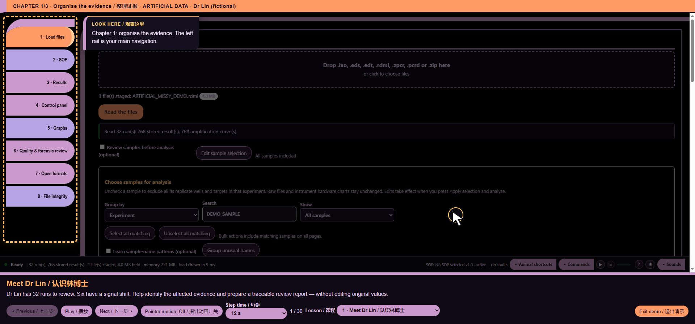

# core/ui/guided_demo.js — function reference

## C10774 · stop

- Ownership: MISSY first-party
- Module: core/ui/guided_demo.js, line 154; script 11, script line 3998
- Form: FunctionExpression; parameters: ``
- AST classification: `new_named`
- R1 entry status: `observed_in_passing_scenario`
- Passing scenario observations: voice-demo, guided-tour
- R2 clean contract evidence: No separately linked clean contract assertion for this function
- Code SHA-256: `b6c035cb84db6b8c518a5f92384d42253cc57456195689f0f8df7502b6e29bd7`
- [Complete exact function source](https://github.com/mihaiionitabio-alt/zpcrweb/blob/missy-public-offline-2026-10-20/documentation/releases/2026-10-31-full-wiki/code/functions/C10774.js)

```javascript
(){clearCue();MISSY_COMPUTER_SOUND.stopAlert();if(reportURL)URL.revokeObjectURL(reportURL)}
```

## C10775 · <callback@4001:76>

- Ownership: MISSY first-party
- Module: core/ui/guided_demo.js, line 157; script 11, script line 4001
- Form: ArrowFunctionExpression; parameters: ``
- AST classification: `new_or_changed_anonymous`
- R1 entry status: `observed_in_passing_scenario`
- Passing scenario observations: voice-demo, training, chart-focus, guided-tour
- R2 clean contract evidence: No separately linked clean contract assertion for this function
- Code SHA-256: `853b94752dba1e3011ba97d299f79eee47a5665923ad5caad5cf1f29421a5eb4`
- [Complete exact function source](https://github.com/mihaiionitabio-alt/zpcrweb/blob/missy-public-offline-2026-10-20/documentation/releases/2026-10-31-full-wiki/code/functions/C10775.js)

```javascript
()=>{installChild();if(!window.__MISSY_VOICE_DEMO_FRAME)requestAnimationFrame(()=>document.getElementById('missy-startup-enter')?.click());}
```

## C10776 · <callback@4001:154>

- Ownership: MISSY first-party
- Module: core/ui/guided_demo.js, line 157; script 11, script line 4001
- Form: ArrowFunctionExpression; parameters: ``
- AST classification: `new_or_changed_anonymous`
- R1 entry status: `observed_in_passing_scenario`
- Passing scenario observations: training, guided-tour
- R2 clean contract evidence: No separately linked clean contract assertion for this function
- Code SHA-256: `039360b15696ba4ffe86995c01dc7891bf06d806e9672c610d28d411bd1f2d4f`
- [Complete exact function source](https://github.com/mihaiionitabio-alt/zpcrweb/blob/missy-public-offline-2026-10-20/documentation/releases/2026-10-31-full-wiki/code/functions/C10776.js)

```javascript
()=>document.getElementById('missy-startup-enter')?.click()
```

## C10777 · <callback@4002:46>

- Ownership: MISSY first-party
- Module: core/ui/guided_demo.js, line 158; script 11, script line 4002
- Form: ArrowFunctionExpression; parameters: ``
- AST classification: `new_or_changed_anonymous`
- R1 entry status: `observed_in_passing_scenario`
- Passing scenario observations: voice-demo, formats, training, voice-routing, voice-state, ack-queue, clarification, voice-bargein, command-finish, chart-focus, guided-tour, precision, quantstudio, evidence-keyboard
- R2 clean contract evidence: No separately linked clean contract assertion for this function
- Code SHA-256: `7f565c2d1bdbfe44bb637d39a8d6043810bf7ba83f6b5aaa42b561afc39cbd71`
- [Complete exact function source](https://github.com/mihaiionitabio-alt/zpcrweb/blob/missy-public-offline-2026-10-20/documentation/releases/2026-10-31-full-wiki/code/functions/C10777.js)

```javascript
()=>{
 const button=document.createElement('button');button.id='missy-startup-demo';button.type='button';button.disabled=true;button.setAttribute('data-i18n-skip','');button.textContent=tr('▶ Guided demo · artificial data','▶ 导览演示 · 模拟数据');document.querySelector('#missy-startup .startup-footer').prepend(button);const entry=document.getElementById('missy-startup-enter');new MutationObserver(()=>button.disabled=entry.disabled).observe(entry,{attributes:true,attributeFilter:['disabled']});button.disabled=entry.disabled;const demoNote=document.getElementById('missy-startup-demo-note');const demoLabels=()=>{button.textContent=tr('▶ Guided demo · artificial data','▶ 导览演示 · 模拟数据');demoNote.textContent=tr('Explore MISSY with artificial data','使用模拟数据体验 MISSY');};demoLabels();new MutationObserver(demoLabels).observe(document.body,{attributes:true,attributeFilter:['class']});
 button.onclick=()=>{
 const overlay=document.createElement('div');overlay.id='missy-demo-overlay';const header=document.createElement('div');header.className='demo-session-label';header.textContent=tr('MISSY DEMO · ARTIFICIAL DATA · isolated temporary session','MISSY 演示 · 人工模拟数据 · 独立临时会话');const frame=document.createElement('iframe');frame.title=tr('MISSY artificial-data demonstration','MISSY人工模拟数据演示');frame.setAttribute('sandbox','allow-scripts allow-same-origin allow-downloads');const footer=document.createElement('div');footer.className='demo-tour-footer';footer.innerHTML='<div id="demo-tour-title" role="status" aria-live="polite"></div><p id="demo-tour-text"></p><div class="demo-tour-buttons"><button id="demo-prev">◂ Previous / 上一步</button><button id="demo-pause">Pause / 暂停</button><button id="demo-next">Next / 下一步 ▸</button><button id="demo-pointer-motion" type="button" aria-pressed="false">Pointer motion / 指针动画</button><label>Step time / 每步 <select id="demo-delay"><option value="12000">12 s</option><option value="20000">20 s</option><option value="30000">30 s</option></select></label><span id="demo-tour-progress"></span><label>Lesson / 课程 <select id="demo-lesson"></select></label><a id="demo-report-preview" target="_blank" rel="noopener" hidden>Preview demo PDF / 预览演示 PDF</a><button id="demo-exit">Exit demo / 退出演示</button></div>';const slide=document.createElement('div');slide.className='demo-title-slide';slide.hidden=true;slide.innerHTML='<div class="demo-title-console"><div class="demo-console-orb" aria-hidden="true"></div><div class="demo-console-screen"><div class="demo-console-bands" aria-hidden="true">'+Array.from({length:12},(_,i)=>'<i data-demo-band="'+i+'"></i>').join('')+'</div><div class="demo-access-label">MISSY / ACCESSING / 正在访问</div><h2></h2><p>ARTIFICIAL DEMONSTRATION / 模拟演示</p></div><div class="demo-console-keyboard" aria-hidden="true"></div></div>';const previewDialog=document.createElement('dialog');previewDialog.id='demo-pdf-dialog';previewDialog.innerHTML='<div><strong>ARTIFICIAL DEMO / PDF review / 模拟数据审核</strong><button type="button">Close / 关闭</button></div><iframe title="Artificial demonstration PDF preview"></iframe>';overlay.append(header,frame,slide,footer,previewDialog);document.body.append(overlay);previewDialog.querySelector('button').onclick=()=>{previewDialog.close();previewDialog.querySelector('iframe').src='about:blank';};footer.querySelector('#demo-report-preview').onclick=e=>{e.preventDefault();if(api?.reportURL){previewDialog.querySelector('iframe').src=api.reportURL;previewDialog.showModal();}};
 let at=0,timer=null,lightTimer=null,paused=false,busy=false,api;let pointerMotion=!matchMedia('(prefers-reduced-motion:reduce)').matches;const motionButton=footer.querySelector('#demo-pointer-motion');const updateMotion=()=>{motionButton.setAttribute('aria-pressed',String(pointerMotion));motionButton.textContent=pointerMotion?'Pointer motion: On / 指针动画：开':'Pointer motion: Off / 指针动画：关';api?.setPointerMotion(pointerMotion);};motionButton.onclick=()=>{pointerMotion=!pointerMotion;updateMotion();};updateMotion();const title=footer.querySelector('#demo-tour-title'),text=footer.querySelector('#demo-tour-text');title.textContent=tr('Preparing artificial demonstration…','正在准备模拟演示…');text.textContent=tr('All data is generated inside this HTML. No files are read from your computer.','全部数据由本 HTML 生成，不读取计算机中的文件。');
 const schedule=()=>{clearTimeout(timer);if(overlay.isConnected&&!paused&&at<api.steps.length-1)timer=setTimeout(()=>go(at+1),Number(footer.querySelector('#demo-delay').value));};
 async function go(i){if(busy||!api||!overlay.isConnected)return;busy=true;clearTimeout(timer);at=Math.max(0,Math.min(api.steps.length-1,i));footer.querySelector('#demo-lesson').disabled=true;try{header.textContent='CHAPTER '+(Math.floor(at/10)+1)+'/3 · '+['Organise the evidence / 整理证据','Investigate the drift / 调查漂移','Prepare the review / 准备审核'][Math.floor(at/10)]+' · ARTIFICIAL DATA · Dr Lin (fictional)';slide.querySelector('h2').textContent=api.steps[at].title;slide.hidden=false;let tick=0;const bands=[...slide.querySelectorAll('[data-demo-band]')],motion=!matchMedia('(prefers-reduced-motion:reduce)').matches;const animate=()=>bands.forEach((b,i)=>b.style.visibility=(i+tick)%3===0?'hidden':'visible');animate();const lights=motion?setInterval(()=>{tick++;animate()},500):null;lightTimer=lights;let step;try{[step]=await Promise.all([api.go(at),new Promise(r=>setTimeout(r,5000))]);}finally{if(lights)clearInterval(lights);slide.hidden=true;}if(!overlay.isConnected)return;title.textContent=step.title;text.textContent=step.text;footer.querySelector('#demo-tour-progress').textContent=(at+1)+' / '+api.steps.length;footer.querySelector('#demo-prev').disabled=at===0;footer.querySelector('#demo-next').disabled=at===api.steps.length-1;footer.querySelector('#demo-lesson').value=String(at);await api.reveal?.();const preview=footer.querySelector('#demo-report-preview');preview.hidden=!api.reportURL;if(api.reportURL)preview.href=api.reportURL;}catch(e){paused=true;title.textContent='Demo paused / 演示已暂停';text.textContent=e.message;}finally{busy=false;footer.querySelector('#demo-lesson').disabled=false;schedule();}}
 footer.querySelector('#demo-prev').onclick=()=>go(at-1);footer.querySelector('#demo-next').onclick=()=>go(at+1);footer.querySelector('#demo-pause').onclick=()=>{paused=!paused;footer.querySelector('#demo-pause').textContent=paused?'Play / 播放':'Pause / 暂停';if(paused)clearTimeout(timer);else schedule();};footer.querySelector('#demo-delay').onchange=()=>{if(api)schedule();};const exit=()=>{paused=true;clearTimeout(timer);if(lightTimer)clearInterval(lightTimer);api?.stop();overlay.remove();if(window.MISSY_DEMO_TOUR?.frame===frame)delete window.MISSY_DEMO_TOUR;button.focus();};footer.querySelector('#demo-exit').onclick=exit;overlay.addEventListener('keydown',e=>{if(e.key==='Escape'&&e.target===footer.querySelector('#demo-exit'))exit();});
 frame.onload=()=>{api=frame.contentWindow.MISSY_DEMO_CHILD;if(api){updateMotion();const select=footer.querySelector('#demo-lesson');for(let ch=0;ch<3;ch++){const group=document.createElement('optgroup');group.label=['1 · Organise / 整理','2 · Investigate / 调查','3 · Review / 审核'][ch];api.steps.forEach((step,i)=>{if(Math.floor(i/10)===ch)group.append(new Option((i+1)+' · '+step.title,String(i)));});select.append(group);}select.onchange=()=>go(Number(select.value));go(0);}else{text.textContent=tr('Demo could not initialize. Exit and retry.','演示无法初始化，请退出后重试。');}};
 const seed='<script>window.__MISSY_DEMO_FRAME=true;window.__MISSY_DEMO_LANG='+JSON.stringify(UI_LANG)+';(()=>{const values=new Map();const memory={getItem:k=>values.has(String(k))?values.get(String(k)):null,setItem:(k,v)=>values.set(String(k),String(v)),removeItem:k=>values.delete(String(k)),clear:()=>values.clear(),key:i=>[...values.keys()][i]||null,get length(){return values.size}};Object.defineProperty(window,"localStorage",{value:memory});Object.defineProperty(window,"sessionStorage",{value:memory});})();<\/script>';
 frame.srcdoc=MISSY_PUBLIC_SOURCE.replace(/const DEFAULT_LANG="(?:en|zh)";/,'const DEFAULT_LANG="'+(document.body.classList.contains('lang-zh')?'zh':'en')+'";').replace('<meta charset="utf-8">','<meta charset="utf-8">'+seed);window.MISSY_DEMO_TOUR={go,get busy(){return busy},get index(){return at},get count(){return api?.steps.length||0},get frame(){return frame},pause(){if(!paused)footer.querySelector('#demo-pause').click()},exit};
 };
 }
```

## C10778 · <callback@4003:387>

- Ownership: MISSY first-party
- Module: core/ui/guided_demo.js, line 159; script 11, script line 4003
- Form: ArrowFunctionExpression; parameters: ``
- AST classification: `new_or_changed_anonymous`
- R1 entry status: `observed_in_passing_scenario`
- Passing scenario observations: voice-demo, formats, training, voice-routing, voice-state, ack-queue, clarification, voice-bargein, command-finish, chart-focus, guided-tour, precision, quantstudio, evidence-keyboard
- R2 clean contract evidence: No separately linked clean contract assertion for this function
- Code SHA-256: `80d2704338f80aad06847e5fb19224c51930e7bcc33b04b8e8d9b06735473698`
- [Complete exact function source](https://github.com/mihaiionitabio-alt/zpcrweb/blob/missy-public-offline-2026-10-20/documentation/releases/2026-10-31-full-wiki/code/functions/C10778.js)

```javascript
()=>button.disabled=entry.disabled
```

## C10779 · demoLabels

- Ownership: MISSY first-party
- Module: core/ui/guided_demo.js, line 159; script 11, script line 4003
- Form: ArrowFunctionExpression; parameters: ``
- AST classification: `new_named`
- R1 entry status: `observed_in_passing_scenario`
- Passing scenario observations: voice-demo, formats, training, voice-routing, voice-state, ack-queue, clarification, voice-bargein, command-finish, chart-focus, guided-tour, precision, quantstudio, evidence-keyboard
- R2 clean contract evidence: No separately linked clean contract assertion for this function
- Code SHA-256: `2a482e5756a0132eba1446f35487a9086377ffbced33fd1b964ae245de23c396`
- [Complete exact function source](https://github.com/mihaiionitabio-alt/zpcrweb/blob/missy-public-offline-2026-10-20/documentation/releases/2026-10-31-full-wiki/code/functions/C10779.js)

```javascript
()=>{button.textContent=tr('▶ Guided demo · artificial data','▶ 导览演示 · 模拟数据');demoNote.textContent=tr('Explore MISSY with artificial data','使用模拟数据体验 MISSY');}
```

## C10780 · button.onclick

- Ownership: MISSY first-party
- Module: core/ui/guided_demo.js, line 160; script 11, script line 4004
- Form: ArrowFunctionExpression; parameters: ``
- AST classification: `new_named`
- R1 entry status: `observed_in_passing_scenario`
- Passing scenario observations: guided-tour
- R2 clean contract evidence: No separately linked clean contract assertion for this function
- Code SHA-256: `50a7447aff9a2292994a1ff0e7f643220cf428781bd55492bb08f1840914a177`
- [Complete exact function source](https://github.com/mihaiionitabio-alt/zpcrweb/blob/missy-public-offline-2026-10-20/documentation/releases/2026-10-31-full-wiki/code/functions/C10780.js)

```javascript
()=>{
 const overlay=document.createElement('div');overlay.id='missy-demo-overlay';const header=document.createElement('div');header.className='demo-session-label';header.textContent=tr('MISSY DEMO · ARTIFICIAL DATA · isolated temporary session','MISSY 演示 · 人工模拟数据 · 独立临时会话');const frame=document.createElement('iframe');frame.title=tr('MISSY artificial-data demonstration','MISSY人工模拟数据演示');frame.setAttribute('sandbox','allow-scripts allow-same-origin allow-downloads');const footer=document.createElement('div');footer.className='demo-tour-footer';footer.innerHTML='<div id="demo-tour-title" role="status" aria-live="polite"></div><p id="demo-tour-text"></p><div class="demo-tour-buttons"><button id="demo-prev">◂ Previous / 上一步</button><button id="demo-pause">Pause / 暂停</button><button id="demo-next">Next / 下一步 ▸</button><button id="demo-pointer-motion" type="button" aria-pressed="false">Pointer motion / 指针动画</button><label>Step time / 每步 <select id="demo-delay"><option value="12000">12 s</option><option value="20000">20 s</option><option value="30000">30 s</option></select></label><span id="demo-tour-progress"></span><label>Lesson / 课程 <select id="demo-lesson"></select></label><a id="demo-report-preview" target="_blank" rel="noopener" hidden>Preview demo PDF / 预览演示 PDF</a><button id="demo-exit">Exit demo / 退出演示</button></div>';const slide=document.createElement('div');slide.className='demo-title-slide';slide.hidden=true;slide.innerHTML='<div class="demo-title-console"><div class="demo-console-orb" aria-hidden="true"></div><div class="demo-console-screen"><div class="demo-console-bands" aria-hidden="true">'+Array.from({length:12},(_,i)=>'<i data-demo-band="'+i+'"></i>').join('')+'</div><div class="demo-access-label">MISSY / ACCESSING / 正在访问</div><h2></h2><p>ARTIFICIAL DEMONSTRATION / 模拟演示</p></div><div class="demo-console-keyboard" aria-hidden="true"></div></div>';const previewDialog=document.createElement('dialog');previewDialog.id='demo-pdf-dialog';previewDialog.innerHTML='<div><strong>ARTIFICIAL DEMO / PDF review / 模拟数据审核</strong><button type="button">Close / 关闭</button></div><iframe title="Artificial demonstration PDF preview"></iframe>';overlay.append(header,frame,slide,footer,previewDialog);document.body.append(overlay);previewDialog.querySelector('button').onclick=()=>{previewDialog.close();previewDialog.querySelector('iframe').src='about:blank';};footer.querySelector('#demo-report-preview').onclick=e=>{e.preventDefault();if(api?.reportURL){previewDialog.querySelector('iframe').src=api.reportURL;previewDialog.showModal();}};
 let at=0,timer=null,lightTimer=null,paused=false,busy=false,api;let pointerMotion=!matchMedia('(prefers-reduced-motion:reduce)').matches;const motionButton=footer.querySelector('#demo-pointer-motion');const updateMotion=()=>{motionButton.setAttribute('aria-pressed',String(pointerMotion));motionButton.textContent=pointerMotion?'Pointer motion: On / 指针动画：开':'Pointer motion: Off / 指针动画：关';api?.setPointerMotion(pointerMotion);};motionButton.onclick=()=>{pointerMotion=!pointerMotion;updateMotion();};updateMotion();const title=footer.querySelector('#demo-tour-title'),text=footer.querySelector('#demo-tour-text');title.textContent=tr('Preparing artificial demonstration…','正在准备模拟演示…');text.textContent=tr('All data is generated inside this HTML. No files are read from your computer.','全部数据由本 HTML 生成，不读取计算机中的文件。');
 const schedule=()=>{clearTimeout(timer);if(overlay.isConnected&&!paused&&at<api.steps.length-1)timer=setTimeout(()=>go(at+1),Number(footer.querySelector('#demo-delay').value));};
 async function go(i){if(busy||!api||!overlay.isConnected)return;busy=true;clearTimeout(timer);at=Math.max(0,Math.min(api.steps.length-1,i));footer.querySelector('#demo-lesson').disabled=true;try{header.textContent='CHAPTER '+(Math.floor(at/10)+1)+'/3 · '+['Organise the evidence / 整理证据','Investigate the drift / 调查漂移','Prepare the review / 准备审核'][Math.floor(at/10)]+' · ARTIFICIAL DATA · Dr Lin (fictional)';slide.querySelector('h2').textContent=api.steps[at].title;slide.hidden=false;let tick=0;const bands=[...slide.querySelectorAll('[data-demo-band]')],motion=!matchMedia('(prefers-reduced-motion:reduce)').matches;const animate=()=>bands.forEach((b,i)=>b.style.visibility=(i+tick)%3===0?'hidden':'visible');animate();const lights=motion?setInterval(()=>{tick++;animate()},500):null;lightTimer=lights;let step;try{[step]=await Promise.all([api.go(at),new Promise(r=>setTimeout(r,5000))]);}finally{if(lights)clearInterval(lights);slide.hidden=true;}if(!overlay.isConnected)return;title.textContent=step.title;text.textContent=step.text;footer.querySelector('#demo-tour-progress').textContent=(at+1)+' / '+api.steps.length;footer.querySelector('#demo-prev').disabled=at===0;footer.querySelector('#demo-next').disabled=at===api.steps.length-1;footer.querySelector('#demo-lesson').value=String(at);await api.reveal?.();const preview=footer.querySelector('#demo-report-preview');preview.hidden=!api.reportURL;if(api.reportURL)preview.href=api.reportURL;}catch(e){paused=true;title.textContent='Demo paused / 演示已暂停';text.textContent=e.message;}finally{busy=false;footer.querySelector('#demo-lesson').disabled=false;schedule();}}
 footer.querySelector('#demo-prev').onclick=()=>go(at-1);footer.querySelector('#demo-next').onclick=()=>go(at+1);footer.querySelector('#demo-pause').onclick=()=>{paused=!paused;footer.querySelector('#demo-pause').textContent=paused?'Play / 播放':'Pause / 暂停';if(paused)clearTimeout(timer);else schedule();};footer.querySelector('#demo-delay').onchange=()=>{if(api)schedule();};const exit=()=>{paused=true;clearTimeout(timer);if(lightTimer)clearInterval(lightTimer);api?.stop();overlay.remove();if(window.MISSY_DEMO_TOUR?.frame===frame)delete window.MISSY_DEMO_TOUR;button.focus();};footer.querySelector('#demo-exit').onclick=exit;overlay.addEventListener('keydown',e=>{if(e.key==='Escape'&&e.target===footer.querySelector('#demo-exit'))exit();});
 frame.onload=()=>{api=frame.contentWindow.MISSY_DEMO_CHILD;if(api){updateMotion();const select=footer.querySelector('#demo-lesson');for(let ch=0;ch<3;ch++){const group=document.createElement('optgroup');group.label=['1 · Organise / 整理','2 · Investigate / 调查','3 · Review / 审核'][ch];api.steps.forEach((step,i)=>{if(Math.floor(i/10)===ch)group.append(new Option((i+1)+' · '+step.title,String(i)));});select.append(group);}select.onchange=()=>go(Number(select.value));go(0);}else{text.textContent=tr('Demo could not initialize. Exit and retry.','演示无法初始化，请退出后重试。');}};
 const seed='<script>window.__MISSY_DEMO_FRAME=true;window.__MISSY_DEMO_LANG='+JSON.stringify(UI_LANG)+';(()=>{const values=new Map();const memory={getItem:k=>values.has(String(k))?values.get(String(k)):null,setItem:(k,v)=>values.set(String(k),String(v)),removeItem:k=>values.delete(String(k)),clear:()=>values.clear(),key:i=>[...values.keys()][i]||null,get length(){return values.size}};Object.defineProperty(window,"localStorage",{value:memory});Object.defineProperty(window,"sessionStorage",{value:memory});})();<\/script>';
 frame.srcdoc=MISSY_PUBLIC_SOURCE.replace(/const DEFAULT_LANG="(?:en|zh)";/,'const DEFAULT_LANG="'+(document.body.classList.contains('lang-zh')?'zh':'en')+'";').replace('<meta charset="utf-8">','<meta charset="utf-8">'+seed);window.MISSY_DEMO_TOUR={go,get busy(){return busy},get index(){return at},get count(){return api?.steps.length||0},get frame(){return frame},pause(){if(!paused)footer.querySelector('#demo-pause').click()},exit};
 }
```

## C10781 · <callback@4005:1645>

- Ownership: MISSY first-party
- Module: core/ui/guided_demo.js, line 161; script 11, script line 4005
- Form: ArrowFunctionExpression; parameters: `_, i`
- AST classification: `new_or_changed_anonymous`
- R1 entry status: `observed_in_passing_scenario`
- Passing scenario observations: guided-tour
- R2 clean contract evidence: No separately linked clean contract assertion for this function
- Code SHA-256: `a835edb29974c47f8d16847b8e878505c6b6a50bd234b3c217c223c218e8fa94`
- [Complete exact function source](https://github.com/mihaiionitabio-alt/zpcrweb/blob/missy-public-offline-2026-10-20/documentation/releases/2026-10-31-full-wiki/code/functions/C10781.js)

```javascript
(_,i)=>'<i data-demo-band="'+i+'"></i>'
```

## C10782 · previewDialog.querySelector('button').onclick

- Ownership: MISSY first-party
- Module: core/ui/guided_demo.js, line 161; script 11, script line 4005
- Form: ArrowFunctionExpression; parameters: ``
- AST classification: `new_named`
- R1 entry status: `observed_in_passing_scenario`
- Passing scenario observations: guided-tour
- R2 clean contract evidence: No separately linked clean contract assertion for this function
- Code SHA-256: `c1b124f93ef096eb680c5f77ef102e8f835acd4f49df354e71436b85dc7298e7`
- [Complete exact function source](https://github.com/mihaiionitabio-alt/zpcrweb/blob/missy-public-offline-2026-10-20/documentation/releases/2026-10-31-full-wiki/code/functions/C10782.js)

```javascript
()=>{previewDialog.close();previewDialog.querySelector('iframe').src='about:blank';}
```

## C10783 · footer.querySelector('#demo-report-preview').onclick

- Ownership: MISSY first-party
- Module: core/ui/guided_demo.js, line 161; script 11, script line 4005
- Form: ArrowFunctionExpression; parameters: `e`
- AST classification: `new_named`
- R1 entry status: `observed_in_passing_scenario`
- Passing scenario observations: guided-tour
- R2 clean contract evidence: No separately linked clean contract assertion for this function
- Code SHA-256: `a2b1f22e90d89397c10bb466106fee4af1193d6da3f7c7551b62fba97183c972`
- [Complete exact function source](https://github.com/mihaiionitabio-alt/zpcrweb/blob/missy-public-offline-2026-10-20/documentation/releases/2026-10-31-full-wiki/code/functions/C10783.js)

```javascript
e=>{e.preventDefault();if(api?.reportURL){previewDialog.querySelector('iframe').src=api.reportURL;previewDialog.showModal();}}
```

## C10784 · updateMotion

- Ownership: MISSY first-party
- Module: core/ui/guided_demo.js, line 162; script 11, script line 4006
- Form: ArrowFunctionExpression; parameters: ``
- AST classification: `new_named`
- R1 entry status: `observed_in_passing_scenario`
- Passing scenario observations: guided-tour
- R2 clean contract evidence: No separately linked clean contract assertion for this function
- Code SHA-256: `d14f0dfab5015fd89ef288566d044c1ca95e4ebcd7ad8a15c104e42d2f4ad7ca`
- [Complete exact function source](https://github.com/mihaiionitabio-alt/zpcrweb/blob/missy-public-offline-2026-10-20/documentation/releases/2026-10-31-full-wiki/code/functions/C10784.js)

```javascript
()=>{motionButton.setAttribute('aria-pressed',String(pointerMotion));motionButton.textContent=pointerMotion?'Pointer motion: On / 指针动画：开':'Pointer motion: Off / 指针动画：关';api?.setPointerMotion(pointerMotion);}
```

## C10785 · motionButton.onclick

- Ownership: MISSY first-party
- Module: core/ui/guided_demo.js, line 162; script 11, script line 4006
- Form: ArrowFunctionExpression; parameters: ``
- AST classification: `new_named`
- R1 entry status: `not_observed_in_passing_scenario`
- Passing scenario observations: No passing R1 instrumented scenario observation
- R2 clean contract evidence: No separately linked clean contract assertion for this function
- Code SHA-256: `1b0e8ff4aed7b68b8a929f0a3245ad719ceab7aae935f58360d5fc0a6e60d827`
- [Complete exact function source](https://github.com/mihaiionitabio-alt/zpcrweb/blob/missy-public-offline-2026-10-20/documentation/releases/2026-10-31-full-wiki/code/functions/C10785.js)

```javascript
()=>{pointerMotion=!pointerMotion;updateMotion();}
```

## C10786 · schedule

- Ownership: MISSY first-party
- Module: core/ui/guided_demo.js, line 163; script 11, script line 4007
- Form: ArrowFunctionExpression; parameters: ``
- AST classification: `new_named`
- R1 entry status: `observed_in_passing_scenario`
- Passing scenario observations: guided-tour
- R2 clean contract evidence: No separately linked clean contract assertion for this function
- Code SHA-256: `b3328caf2d0c144e0b75e2b74f3e3a16f4eb0c7bf6c7d76573f82b0b3eb4a74a`
- [Complete exact function source](https://github.com/mihaiionitabio-alt/zpcrweb/blob/missy-public-offline-2026-10-20/documentation/releases/2026-10-31-full-wiki/code/functions/C10786.js)

```javascript
()=>{clearTimeout(timer);if(overlay.isConnected&&!paused&&at<api.steps.length-1)timer=setTimeout(()=>go(at+1),Number(footer.querySelector('#demo-delay').value));}
```

## C10787 · <callback@4007:113>

- Ownership: MISSY first-party
- Module: core/ui/guided_demo.js, line 163; script 11, script line 4007
- Form: ArrowFunctionExpression; parameters: ``
- AST classification: `new_or_changed_anonymous`
- R1 entry status: `not_observed_in_passing_scenario`
- Passing scenario observations: No passing R1 instrumented scenario observation
- R2 clean contract evidence: No separately linked clean contract assertion for this function
- Code SHA-256: `b7cd98e4f906778042ac2105228242ae00d9cfb62cd536a392d8cc08e9938a00`
- [Complete exact function source](https://github.com/mihaiionitabio-alt/zpcrweb/blob/missy-public-offline-2026-10-20/documentation/releases/2026-10-31-full-wiki/code/functions/C10787.js)

```javascript
()=>go(at+1)
```

## C10788 · go

- Ownership: MISSY first-party
- Module: core/ui/guided_demo.js, line 164; script 11, script line 4008
- Form: FunctionDeclaration; parameters: `i`
- AST classification: `new_named`
- R1 entry status: `observed_in_passing_scenario`
- Passing scenario observations: guided-tour
- R2 clean contract evidence: No separately linked clean contract assertion for this function
- Code SHA-256: `f83ffdfc90695036a0d740ce978dede990eaa5f028185eaab8105af0b5f291c6`
- [Complete exact function source](https://github.com/mihaiionitabio-alt/zpcrweb/blob/missy-public-offline-2026-10-20/documentation/releases/2026-10-31-full-wiki/code/functions/C10788.js)

```javascript
async function go(i){if(busy||!api||!overlay.isConnected)return;busy=true;clearTimeout(timer);at=Math.max(0,Math.min(api.steps.length-1,i));footer.querySelector('#demo-lesson').disabled=true;try{header.textContent='CHAPTER '+(Math.floor(at/10)+1)+'/3 · '+['Organise the evidence / 整理证据','Investigate the drift / 调查漂移','Prepare the review / 准备审核'][Math.floor(at/10)]+' · ARTIFICIAL DATA · Dr Lin (fictional)';slide.querySelector('h2').textContent=api.steps[at].title;slide.hidden=false;let tick=0;const bands=[...slide.querySelectorAll('[data-demo-band]')],motion=!matchMedia('(prefers-reduced-motion:reduce)').matches;const animate=()=>bands.forEach((b,i)=>b.style.visibility=(i+tick)%3===0?'hidden':'visible');animate();const lights=motion?setInterval(()=>{tick++;animate()},500):null;lightTimer=lights;let step;try{[step]=await Promise.all([api.go(at),new Promise(r=>setTimeout(r,5000))]);}finally{if(lights)clearInterval(lights);slide.hidden=true;}if(!overlay.isConnected)return;title.textContent=step.title;text.textContent=step.text;footer.querySelector('#demo-tour-progress').textContent=(at+1)+' / '+api.steps.length;footer.querySelector('#demo-prev').disabled=at===0;footer.querySelector('#demo-next').disabled=at===api.steps.length-1;footer.querySelector('#demo-lesson').value=String(at);await api.reveal?.();const preview=footer.querySelector('#demo-report-preview');preview.hidden=!api.reportURL;if(api.reportURL)preview.href=api.reportURL;}catch(e){paused=true;title.textContent='Demo paused / 演示已暂停';text.textContent=e.message;}finally{busy=false;footer.querySelector('#demo-lesson').disabled=false;schedule();}}
```

## C10789 · animate

- Ownership: MISSY first-party
- Module: core/ui/guided_demo.js, line 164; script 11, script line 4008
- Form: ArrowFunctionExpression; parameters: ``
- AST classification: `new_named`
- R1 entry status: `observed_in_passing_scenario`
- Passing scenario observations: guided-tour
- R2 clean contract evidence: No separately linked clean contract assertion for this function
- Code SHA-256: `8cd9e03cc7e9878243fd8cd36fc583eec49592c4c3ae4f514426f83e77a12ee2`
- [Complete exact function source](https://github.com/mihaiionitabio-alt/zpcrweb/blob/missy-public-offline-2026-10-20/documentation/releases/2026-10-31-full-wiki/code/functions/C10789.js)

```javascript
()=>bands.forEach((b,i)=>b.style.visibility=(i+tick)%3===0?'hidden':'visible')
```

## C10790 · <callback@4008:651>

- Ownership: MISSY first-party
- Module: core/ui/guided_demo.js, line 164; script 11, script line 4008
- Form: ArrowFunctionExpression; parameters: `b, i`
- AST classification: `new_or_changed_anonymous`
- R1 entry status: `observed_in_passing_scenario`
- Passing scenario observations: guided-tour
- R2 clean contract evidence: No separately linked clean contract assertion for this function
- Code SHA-256: `cbf83affd8b8deec02913239fa4dc861cd9960deb71ce907d50b74919cd09106`
- [Complete exact function source](https://github.com/mihaiionitabio-alt/zpcrweb/blob/missy-public-offline-2026-10-20/documentation/releases/2026-10-31-full-wiki/code/functions/C10790.js)

```javascript
(b,i)=>b.style.visibility=(i+tick)%3===0?'hidden':'visible'
```

## C10791 · <callback@4008:754>

- Ownership: MISSY first-party
- Module: core/ui/guided_demo.js, line 164; script 11, script line 4008
- Form: ArrowFunctionExpression; parameters: ``
- AST classification: `new_or_changed_anonymous`
- R1 entry status: `observed_in_passing_scenario`
- Passing scenario observations: guided-tour
- R2 clean contract evidence: No separately linked clean contract assertion for this function
- Code SHA-256: `3de8df664a14e4e4a963a9e6f37b377cdefe5b6707a2092cd1a492d040fe0821`
- [Complete exact function source](https://github.com/mihaiionitabio-alt/zpcrweb/blob/missy-public-offline-2026-10-20/documentation/releases/2026-10-31-full-wiki/code/functions/C10791.js)

```javascript
()=>{tick++;animate()}
```

## C10792 · <callback@4008:867>

- Ownership: MISSY first-party
- Module: core/ui/guided_demo.js, line 164; script 11, script line 4008
- Form: ArrowFunctionExpression; parameters: `r`
- AST classification: `new_or_changed_anonymous`
- R1 entry status: `observed_in_passing_scenario`
- Passing scenario observations: guided-tour
- R2 clean contract evidence: No separately linked clean contract assertion for this function
- Code SHA-256: `678b06a3ee91e06dd87983ff0012088fdfceea6f72b7723b049fd87183afc43f`
- [Complete exact function source](https://github.com/mihaiionitabio-alt/zpcrweb/blob/missy-public-offline-2026-10-20/documentation/releases/2026-10-31-full-wiki/code/functions/C10792.js)

```javascript
r=>setTimeout(r,5000)
```

## C10793 · footer.querySelector('#demo-prev').onclick

- Ownership: MISSY first-party
- Module: core/ui/guided_demo.js, line 165; script 11, script line 4009
- Form: ArrowFunctionExpression; parameters: ``
- AST classification: `new_named`
- R1 entry status: `not_observed_in_passing_scenario`
- Passing scenario observations: No passing R1 instrumented scenario observation
- R2 clean contract evidence: No separately linked clean contract assertion for this function
- Code SHA-256: `da083d1b62ac54e950d656156fa5b934f019b70e0188dce3c504dd6beda3432f`
- [Complete exact function source](https://github.com/mihaiionitabio-alt/zpcrweb/blob/missy-public-offline-2026-10-20/documentation/releases/2026-10-31-full-wiki/code/functions/C10793.js)

```javascript
()=>go(at-1)
```

## C10794 · footer.querySelector('#demo-next').onclick

- Ownership: MISSY first-party
- Module: core/ui/guided_demo.js, line 165; script 11, script line 4009
- Form: ArrowFunctionExpression; parameters: ``
- AST classification: `new_named`
- R1 entry status: `not_observed_in_passing_scenario`
- Passing scenario observations: No passing R1 instrumented scenario observation
- R2 clean contract evidence: No separately linked clean contract assertion for this function
- Code SHA-256: `b7cd98e4f906778042ac2105228242ae00d9cfb62cd536a392d8cc08e9938a00`
- [Complete exact function source](https://github.com/mihaiionitabio-alt/zpcrweb/blob/missy-public-offline-2026-10-20/documentation/releases/2026-10-31-full-wiki/code/functions/C10794.js)

```javascript
()=>go(at+1)
```

## C10795 · footer.querySelector('#demo-pause').onclick

- Ownership: MISSY first-party
- Module: core/ui/guided_demo.js, line 165; script 11, script line 4009
- Form: ArrowFunctionExpression; parameters: ``
- AST classification: `new_named`
- R1 entry status: `observed_in_passing_scenario`
- Passing scenario observations: guided-tour
- R2 clean contract evidence: No separately linked clean contract assertion for this function
- Code SHA-256: `96e82da8f62a4a9de8c9d38c401c4cc8597dc21cdb59cd296130516ddf41acb4`
- [Complete exact function source](https://github.com/mihaiionitabio-alt/zpcrweb/blob/missy-public-offline-2026-10-20/documentation/releases/2026-10-31-full-wiki/code/functions/C10795.js)

```javascript
()=>{paused=!paused;footer.querySelector('#demo-pause').textContent=paused?'Play / 播放':'Pause / 暂停';if(paused)clearTimeout(timer);else schedule();}
```

## C10796 · footer.querySelector('#demo-delay').onchange

- Ownership: MISSY first-party
- Module: core/ui/guided_demo.js, line 165; script 11, script line 4009
- Form: ArrowFunctionExpression; parameters: ``
- AST classification: `new_named`
- R1 entry status: `not_observed_in_passing_scenario`
- Passing scenario observations: No passing R1 instrumented scenario observation
- R2 clean contract evidence: No separately linked clean contract assertion for this function
- Code SHA-256: `7e0fee5c6c1196a5d8490b727fe8b0e4574b792db45508e538afdf0bfbe3f804`
- [Complete exact function source](https://github.com/mihaiionitabio-alt/zpcrweb/blob/missy-public-offline-2026-10-20/documentation/releases/2026-10-31-full-wiki/code/functions/C10796.js)

```javascript
()=>{if(api)schedule();}
```

## C10797 · exit

- Ownership: MISSY first-party
- Module: core/ui/guided_demo.js, line 165; script 11, script line 4009
- Form: ArrowFunctionExpression; parameters: ``
- AST classification: `new_named`
- R1 entry status: `observed_in_passing_scenario`
- Passing scenario observations: guided-tour
- R2 clean contract evidence: No separately linked clean contract assertion for this function
- Code SHA-256: `a4340499f3e03ef75e964e17f537755b49c89993e0e2e2c77e72d4504b47316b`
- [Complete exact function source](https://github.com/mihaiionitabio-alt/zpcrweb/blob/missy-public-offline-2026-10-20/documentation/releases/2026-10-31-full-wiki/code/functions/C10797.js)

```javascript
()=>{paused=true;clearTimeout(timer);if(lightTimer)clearInterval(lightTimer);api?.stop();overlay.remove();if(window.MISSY_DEMO_TOUR?.frame===frame)delete window.MISSY_DEMO_TOUR;button.focus();}
```

## C10798 · <callback@4009:663>

- Ownership: MISSY first-party
- Module: core/ui/guided_demo.js, line 165; script 11, script line 4009
- Form: ArrowFunctionExpression; parameters: `e`
- AST classification: `new_or_changed_anonymous`
- R1 entry status: `not_observed_in_passing_scenario`
- Passing scenario observations: No passing R1 instrumented scenario observation
- R2 clean contract evidence: No separately linked clean contract assertion for this function
- Code SHA-256: `065a2d0f288412b6639835669df3b9821ce077a8c54eb24044ab6238cc21c771`
- [Complete exact function source](https://github.com/mihaiionitabio-alt/zpcrweb/blob/missy-public-offline-2026-10-20/documentation/releases/2026-10-31-full-wiki/code/functions/C10798.js)

```javascript
e=>{if(e.key==='Escape'&&e.target===footer.querySelector('#demo-exit'))exit();}
```

## C10799 · frame.onload

- Ownership: MISSY first-party
- Module: core/ui/guided_demo.js, line 166; script 11, script line 4010
- Form: ArrowFunctionExpression; parameters: ``
- AST classification: `new_named`
- R1 entry status: `observed_in_passing_scenario`
- Passing scenario observations: guided-tour
- R2 clean contract evidence: No separately linked clean contract assertion for this function
- Code SHA-256: `eec766390a989d1ee291bc968df54d76dc38b824739eb57b40c39c6519f5f6d2`
- [Complete exact function source](https://github.com/mihaiionitabio-alt/zpcrweb/blob/missy-public-offline-2026-10-20/documentation/releases/2026-10-31-full-wiki/code/functions/C10799.js)

```javascript
()=>{api=frame.contentWindow.MISSY_DEMO_CHILD;if(api){updateMotion();const select=footer.querySelector('#demo-lesson');for(let ch=0;ch<3;ch++){const group=document.createElement('optgroup');group.label=['1 · Organise / 整理','2 · Investigate / 调查','3 · Review / 审核'][ch];api.steps.forEach((step,i)=>{if(Math.floor(i/10)===ch)group.append(new Option((i+1)+' · '+step.title,String(i)));});select.append(group);}select.onchange=()=>go(Number(select.value));go(0);}else{text.textContent=tr('Demo could not initialize. Exit and retry.','演示无法初始化，请退出后重试。');}}
```

## C10800 · <callback@4010:301>

- Ownership: MISSY first-party
- Module: core/ui/guided_demo.js, line 166; script 11, script line 4010
- Form: ArrowFunctionExpression; parameters: `step, i`
- AST classification: `new_or_changed_anonymous`
- R1 entry status: `observed_in_passing_scenario`
- Passing scenario observations: guided-tour
- R2 clean contract evidence: No separately linked clean contract assertion for this function
- Code SHA-256: `957ccf2453fb556c9870f15a5adb0c87d2cdf1adcb86eacc8f884e8d6091663d`
- [Complete exact function source](https://github.com/mihaiionitabio-alt/zpcrweb/blob/missy-public-offline-2026-10-20/documentation/releases/2026-10-31-full-wiki/code/functions/C10800.js)

```javascript
(step,i)=>{if(Math.floor(i/10)===ch)group.append(new Option((i+1)+' · '+step.title,String(i)));}
```

## C10801 · select.onchange

- Ownership: MISSY first-party
- Module: core/ui/guided_demo.js, line 166; script 11, script line 4010
- Form: ArrowFunctionExpression; parameters: ``
- AST classification: `ambiguous_name_match`
- R1 entry status: `not_observed_in_passing_scenario`
- Passing scenario observations: No passing R1 instrumented scenario observation
- R2 clean contract evidence: No separately linked clean contract assertion for this function
- Code SHA-256: `7b4c612b5913dc977b5e0403b5e6f66d9040b38c633aff7fbbe5144102f852e6`
- [Complete exact function source](https://github.com/mihaiionitabio-alt/zpcrweb/blob/missy-public-offline-2026-10-20/documentation/releases/2026-10-31-full-wiki/code/functions/C10801.js)

```javascript
()=>go(Number(select.value))
```

## C10802 · busy

- Ownership: MISSY first-party
- Module: core/ui/guided_demo.js, line 168; script 11, script line 4012
- Form: FunctionExpression; parameters: ``
- AST classification: `new_named`
- R1 entry status: `observed_in_passing_scenario`
- Passing scenario observations: guided-tour
- R2 clean contract evidence: No separately linked clean contract assertion for this function
- Code SHA-256: `3bb384bb3deb023583eb26efb3ece1992ddb12c9f55f2b9c72fc9921f3ed20f5`
- [Complete exact function source](https://github.com/mihaiionitabio-alt/zpcrweb/blob/missy-public-offline-2026-10-20/documentation/releases/2026-10-31-full-wiki/code/functions/C10802.js)

```javascript
(){return busy}
```

## C10803 · index

- Ownership: MISSY first-party
- Module: core/ui/guided_demo.js, line 168; script 11, script line 4012
- Form: FunctionExpression; parameters: ``
- AST classification: `new_named`
- R1 entry status: `not_observed_in_passing_scenario`
- Passing scenario observations: No passing R1 instrumented scenario observation
- R2 clean contract evidence: No separately linked clean contract assertion for this function
- Code SHA-256: `834ee23656582be3d311e4c42cae74136ff955349119f4953546217ffc234d05`
- [Complete exact function source](https://github.com/mihaiionitabio-alt/zpcrweb/blob/missy-public-offline-2026-10-20/documentation/releases/2026-10-31-full-wiki/code/functions/C10803.js)

```javascript
(){return at}
```

## C10804 · count

- Ownership: MISSY first-party
- Module: core/ui/guided_demo.js, line 168; script 11, script line 4012
- Form: FunctionExpression; parameters: ``
- AST classification: `ambiguous_name_match`
- R1 entry status: `observed_in_passing_scenario`
- Passing scenario observations: guided-tour
- R2 clean contract evidence: No separately linked clean contract assertion for this function
- Code SHA-256: `a9d3d05643c3384f28d06b82b407d33859faf9243d4b2fce54600613153b5d67`
- [Complete exact function source](https://github.com/mihaiionitabio-alt/zpcrweb/blob/missy-public-offline-2026-10-20/documentation/releases/2026-10-31-full-wiki/code/functions/C10804.js)

```javascript
(){return api?.steps.length||0}
```

## C10805 · frame

- Ownership: MISSY first-party
- Module: core/ui/guided_demo.js, line 168; script 11, script line 4012
- Form: FunctionExpression; parameters: ``
- AST classification: `new_named`
- R1 entry status: `observed_in_passing_scenario`
- Passing scenario observations: guided-tour
- R2 clean contract evidence: No separately linked clean contract assertion for this function
- Code SHA-256: `302bb1b37d4e66db90fbcc527db8c620b0e1f6460f996acf79856ee0f4057301`
- [Complete exact function source](https://github.com/mihaiionitabio-alt/zpcrweb/blob/missy-public-offline-2026-10-20/documentation/releases/2026-10-31-full-wiki/code/functions/C10805.js)

```javascript
(){return frame}
```

## C10806 · pause

- Ownership: MISSY first-party
- Module: core/ui/guided_demo.js, line 168; script 11, script line 4012
- Form: FunctionExpression; parameters: ``
- AST classification: `new_named`
- R1 entry status: `observed_in_passing_scenario`
- Passing scenario observations: guided-tour
- R2 clean contract evidence: No separately linked clean contract assertion for this function
- Code SHA-256: `2da5d7015ea99da1876c311b88a7a209f8874ae0a6060e06e37777f804834cf4`
- [Complete exact function source](https://github.com/mihaiionitabio-alt/zpcrweb/blob/missy-public-offline-2026-10-20/documentation/releases/2026-10-31-full-wiki/code/functions/C10806.js)

```javascript
(){if(!paused)footer.querySelector('#demo-pause').click()}
```

[Wiki home](/p/zpcrweb/wiki/Home/)

## Illustrated interface context

Guided demo controller and highlighted evidence. This is UI context, not proof of function-level correctness.



*Representative webpage view for core/ui/guided_demo.js*

[Complete illustrated workflow and source mapping](https://github.com/mihaiionitabio-alt/zpcrweb/blob/missy-public-offline-2026-10-20/documentation/releases/2026-11-01-illustrated-wiki/pages/FunctionScreenshots.md)
