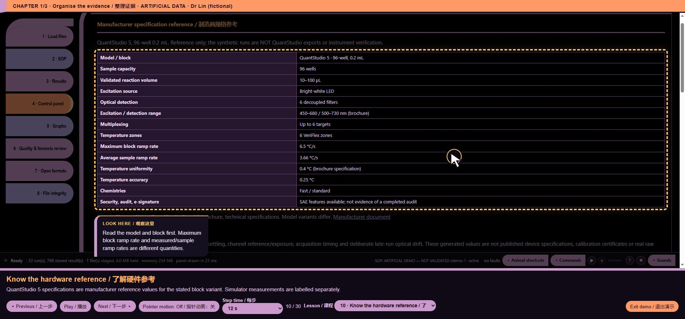

# core/ui/instrument_context.js — function reference

## C10458 · <callback@3497:32>

- Ownership: MISSY first-party
- Module: core/ui/instrument_context.js, line 3; script 11, script line 3497
- Form: ArrowFunctionExpression; parameters: ``
- AST classification: `new_or_changed_anonymous`
- R1 entry status: `observed_in_passing_scenario`
- Passing scenario observations: voice-demo, formats, training, voice-routing, voice-state, ack-queue, clarification, voice-bargein, command-finish, chart-focus, guided-tour, precision, quantstudio, evidence-keyboard
- R2 clean contract evidence: No separately linked clean contract assertion for this function
- Code SHA-256: `f7fa98db5f99c05de79b429c0098ce2a59c0b310a2d94c2860fe5ecdebe17960`
- [Complete exact function source](https://github.com/mihaiionitabio-alt/zpcrweb/blob/missy-public-offline-2026-10-20/documentation/releases/2026-10-31-full-wiki/code/functions/C10458.js)

```javascript
()=>{
 const t=(en,zh)=>UI_LANG==='zh'?zh:en;
 const labels={count:['Retained record count','保留的记录数'],availability:['Availability','提供情况'],time:['Decoded time field','解码后的时间字段'],temperature:['Temperature field','温度字段'],sample_mean:['Existing parser sample-temperature mean','已有解析器的样本温度均值'],cover:['Cover temperature field','盖温度字段'],heatsink:['Heatsink temperature field','散热器温度字段'],zone_span:['Existing parser zone-temperature span','已有解析器的温区温度范围'],led_temperature:['LED temperature field','LED 温度字段'],led_current:['LED current/setting field','LED 电流／设置字段'],led_voltage:['LED voltage field','LED 电压字段'],junction:['LED junction temperature field','LED 结温字段'],exposure:['Exposure/integration field','曝光／积分字段'],channel:['Stored channel identifier','保存的通道标识'],reference:['Stored reference value','保存的参比值'],valid:['Stored acquisition-valid flag','保存的采集有效标志'],mask:['Opaque channel mask','未解释的通道掩码'],gain:['Gain evidence','增益记录'],omitted:['Fields omitted from this excerpt','此摘录未显示的字段数']};
 const basis={
  trace:['Retained display trace, possibly thinned; not the complete original temperature log. No new resampling.','保留的显示轨迹可能经过抽稀；不等于完整原始温度日志。不进行新的重采样。'],
  acquisition:['Existing decoded acquisition field. No new unit conversion, channel/dye mapping or QC verdict.','已有解码采集字段。不进行新的单位换算、通道／染料映射或质控判定。'],
  eds_temperature:['Existing parser tuple; sample mean and zone span are already parser-derived, not raw per-zone measurements.','已有解析器元组；样本均值和温区范围已由解析器计算，不是原始逐温区测量值。'],
  eds_led:['Existing decoded LEDStatus field; electrical units and calibration are not established here.','已有解码 LEDStatus 字段；此处不确认电学单位或校准状态。'],
  eds_exposure:['Existing exposure request per filter; no unit conversion, coverage/gap test or completeness claim.','已有逐滤光片曝光请求；不进行单位换算、覆盖／缺口检查，也不声明数据完整。'],
  reader_measured:['Existing reader interpretation: measured. Sensor location and calibration are not independently verified.','已有读取器判读为测量值。未独立验证传感器位置和校准状态。'],
  reader_setpoint:['Existing reader interpretation: setpoint. Not a measured temperature.','已有读取器判读为设定值。不属于测量温度。'],
  stored_temperature:['Stored temperature field; sensor/model/setpoint basis is not established by this view.','保存的温度字段；此视图未确定传感器测量／模型估计／设定值依据。'],
  led_setting:['Selected-channel decoded LED setting; not a calibrated current, gain or exposure measurement.','所选通道的解码 LED 设置；不代表已校准电流、增益或曝光测量值。'],
  mask:['Stored opaque mask; no bit meaning, active-channel status or dye identity is inferred.','保存的未解释掩码；不推断位含义、通道启用状态或染料标识。'],
  native_time:['Stored time text; no timezone conversion, clock correction or timing-precision claim.','保存的时间文本；不进行时区换算或时钟校正，也不声明时间精度。'],
  missing:['Not exposed by this decoded view. Not an instrument or sample failure; no new decoding is attempted.','此解码视图未提供。不代表仪器或样本失败；不尝试新的解码。'],
  locked:['Locked inventory only; no decoded instrument records.','仅有加密文件清单；未解码仪器记录。'],
  template:['Template/setup only; no completed acquisition is implied.','仅模板／设置；不表示已完成数据采集。'],
  layout:['Retained trace axes do not match; this excerpt is unavailable. Existing readers and results are unaffected.','保留轨迹的坐标轴长度不匹配，无法提供此摘录。不影响已有读取器和结果。'],
  count:['Count in the retained decoded collection, not a completeness or acquisition-validity verdict.','保留的解码集合中的计数，不属于数据完整性或采集有效性判定。'],
  bound:['Bounded excerpt only; omitted metadata remains in the existing decoded object.','仅提供有界摘录；未显示的元数据仍保留在已有解码对象中。']
 };
 const value=v=>typeof v==='number'?(Object.is(v,-0)?'-0':String(v)):typeof v==='string'||typeof v==='boolean'?String(v):'';
 const status=v=>v==null?'unavailable':typeof v==='number'?Number.isFinite(v)?'number':'nonfinite':v===''?'empty':typeof v==='boolean'?'boolean':'text';
 function snapshot(run,index=0){
  const records=[],add=(field,v,source,scope,basisCode,suffix='')=>records.push({field,value:value(v),state:status(v),source,scope,basis:basisCode,suffix});
  const out={view:index+1,filename:run.file||'',records};
  if(run.pcrdLocked||run.isTemplate){add('availability',null,'', '',run.pcrdLocked?'locked':'template');return out;}
  const endpoints=(a,path,fn,why)=>{if(!Array.isArray(a))return;add('count',a.length,path,'', 'count');for(const i of new Set(a.length?[0,a.length-1]:[]))fn(a[i],i,path+'['+i+']',why);};
  const raw=run.zpcr||run.pcrd;
  if(raw&&Array.isArray(raw.reads)&&raw.reads.length){
   const selected=typeof MISSY_NATIVE_INSPECTOR==='undefined'?null:MISSY_NATIVE_INSPECTOR.snapshot(run,index);
   const choice=selected?.status==='provided'?selected.selection:{read:0,channel:0},r=raw.reads[choice.read],path=(run.zpcr?'zpcr':'pcrd')+'.reads['+choice.read+']';
   const scope={read:choice.read+1,name:r.name||'',channel:choice.channel+1};
   add('time',r.dateText,path+'.dateText',scope,'native_time');
   const temps=Object.entries(r.temps||{});for(const [key,o]of temps.slice(0,32)){const why=run.zpcr&&o?.kind==='measured'?'reader_measured':run.zpcr&&o?.kind==='setpoint'?'reader_setpoint':'stored_temperature';add('temperature',o?.c,path+'.temps.'+key+'.c',scope,why,key);}
   if(!temps.length)add('temperature',null,path+'.temps',scope,'missing');if(temps.length>32)add('omitted',temps.length-32,path+'.temps',scope,'bound');
   add('led_current',r.leds?.[choice.channel],path+'.leds['+choice.channel+']',scope,'led_setting');
   add('mask',r.channelMaskRaw,path+'.channelMaskRaw',scope,'mask');
   add('exposure',null,path,scope,'missing');
  }else if(run.eds){
   endpoints(run.eds.log?.temps,'eds.log.temps',(r,i,path)=>{for(const [field,k]of [['time',0],['sample_mean',1],['cover',2],['heatsink',3],['zone_span',4]])add(field,r?.[k],path+'['+k+']',{record:i+1},'eds_temperature');});
   endpoints(run.eds.log?.leds,'eds.log.leds',(r,i,path)=>{for(const [field,k]of [['time',0],['led_temperature',1],['led_current',2],['led_voltage',3],['junction',4]])add(field,r?.[k],path+'['+k+']',{record:i+1},'eds_led');});
   const exposure=run.cc?.qs?.exposure,filters=exposure&&typeof exposure==='object'?Object.entries(exposure):[];
   for(const [filter,a]of filters.slice(0,16))endpoints(a,'cc.qs.exposure['+JSON.stringify(filter)+']',(v,i,path)=>add('exposure',v,path,{record:i+1},'eds_exposure',filter));
   if(!filters.length)add('exposure',null,'cc.qs.exposure','','missing');if(filters.length>16)add('omitted',filters.length-16,'cc.qs.exposure','','bound');
  }else if(run.cc){
   const l=run.cc.log;
   if(l&&Array.isArray(l.seconds)&&Array.isArray(l.temp)){
    if(l.seconds.length!==l.temp.length)add('temperature',null,'cc.log','','layout');
    else{add('count',l.seconds.length,'cc.log','','count');for(const i of new Set(l.seconds.length?[0,l.seconds.length-1]:[])){add('time',l.seconds[i],'cc.log.seconds['+i+']',{record:i+1},'trace');add('temperature',l.temp[i],'cc.log.temp['+i+']',{record:i+1},'trace');}}
   }
   endpoints(run.cc.acq,'cc.acq',(r,i,path)=>{for(const [field,key]of [['time','ms'],['temperature','temp'],['channel','channel'],['exposure','intgr'],['valid','valid'],['reference','ref']])add(field,r?.[key],path+'.'+key,{record:i+1},'acquisition');});
  }
  if(!records.length)add('availability',null,'','','missing');
  add('gain',null,'','','missing');return out;
 }
 function rows(localized=false){const p=(en,zh)=>localized?t(en,zh):en;return RUNS.flatMap((run,i)=>snapshot(run,i).records.map(r=>({context_view:i+1,filename:run.file||'',context_scope:(r.scope&&typeof r.scope==='object'?(r.scope.read?p('Read ','读取序号 ')+r.scope.read+' · '+r.scope.name+p(' · channel ',' · 通道 ')+r.scope.channel:p('Record ','记录 ')+r.scope.record):r.scope)+(r.source?' · '+r.source:''),context_field:(localized?t(...labels[r.field]):labels[r.field][0])+(r.suffix?' · '+r.suffix:''),context_value:r.value,context_basis:localized?t(...basis[r.basis]):basis[r.basis][0],context_state:({number:p('Decoded finite number','解码后的有限数值'),nonfinite:p('Decoded non-finite/unavailable marker; not replaced','解码后的非有限／不可用标记；未替换'),empty:p('Empty decoded field; no value assumed','空解码字段；不假定数值'),unavailable:p('Unavailable; not zero','未提供；不等于零'),boolean:p('Stored Boolean flag; not a new QC verdict','保存的布尔标志；不属于新的质控判定'),text:p('Decoded text; unchanged','解码文本；保持不变')})[r.state],field_code:r.field,basis_code:r.basis,source_path:r.source})));}
 function render(){return MISSY_EVIDENCE_A11Y.refresh('missy-instrument-context',renderContent);}
 function renderContent(){
  const host=document.getElementById('loadedcard');if(!host)return;let box=document.getElementById('missy-instrument-context');if(!box){box=document.createElement('details');box.id='missy-instrument-context';box.setAttribute('data-i18n-skip','');box.addEventListener('toggle',render);host.append(box);}
  box.hidden=!RUNS.length;const open=box.open;const title=document.createElement('summary');title.textContent=t('Thermal and optical context (read only)','温度与光学记录背景（只读）');MISSY_EVIDENCE_A11Y.reset(box,title);if(!open)return;
  const note=document.createElement('p');note.textContent=t('Native context follows the applied reading-inspector read/channel. IXO/EDS show first/last retained records, not full logs. No new temperatures, ramp rates, uniformity, gain or calibration corrections are calculated. Source units and sensor basis are not newly established.','原始格式背景随读数检查器已应用的读取序号／通道变化。IXO／EDS 仅显示保留的首末记录，不是完整日志。不计算新的温度、升降温速率、均匀性、增益或校准修正，也不重新确定源单位和传感器依据。');box.append(note);
  const all=rows(true);RUNS.forEach((run,i)=>{const card=document.createElement('div'),h=document.createElement('h4'),dl=document.createElement('dl');h.textContent=(i+1)+' · '+run.file;card.append(h,dl);for(const r of all.filter(x=>x.context_view===i+1)){const dt=document.createElement('dt'),dd=document.createElement('dd');dt.textContent=r.context_field;dd.textContent=[r.context_value,r.context_state,r.context_scope,r.context_basis].filter(Boolean).join(' · ');dl.append(dt,dd);}box.append(card);});
 }
 MISSY_HOOKS.use('showTab','instrument-context/read-only-panel',263,next=>function(...args){const result=next(...args);render();return result;});
 MISSY_HOOKS.use('selDataItems','instrument-context/optional-table',263,next=>function(){return next().concat({id:'data:instrument_context',kind:'data',group:'Source provenance',title:'Thermal and optical context excerpt',note:'',ready:()=>RUNS.length>0,rows:()=>rows(true),file:'instrument_context_excerpt.csv',tableOptions:{full:true,columns:['filename','context_scope','context_field','context_value','context_state','context_basis']},text:()=>csvOf(rows(false))});});
 MISSY_HOOKS.use('exportCatalogue','instrument-context/optional-csv',263,next=>function(){return next().concat({title:'Thermal and optical context excerpt (CSV)',note:'',ready:()=>RUNS.length>0,run:()=>download('instrument_context_excerpt.csv',csvOf(rows(false)),'text/csv')});});
 MISSY_HOOKS.use('cmdExec','instrument-context/read-only-command',263,next=>async function(raw){if(String(raw).trim().toLowerCase()==='context'){cmdTable(rows(true).map(r=>[r.filename,[r.context_field,r.context_value,r.context_state,r.context_scope,r.context_basis].filter(Boolean).join(' · ')]),true);return;}return next(raw);});
 if(typeof REPORT_LITERAL_COLUMNS!=='undefined')for(const key of ['context_scope','context_value','context_basis'])REPORT_LITERAL_COLUMNS.add(key);
 CMD_HELP.push(['context','show read-only thermal and optical context']);Object.assign(ZH_TERMS,{'Thermal and optical context excerpt':'温度与光学背景摘录','Thermal and optical context excerpt (CSV)':'温度与光学背景摘录（CSV）','show read-only thermal and optical context':'显示只读温度与光学背景',context_scope:'记录范围',context_field:'记录字段',context_value:'记录值',context_state:'数值状态',context_basis:'记录依据'});
 const style=document.createElement('style');style.textContent='#missy-instrument-context{margin-top:16px;border-top:1px solid #d8dee8;padding-top:10px}#missy-instrument-context[hidden]{display:none!important}#missy-instrument-context summary{cursor:pointer;font-weight:600}#missy-instrument-context h4,#missy-instrument-context p{overflow-wrap:anywhere}#missy-instrument-context dl{display:grid;grid-template-columns:minmax(160px,300px) minmax(0,1fr);gap:6px 14px}#missy-instrument-context dt,#missy-instrument-context dd{margin:0;min-width:0;overflow-wrap:anywhere}@media(max-width:600px){#missy-instrument-context dl{grid-template-columns:minmax(0,1fr)}#missy-instrument-context dd{margin-bottom:6px}}';document.head.append(style);
 document.addEventListener('DOMContentLoaded',()=>{render();const loaded=document.getElementById('loaded');if(loaded)new MutationObserver(render).observe(loaded,{childList:true});new MutationObserver(render).observe(document.body,{attributes:true,attributeFilter:['class']});});
 document.addEventListener('submit',e=>{if(e.composedPath().some(n=>n.id==='missy-native-inspector'))render();});
 return Object.freeze({snapshot,rows,render});
}
```

## C10459 · t

- Ownership: MISSY first-party
- Module: core/ui/instrument_context.js, line 4; script 11, script line 3498
- Form: ArrowFunctionExpression; parameters: `en, zh`
- AST classification: `ambiguous_name_match`
- R1 entry status: `observed_in_passing_scenario`
- Passing scenario observations: voice-demo, formats, training, voice-routing, voice-state, ack-queue, clarification, voice-bargein, command-finish, chart-focus, guided-tour, precision, quantstudio, evidence-keyboard
- R2 clean contract evidence: No separately linked clean contract assertion for this function
- Code SHA-256: `57fe109157b63479c9f8652d14cc788e6cd7864c8445ea4034fa708c8cb76346`
- [Complete exact function source](https://github.com/mihaiionitabio-alt/zpcrweb/blob/missy-public-offline-2026-10-20/documentation/releases/2026-10-31-full-wiki/code/functions/C10459.js)

```javascript
(en,zh)=>UI_LANG==='zh'?zh:en
```

## C10460 · value

- Ownership: MISSY first-party
- Module: core/ui/instrument_context.js, line 25; script 11, script line 3519
- Form: ArrowFunctionExpression; parameters: `v`
- AST classification: `new_named`
- R1 entry status: `observed_in_passing_scenario`
- Passing scenario observations: voice-demo, training, guided-tour, evidence-keyboard
- R2 clean contract evidence: No separately linked clean contract assertion for this function
- Code SHA-256: `1b3e9a9b841e15a2e7f41beda905ca749435e591d0415f339f1e6aa561f7dff1`
- [Complete exact function source](https://github.com/mihaiionitabio-alt/zpcrweb/blob/missy-public-offline-2026-10-20/documentation/releases/2026-10-31-full-wiki/code/functions/C10460.js)

```javascript
v=>typeof v==='number'?(Object.is(v,-0)?'-0':String(v)):typeof v==='string'||typeof v==='boolean'?String(v):''
```

## C10461 · status

- Ownership: MISSY first-party
- Module: core/ui/instrument_context.js, line 26; script 11, script line 3520
- Form: ArrowFunctionExpression; parameters: `v`
- AST classification: `new_named`
- R1 entry status: `observed_in_passing_scenario`
- Passing scenario observations: voice-demo, training, guided-tour, evidence-keyboard
- R2 clean contract evidence: No separately linked clean contract assertion for this function
- Code SHA-256: `4349ae55f38a0989c6b762548c913190858d4b7d0f9657a53d6fd65cff2bd6e3`
- [Complete exact function source](https://github.com/mihaiionitabio-alt/zpcrweb/blob/missy-public-offline-2026-10-20/documentation/releases/2026-10-31-full-wiki/code/functions/C10461.js)

```javascript
v=>v==null?'unavailable':typeof v==='number'?Number.isFinite(v)?'number':'nonfinite':v===''?'empty':typeof v==='boolean'?'boolean':'text'
```

## C10462 · snapshot

- Ownership: MISSY first-party
- Module: core/ui/instrument_context.js, line 27; script 11, script line 3521
- Form: FunctionDeclaration; parameters: `run, index=0`
- AST classification: `new_named`
- R1 entry status: `observed_in_passing_scenario`
- Passing scenario observations: voice-demo, training, guided-tour, evidence-keyboard
- R2 clean contract evidence: No separately linked clean contract assertion for this function
- Code SHA-256: `cffeb373e9839597f803f3245b250338d3b95d1358f930ed7b1d1cf506022aa9`
- [Complete exact function source](https://github.com/mihaiionitabio-alt/zpcrweb/blob/missy-public-offline-2026-10-20/documentation/releases/2026-10-31-full-wiki/code/functions/C10462.js)

```javascript
function snapshot(run,index=0){
  const records=[],add=(field,v,source,scope,basisCode,suffix='')=>records.push({field,value:value(v),state:status(v),source,scope,basis:basisCode,suffix});
  const out={view:index+1,filename:run.file||'',records};
  if(run.pcrdLocked||run.isTemplate){add('availability',null,'', '',run.pcrdLocked?'locked':'template');return out;}
  const endpoints=(a,path,fn,why)=>{if(!Array.isArray(a))return;add('count',a.length,path,'', 'count');for(const i of new Set(a.length?[0,a.length-1]:[]))fn(a[i],i,path+'['+i+']',why);};
  const raw=run.zpcr||run.pcrd;
  if(raw&&Array.isArray(raw.reads)&&raw.reads.length){
   const selected=typeof MISSY_NATIVE_INSPECTOR==='undefined'?null:MISSY_NATIVE_INSPECTOR.snapshot(run,index);
   const choice=selected?.status==='provided'?selected.selection:{read:0,channel:0},r=raw.reads[choice.read],path=(run.zpcr?'zpcr':'pcrd')+'.reads['+choice.read+']';
   const scope={read:choice.read+1,name:r.name||'',channel:choice.channel+1};
   add('time',r.dateText,path+'.dateText',scope,'native_time');
   const temps=Object.entries(r.temps||{});for(const [key,o]of temps.slice(0,32)){const why=run.zpcr&&o?.kind==='measured'?'reader_measured':run.zpcr&&o?.kind==='setpoint'?'reader_setpoint':'stored_temperature';add('temperature',o?.c,path+'.temps.'+key+'.c',scope,why,key);}
   if(!temps.length)add('temperature',null,path+'.temps',scope,'missing');if(temps.length>32)add('omitted',temps.length-32,path+'.temps',scope,'bound');
   add('led_current',r.leds?.[choice.channel],path+'.leds['+choice.channel+']',scope,'led_setting');
   add('mask',r.channelMaskRaw,path+'.channelMaskRaw',scope,'mask');
   add('exposure',null,path,scope,'missing');
  }else if(run.eds){
   endpoints(run.eds.log?.temps,'eds.log.temps',(r,i,path)=>{for(const [field,k]of [['time',0],['sample_mean',1],['cover',2],['heatsink',3],['zone_span',4]])add(field,r?.[k],path+'['+k+']',{record:i+1},'eds_temperature');});
   endpoints(run.eds.log?.leds,'eds.log.leds',(r,i,path)=>{for(const [field,k]of [['time',0],['led_temperature',1],['led_current',2],['led_voltage',3],['junction',4]])add(field,r?.[k],path+'['+k+']',{record:i+1},'eds_led');});
   const exposure=run.cc?.qs?.exposure,filters=exposure&&typeof exposure==='object'?Object.entries(exposure):[];
   for(const [filter,a]of filters.slice(0,16))endpoints(a,'cc.qs.exposure['+JSON.stringify(filter)+']',(v,i,path)=>add('exposure',v,path,{record:i+1},'eds_exposure',filter));
   if(!filters.length)add('exposure',null,'cc.qs.exposure','','missing');if(filters.length>16)add('omitted',filters.length-16,'cc.qs.exposure','','bound');
  }else if(run.cc){
   const l=run.cc.log;
   if(l&&Array.isArray(l.seconds)&&Array.isArray(l.temp)){
    if(l.seconds.length!==l.temp.length)add('temperature',null,'cc.log','','layout');
    else{add('count',l.seconds.length,'cc.log','','count');for(const i of new Set(l.seconds.length?[0,l.seconds.length-1]:[])){add('time',l.seconds[i],'cc.log.seconds['+i+']',{record:i+1},'trace');add('temperature',l.temp[i],'cc.log.temp['+i+']',{record:i+1},'trace');}}
   }
   endpoints(run.cc.acq,'cc.acq',(r,i,path)=>{for(const [field,key]of [['time','ms'],['temperature','temp'],['channel','channel'],['exposure','intgr'],['valid','valid'],['reference','ref']])add(field,r?.[key],path+'.'+key,{record:i+1},'acquisition');});
  }
  if(!records.length)add('availability',null,'','','missing');
  add('gain',null,'','','missing');return out;
 }
```

## C10463 · add

- Ownership: MISSY first-party
- Module: core/ui/instrument_context.js, line 28; script 11, script line 3522
- Form: ArrowFunctionExpression; parameters: `field, v, source, scope, basisCode, suffix=''`
- AST classification: `ambiguous_name_match`
- R1 entry status: `observed_in_passing_scenario`
- Passing scenario observations: voice-demo, training, guided-tour, evidence-keyboard
- R2 clean contract evidence: No separately linked clean contract assertion for this function
- Code SHA-256: `a8fc9bd1f7a0b1e5dbb2d28dc5f6decc26cd6919a29aaa932cbb04f93dc8dbcf`
- [Complete exact function source](https://github.com/mihaiionitabio-alt/zpcrweb/blob/missy-public-offline-2026-10-20/documentation/releases/2026-10-31-full-wiki/code/functions/C10463.js)

```javascript
(field,v,source,scope,basisCode,suffix='')=>records.push({field,value:value(v),state:status(v),source,scope,basis:basisCode,suffix})
```

## C10464 · endpoints

- Ownership: MISSY first-party
- Module: core/ui/instrument_context.js, line 31; script 11, script line 3525
- Form: ArrowFunctionExpression; parameters: `a, path, fn, why`
- AST classification: `new_named`
- R1 entry status: `observed_in_passing_scenario`
- Passing scenario observations: voice-demo, training, guided-tour, evidence-keyboard
- R2 clean contract evidence: No separately linked clean contract assertion for this function
- Code SHA-256: `9f4238a81e615966bd89aff2eb4cc592663dbdc1fe46f684748b0f7462078c35`
- [Complete exact function source](https://github.com/mihaiionitabio-alt/zpcrweb/blob/missy-public-offline-2026-10-20/documentation/releases/2026-10-31-full-wiki/code/functions/C10464.js)

```javascript
(a,path,fn,why)=>{if(!Array.isArray(a))return;add('count',a.length,path,'', 'count');for(const i of new Set(a.length?[0,a.length-1]:[]))fn(a[i],i,path+'['+i+']',why);}
```

## C10465 · <callback@3538:48>

- Ownership: MISSY first-party
- Module: core/ui/instrument_context.js, line 44; script 11, script line 3538
- Form: ArrowFunctionExpression; parameters: `r, i, path`
- AST classification: `new_or_changed_anonymous`
- R1 entry status: `observed_in_passing_scenario`
- Passing scenario observations: evidence-keyboard
- R2 clean contract evidence: No separately linked clean contract assertion for this function
- Code SHA-256: `9252e96859e80fcbb69137b997b9909752309352e3bdda2dfe27acbb4633bba5`
- [Complete exact function source](https://github.com/mihaiionitabio-alt/zpcrweb/blob/missy-public-offline-2026-10-20/documentation/releases/2026-10-31-full-wiki/code/functions/C10465.js)

```javascript
(r,i,path)=>{for(const [field,k]of [['time',0],['sample_mean',1],['cover',2],['heatsink',3],['zone_span',4]])add(field,r?.[k],path+'['+k+']',{record:i+1},'eds_temperature');}
```

## C10466 · <callback@3539:46>

- Ownership: MISSY first-party
- Module: core/ui/instrument_context.js, line 45; script 11, script line 3539
- Form: ArrowFunctionExpression; parameters: `r, i, path`
- AST classification: `new_or_changed_anonymous`
- R1 entry status: `observed_in_passing_scenario`
- Passing scenario observations: evidence-keyboard
- R2 clean contract evidence: No separately linked clean contract assertion for this function
- Code SHA-256: `d04ba62212efa323605d034d9aa5776b484336177673be2e89500c8946e654b8`
- [Complete exact function source](https://github.com/mihaiionitabio-alt/zpcrweb/blob/missy-public-offline-2026-10-20/documentation/releases/2026-10-31-full-wiki/code/functions/C10466.js)

```javascript
(r,i,path)=>{for(const [field,k]of [['time',0],['led_temperature',1],['led_current',2],['led_voltage',3],['junction',4]])add(field,r?.[k],path+'['+k+']',{record:i+1},'eds_led');}
```

## C10467 · <callback@3541:103>

- Ownership: MISSY first-party
- Module: core/ui/instrument_context.js, line 47; script 11, script line 3541
- Form: ArrowFunctionExpression; parameters: `v, i, path`
- AST classification: `new_or_changed_anonymous`
- R1 entry status: `observed_in_passing_scenario`
- Passing scenario observations: evidence-keyboard
- R2 clean contract evidence: No separately linked clean contract assertion for this function
- Code SHA-256: `e9579a0549c714baa3f63162b55da944d87602b36aafa295e7bbec4b085f0b3b`
- [Complete exact function source](https://github.com/mihaiionitabio-alt/zpcrweb/blob/missy-public-offline-2026-10-20/documentation/releases/2026-10-31-full-wiki/code/functions/C10467.js)

```javascript
(v,i,path)=>add('exposure',v,path,{record:i+1},'eds_exposure',filter)
```

## C10468 · <callback@3549:33>

- Ownership: MISSY first-party
- Module: core/ui/instrument_context.js, line 55; script 11, script line 3549
- Form: ArrowFunctionExpression; parameters: `r, i, path`
- AST classification: `new_or_changed_anonymous`
- R1 entry status: `observed_in_passing_scenario`
- Passing scenario observations: voice-demo, training, guided-tour, evidence-keyboard
- R2 clean contract evidence: No separately linked clean contract assertion for this function
- Code SHA-256: `5070bd3bb329b9d5e81171223472a64d0604f584cc1c21eba059694d6dfe7add`
- [Complete exact function source](https://github.com/mihaiionitabio-alt/zpcrweb/blob/missy-public-offline-2026-10-20/documentation/releases/2026-10-31-full-wiki/code/functions/C10468.js)

```javascript
(r,i,path)=>{for(const [field,key]of [['time','ms'],['temperature','temp'],['channel','channel'],['exposure','intgr'],['valid','valid'],['reference','ref']])add(field,r?.[key],path+'.'+key,{record:i+1},'acquisition');}
```

## C10469 · rows

- Ownership: MISSY first-party
- Module: core/ui/instrument_context.js, line 60; script 11, script line 3554
- Form: FunctionDeclaration; parameters: `localized=false`
- AST classification: `new_named`
- R1 entry status: `observed_in_passing_scenario`
- Passing scenario observations: voice-demo, training, guided-tour, evidence-keyboard
- R2 clean contract evidence: No separately linked clean contract assertion for this function
- Code SHA-256: `79d463f9ce86a8fe4cef9e2ac0be4e8b3c3009aafc002e9a9d62508746d66028`
- [Complete exact function source](https://github.com/mihaiionitabio-alt/zpcrweb/blob/missy-public-offline-2026-10-20/documentation/releases/2026-10-31-full-wiki/code/functions/C10469.js)

```javascript
function rows(localized=false){const p=(en,zh)=>localized?t(en,zh):en;return RUNS.flatMap((run,i)=>snapshot(run,i).records.map(r=>({context_view:i+1,filename:run.file||'',context_scope:(r.scope&&typeof r.scope==='object'?(r.scope.read?p('Read ','读取序号 ')+r.scope.read+' · '+r.scope.name+p(' · channel ',' · 通道 ')+r.scope.channel:p('Record ','记录 ')+r.scope.record):r.scope)+(r.source?' · '+r.source:''),context_field:(localized?t(...labels[r.field]):labels[r.field][0])+(r.suffix?' · '+r.suffix:''),context_value:r.value,context_basis:localized?t(...basis[r.basis]):basis[r.basis][0],context_state:({number:p('Decoded finite number','解码后的有限数值'),nonfinite:p('Decoded non-finite/unavailable marker; not replaced','解码后的非有限／不可用标记；未替换'),empty:p('Empty decoded field; no value assumed','空解码字段；不假定数值'),unavailable:p('Unavailable; not zero','未提供；不等于零'),boolean:p('Stored Boolean flag; not a new QC verdict','保存的布尔标志；不属于新的质控判定'),text:p('Decoded text; unchanged','解码文本；保持不变')})[r.state],field_code:r.field,basis_code:r.basis,source_path:r.source})));}
```

## C10470 · p

- Ownership: MISSY first-party
- Module: core/ui/instrument_context.js, line 60; script 11, script line 3554
- Form: ArrowFunctionExpression; parameters: `en, zh`
- AST classification: `ambiguous_name_match`
- R1 entry status: `observed_in_passing_scenario`
- Passing scenario observations: voice-demo, training, guided-tour, evidence-keyboard
- R2 clean contract evidence: No separately linked clean contract assertion for this function
- Code SHA-256: `63fdbe9f56438766280ce9932f50ab3cfab6fdead82e057b5474dbeffde0d260`
- [Complete exact function source](https://github.com/mihaiionitabio-alt/zpcrweb/blob/missy-public-offline-2026-10-20/documentation/releases/2026-10-31-full-wiki/code/functions/C10470.js)

```javascript
(en,zh)=>localized?t(en,zh):en
```

## C10471 · <callback@3554:91>

- Ownership: MISSY first-party
- Module: core/ui/instrument_context.js, line 60; script 11, script line 3554
- Form: ArrowFunctionExpression; parameters: `run, i`
- AST classification: `new_or_changed_anonymous`
- R1 entry status: `observed_in_passing_scenario`
- Passing scenario observations: voice-demo, training, guided-tour, evidence-keyboard
- R2 clean contract evidence: No separately linked clean contract assertion for this function
- Code SHA-256: `e54e63b4f1a49deef62d0f66f2e43931add161385b24c14ee455a67bec099e3b`
- [Complete exact function source](https://github.com/mihaiionitabio-alt/zpcrweb/blob/missy-public-offline-2026-10-20/documentation/releases/2026-10-31-full-wiki/code/functions/C10471.js)

```javascript
(run,i)=>snapshot(run,i).records.map(r=>({context_view:i+1,filename:run.file||'',context_scope:(r.scope&&typeof r.scope==='object'?(r.scope.read?p('Read ','读取序号 ')+r.scope.read+' · '+r.scope.name+p(' · channel ',' · 通道 ')+r.scope.channel:p('Record ','记录 ')+r.scope.record):r.scope)+(r.source?' · '+r.source:''),context_field:(localized?t(...labels[r.field]):labels[r.field][0])+(r.suffix?' · '+r.suffix:''),context_value:r.value,context_basis:localized?t(...basis[r.basis]):basis[r.basis][0],context_state:({number:p('Decoded finite number','解码后的有限数值'),nonfinite:p('Decoded non-finite/unavailable marker; not replaced','解码后的非有限／不可用标记；未替换'),empty:p('Empty decoded field; no value assumed','空解码字段；不假定数值'),unavailable:p('Unavailable; not zero','未提供；不等于零'),boolean:p('Stored Boolean flag; not a new QC verdict','保存的布尔标志；不属于新的质控判定'),text:p('Decoded text; unchanged','解码文本；保持不变')})[r.state],field_code:r.field,basis_code:r.basis,source_path:r.source}))
```

## C10472 · <callback@3554:128>

- Ownership: MISSY first-party
- Module: core/ui/instrument_context.js, line 60; script 11, script line 3554
- Form: ArrowFunctionExpression; parameters: `r`
- AST classification: `new_or_changed_anonymous`
- R1 entry status: `observed_in_passing_scenario`
- Passing scenario observations: voice-demo, training, guided-tour, evidence-keyboard
- R2 clean contract evidence: No separately linked clean contract assertion for this function
- Code SHA-256: `c61393d0c74116217693df8642770a3dedabe7af37edda79d35327cbc536504d`
- [Complete exact function source](https://github.com/mihaiionitabio-alt/zpcrweb/blob/missy-public-offline-2026-10-20/documentation/releases/2026-10-31-full-wiki/code/functions/C10472.js)

```javascript
r=>({context_view:i+1,filename:run.file||'',context_scope:(r.scope&&typeof r.scope==='object'?(r.scope.read?p('Read ','读取序号 ')+r.scope.read+' · '+r.scope.name+p(' · channel ',' · 通道 ')+r.scope.channel:p('Record ','记录 ')+r.scope.record):r.scope)+(r.source?' · '+r.source:''),context_field:(localized?t(...labels[r.field]):labels[r.field][0])+(r.suffix?' · '+r.suffix:''),context_value:r.value,context_basis:localized?t(...basis[r.basis]):basis[r.basis][0],context_state:({number:p('Decoded finite number','解码后的有限数值'),nonfinite:p('Decoded non-finite/unavailable marker; not replaced','解码后的非有限／不可用标记；未替换'),empty:p('Empty decoded field; no value assumed','空解码字段；不假定数值'),unavailable:p('Unavailable; not zero','未提供；不等于零'),boolean:p('Stored Boolean flag; not a new QC verdict','保存的布尔标志；不属于新的质控判定'),text:p('Decoded text; unchanged','解码文本；保持不变')})[r.state],field_code:r.field,basis_code:r.basis,source_path:r.source})
```

## C10473 · render

- Ownership: MISSY first-party
- Module: core/ui/instrument_context.js, line 61; script 11, script line 3555
- Form: FunctionDeclaration; parameters: ``
- AST classification: `ambiguous_name_match`
- R1 entry status: `observed_in_passing_scenario`
- Passing scenario observations: voice-demo, formats, training, voice-routing, voice-state, ack-queue, clarification, voice-bargein, command-finish, chart-focus, guided-tour, precision, quantstudio, evidence-keyboard
- R2 clean contract evidence: No separately linked clean contract assertion for this function
- Code SHA-256: `e747d1747d8815b6618ba76d2cfdba9ec8482f0a05984814b536c5a54e0abba6`
- [Complete exact function source](https://github.com/mihaiionitabio-alt/zpcrweb/blob/missy-public-offline-2026-10-20/documentation/releases/2026-10-31-full-wiki/code/functions/C10473.js)

```javascript
function render(){return MISSY_EVIDENCE_A11Y.refresh('missy-instrument-context',renderContent);}
```

## C10474 · renderContent

- Ownership: MISSY first-party
- Module: core/ui/instrument_context.js, line 62; script 11, script line 3556
- Form: FunctionDeclaration; parameters: ``
- AST classification: `new_named`
- R1 entry status: `observed_in_passing_scenario`
- Passing scenario observations: voice-demo, formats, training, voice-routing, voice-state, ack-queue, clarification, voice-bargein, command-finish, chart-focus, guided-tour, precision, quantstudio, evidence-keyboard
- R2 clean contract evidence: No separately linked clean contract assertion for this function
- Code SHA-256: `4fc440de306dab6e8865572e6e65e7c8f2162f05ed00724945e867d1ede57ef1`
- [Complete exact function source](https://github.com/mihaiionitabio-alt/zpcrweb/blob/missy-public-offline-2026-10-20/documentation/releases/2026-10-31-full-wiki/code/functions/C10474.js)

```javascript
function renderContent(){
  const host=document.getElementById('loadedcard');if(!host)return;let box=document.getElementById('missy-instrument-context');if(!box){box=document.createElement('details');box.id='missy-instrument-context';box.setAttribute('data-i18n-skip','');box.addEventListener('toggle',render);host.append(box);}
  box.hidden=!RUNS.length;const open=box.open;const title=document.createElement('summary');title.textContent=t('Thermal and optical context (read only)','温度与光学记录背景（只读）');MISSY_EVIDENCE_A11Y.reset(box,title);if(!open)return;
  const note=document.createElement('p');note.textContent=t('Native context follows the applied reading-inspector read/channel. IXO/EDS show first/last retained records, not full logs. No new temperatures, ramp rates, uniformity, gain or calibration corrections are calculated. Source units and sensor basis are not newly established.','原始格式背景随读数检查器已应用的读取序号／通道变化。IXO／EDS 仅显示保留的首末记录，不是完整日志。不计算新的温度、升降温速率、均匀性、增益或校准修正，也不重新确定源单位和传感器依据。');box.append(note);
  const all=rows(true);RUNS.forEach((run,i)=>{const card=document.createElement('div'),h=document.createElement('h4'),dl=document.createElement('dl');h.textContent=(i+1)+' · '+run.file;card.append(h,dl);for(const r of all.filter(x=>x.context_view===i+1)){const dt=document.createElement('dt'),dd=document.createElement('dd');dt.textContent=r.context_field;dd.textContent=[r.context_value,r.context_state,r.context_scope,r.context_basis].filter(Boolean).join(' · ');dl.append(dt,dd);}box.append(card);});
 }
```

## C10475 · <callback@3560:36>

- Ownership: MISSY first-party
- Module: core/ui/instrument_context.js, line 66; script 11, script line 3560
- Form: ArrowFunctionExpression; parameters: `run, i`
- AST classification: `new_or_changed_anonymous`
- R1 entry status: `observed_in_passing_scenario`
- Passing scenario observations: evidence-keyboard
- R2 clean contract evidence: No separately linked clean contract assertion for this function
- Code SHA-256: `55805028e4b501b0ce44617602f7837f36ff2a5094e1a98dc8f4f333ec46b661`
- [Complete exact function source](https://github.com/mihaiionitabio-alt/zpcrweb/blob/missy-public-offline-2026-10-20/documentation/releases/2026-10-31-full-wiki/code/functions/C10475.js)

```javascript
(run,i)=>{const card=document.createElement('div'),h=document.createElement('h4'),dl=document.createElement('dl');h.textContent=(i+1)+' · '+run.file;card.append(h,dl);for(const r of all.filter(x=>x.context_view===i+1)){const dt=document.createElement('dt'),dd=document.createElement('dd');dt.textContent=r.context_field;dd.textContent=[r.context_value,r.context_state,r.context_scope,r.context_basis].filter(Boolean).join(' · ');dl.append(dt,dd);}box.append(card);}
```

## C10476 · <callback@3560:229>

- Ownership: MISSY first-party
- Module: core/ui/instrument_context.js, line 66; script 11, script line 3560
- Form: ArrowFunctionExpression; parameters: `x`
- AST classification: `new_or_changed_anonymous`
- R1 entry status: `observed_in_passing_scenario`
- Passing scenario observations: evidence-keyboard
- R2 clean contract evidence: No separately linked clean contract assertion for this function
- Code SHA-256: `07082982b24b7c060548282096dfdab9b8fe40c559ab56cb87bad862c9a03b63`
- [Complete exact function source](https://github.com/mihaiionitabio-alt/zpcrweb/blob/missy-public-offline-2026-10-20/documentation/releases/2026-10-31-full-wiki/code/functions/C10476.js)

```javascript
x=>x.context_view===i+1
```

## C10477 · <callback@3562:68>

- Ownership: MISSY first-party
- Module: core/ui/instrument_context.js, line 68; script 11, script line 3562
- Form: ArrowFunctionExpression; parameters: `next`
- AST classification: `new_or_changed_anonymous`
- R1 entry status: `observed_in_passing_scenario`
- Passing scenario observations: voice-demo, formats, training, voice-routing, clarification, chart-focus, guided-tour, precision, evidence-keyboard
- R2 clean contract evidence: No separately linked clean contract assertion for this function
- Code SHA-256: `56eb88a53fdd2ca50d94e1060947166b7945000f409408ace28b2292c42c3ba1`
- [Complete exact function source](https://github.com/mihaiionitabio-alt/zpcrweb/blob/missy-public-offline-2026-10-20/documentation/releases/2026-10-31-full-wiki/code/functions/C10477.js)

```javascript
next=>function(...args){const result=next(...args);render();return result;}
```

## C10478 · <callback@3562:74>

- Ownership: MISSY first-party
- Module: core/ui/instrument_context.js, line 68; script 11, script line 3562
- Form: FunctionExpression; parameters: `...args`
- AST classification: `new_or_changed_anonymous`
- R1 entry status: `observed_in_passing_scenario`
- Passing scenario observations: voice-demo, formats, training, voice-routing, clarification, chart-focus, guided-tour, precision, evidence-keyboard
- R2 clean contract evidence: No separately linked clean contract assertion for this function
- Code SHA-256: `e49bb70518c4db559135a658d28ff9c562c80a436339bb44baee7a67f10340e5`
- [Complete exact function source](https://github.com/mihaiionitabio-alt/zpcrweb/blob/missy-public-offline-2026-10-20/documentation/releases/2026-10-31-full-wiki/code/functions/C10478.js)

```javascript
function(...args){const result=next(...args);render();return result;}
```

## C10479 · <callback@3563:72>

- Ownership: MISSY first-party
- Module: core/ui/instrument_context.js, line 69; script 11, script line 3563
- Form: ArrowFunctionExpression; parameters: `next`
- AST classification: `new_or_changed_anonymous`
- R1 entry status: `observed_in_passing_scenario`
- Passing scenario observations: voice-demo, formats, training, guided-tour, precision, evidence-keyboard
- R2 clean contract evidence: No separately linked clean contract assertion for this function
- Code SHA-256: `81d172bbc760fb39c66cd2d47b46d48d2374ed9873b8da121b0bdd82535f748d`
- [Complete exact function source](https://github.com/mihaiionitabio-alt/zpcrweb/blob/missy-public-offline-2026-10-20/documentation/releases/2026-10-31-full-wiki/code/functions/C10479.js)

```javascript
next=>function(){return next().concat({id:'data:instrument_context',kind:'data',group:'Source provenance',title:'Thermal and optical context excerpt',note:'',ready:()=>RUNS.length>0,rows:()=>rows(true),file:'instrument_context_excerpt.csv',tableOptions:{full:true,columns:['filename','context_scope','context_field','context_value','context_state','context_basis']},text:()=>csvOf(rows(false))});}
```

## C10480 · <callback@3563:78>

- Ownership: MISSY first-party
- Module: core/ui/instrument_context.js, line 69; script 11, script line 3563
- Form: FunctionExpression; parameters: ``
- AST classification: `new_or_changed_anonymous`
- R1 entry status: `observed_in_passing_scenario`
- Passing scenario observations: voice-demo, formats, training, guided-tour, precision, evidence-keyboard
- R2 clean contract evidence: No separately linked clean contract assertion for this function
- Code SHA-256: `2ec82957cdf4c66f70d02d0ec1bd274d3a384910d72d552dda5cfcd8aa7916be`
- [Complete exact function source](https://github.com/mihaiionitabio-alt/zpcrweb/blob/missy-public-offline-2026-10-20/documentation/releases/2026-10-31-full-wiki/code/functions/C10480.js)

```javascript
function(){return next().concat({id:'data:instrument_context',kind:'data',group:'Source provenance',title:'Thermal and optical context excerpt',note:'',ready:()=>RUNS.length>0,rows:()=>rows(true),file:'instrument_context_excerpt.csv',tableOptions:{full:true,columns:['filename','context_scope','context_field','context_value','context_state','context_basis']},text:()=>csvOf(rows(false))});}
```

## C10481 · ready

- Ownership: MISSY first-party
- Module: core/ui/instrument_context.js, line 69; script 11, script line 3563
- Form: ArrowFunctionExpression; parameters: ``
- AST classification: `current_matching_baseline_ast`
- R1 entry status: `observed_in_passing_scenario`
- Passing scenario observations: voice-demo, training, guided-tour
- R2 clean contract evidence: No separately linked clean contract assertion for this function
- Code SHA-256: `25094bcfe1a30bbfcee422a04d70edc47359e0f08caa1988d968110c9f222c7d`
- [Complete exact function source](https://github.com/mihaiionitabio-alt/zpcrweb/blob/missy-public-offline-2026-10-20/documentation/releases/2026-10-31-full-wiki/code/functions/C10481.js)

```javascript
()=>RUNS.length>0
```

## C10482 · rows

- Ownership: MISSY first-party
- Module: core/ui/instrument_context.js, line 69; script 11, script line 3563
- Form: ArrowFunctionExpression; parameters: ``
- AST classification: `new_named`
- R1 entry status: `observed_in_passing_scenario`
- Passing scenario observations: voice-demo, training, guided-tour
- R2 clean contract evidence: No separately linked clean contract assertion for this function
- Code SHA-256: `1c9448d4bb8a10ebfddc92364816d6a77b267a9029d1e49eb44966cd040aaf2a`
- [Complete exact function source](https://github.com/mihaiionitabio-alt/zpcrweb/blob/missy-public-offline-2026-10-20/documentation/releases/2026-10-31-full-wiki/code/functions/C10482.js)

```javascript
()=>rows(true)
```

## C10483 · text

- Ownership: MISSY first-party
- Module: core/ui/instrument_context.js, line 69; script 11, script line 3563
- Form: ArrowFunctionExpression; parameters: ``
- AST classification: `ambiguous_name_match`
- R1 entry status: `not_observed_in_passing_scenario`
- Passing scenario observations: No passing R1 instrumented scenario observation
- R2 clean contract evidence: No separately linked clean contract assertion for this function
- Code SHA-256: `05259275e79e3889bfcc3d9a70bd1d6bfd18ed427f12b09e8f2be6cdc85a54f1`
- [Complete exact function source](https://github.com/mihaiionitabio-alt/zpcrweb/blob/missy-public-offline-2026-10-20/documentation/releases/2026-10-31-full-wiki/code/functions/C10483.js)

```javascript
()=>csvOf(rows(false))
```

## C10484 · <callback@3564:73>

- Ownership: MISSY first-party
- Module: core/ui/instrument_context.js, line 70; script 11, script line 3564
- Form: ArrowFunctionExpression; parameters: `next`
- AST classification: `new_or_changed_anonymous`
- R1 entry status: `observed_in_passing_scenario`
- Passing scenario observations: voice-demo, guided-tour
- R2 clean contract evidence: No separately linked clean contract assertion for this function
- Code SHA-256: `c2ecc8dd75395c58e5110cb8b0b1e370ba26d05eb8f64fa84876c6ba7a87768c`
- [Complete exact function source](https://github.com/mihaiionitabio-alt/zpcrweb/blob/missy-public-offline-2026-10-20/documentation/releases/2026-10-31-full-wiki/code/functions/C10484.js)

```javascript
next=>function(){return next().concat({title:'Thermal and optical context excerpt (CSV)',note:'',ready:()=>RUNS.length>0,run:()=>download('instrument_context_excerpt.csv',csvOf(rows(false)),'text/csv')});}
```

## C10485 · <callback@3564:79>

- Ownership: MISSY first-party
- Module: core/ui/instrument_context.js, line 70; script 11, script line 3564
- Form: FunctionExpression; parameters: ``
- AST classification: `new_or_changed_anonymous`
- R1 entry status: `observed_in_passing_scenario`
- Passing scenario observations: voice-demo, guided-tour
- R2 clean contract evidence: No separately linked clean contract assertion for this function
- Code SHA-256: `d5b43a6a8c723d1a28518a39fb7f2435a6f9f4413e4c3a3afa6db6df9ffb1c21`
- [Complete exact function source](https://github.com/mihaiionitabio-alt/zpcrweb/blob/missy-public-offline-2026-10-20/documentation/releases/2026-10-31-full-wiki/code/functions/C10485.js)

```javascript
function(){return next().concat({title:'Thermal and optical context excerpt (CSV)',note:'',ready:()=>RUNS.length>0,run:()=>download('instrument_context_excerpt.csv',csvOf(rows(false)),'text/csv')});}
```

## C10486 · ready

- Ownership: MISSY first-party
- Module: core/ui/instrument_context.js, line 70; script 11, script line 3564
- Form: ArrowFunctionExpression; parameters: ``
- AST classification: `current_matching_baseline_ast`
- R1 entry status: `observed_in_passing_scenario`
- Passing scenario observations: voice-demo, guided-tour
- R2 clean contract evidence: No separately linked clean contract assertion for this function
- Code SHA-256: `25094bcfe1a30bbfcee422a04d70edc47359e0f08caa1988d968110c9f222c7d`
- [Complete exact function source](https://github.com/mihaiionitabio-alt/zpcrweb/blob/missy-public-offline-2026-10-20/documentation/releases/2026-10-31-full-wiki/code/functions/C10486.js)

```javascript
()=>RUNS.length>0
```

## C10487 · run

- Ownership: MISSY first-party
- Module: core/ui/instrument_context.js, line 70; script 11, script line 3564
- Form: ArrowFunctionExpression; parameters: ``
- AST classification: `ambiguous_name_match`
- R1 entry status: `not_observed_in_passing_scenario`
- Passing scenario observations: No passing R1 instrumented scenario observation
- R2 clean contract evidence: No separately linked clean contract assertion for this function
- Code SHA-256: `1eb01c69888a10480c9502ac9723e1ab5f5b0dee8c803f5de2f4fd3e1fd25d7c`
- [Complete exact function source](https://github.com/mihaiionitabio-alt/zpcrweb/blob/missy-public-offline-2026-10-20/documentation/releases/2026-10-31-full-wiki/code/functions/C10487.js)

```javascript
()=>download('instrument_context_excerpt.csv',csvOf(rows(false)),'text/csv')
```

## C10488 · <callback@3565:70>

- Ownership: MISSY first-party
- Module: core/ui/instrument_context.js, line 71; script 11, script line 3565
- Form: ArrowFunctionExpression; parameters: `next`
- AST classification: `new_or_changed_anonymous`
- R1 entry status: `not_observed_in_passing_scenario`
- Passing scenario observations: No passing R1 instrumented scenario observation
- R2 clean contract evidence: No separately linked clean contract assertion for this function
- Code SHA-256: `a13f9fa5668a1d27816522d74086b811ace49db358f11d8463a35d8edbcd44be`
- [Complete exact function source](https://github.com/mihaiionitabio-alt/zpcrweb/blob/missy-public-offline-2026-10-20/documentation/releases/2026-10-31-full-wiki/code/functions/C10488.js)

```javascript
next=>async function(raw){if(String(raw).trim().toLowerCase()==='context'){cmdTable(rows(true).map(r=>[r.filename,[r.context_field,r.context_value,r.context_state,r.context_scope,r.context_basis].filter(Boolean).join(' · ')]),true);return;}return next(raw);}
```

## C10489 · <callback@3565:76>

- Ownership: MISSY first-party
- Module: core/ui/instrument_context.js, line 71; script 11, script line 3565
- Form: FunctionExpression; parameters: `raw`
- AST classification: `new_or_changed_anonymous`
- R1 entry status: `not_observed_in_passing_scenario`
- Passing scenario observations: No passing R1 instrumented scenario observation
- R2 clean contract evidence: No separately linked clean contract assertion for this function
- Code SHA-256: `f0fb094809f4563e27853a6203d39169d31b7a3dd3a98dcde0748c97264012a0`
- [Complete exact function source](https://github.com/mihaiionitabio-alt/zpcrweb/blob/missy-public-offline-2026-10-20/documentation/releases/2026-10-31-full-wiki/code/functions/C10489.js)

```javascript
async function(raw){if(String(raw).trim().toLowerCase()==='context'){cmdTable(rows(true).map(r=>[r.filename,[r.context_field,r.context_value,r.context_state,r.context_scope,r.context_basis].filter(Boolean).join(' · ')]),true);return;}return next(raw);}
```

## C10490 · <callback@3565:169>

- Ownership: MISSY first-party
- Module: core/ui/instrument_context.js, line 71; script 11, script line 3565
- Form: ArrowFunctionExpression; parameters: `r`
- AST classification: `new_or_changed_anonymous`
- R1 entry status: `not_observed_in_passing_scenario`
- Passing scenario observations: No passing R1 instrumented scenario observation
- R2 clean contract evidence: No separately linked clean contract assertion for this function
- Code SHA-256: `15b91e81f6b0d09a5316b2192370277accf5336aa4c79d6731fbc3da7ddab7dc`
- [Complete exact function source](https://github.com/mihaiionitabio-alt/zpcrweb/blob/missy-public-offline-2026-10-20/documentation/releases/2026-10-31-full-wiki/code/functions/C10490.js)

```javascript
r=>[r.filename,[r.context_field,r.context_value,r.context_state,r.context_scope,r.context_basis].filter(Boolean).join(' · ')]
```

## C10491 · <callback@3569:46>

- Ownership: MISSY first-party
- Module: core/ui/instrument_context.js, line 75; script 11, script line 3569
- Form: ArrowFunctionExpression; parameters: ``
- AST classification: `new_or_changed_anonymous`
- R1 entry status: `observed_in_passing_scenario`
- Passing scenario observations: voice-demo, formats, training, voice-routing, voice-state, ack-queue, clarification, voice-bargein, command-finish, chart-focus, guided-tour, precision, quantstudio, evidence-keyboard
- R2 clean contract evidence: No separately linked clean contract assertion for this function
- Code SHA-256: `73b43c16ade8c5ce99b9e98e32ed76af8eeadae3d8c12450e00258c62c7bc4f8`
- [Complete exact function source](https://github.com/mihaiionitabio-alt/zpcrweb/blob/missy-public-offline-2026-10-20/documentation/releases/2026-10-31-full-wiki/code/functions/C10491.js)

```javascript
()=>{render();const loaded=document.getElementById('loaded');if(loaded)new MutationObserver(render).observe(loaded,{childList:true});new MutationObserver(render).observe(document.body,{attributes:true,attributeFilter:['class']});}
```

## C10492 · <callback@3570:36>

- Ownership: MISSY first-party
- Module: core/ui/instrument_context.js, line 76; script 11, script line 3570
- Form: ArrowFunctionExpression; parameters: `e`
- AST classification: `new_or_changed_anonymous`
- R1 entry status: `observed_in_passing_scenario`
- Passing scenario observations: voice-demo, formats, training, voice-routing, voice-state, ack-queue, clarification, voice-bargein, command-finish, chart-focus, precision, evidence-keyboard
- R2 clean contract evidence: No separately linked clean contract assertion for this function
- Code SHA-256: `9d04046c1a9abed23018c621cff428c3f78d8f3dd558876a73c1e75168edb8b6`
- [Complete exact function source](https://github.com/mihaiionitabio-alt/zpcrweb/blob/missy-public-offline-2026-10-20/documentation/releases/2026-10-31-full-wiki/code/functions/C10492.js)

```javascript
e=>{if(e.composedPath().some(n=>n.id==='missy-native-inspector'))render();}
```

## C10493 · <callback@3570:65>

- Ownership: MISSY first-party
- Module: core/ui/instrument_context.js, line 76; script 11, script line 3570
- Form: ArrowFunctionExpression; parameters: `n`
- AST classification: `new_or_changed_anonymous`
- R1 entry status: `observed_in_passing_scenario`
- Passing scenario observations: voice-demo, formats, training, voice-routing, voice-state, ack-queue, clarification, voice-bargein, command-finish, chart-focus, precision, evidence-keyboard
- R2 clean contract evidence: No separately linked clean contract assertion for this function
- Code SHA-256: `0db6dbe1ed3a77cb2485a358f025a236f1787d890cc363b373d5245815e87b21`
- [Complete exact function source](https://github.com/mihaiionitabio-alt/zpcrweb/blob/missy-public-offline-2026-10-20/documentation/releases/2026-10-31-full-wiki/code/functions/C10493.js)

```javascript
n=>n.id==='missy-native-inspector'
```

[Wiki home](/p/zpcrweb/wiki/Home/)

## Illustrated interface context

Instrument/hardware reference context, distinct from measured performance. This is UI context, not proof of function-level correctness.



*Representative webpage view for core/ui/instrument_context.js*

[Complete illustrated workflow and source mapping](https://github.com/mihaiionitabio-alt/zpcrweb/blob/missy-public-offline-2026-10-20/documentation/releases/2026-11-01-illustrated-wiki/pages/FunctionScreenshots.md)
