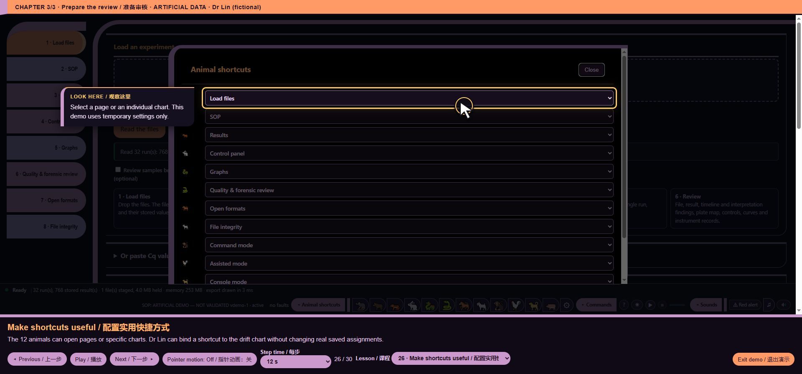

# core/ui/mascot_controls.js — function reference

## C09779 · MASCOT_OPEN_SETTINGS

- Ownership: MISSY first-party
- Module: core/ui/mascot_controls.js, line 6; script 11, script line 1899
- Form: ArrowFunctionExpression; parameters: ``
- AST classification: `current_matching_baseline_ast`
- R1 entry status: `not_observed_in_passing_scenario`
- Passing scenario observations: No passing R1 instrumented scenario observation
- R2 clean contract evidence: No separately linked clean contract assertion for this function
- Code SHA-256: `dec7a076dec41531da7f2d40bd4b896e27d45dd09ecd541190941bf88e6de894`
- [Complete exact function source](https://github.com/mihaiionitabio-alt/zpcrweb/blob/missy-public-offline-2026-10-20/documentation/releases/2026-10-31-full-wiki/code/functions/C09779.js)

```javascript
()=>{}
```

## C09780 · <callback@1900:138>

- Ownership: MISSY first-party
- Module: core/ui/mascot_controls.js, line 7; script 11, script line 1900
- Form: ArrowFunctionExpression; parameters: `x`
- AST classification: `new_or_changed_anonymous`
- R1 entry status: `not_observed_in_passing_scenario`
- Passing scenario observations: No passing R1 instrumented scenario observation
- R2 clean contract evidence: No separately linked clean contract assertion for this function
- Code SHA-256: `ad0e5e14e444a89d8f488d409bb03aeaf52b4e366008235a445ec27c3a979199`
- [Complete exact function source](https://github.com/mihaiionitabio-alt/zpcrweb/blob/missy-public-offline-2026-10-20/documentation/releases/2026-10-31-full-wiki/code/functions/C09780.js)

```javascript
x=>typeof x==='string'&&/^(page|mode|graph|section):/.test(x)
```

## C09781 · mascotDestinations

- Ownership: MISSY first-party
- Module: core/ui/mascot_controls.js, line 8; script 11, script line 1901
- Form: FunctionDeclaration; parameters: ``
- AST classification: `new_named`
- R1 entry status: `observed_in_passing_scenario`
- Passing scenario observations: voice-demo, formats, training, voice-routing, voice-state, ack-queue, clarification, voice-bargein, command-finish, chart-focus, guided-tour, precision, quantstudio, evidence-keyboard
- R2 clean contract evidence: No separately linked clean contract assertion for this function
- Code SHA-256: `890512021aaea9ed6570e1fe18ce6ea2d93656c0bb63427b18030d518d4488f2`
- [Complete exact function source](https://github.com/mihaiionitabio-alt/zpcrweb/blob/missy-public-offline-2026-10-20/documentation/releases/2026-10-31-full-wiki/code/functions/C09781.js)

```javascript
function mascotDestinations(){return [
 ...[['load','Load files'],['sop','SOP'],['results','Results'],['panel','Control panel'],['graphs','Graphs'],['review','Quality & forensic review'],['export','Open formats'],['integrity','File integrity']].map(([id,label])=>({id:'page:'+id,label:ui(label)})),
 {id:'section:license',label:ui('GPL · Source')},
 ...[['command','Command mode'],['assisted','Assisted mode'],['console','Console mode']].map(([id,label])=>({id:'mode:'+id,label:ui(label)})),
 ...(APP_STATE.phase==='ready'?selCatalogue():[]).filter(x=>x.kind==='image'&&reportItemVisible(x)).map(x=>({id:'graph:'+x.id,label:(x.id.startsWith('cc:')?(CC_BY_ID[x.id.slice(3)]?.code+' · '):'')+ui(x.title),group:x.id.startsWith('cc:')?ui('Control charts'):ui('Graphs')}))
];}
```

## C09782 · <callback@1902:210>

- Ownership: MISSY first-party
- Module: core/ui/mascot_controls.js, line 9; script 11, script line 1902
- Form: ArrowFunctionExpression; parameters: `[id,label]`
- AST classification: `new_or_changed_anonymous`
- R1 entry status: `observed_in_passing_scenario`
- Passing scenario observations: voice-demo, formats, training, voice-routing, voice-state, ack-queue, clarification, voice-bargein, command-finish, chart-focus, guided-tour, precision, quantstudio, evidence-keyboard
- R2 clean contract evidence: No separately linked clean contract assertion for this function
- Code SHA-256: `57547a7c7622141d9d48373910d40b71ec11c12866ad421acacdc6e9cc66fd28`
- [Complete exact function source](https://github.com/mihaiionitabio-alt/zpcrweb/blob/missy-public-offline-2026-10-20/documentation/releases/2026-10-31-full-wiki/code/functions/C09782.js)

```javascript
([id,label])=>({id:'page:'+id,label:ui(label)})
```

## C09783 · <callback@1904:93>

- Ownership: MISSY first-party
- Module: core/ui/mascot_controls.js, line 11; script 11, script line 1904
- Form: ArrowFunctionExpression; parameters: `[id,label]`
- AST classification: `new_or_changed_anonymous`
- R1 entry status: `observed_in_passing_scenario`
- Passing scenario observations: voice-demo, formats, training, voice-routing, voice-state, ack-queue, clarification, voice-bargein, command-finish, chart-focus, guided-tour, precision, quantstudio, evidence-keyboard
- R2 clean contract evidence: No separately linked clean contract assertion for this function
- Code SHA-256: `084fabfaf316af89b4e9209d9d65ae788b6231a5698b4c70cbefdb99bb7be9f4`
- [Complete exact function source](https://github.com/mihaiionitabio-alt/zpcrweb/blob/missy-public-offline-2026-10-20/documentation/releases/2026-10-31-full-wiki/code/functions/C09783.js)

```javascript
([id,label])=>({id:'mode:'+id,label:ui(label)})
```

## C09784 · <callback@1905:57>

- Ownership: MISSY first-party
- Module: core/ui/mascot_controls.js, line 12; script 11, script line 1905
- Form: ArrowFunctionExpression; parameters: `x`
- AST classification: `new_or_changed_anonymous`
- R1 entry status: `observed_in_passing_scenario`
- Passing scenario observations: voice-demo, formats, guided-tour, precision, evidence-keyboard
- R2 clean contract evidence: No separately linked clean contract assertion for this function
- Code SHA-256: `ae70f79e42c21666dd6f4e97c13430e9e7333b4f8b71227781fd4194d6abef33`
- [Complete exact function source](https://github.com/mihaiionitabio-alt/zpcrweb/blob/missy-public-offline-2026-10-20/documentation/releases/2026-10-31-full-wiki/code/functions/C09784.js)

```javascript
x=>x.kind==='image'&&reportItemVisible(x)
```

## C09785 · <callback@1905:104>

- Ownership: MISSY first-party
- Module: core/ui/mascot_controls.js, line 12; script 11, script line 1905
- Form: ArrowFunctionExpression; parameters: `x`
- AST classification: `new_or_changed_anonymous`
- R1 entry status: `observed_in_passing_scenario`
- Passing scenario observations: voice-demo, formats, guided-tour, precision, evidence-keyboard
- R2 clean contract evidence: No separately linked clean contract assertion for this function
- Code SHA-256: `9a702138851aefd5133c2c5fc5e11dd026044c29a22a1b9e89f8bb4e330b0f62`
- [Complete exact function source](https://github.com/mihaiionitabio-alt/zpcrweb/blob/missy-public-offline-2026-10-20/documentation/releases/2026-10-31-full-wiki/code/functions/C09785.js)

```javascript
x=>({id:'graph:'+x.id,label:(x.id.startsWith('cc:')?(CC_BY_ID[x.id.slice(3)]?.code+' · '):'')+ui(x.title),group:x.id.startsWith('cc:')?ui('Control charts'):ui('Graphs')})
```

## C09786 · mascotGo

- Ownership: MISSY first-party
- Module: core/ui/mascot_controls.js, line 14; script 11, script line 1907
- Form: FunctionDeclaration; parameters: `id`
- AST classification: `new_named`
- R1 entry status: `not_observed_in_passing_scenario`
- Passing scenario observations: No passing R1 instrumented scenario observation
- R2 clean contract evidence: No separately linked clean contract assertion for this function
- Code SHA-256: `f1e7d42441be9b23223dc660105562ffa9c6479b0fe3aab36ff43ac5e37c1aa0`
- [Complete exact function source](https://github.com/mihaiionitabio-alt/zpcrweb/blob/missy-public-offline-2026-10-20/documentation/releases/2026-10-31-full-wiki/code/functions/C09786.js)

```javascript
function mascotGo(id){
 if(id.startsWith('graph:')){const target=id.slice(6),item=selCatalogue().find(x=>x.id===target);if(!item||!reportItemVisible(item)){MASCOT_OPEN_SETTINGS('Load the matching files to open this graph.');return;}GRAPH_CHROME_HIDDEN=true;unifiedBrowse(target);return;}
 mgClose();cmdClose();astClose();
 if(id==='section:license'){document.getElementById('missy-public-license').open=true;document.getElementById('missy-public-license').querySelector('summary').focus();}
 else if(id.startsWith('page:')){showTab(id.slice(5));window.scrollTo({top:0,behavior:'smooth'});}
 else if(id==='mode:command')cmdOpen();else if(id==='mode:assisted')astOpen();else if(id==='mode:console')mgOpen();
}
```

## C09787 · <callback@1908:79>

- Ownership: MISSY first-party
- Module: core/ui/mascot_controls.js, line 15; script 11, script line 1908
- Form: ArrowFunctionExpression; parameters: `x`
- AST classification: `new_or_changed_anonymous`
- R1 entry status: `not_observed_in_passing_scenario`
- Passing scenario observations: No passing R1 instrumented scenario observation
- R2 clean contract evidence: No separately linked clean contract assertion for this function
- Code SHA-256: `05877d7957ff797cb11a03ba530e248b1438bc18a9fb6cf07d342231568cadf3`
- [Complete exact function source](https://github.com/mihaiionitabio-alt/zpcrweb/blob/missy-public-offline-2026-10-20/documentation/releases/2026-10-31-full-wiki/code/functions/C09787.js)

```javascript
x=>x.id===target
```

## C09788 · <callback@1915:45>

- Ownership: MISSY first-party
- Module: core/ui/mascot_controls.js, line 22; script 11, script line 1915
- Form: ArrowFunctionExpression; parameters: ``
- AST classification: `new_or_changed_anonymous`
- R1 entry status: `observed_in_passing_scenario`
- Passing scenario observations: voice-demo, formats, training, voice-routing, voice-state, ack-queue, clarification, voice-bargein, command-finish, chart-focus, guided-tour, precision, quantstudio, evidence-keyboard
- R2 clean contract evidence: No separately linked clean contract assertion for this function
- Code SHA-256: `58c6815319d4c97200b019e151e53043f7c25e12d8c8f1ca254f23083fba87f0`
- [Complete exact function source](https://github.com/mihaiionitabio-alt/zpcrweb/blob/missy-public-offline-2026-10-20/documentation/releases/2026-10-31-full-wiki/code/functions/C09788.js)

```javascript
()=>{
 const friends=document.querySelector('.cute-friends'),bar=document.getElementById('statusbar');if(!friends||!bar)return;
 friends.removeAttribute('aria-hidden');friends.setAttribute('aria-label','Animal shortcuts');
 /* Presentation CSS is embedded in the initial style block. */
 const dialog=document.createElement('dialog');dialog.id='mascot-settings';dialog.innerHTML='<header><h2>Animal shortcuts</h2><button type="button" id="mascot-close">Close</button></header><p id="mascot-message" role="status"></p><form id="mascot-form"></form><footer><button type="button" id="mascot-reset">Restore defaults</button><button type="button" id="mascot-save">Save shortcuts</button></footer>';document.body.append(dialog);
 const choices=()=>{const list=mascotDestinations();dialog.querySelector('form').replaceChildren(...MISSY_ANIMALS.map((animal,i)=>{const label=document.createElement('label'),name=document.createElement('span'),select=document.createElement('select');name.textContent=animal;select.dataset.animal=String(i);select.setAttribute('aria-label',ui('Destination')+' '+(i+1));for(const group of [...new Set(list.map(x=>x.group||ui('Destination')))]){const optgroup=document.createElement('optgroup');optgroup.label=group;for(const x of list.filter(x=>(x.group||ui('Destination'))===group))optgroup.append(new Option(x.label,x.id));select.append(optgroup);}select.title=list.find(x=>x.id===MISSY_SHORTCUTS[i])?.label||'';select.onchange=()=>select.title=select.selectedOptions[0]?.textContent||'';if(!list.some(x=>x.id===MISSY_SHORTCUTS[i]))select.add(new Option(ui('Unavailable graph')+' · '+MISSY_SHORTCUTS[i],MISSY_SHORTCUTS[i]));select.value=MISSY_SHORTCUTS[i];label.append(name,select);return label;}));localizeDOM(dialog,true);};
 const paint=()=>{const list=mascotDestinations();for(const [i,b] of [...friends.querySelectorAll('[data-animal]')].entries()){const label=list.find(x=>x.id===MISSY_SHORTCUTS[i])?.label||ui('Unavailable graph');b.title=label;b.setAttribute('aria-label',MISSY_ANIMALS[i]+' '+label);}};
 friends.replaceChildren(...MISSY_ANIMALS.map((animal,i)=>{const b=document.createElement('button');b.type='button';b.textContent=animal;b.dataset.animal=String(i);b.setAttribute('data-i18n-skip','');b.onclick=()=>{b.classList.remove('is-playing');void b.offsetWidth;b.classList.add('is-playing');mascotGo(MISSY_SHORTCUTS[i]);};b.onanimationend=()=>b.classList.remove('is-playing');return b;}));
 const config=document.createElement('button');config.type='button';config.id='mascot-config';config.textContent='⚙';config.title='Configure shortcuts';config.setAttribute('aria-label','Configure shortcuts');MASCOT_OPEN_SETTINGS=(message='')=>{choices();dialog.querySelector('#mascot-message').textContent=ui(message);if(!dialog.open)dialog.showModal();};config.onclick=()=>MASCOT_OPEN_SETTINGS();friends.append(config);
 dialog.querySelector('#mascot-close').onclick=()=>dialog.close();dialog.querySelector('#mascot-reset').onclick=()=>{[...dialog.querySelectorAll('select')].forEach((s,i)=>s.value=MISSY_SHORTCUT_DEFAULTS[i]);};dialog.querySelector('#mascot-save').onclick=()=>{MISSY_SHORTCUTS=[...dialog.querySelectorAll('select')].map(s=>s.value);try{localStorage.setItem(MISSY_SHORTCUT_KEY,JSON.stringify(MISSY_SHORTCUTS));}catch{}paint();dialog.close();};dialog.addEventListener('close',paint);
 const legal=document.getElementById('missy-public-license');if(legal){legal.querySelector('summary').textContent='GPL · Source';const launcher=document.createElement('button');launcher.id='sb-license';launcher.type='button';launcher.textContent='GPL · Source';launcher.setAttribute('aria-controls','missy-public-license');launcher.setAttribute('aria-expanded','false');launcher.onclick=()=>{legal.open=!legal.open;if(legal.open)legal.querySelector('summary').focus();};bar.querySelector('.sb-right').insertBefore(launcher,document.getElementById('sb-toggle'));legal.addEventListener('toggle',()=>launcher.setAttribute('aria-expanded',String(legal.open)));const close=document.createElement('button');close.id='license-close';close.type='button';close.textContent='Close';close.onclick=()=>{legal.open=false;launcher.focus();};legal.querySelector('summary').after(close);document.addEventListener('keydown',e=>{if(e.key==='Escape')legal.open=false;});}
 const update=()=>{document.documentElement.style.setProperty('--missy-footer-height',Math.ceil(bar.getBoundingClientRect().height)+'px');paint();};new ResizeObserver(update).observe(bar);window.addEventListener('resize',update);document.getElementById('language-select')?.addEventListener('change',()=>{paint();if(dialog.open)choices();});update();
}
```

## C09789 · choices

- Ownership: MISSY first-party
- Module: core/ui/mascot_controls.js, line 27; script 11, script line 1920
- Form: ArrowFunctionExpression; parameters: ``
- AST classification: `new_named`
- R1 entry status: `observed_in_passing_scenario`
- Passing scenario observations: guided-tour
- R2 clean contract evidence: No separately linked clean contract assertion for this function
- Code SHA-256: `51a4f55e40654eaad36bf221c1f00cf2e1f874c060abc499c45bed47bd322ba2`
- [Complete exact function source](https://github.com/mihaiionitabio-alt/zpcrweb/blob/missy-public-offline-2026-10-20/documentation/releases/2026-10-31-full-wiki/code/functions/C09789.js)

```javascript
()=>{const list=mascotDestinations();dialog.querySelector('form').replaceChildren(...MISSY_ANIMALS.map((animal,i)=>{const label=document.createElement('label'),name=document.createElement('span'),select=document.createElement('select');name.textContent=animal;select.dataset.animal=String(i);select.setAttribute('aria-label',ui('Destination')+' '+(i+1));for(const group of [...new Set(list.map(x=>x.group||ui('Destination')))]){const optgroup=document.createElement('optgroup');optgroup.label=group;for(const x of list.filter(x=>(x.group||ui('Destination'))===group))optgroup.append(new Option(x.label,x.id));select.append(optgroup);}select.title=list.find(x=>x.id===MISSY_SHORTCUTS[i])?.label||'';select.onchange=()=>select.title=select.selectedOptions[0]?.textContent||'';if(!list.some(x=>x.id===MISSY_SHORTCUTS[i]))select.add(new Option(ui('Unavailable graph')+' · '+MISSY_SHORTCUTS[i],MISSY_SHORTCUTS[i]));select.value=MISSY_SHORTCUTS[i];label.append(name,select);return label;}));localizeDOM(dialog,true);}
```

## C09790 · <callback@1920:118>

- Ownership: MISSY first-party
- Module: core/ui/mascot_controls.js, line 27; script 11, script line 1920
- Form: ArrowFunctionExpression; parameters: `animal, i`
- AST classification: `new_or_changed_anonymous`
- R1 entry status: `observed_in_passing_scenario`
- Passing scenario observations: guided-tour
- R2 clean contract evidence: No separately linked clean contract assertion for this function
- Code SHA-256: `16fe65b3a8d37f4078a7995b8f105fd8993d4679e674d70357d14979453d0a51`
- [Complete exact function source](https://github.com/mihaiionitabio-alt/zpcrweb/blob/missy-public-offline-2026-10-20/documentation/releases/2026-10-31-full-wiki/code/functions/C09790.js)

```javascript
(animal,i)=>{const label=document.createElement('label'),name=document.createElement('span'),select=document.createElement('select');name.textContent=animal;select.dataset.animal=String(i);select.setAttribute('aria-label',ui('Destination')+' '+(i+1));for(const group of [...new Set(list.map(x=>x.group||ui('Destination')))]){const optgroup=document.createElement('optgroup');optgroup.label=group;for(const x of list.filter(x=>(x.group||ui('Destination'))===group))optgroup.append(new Option(x.label,x.id));select.append(optgroup);}select.title=list.find(x=>x.id===MISSY_SHORTCUTS[i])?.label||'';select.onchange=()=>select.title=select.selectedOptions[0]?.textContent||'';if(!list.some(x=>x.id===MISSY_SHORTCUTS[i]))select.add(new Option(ui('Unavailable graph')+' · '+MISSY_SHORTCUTS[i],MISSY_SHORTCUTS[i]));select.value=MISSY_SHORTCUTS[i];label.append(name,select);return label;}
```

## C09791 · <callback@1920:409>

- Ownership: MISSY first-party
- Module: core/ui/mascot_controls.js, line 27; script 11, script line 1920
- Form: ArrowFunctionExpression; parameters: `x`
- AST classification: `new_or_changed_anonymous`
- R1 entry status: `observed_in_passing_scenario`
- Passing scenario observations: guided-tour
- R2 clean contract evidence: No separately linked clean contract assertion for this function
- Code SHA-256: `9214b7561d02682fdce41d3a11d1131fe71733c5bb8d460be0deaf5ecb1fd760`
- [Complete exact function source](https://github.com/mihaiionitabio-alt/zpcrweb/blob/missy-public-offline-2026-10-20/documentation/releases/2026-10-31-full-wiki/code/functions/C09791.js)

```javascript
x=>x.group||ui('Destination')
```

## C09792 · <callback@1920:541>

- Ownership: MISSY first-party
- Module: core/ui/mascot_controls.js, line 27; script 11, script line 1920
- Form: ArrowFunctionExpression; parameters: `x`
- AST classification: `new_or_changed_anonymous`
- R1 entry status: `observed_in_passing_scenario`
- Passing scenario observations: guided-tour
- R2 clean contract evidence: No separately linked clean contract assertion for this function
- Code SHA-256: `5298f1a09afa718786ec091ae1d819d240797e0a93aba0764e4a32d0a4e23ee6`
- [Complete exact function source](https://github.com/mihaiionitabio-alt/zpcrweb/blob/missy-public-offline-2026-10-20/documentation/releases/2026-10-31-full-wiki/code/functions/C09792.js)

```javascript
x=>(x.group||ui('Destination'))===group
```

## C09793 · <callback@1920:672>

- Ownership: MISSY first-party
- Module: core/ui/mascot_controls.js, line 27; script 11, script line 1920
- Form: ArrowFunctionExpression; parameters: `x`
- AST classification: `new_or_changed_anonymous`
- R1 entry status: `observed_in_passing_scenario`
- Passing scenario observations: guided-tour
- R2 clean contract evidence: No separately linked clean contract assertion for this function
- Code SHA-256: `e82ae04bf2e6e939e8691444db1818056c82bf22f3d48a9c64ad546128841367`
- [Complete exact function source](https://github.com/mihaiionitabio-alt/zpcrweb/blob/missy-public-offline-2026-10-20/documentation/releases/2026-10-31-full-wiki/code/functions/C09793.js)

```javascript
x=>x.id===MISSY_SHORTCUTS[i]
```

## C09794 · select.onchange

- Ownership: MISSY first-party
- Module: core/ui/mascot_controls.js, line 27; script 11, script line 1920
- Form: ArrowFunctionExpression; parameters: ``
- AST classification: `ambiguous_name_match`
- R1 entry status: `not_observed_in_passing_scenario`
- Passing scenario observations: No passing R1 instrumented scenario observation
- R2 clean contract evidence: No separately linked clean contract assertion for this function
- Code SHA-256: `972dcbe53876cb3d79bb1bc672418681829e3a7679d83c6a35cf9ea675bff0ac`
- [Complete exact function source](https://github.com/mihaiionitabio-alt/zpcrweb/blob/missy-public-offline-2026-10-20/documentation/releases/2026-10-31-full-wiki/code/functions/C09794.js)

```javascript
()=>select.title=select.selectedOptions[0]?.textContent||''
```

## C09795 · <callback@1920:803>

- Ownership: MISSY first-party
- Module: core/ui/mascot_controls.js, line 27; script 11, script line 1920
- Form: ArrowFunctionExpression; parameters: `x`
- AST classification: `new_or_changed_anonymous`
- R1 entry status: `observed_in_passing_scenario`
- Passing scenario observations: guided-tour
- R2 clean contract evidence: No separately linked clean contract assertion for this function
- Code SHA-256: `e82ae04bf2e6e939e8691444db1818056c82bf22f3d48a9c64ad546128841367`
- [Complete exact function source](https://github.com/mihaiionitabio-alt/zpcrweb/blob/missy-public-offline-2026-10-20/documentation/releases/2026-10-31-full-wiki/code/functions/C09795.js)

```javascript
x=>x.id===MISSY_SHORTCUTS[i]
```

## C09796 · paint

- Ownership: MISSY first-party
- Module: core/ui/mascot_controls.js, line 28; script 11, script line 1921
- Form: ArrowFunctionExpression; parameters: ``
- AST classification: `new_named`
- R1 entry status: `observed_in_passing_scenario`
- Passing scenario observations: voice-demo, formats, training, voice-routing, voice-state, ack-queue, clarification, voice-bargein, command-finish, chart-focus, guided-tour, precision, quantstudio, evidence-keyboard
- R2 clean contract evidence: No separately linked clean contract assertion for this function
- Code SHA-256: `4ca511a8d780cae485eac5249d3cd741fd7282806d8b1c0501818e9e7df2293d`
- [Complete exact function source](https://github.com/mihaiionitabio-alt/zpcrweb/blob/missy-public-offline-2026-10-20/documentation/releases/2026-10-31-full-wiki/code/functions/C09796.js)

```javascript
()=>{const list=mascotDestinations();for(const [i,b] of [...friends.querySelectorAll('[data-animal]')].entries()){const label=list.find(x=>x.id===MISSY_SHORTCUTS[i])?.label||ui('Unavailable graph');b.title=label;b.setAttribute('aria-label',MISSY_ANIMALS[i]+' '+label);}}
```

## C09797 · <callback@1921:149>

- Ownership: MISSY first-party
- Module: core/ui/mascot_controls.js, line 28; script 11, script line 1921
- Form: ArrowFunctionExpression; parameters: `x`
- AST classification: `new_or_changed_anonymous`
- R1 entry status: `observed_in_passing_scenario`
- Passing scenario observations: voice-demo, formats, training, voice-routing, voice-state, ack-queue, clarification, voice-bargein, command-finish, chart-focus, guided-tour, precision, quantstudio, evidence-keyboard
- R2 clean contract evidence: No separately linked clean contract assertion for this function
- Code SHA-256: `e82ae04bf2e6e939e8691444db1818056c82bf22f3d48a9c64ad546128841367`
- [Complete exact function source](https://github.com/mihaiionitabio-alt/zpcrweb/blob/missy-public-offline-2026-10-20/documentation/releases/2026-10-31-full-wiki/code/functions/C09797.js)

```javascript
x=>x.id===MISSY_SHORTCUTS[i]
```

## C09798 · <callback@1922:46>

- Ownership: MISSY first-party
- Module: core/ui/mascot_controls.js, line 29; script 11, script line 1922
- Form: ArrowFunctionExpression; parameters: `animal, i`
- AST classification: `new_or_changed_anonymous`
- R1 entry status: `observed_in_passing_scenario`
- Passing scenario observations: voice-demo, formats, training, voice-routing, voice-state, ack-queue, clarification, voice-bargein, command-finish, chart-focus, guided-tour, precision, quantstudio, evidence-keyboard
- R2 clean contract evidence: No separately linked clean contract assertion for this function
- Code SHA-256: `5662ac5024525f0b340d3a9d8b7c5face5e5718b522cba869c2ae5257a265517`
- [Complete exact function source](https://github.com/mihaiionitabio-alt/zpcrweb/blob/missy-public-offline-2026-10-20/documentation/releases/2026-10-31-full-wiki/code/functions/C09798.js)

```javascript
(animal,i)=>{const b=document.createElement('button');b.type='button';b.textContent=animal;b.dataset.animal=String(i);b.setAttribute('data-i18n-skip','');b.onclick=()=>{b.classList.remove('is-playing');void b.offsetWidth;b.classList.add('is-playing');mascotGo(MISSY_SHORTCUTS[i]);};b.onanimationend=()=>b.classList.remove('is-playing');return b;}
```

## C09799 · b.onclick

- Ownership: MISSY first-party
- Module: core/ui/mascot_controls.js, line 29; script 11, script line 1922
- Form: ArrowFunctionExpression; parameters: ``
- AST classification: `ambiguous_name_match`
- R1 entry status: `not_observed_in_passing_scenario`
- Passing scenario observations: No passing R1 instrumented scenario observation
- R2 clean contract evidence: No separately linked clean contract assertion for this function
- Code SHA-256: `69a5387eba0b151af4412bf3ad596256f9791bef0e0c840c4522a41e4bb5e0b5`
- [Complete exact function source](https://github.com/mihaiionitabio-alt/zpcrweb/blob/missy-public-offline-2026-10-20/documentation/releases/2026-10-31-full-wiki/code/functions/C09799.js)

```javascript
()=>{b.classList.remove('is-playing');void b.offsetWidth;b.classList.add('is-playing');mascotGo(MISSY_SHORTCUTS[i]);}
```

## C09800 · b.onanimationend

- Ownership: MISSY first-party
- Module: core/ui/mascot_controls.js, line 29; script 11, script line 1922
- Form: ArrowFunctionExpression; parameters: ``
- AST classification: `new_named`
- R1 entry status: `not_observed_in_passing_scenario`
- Passing scenario observations: No passing R1 instrumented scenario observation
- R2 clean contract evidence: No separately linked clean contract assertion for this function
- Code SHA-256: `be453aa9a1e6cb2dd750fe953437c0ccc86f1fceb62979f22c9d44a264021efe`
- [Complete exact function source](https://github.com/mihaiionitabio-alt/zpcrweb/blob/missy-public-offline-2026-10-20/documentation/releases/2026-10-31-full-wiki/code/functions/C09800.js)

```javascript
()=>b.classList.remove('is-playing')
```

## C09801 · MASCOT_OPEN_SETTINGS

- Ownership: MISSY first-party
- Module: core/ui/mascot_controls.js, line 30; script 11, script line 1923
- Form: ArrowFunctionExpression; parameters: `message=''`
- AST classification: `new_named`
- R1 entry status: `observed_in_passing_scenario`
- Passing scenario observations: guided-tour
- R2 clean contract evidence: No separately linked clean contract assertion for this function
- Code SHA-256: `f2f29122653799861132770abb780159b2e6b85e2631c87c39350cd04bf38bab`
- [Complete exact function source](https://github.com/mihaiionitabio-alt/zpcrweb/blob/missy-public-offline-2026-10-20/documentation/releases/2026-10-31-full-wiki/code/functions/C09801.js)

```javascript
(message='')=>{choices();dialog.querySelector('#mascot-message').textContent=ui(message);if(!dialog.open)dialog.showModal();}
```

## C09802 · config.onclick

- Ownership: MISSY first-party
- Module: core/ui/mascot_controls.js, line 30; script 11, script line 1923
- Form: ArrowFunctionExpression; parameters: ``
- AST classification: `new_named`
- R1 entry status: `observed_in_passing_scenario`
- Passing scenario observations: guided-tour
- R2 clean contract evidence: No separately linked clean contract assertion for this function
- Code SHA-256: `fd2328470a20cea6089233b6770163689b944d3a13c737985c85ee5f038d4cca`
- [Complete exact function source](https://github.com/mihaiionitabio-alt/zpcrweb/blob/missy-public-offline-2026-10-20/documentation/releases/2026-10-31-full-wiki/code/functions/C09802.js)

```javascript
()=>MASCOT_OPEN_SETTINGS()
```

## C09803 · dialog.querySelector('#mascot-close').onclick

- Ownership: MISSY first-party
- Module: core/ui/mascot_controls.js, line 31; script 11, script line 1924
- Form: ArrowFunctionExpression; parameters: ``
- AST classification: `new_named`
- R1 entry status: `not_observed_in_passing_scenario`
- Passing scenario observations: No passing R1 instrumented scenario observation
- R2 clean contract evidence: No separately linked clean contract assertion for this function
- Code SHA-256: `4964909879175120a04942c746b8b3712dd018606b478549106ea81e1ca57195`
- [Complete exact function source](https://github.com/mihaiionitabio-alt/zpcrweb/blob/missy-public-offline-2026-10-20/documentation/releases/2026-10-31-full-wiki/code/functions/C09803.js)

```javascript
()=>dialog.close()
```

## C09804 · dialog.querySelector('#mascot-reset').onclick

- Ownership: MISSY first-party
- Module: core/ui/mascot_controls.js, line 31; script 11, script line 1924
- Form: ArrowFunctionExpression; parameters: ``
- AST classification: `new_named`
- R1 entry status: `not_observed_in_passing_scenario`
- Passing scenario observations: No passing R1 instrumented scenario observation
- R2 clean contract evidence: No separately linked clean contract assertion for this function
- Code SHA-256: `4a7fb79b849c377f8b74c679e2c37be40cf80f7bd46c535115945a7789b4f41e`
- [Complete exact function source](https://github.com/mihaiionitabio-alt/zpcrweb/blob/missy-public-offline-2026-10-20/documentation/releases/2026-10-31-full-wiki/code/functions/C09804.js)

```javascript
()=>{[...dialog.querySelectorAll('select')].forEach((s,i)=>s.value=MISSY_SHORTCUT_DEFAULTS[i]);}
```

## C09805 · <callback@1924:164>

- Ownership: MISSY first-party
- Module: core/ui/mascot_controls.js, line 31; script 11, script line 1924
- Form: ArrowFunctionExpression; parameters: `s, i`
- AST classification: `new_or_changed_anonymous`
- R1 entry status: `not_observed_in_passing_scenario`
- Passing scenario observations: No passing R1 instrumented scenario observation
- R2 clean contract evidence: No separately linked clean contract assertion for this function
- Code SHA-256: `471101bb121004f261284fe8545a36ec5b5706774cbf0a0977ed54bc331227c4`
- [Complete exact function source](https://github.com/mihaiionitabio-alt/zpcrweb/blob/missy-public-offline-2026-10-20/documentation/releases/2026-10-31-full-wiki/code/functions/C09805.js)

```javascript
(s,i)=>s.value=MISSY_SHORTCUT_DEFAULTS[i]
```

## C09806 · dialog.querySelector('#mascot-save').onclick

- Ownership: MISSY first-party
- Module: core/ui/mascot_controls.js, line 31; script 11, script line 1924
- Form: ArrowFunctionExpression; parameters: ``
- AST classification: `new_named`
- R1 entry status: `not_observed_in_passing_scenario`
- Passing scenario observations: No passing R1 instrumented scenario observation
- R2 clean contract evidence: No separately linked clean contract assertion for this function
- Code SHA-256: `1f2cfe116622ea0465ed289e70897f8d8636cfe601885b377b33272250c8e57c`
- [Complete exact function source](https://github.com/mihaiionitabio-alt/zpcrweb/blob/missy-public-offline-2026-10-20/documentation/releases/2026-10-31-full-wiki/code/functions/C09806.js)

```javascript
()=>{MISSY_SHORTCUTS=[...dialog.querySelectorAll('select')].map(s=>s.value);try{localStorage.setItem(MISSY_SHORTCUT_KEY,JSON.stringify(MISSY_SHORTCUTS));}catch{}paint();dialog.close();}
```

## C09807 · <callback@1924:318>

- Ownership: MISSY first-party
- Module: core/ui/mascot_controls.js, line 31; script 11, script line 1924
- Form: ArrowFunctionExpression; parameters: `s`
- AST classification: `new_or_changed_anonymous`
- R1 entry status: `not_observed_in_passing_scenario`
- Passing scenario observations: No passing R1 instrumented scenario observation
- R2 clean contract evidence: No separately linked clean contract assertion for this function
- Code SHA-256: `7f2461d0cfc2cb49049c3cb162d22d3f95b0df3bf2b2a08420729a387712543f`
- [Complete exact function source](https://github.com/mihaiionitabio-alt/zpcrweb/blob/missy-public-offline-2026-10-20/documentation/releases/2026-10-31-full-wiki/code/functions/C09807.js)

```javascript
s=>s.value
```

## C09808 · launcher.onclick

- Ownership: MISSY first-party
- Module: core/ui/mascot_controls.js, line 32; script 11, script line 1925
- Form: ArrowFunctionExpression; parameters: ``
- AST classification: `new_named`
- R1 entry status: `not_observed_in_passing_scenario`
- Passing scenario observations: No passing R1 instrumented scenario observation
- R2 clean contract evidence: No separately linked clean contract assertion for this function
- Code SHA-256: `c88d8d85f7cc09a4cefc72fa42d6c22abed2e43d97ca63f1ab6c3322a2120bf2`
- [Complete exact function source](https://github.com/mihaiionitabio-alt/zpcrweb/blob/missy-public-offline-2026-10-20/documentation/releases/2026-10-31-full-wiki/code/functions/C09808.js)

```javascript
()=>{legal.open=!legal.open;if(legal.open)legal.querySelector('summary').focus();}
```

## C09809 · <callback@1925:593>

- Ownership: MISSY first-party
- Module: core/ui/mascot_controls.js, line 32; script 11, script line 1925
- Form: ArrowFunctionExpression; parameters: ``
- AST classification: `new_or_changed_anonymous`
- R1 entry status: `not_observed_in_passing_scenario`
- Passing scenario observations: No passing R1 instrumented scenario observation
- R2 clean contract evidence: No separately linked clean contract assertion for this function
- Code SHA-256: `d09822534853f04ed7ffe8b6c412c09fd81d552c6ca976d0671df2ec45f69de8`
- [Complete exact function source](https://github.com/mihaiionitabio-alt/zpcrweb/blob/missy-public-offline-2026-10-20/documentation/releases/2026-10-31-full-wiki/code/functions/C09809.js)

```javascript
()=>launcher.setAttribute('aria-expanded',String(legal.open))
```

## C09810 · close.onclick

- Ownership: MISSY first-party
- Module: core/ui/mascot_controls.js, line 32; script 11, script line 1925
- Form: ArrowFunctionExpression; parameters: ``
- AST classification: `new_named`
- R1 entry status: `not_observed_in_passing_scenario`
- Passing scenario observations: No passing R1 instrumented scenario observation
- R2 clean contract evidence: No separately linked clean contract assertion for this function
- Code SHA-256: `c27d8eeba73ba4c20bb425c7070b0e9abb498a0c3fe056ccf64f5078fbbf3672`
- [Complete exact function source](https://github.com/mihaiionitabio-alt/zpcrweb/blob/missy-public-offline-2026-10-20/documentation/releases/2026-10-31-full-wiki/code/functions/C09810.js)

```javascript
()=>{legal.open=false;launcher.focus();}
```

## C09811 · <callback@1925:907>

- Ownership: MISSY first-party
- Module: core/ui/mascot_controls.js, line 32; script 11, script line 1925
- Form: ArrowFunctionExpression; parameters: `e`
- AST classification: `new_or_changed_anonymous`
- R1 entry status: `observed_in_passing_scenario`
- Passing scenario observations: training, evidence-keyboard
- R2 clean contract evidence: No separately linked clean contract assertion for this function
- Code SHA-256: `2c997f8fbfcd22121eeabb3ce9a54e33958b3665d68312e537ddc246262ba98b`
- [Complete exact function source](https://github.com/mihaiionitabio-alt/zpcrweb/blob/missy-public-offline-2026-10-20/documentation/releases/2026-10-31-full-wiki/code/functions/C09811.js)

```javascript
e=>{if(e.key==='Escape')legal.open=false;}
```

## C09812 · update

- Ownership: MISSY first-party
- Module: core/ui/mascot_controls.js, line 33; script 11, script line 1926
- Form: ArrowFunctionExpression; parameters: ``
- AST classification: `ambiguous_name_match`
- R1 entry status: `observed_in_passing_scenario`
- Passing scenario observations: voice-demo, formats, training, voice-routing, voice-state, ack-queue, clarification, voice-bargein, command-finish, chart-focus, guided-tour, precision, quantstudio, evidence-keyboard
- R2 clean contract evidence: No separately linked clean contract assertion for this function
- Code SHA-256: `66648cfda34a60dddb404e24b438d5c30baeb804d360bc7c2e10bcaa33a42f7e`
- [Complete exact function source](https://github.com/mihaiionitabio-alt/zpcrweb/blob/missy-public-offline-2026-10-20/documentation/releases/2026-10-31-full-wiki/code/functions/C09812.js)

```javascript
()=>{document.documentElement.style.setProperty('--missy-footer-height',Math.ceil(bar.getBoundingClientRect().height)+'px');paint();}
```

## C09813 · <callback@1926:299>

- Ownership: MISSY first-party
- Module: core/ui/mascot_controls.js, line 33; script 11, script line 1926
- Form: ArrowFunctionExpression; parameters: ``
- AST classification: `new_or_changed_anonymous`
- R1 entry status: `not_observed_in_passing_scenario`
- Passing scenario observations: No passing R1 instrumented scenario observation
- R2 clean contract evidence: No separately linked clean contract assertion for this function
- Code SHA-256: `8d6a2426815f2e146fa7b61a3183cb1355511a8fc7f38b5d4efb37339f946f55`
- [Complete exact function source](https://github.com/mihaiionitabio-alt/zpcrweb/blob/missy-public-offline-2026-10-20/documentation/releases/2026-10-31-full-wiki/code/functions/C09813.js)

```javascript
()=>{paint();if(dialog.open)choices();}
```

[Wiki home](/p/zpcrweb/wiki/Home/)

## Illustrated interface context

Animal shortcut controls. This is UI context, not proof of function-level correctness.



*Representative webpage view for core/ui/mascot_controls.js*

[Complete illustrated workflow and source mapping](https://github.com/mihaiionitabio-alt/zpcrweb/blob/missy-public-offline-2026-10-20/documentation/releases/2026-11-01-illustrated-wiki/pages/FunctionScreenshots.md)
