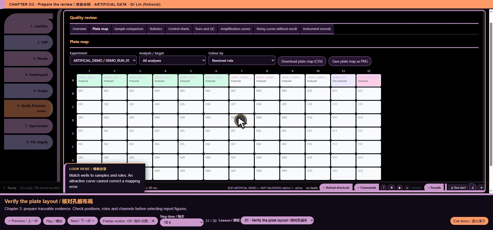

# core/ui/native_inspector.js — function reference

## C10413 · <callback@3433:30>

- Ownership: MISSY first-party
- Module: core/ui/native_inspector.js, line 3; script 11, script line 3433
- Form: ArrowFunctionExpression; parameters: ``
- AST classification: `new_or_changed_anonymous`
- R1 entry status: `observed_in_passing_scenario`
- Passing scenario observations: voice-demo, formats, training, voice-routing, voice-state, ack-queue, clarification, voice-bargein, command-finish, chart-focus, guided-tour, precision, quantstudio, evidence-keyboard
- R2 clean contract evidence: No separately linked clean contract assertion for this function
- Code SHA-256: `7d4e33ef1b943b51427e653d7a4bd0962531f722a28ebca9749c8b113d35968f`
- [Complete exact function source](https://github.com/mihaiionitabio-alt/zpcrweb/blob/missy-public-offline-2026-10-20/documentation/releases/2026-10-31-full-wiki/code/functions/C10413.js)

```javascript
()=>{
 const selections=new WeakMap(),initial=()=>({read:0,channel:0,row:0,column:0});
 // Existing report pseudonymization shallow-clones runs, retaining native payload identity.
 const selectionKey=run=>run.zpcr||run.pcrd||run;
 const t=(en,zh)=>UI_LANG==='zh'?zh:en;
 const array=a=>Array.isArray(a)||(ArrayBuffer.isView(a)&&typeof a.length==='number');
 const integer=(n,max)=>Number.isSafeInteger(n)&&n>=0&&n<max;
 const numeric=v=>typeof v!=='number'?'':Object.is(v,-0)?'-0':String(v);
 const labels={mean:['Stored mean','保存的均值'],sd:['Stored within-read SD','保存的单次读数标准差'],min:['Stored minimum','保存的最小值'],max:['Stored maximum','保存的最大值']};
 function snapshot(run,index=0,choice=selections.get(selectionKey(run))||initial()){
  const out={view:index+1,filename:run.file||'',status:'not_exposed',reason:run.pcrdLocked?'locked':run.isTemplate?'template':'no_native',selection:{...choice},entries:[]};
  if(run.pcrdLocked||run.isTemplate)return out;
  const raw=run.zpcr||run.pcrd;if(!Array.isArray(raw?.reads)||!raw.reads.length)return out;
  if(!integer(choice.read,raw.reads.length)){out.reason='invalid_selection';return out;}
  const read=raw.reads[choice.read],width=run.zpcr?4:read.tupleWidth,data=run.zpcr?read.wellData:read.originalData,dark=run.zpcr?read.darkData:read.originalDark;
  if(![read.rows,read.cols,read.channels].every(n=>Number.isSafeInteger(n)&&n>0)||![1,2,4].includes(width)||!array(data)||data.length!==read.rows*read.cols*read.channels*width){out.reason='unsupported_layout';return out;}
  if(!integer(choice.channel,read.channels)||!integer(choice.row,read.rows)||!integer(choice.column,read.cols)){out.reason='invalid_selection';return out;}
  Object.assign(out,{status:'provided',reason:'',format:run.zpcr?'zpcr':'pcrd',read_name:read.name||'',step:read.step??'',cycle:read.cycle??'',read_count:raw.reads.length,rows:read.rows,columns:read.cols,channels:read.channels,width,role:'unknown'});
  const grid=raw.grid||{};
  if(Number.isSafeInteger(grid.sampleRows)&&Number.isSafeInteger(grid.referenceRows)&&grid.sampleRows>=0&&grid.referenceRows>=0&&grid.sampleRows+grid.referenceRows===read.rows)out.role=choice.row<grid.sampleRows?'sample_grid':'reference_grid';
  const base=((choice.channel*read.rows+choice.row)*read.cols+choice.column)*width;
  const push=(kind,source,at,a,k)=>{const value=a?.[at];out.entries.push({kind,source_array:source,source_index:at,component:run.zpcr?['mean','sd','min','max'][k]:'native_'+(k+1),value:numeric(value),state:typeof value!=='number'?'unavailable':Number.isFinite(value)?'finite':'native_nonfinite'});};
  for(let k=0;k<width;k++)push('position',run.zpcr?'wellData':'originalData',base+k,data,k);
  const darkAvailable=array(dark)&&dark.length===read.channels*width;
  for(let k=0;k<width;k++)push('dark',run.zpcr?'darkData':'originalDark',choice.channel*width+k,darkAvailable?dark:null,k);
  return out;
 }
 function select(run,choice){if(snapshot(run,0,choice).status!=='provided')return false;selections.set(selectionKey(run),{read:choice.read,channel:choice.channel,row:choice.row,column:choice.column});return true;}
 function reason(code,localized){const p=(en,zh)=>localized?t(en,zh):en;return ({locked:p('Locked inventory only; no decoded native values.','仅有加密文件清单；未解码原始值。'),template:p('Template only; no completed acquisition is implied.','仅模板；不表示已完成数据采集。'),no_native:p('This view does not expose supported original native arrays. No new decoding is attempted.','此视图未提供受支持的原始数组。不尝试新的解码。'),unsupported_layout:p('Native array layout is not supported by this inspector; existing reader/results are unaffected.','此检查器不支持该原始数组布局；不影响已有读取器和结果。'),invalid_selection:p('Choose valid integer read, channel, physical row and column indices.','请选择有效的整数读取序号、通道、实际行号和列号。')})[code]||'';}
 function role(code,localized){const p=(en,zh)=>localized?t(en,zh):en;return ({sample_grid:p('Declared sample grid; not sample identity','声明的样本区域；不表示样本标识'),reference_grid:p('Declared instrument reference row; not a PCR control','声明的仪器参比行；不属于 PCR 对照'),unknown:p('Physical role unavailable','未提供实际位置用途')})[code];}
 function scope(s,localized){if(s.status!=='provided')return reason(s.reason,localized);const p=(en,zh)=>localized?t(en,zh):en,c=s.selection;return p('Read ','读取序号 ')+(c.read+1)+' · '+s.read_name+p('; channel ','；通道 ')+(c.channel+1)+p('; physical row/column ','；实际行／列 ')+(c.row+1)+'/'+(c.column+1)+p('; step/cycle ','；步骤／循环 ')+s.step+'/'+s.cycle+' · '+role(s.role,localized);}
 function component(e,localized){const p=(en,zh)=>localized?t(en,zh):en;return (e.kind==='dark'?p('Dark: ','暗值：'):p('Position: ','位置：'))+(labels[e.component]?(localized?t(...labels[e.component]):labels[e.component][0]):p('Original component ','原始组分 ')+e.component.split('_')[1]+p(' (meaning not assigned)','（未赋予含义）'));}
 function state(code,localized){const p=(en,zh)=>localized?t(en,zh):en;return ({finite:p('Decoded finite number','解码后的有限数值'),native_nonfinite:p('Native non-finite token; not replaced','原始非有限标记；未替换'),unavailable:p('Unavailable; not zero','未提供；不等于零')})[code];}
 function rows(localized=false){return RUNS.flatMap((run,i)=>{const s=snapshot(run,i),p=(en,zh)=>localized?t(en,zh):en;const common={native_view:i+1,filename:s.filename,inspection_scope:scope(s,localized)};
  if(s.status!=='provided')return [{...common,native_component:p('Availability','提供情况'),native_value:'',native_state:reason(s.reason,localized),native_basis:p('Existing reader and results unchanged.','已有读取器和结果保持不变。')}];
  return s.entries.map(e=>({...common,native_component:component(e,localized),native_value:e.value,native_state:state(e.state,localized),native_basis:e.source_array+'['+e.source_index+']'+p(' · decoded numeric excerpt only; not original bits or calibrated units',' · 仅为解码后的数值摘录；不代表原始位值或校准单位'),component_code:e.component,source_array:e.source_array,source_index:e.source_index,read_number:s.selection.read+1,channel_number:s.selection.channel+1,physical_row:s.selection.row+1,physical_column:s.selection.column+1,role_code:s.role}));});}
 function render(){return MISSY_EVIDENCE_A11Y.refresh('missy-native-inspector',renderContent);}
 function renderContent(){
  const host=document.getElementById('loadedcard');if(!host)return;let box=document.getElementById('missy-native-inspector');
  if(!box){box=document.createElement('details');box.id='missy-native-inspector';box.setAttribute('data-i18n-skip','');box.addEventListener('toggle',render);host.append(box);}
  box.hidden=!RUNS.length;const open=box.open;const title=document.createElement('summary');title.textContent=t('Native reading inspector (read only)','原始读数检查器（只读）');MISSY_EVIDENCE_A11Y.reset(box,title);if(!open)return;
  const note=document.createElement('p');note.textContent=t('Inspect one decoded read/channel/physical position per source. This is an excerpt, not a complete raw export. No Cq, Tm, quantity or QC result is calculated. Stored within-read SD is not replicate SD; contributing count is unavailable. Optical channel does not establish dye identity.','每个源文件仅查看一个解码后的读取序号／通道／实际位置。这是摘录，不是完整原始数据导出。不计算 Cq、Tm、定量值或质控结果。保存的单次读数标准差不等于重复测定标准差；未提供构成该读数的测量次数。光学通道不表示染料标识。');box.append(note);
  RUNS.forEach((run,i)=>{const s=snapshot(run,i),card=document.createElement('div'),h=document.createElement('h4');card.className='native-card';h.id='missy-native-source-'+i;h.textContent=(i+1)+' · '+run.file;card.append(h);box.append(card);
   if(s.status!=='provided'){const p=document.createElement('p');p.textContent=reason(s.reason,true);card.append(p);return;}
   const form=document.createElement('form');form.noValidate=true;form.setAttribute('aria-labelledby',h.id);const inputs={};
   for(const [key,label,max]of [['read',t('Read number','读取序号'),s.read_count],['channel',t('Stored channel','保存的通道'),s.channels],['row',t('Physical row','实际行号'),s.rows],['column',t('Physical column','实际列号'),s.columns]]){const l=document.createElement('label'),input=document.createElement('input');l.textContent=label+' (1–'+max+') ';input.type='number';input.min='1';input.max=String(max);input.step='1';input.value=String(s.selection[key]+1);input.setAttribute('aria-label',label);input.dataset.nativeIndex=key;input.setAttribute('aria-describedby','missy-native-error-'+i);l.append(input);form.append(l);inputs[key]=input;}
   const button=document.createElement('button');button.type='submit';button.textContent=t('Inspect','查看');form.append(button);const error=document.createElement('p');error.id='missy-native-error-'+i;error.setAttribute('aria-live','polite');form.addEventListener('submit',e=>{e.preventDefault();const choice=Object.fromEntries(Object.entries(inputs).map(([k,v])=>[k,v.value.trim()===''?NaN:Number(v.value)-1]));if(!select(run,choice)){error.textContent=reason('invalid_selection',true);return;}render();});card.append(form,error);
   const context=document.createElement('p');context.textContent=scope(s,true);card.append(context);const dl=document.createElement('dl');for(const e of s.entries){const dt=document.createElement('dt'),dd=document.createElement('dd');dt.textContent=component(e,true);dd.textContent=[e.value,state(e.state,true),e.source_array+'['+e.source_index+']'].filter(Boolean).join(' · ');dl.append(dt,dd);}card.append(dl);
  });
 }
 MISSY_HOOKS.use('showTab','native-inspector/read-only-panel',262,next=>function(...args){const result=next(...args);render();return result;});
 MISSY_HOOKS.use('selDataItems','native-inspector/optional-table',262,next=>function(){return next().concat({id:'data:native_excerpt',kind:'data',group:'Source provenance',title:'Native reading excerpt',note:'',ready:()=>RUNS.length>0,rows:()=>rows(true),file:'native_reading_excerpt.csv',tableOptions:{full:true,columns:['filename','inspection_scope','native_component','native_value','native_state','native_basis']},text:()=>csvOf(rows(false))});});
 MISSY_HOOKS.use('exportCatalogue','native-inspector/optional-csv',262,next=>function(){return next().concat({title:'Native reading excerpt (CSV)',note:'',ready:()=>RUNS.length>0,run:()=>download('native_reading_excerpt.csv',csvOf(rows(false)),'text/csv')});});
 MISSY_HOOKS.use('cmdExec','native-inspector/read-only-command',262,next=>async function(raw){if(String(raw).trim().toLowerCase()==='native'){cmdTable(rows(true).map(r=>[r.filename,[r.inspection_scope,r.native_component,r.native_value,r.native_state,r.native_basis].filter(Boolean).join(' · ')]),true);return;}return next(raw);});
 if(typeof REPORT_LITERAL_COLUMNS!=='undefined')for(const key of ['inspection_scope','native_value','native_basis'])REPORT_LITERAL_COLUMNS.add(key);
 CMD_HELP.push(['native','show the current read-only native reading excerpt']);
 Object.assign(ZH_TERMS,{'Native reading excerpt':'原始读数摘录','Native reading excerpt (CSV)':'原始读数摘录（CSV）','show the current read-only native reading excerpt':'显示当前只读原始读数摘录',inspection_scope:'查看范围',native_component:'原始组分',native_value:'原始数值',native_state:'数值状态',native_basis:'数值依据'});
 const style=document.createElement('style');style.textContent='#missy-native-inspector{margin-top:16px;border-top:1px solid #d8dee8;padding-top:10px}#missy-native-inspector[hidden]{display:none!important}#missy-native-inspector summary{cursor:pointer;font-weight:600}#missy-native-inspector h4,#missy-native-inspector p{overflow-wrap:anywhere}#missy-native-inspector .native-card{border-top:1px solid #e5e7eb;padding:10px 0}#missy-native-inspector form{display:flex;flex-wrap:wrap;gap:10px;align-items:end}#missy-native-inspector label{display:flex;flex-direction:column;min-width:0;max-width:100%}#missy-native-inspector input{width:100px;max-width:100%;box-sizing:border-box}#missy-native-inspector dl{display:grid;grid-template-columns:minmax(160px,300px) minmax(0,1fr);gap:6px 14px}#missy-native-inspector dt,#missy-native-inspector dd{margin:0;min-width:0;overflow-wrap:anywhere}@media(max-width:600px){#missy-native-inspector dl{grid-template-columns:minmax(0,1fr)}#missy-native-inspector dd{margin-bottom:6px}}';document.head.append(style);
 document.addEventListener('DOMContentLoaded',()=>{render();const loaded=document.getElementById('loaded');if(loaded)new MutationObserver(render).observe(loaded,{childList:true});new MutationObserver(render).observe(document.body,{attributes:true,attributeFilter:['class']});});
 return Object.freeze({snapshot,select,rows,render});
}
```

## C10414 · initial

- Ownership: MISSY first-party
- Module: core/ui/native_inspector.js, line 4; script 11, script line 3434
- Form: ArrowFunctionExpression; parameters: ``
- AST classification: `new_named`
- R1 entry status: `observed_in_passing_scenario`
- Passing scenario observations: voice-demo, training, guided-tour, evidence-keyboard
- R2 clean contract evidence: No separately linked clean contract assertion for this function
- Code SHA-256: `bea6019e55e0740784abbbd784378ef8c2d021b2ac48355230f595931a47f860`
- [Complete exact function source](https://github.com/mihaiionitabio-alt/zpcrweb/blob/missy-public-offline-2026-10-20/documentation/releases/2026-10-31-full-wiki/code/functions/C10414.js)

```javascript
()=>({read:0,channel:0,row:0,column:0})
```

## C10415 · selectionKey

- Ownership: MISSY first-party
- Module: core/ui/native_inspector.js, line 6; script 11, script line 3436
- Form: ArrowFunctionExpression; parameters: `run`
- AST classification: `new_named`
- R1 entry status: `observed_in_passing_scenario`
- Passing scenario observations: voice-demo, training, guided-tour, evidence-keyboard
- R2 clean contract evidence: No separately linked clean contract assertion for this function
- Code SHA-256: `4b73b666fdc723352c0dff9a47abd9bc038c29c71c7ee6461899e1c3fcd3e8bb`
- [Complete exact function source](https://github.com/mihaiionitabio-alt/zpcrweb/blob/missy-public-offline-2026-10-20/documentation/releases/2026-10-31-full-wiki/code/functions/C10415.js)

```javascript
run=>run.zpcr||run.pcrd||run
```

## C10416 · t

- Ownership: MISSY first-party
- Module: core/ui/native_inspector.js, line 7; script 11, script line 3437
- Form: ArrowFunctionExpression; parameters: `en, zh`
- AST classification: `ambiguous_name_match`
- R1 entry status: `observed_in_passing_scenario`
- Passing scenario observations: voice-demo, formats, training, voice-routing, voice-state, ack-queue, clarification, voice-bargein, command-finish, chart-focus, guided-tour, precision, quantstudio, evidence-keyboard
- R2 clean contract evidence: No separately linked clean contract assertion for this function
- Code SHA-256: `57fe109157b63479c9f8652d14cc788e6cd7864c8445ea4034fa708c8cb76346`
- [Complete exact function source](https://github.com/mihaiionitabio-alt/zpcrweb/blob/missy-public-offline-2026-10-20/documentation/releases/2026-10-31-full-wiki/code/functions/C10416.js)

```javascript
(en,zh)=>UI_LANG==='zh'?zh:en
```

## C10417 · array

- Ownership: MISSY first-party
- Module: core/ui/native_inspector.js, line 8; script 11, script line 3438
- Form: ArrowFunctionExpression; parameters: `a`
- AST classification: `new_named`
- R1 entry status: `observed_in_passing_scenario`
- Passing scenario observations: evidence-keyboard
- R2 clean contract evidence: No separately linked clean contract assertion for this function
- Code SHA-256: `6b5cf77d5dcd97fc1a007fe4a362c0e66affff6dbad8ffa16e3529b444bdaa17`
- [Complete exact function source](https://github.com/mihaiionitabio-alt/zpcrweb/blob/missy-public-offline-2026-10-20/documentation/releases/2026-10-31-full-wiki/code/functions/C10417.js)

```javascript
a=>Array.isArray(a)||(ArrayBuffer.isView(a)&&typeof a.length==='number')
```

## C10418 · integer

- Ownership: MISSY first-party
- Module: core/ui/native_inspector.js, line 9; script 11, script line 3439
- Form: ArrowFunctionExpression; parameters: `n, max`
- AST classification: `new_named`
- R1 entry status: `observed_in_passing_scenario`
- Passing scenario observations: evidence-keyboard
- R2 clean contract evidence: No separately linked clean contract assertion for this function
- Code SHA-256: `67499e25d55fc9e4be75a5ae1c43e886a4f678234da94c4ce872da85478df59f`
- [Complete exact function source](https://github.com/mihaiionitabio-alt/zpcrweb/blob/missy-public-offline-2026-10-20/documentation/releases/2026-10-31-full-wiki/code/functions/C10418.js)

```javascript
(n,max)=>Number.isSafeInteger(n)&&n>=0&&n<max
```

## C10419 · numeric

- Ownership: MISSY first-party
- Module: core/ui/native_inspector.js, line 10; script 11, script line 3440
- Form: ArrowFunctionExpression; parameters: `v`
- AST classification: `new_named`
- R1 entry status: `observed_in_passing_scenario`
- Passing scenario observations: evidence-keyboard
- R2 clean contract evidence: No separately linked clean contract assertion for this function
- Code SHA-256: `caea6429081b85fe7361568885203edf88f75d39bf5b3d7fe9869b2c14380c4b`
- [Complete exact function source](https://github.com/mihaiionitabio-alt/zpcrweb/blob/missy-public-offline-2026-10-20/documentation/releases/2026-10-31-full-wiki/code/functions/C10419.js)

```javascript
v=>typeof v!=='number'?'':Object.is(v,-0)?'-0':String(v)
```

## C10420 · snapshot

- Ownership: MISSY first-party
- Module: core/ui/native_inspector.js, line 12; script 11, script line 3442
- Form: FunctionDeclaration; parameters: `run, index=0, choice=selections.get(selectionKey(run))||initial()`
- AST classification: `new_named`
- R1 entry status: `observed_in_passing_scenario`
- Passing scenario observations: voice-demo, training, guided-tour, evidence-keyboard
- R2 clean contract evidence: No separately linked clean contract assertion for this function
- Code SHA-256: `5348254d400c04b17b3e05c54835e58078a0317d2054212bc9a4a7ea89fd3303`
- [Complete exact function source](https://github.com/mihaiionitabio-alt/zpcrweb/blob/missy-public-offline-2026-10-20/documentation/releases/2026-10-31-full-wiki/code/functions/C10420.js)

```javascript
function snapshot(run,index=0,choice=selections.get(selectionKey(run))||initial()){
  const out={view:index+1,filename:run.file||'',status:'not_exposed',reason:run.pcrdLocked?'locked':run.isTemplate?'template':'no_native',selection:{...choice},entries:[]};
  if(run.pcrdLocked||run.isTemplate)return out;
  const raw=run.zpcr||run.pcrd;if(!Array.isArray(raw?.reads)||!raw.reads.length)return out;
  if(!integer(choice.read,raw.reads.length)){out.reason='invalid_selection';return out;}
  const read=raw.reads[choice.read],width=run.zpcr?4:read.tupleWidth,data=run.zpcr?read.wellData:read.originalData,dark=run.zpcr?read.darkData:read.originalDark;
  if(![read.rows,read.cols,read.channels].every(n=>Number.isSafeInteger(n)&&n>0)||![1,2,4].includes(width)||!array(data)||data.length!==read.rows*read.cols*read.channels*width){out.reason='unsupported_layout';return out;}
  if(!integer(choice.channel,read.channels)||!integer(choice.row,read.rows)||!integer(choice.column,read.cols)){out.reason='invalid_selection';return out;}
  Object.assign(out,{status:'provided',reason:'',format:run.zpcr?'zpcr':'pcrd',read_name:read.name||'',step:read.step??'',cycle:read.cycle??'',read_count:raw.reads.length,rows:read.rows,columns:read.cols,channels:read.channels,width,role:'unknown'});
  const grid=raw.grid||{};
  if(Number.isSafeInteger(grid.sampleRows)&&Number.isSafeInteger(grid.referenceRows)&&grid.sampleRows>=0&&grid.referenceRows>=0&&grid.sampleRows+grid.referenceRows===read.rows)out.role=choice.row<grid.sampleRows?'sample_grid':'reference_grid';
  const base=((choice.channel*read.rows+choice.row)*read.cols+choice.column)*width;
  const push=(kind,source,at,a,k)=>{const value=a?.[at];out.entries.push({kind,source_array:source,source_index:at,component:run.zpcr?['mean','sd','min','max'][k]:'native_'+(k+1),value:numeric(value),state:typeof value!=='number'?'unavailable':Number.isFinite(value)?'finite':'native_nonfinite'});};
  for(let k=0;k<width;k++)push('position',run.zpcr?'wellData':'originalData',base+k,data,k);
  const darkAvailable=array(dark)&&dark.length===read.channels*width;
  for(let k=0;k<width;k++)push('dark',run.zpcr?'darkData':'originalDark',choice.channel*width+k,darkAvailable?dark:null,k);
  return out;
 }
```

## C10421 · <callback@3448:48>

- Ownership: MISSY first-party
- Module: core/ui/native_inspector.js, line 18; script 11, script line 3448
- Form: ArrowFunctionExpression; parameters: `n`
- AST classification: `new_or_changed_anonymous`
- R1 entry status: `observed_in_passing_scenario`
- Passing scenario observations: evidence-keyboard
- R2 clean contract evidence: No separately linked clean contract assertion for this function
- Code SHA-256: `120f5e5aec9ce34451755f70a5026d169856b3807401f60885a90f16bb5faa5c`
- [Complete exact function source](https://github.com/mihaiionitabio-alt/zpcrweb/blob/missy-public-offline-2026-10-20/documentation/releases/2026-10-31-full-wiki/code/functions/C10421.js)

```javascript
n=>Number.isSafeInteger(n)&&n>0
```

## C10422 · push

- Ownership: MISSY first-party
- Module: core/ui/native_inspector.js, line 24; script 11, script line 3454
- Form: ArrowFunctionExpression; parameters: `kind, source, at, a, k`
- AST classification: `ambiguous_name_match`
- R1 entry status: `observed_in_passing_scenario`
- Passing scenario observations: evidence-keyboard
- R2 clean contract evidence: No separately linked clean contract assertion for this function
- Code SHA-256: `d5c6090e00f749501e9bb07afc88ce70401d616e19b8603312337d83e85d0819`
- [Complete exact function source](https://github.com/mihaiionitabio-alt/zpcrweb/blob/missy-public-offline-2026-10-20/documentation/releases/2026-10-31-full-wiki/code/functions/C10422.js)

```javascript
(kind,source,at,a,k)=>{const value=a?.[at];out.entries.push({kind,source_array:source,source_index:at,component:run.zpcr?['mean','sd','min','max'][k]:'native_'+(k+1),value:numeric(value),state:typeof value!=='number'?'unavailable':Number.isFinite(value)?'finite':'native_nonfinite'});}
```

## C10423 · select

- Ownership: MISSY first-party
- Module: core/ui/native_inspector.js, line 30; script 11, script line 3460
- Form: FunctionDeclaration; parameters: `run, choice`
- AST classification: `new_named`
- R1 entry status: `not_observed_in_passing_scenario`
- Passing scenario observations: No passing R1 instrumented scenario observation
- R2 clean contract evidence: No separately linked clean contract assertion for this function
- Code SHA-256: `d5d9e247e4f6c008e4daf8b2f61d55f839ae089eb08818182e7713ba0b977bd0`
- [Complete exact function source](https://github.com/mihaiionitabio-alt/zpcrweb/blob/missy-public-offline-2026-10-20/documentation/releases/2026-10-31-full-wiki/code/functions/C10423.js)

```javascript
function select(run,choice){if(snapshot(run,0,choice).status!=='provided')return false;selections.set(selectionKey(run),{read:choice.read,channel:choice.channel,row:choice.row,column:choice.column});return true;}
```

## C10424 · reason

- Ownership: MISSY first-party
- Module: core/ui/native_inspector.js, line 31; script 11, script line 3461
- Form: FunctionDeclaration; parameters: `code, localized`
- AST classification: `new_named`
- R1 entry status: `observed_in_passing_scenario`
- Passing scenario observations: voice-demo, training, guided-tour, evidence-keyboard
- R2 clean contract evidence: No separately linked clean contract assertion for this function
- Code SHA-256: `788f3c6bf8bbe0e13a913fe37282ab9bde85952fb3442a7180c4ccefbd0c01e7`
- [Complete exact function source](https://github.com/mihaiionitabio-alt/zpcrweb/blob/missy-public-offline-2026-10-20/documentation/releases/2026-10-31-full-wiki/code/functions/C10424.js)

```javascript
function reason(code,localized){const p=(en,zh)=>localized?t(en,zh):en;return ({locked:p('Locked inventory only; no decoded native values.','仅有加密文件清单；未解码原始值。'),template:p('Template only; no completed acquisition is implied.','仅模板；不表示已完成数据采集。'),no_native:p('This view does not expose supported original native arrays. No new decoding is attempted.','此视图未提供受支持的原始数组。不尝试新的解码。'),unsupported_layout:p('Native array layout is not supported by this inspector; existing reader/results are unaffected.','此检查器不支持该原始数组布局；不影响已有读取器和结果。'),invalid_selection:p('Choose valid integer read, channel, physical row and column indices.','请选择有效的整数读取序号、通道、实际行号和列号。')})[code]||'';}
```

## C10425 · p

- Ownership: MISSY first-party
- Module: core/ui/native_inspector.js, line 31; script 11, script line 3461
- Form: ArrowFunctionExpression; parameters: `en, zh`
- AST classification: `ambiguous_name_match`
- R1 entry status: `observed_in_passing_scenario`
- Passing scenario observations: voice-demo, training, guided-tour, evidence-keyboard
- R2 clean contract evidence: No separately linked clean contract assertion for this function
- Code SHA-256: `63fdbe9f56438766280ce9932f50ab3cfab6fdead82e057b5474dbeffde0d260`
- [Complete exact function source](https://github.com/mihaiionitabio-alt/zpcrweb/blob/missy-public-offline-2026-10-20/documentation/releases/2026-10-31-full-wiki/code/functions/C10425.js)

```javascript
(en,zh)=>localized?t(en,zh):en
```

## C10426 · role

- Ownership: MISSY first-party
- Module: core/ui/native_inspector.js, line 32; script 11, script line 3462
- Form: FunctionDeclaration; parameters: `code, localized`
- AST classification: `new_named`
- R1 entry status: `observed_in_passing_scenario`
- Passing scenario observations: evidence-keyboard
- R2 clean contract evidence: No separately linked clean contract assertion for this function
- Code SHA-256: `f3b7a982ffc85f85d7625f1ff756b20f4d0e359f6a9e603e3c7ab851ec828edd`
- [Complete exact function source](https://github.com/mihaiionitabio-alt/zpcrweb/blob/missy-public-offline-2026-10-20/documentation/releases/2026-10-31-full-wiki/code/functions/C10426.js)

```javascript
function role(code,localized){const p=(en,zh)=>localized?t(en,zh):en;return ({sample_grid:p('Declared sample grid; not sample identity','声明的样本区域；不表示样本标识'),reference_grid:p('Declared instrument reference row; not a PCR control','声明的仪器参比行；不属于 PCR 对照'),unknown:p('Physical role unavailable','未提供实际位置用途')})[code];}
```

## C10427 · p

- Ownership: MISSY first-party
- Module: core/ui/native_inspector.js, line 32; script 11, script line 3462
- Form: ArrowFunctionExpression; parameters: `en, zh`
- AST classification: `ambiguous_name_match`
- R1 entry status: `observed_in_passing_scenario`
- Passing scenario observations: evidence-keyboard
- R2 clean contract evidence: No separately linked clean contract assertion for this function
- Code SHA-256: `63fdbe9f56438766280ce9932f50ab3cfab6fdead82e057b5474dbeffde0d260`
- [Complete exact function source](https://github.com/mihaiionitabio-alt/zpcrweb/blob/missy-public-offline-2026-10-20/documentation/releases/2026-10-31-full-wiki/code/functions/C10427.js)

```javascript
(en,zh)=>localized?t(en,zh):en
```

## C10428 · scope

- Ownership: MISSY first-party
- Module: core/ui/native_inspector.js, line 33; script 11, script line 3463
- Form: FunctionDeclaration; parameters: `s, localized`
- AST classification: `new_named`
- R1 entry status: `observed_in_passing_scenario`
- Passing scenario observations: voice-demo, training, guided-tour, evidence-keyboard
- R2 clean contract evidence: No separately linked clean contract assertion for this function
- Code SHA-256: `c2403909b0299cdd1ca542b654ed1c008e638161afc4a15500635ccd705dc666`
- [Complete exact function source](https://github.com/mihaiionitabio-alt/zpcrweb/blob/missy-public-offline-2026-10-20/documentation/releases/2026-10-31-full-wiki/code/functions/C10428.js)

```javascript
function scope(s,localized){if(s.status!=='provided')return reason(s.reason,localized);const p=(en,zh)=>localized?t(en,zh):en,c=s.selection;return p('Read ','读取序号 ')+(c.read+1)+' · '+s.read_name+p('; channel ','；通道 ')+(c.channel+1)+p('; physical row/column ','；实际行／列 ')+(c.row+1)+'/'+(c.column+1)+p('; step/cycle ','；步骤／循环 ')+s.step+'/'+s.cycle+' · '+role(s.role,localized);}
```

## C10429 · p

- Ownership: MISSY first-party
- Module: core/ui/native_inspector.js, line 33; script 11, script line 3463
- Form: ArrowFunctionExpression; parameters: `en, zh`
- AST classification: `ambiguous_name_match`
- R1 entry status: `observed_in_passing_scenario`
- Passing scenario observations: evidence-keyboard
- R2 clean contract evidence: No separately linked clean contract assertion for this function
- Code SHA-256: `63fdbe9f56438766280ce9932f50ab3cfab6fdead82e057b5474dbeffde0d260`
- [Complete exact function source](https://github.com/mihaiionitabio-alt/zpcrweb/blob/missy-public-offline-2026-10-20/documentation/releases/2026-10-31-full-wiki/code/functions/C10429.js)

```javascript
(en,zh)=>localized?t(en,zh):en
```

## C10430 · component

- Ownership: MISSY first-party
- Module: core/ui/native_inspector.js, line 34; script 11, script line 3464
- Form: FunctionDeclaration; parameters: `e, localized`
- AST classification: `new_named`
- R1 entry status: `observed_in_passing_scenario`
- Passing scenario observations: evidence-keyboard
- R2 clean contract evidence: No separately linked clean contract assertion for this function
- Code SHA-256: `afe412fbb06c3cf6b110c60c8af785d2c95e7674709d3948ce313b2807c1830b`
- [Complete exact function source](https://github.com/mihaiionitabio-alt/zpcrweb/blob/missy-public-offline-2026-10-20/documentation/releases/2026-10-31-full-wiki/code/functions/C10430.js)

```javascript
function component(e,localized){const p=(en,zh)=>localized?t(en,zh):en;return (e.kind==='dark'?p('Dark: ','暗值：'):p('Position: ','位置：'))+(labels[e.component]?(localized?t(...labels[e.component]):labels[e.component][0]):p('Original component ','原始组分 ')+e.component.split('_')[1]+p(' (meaning not assigned)','（未赋予含义）'));}
```

## C10431 · p

- Ownership: MISSY first-party
- Module: core/ui/native_inspector.js, line 34; script 11, script line 3464
- Form: ArrowFunctionExpression; parameters: `en, zh`
- AST classification: `ambiguous_name_match`
- R1 entry status: `observed_in_passing_scenario`
- Passing scenario observations: evidence-keyboard
- R2 clean contract evidence: No separately linked clean contract assertion for this function
- Code SHA-256: `63fdbe9f56438766280ce9932f50ab3cfab6fdead82e057b5474dbeffde0d260`
- [Complete exact function source](https://github.com/mihaiionitabio-alt/zpcrweb/blob/missy-public-offline-2026-10-20/documentation/releases/2026-10-31-full-wiki/code/functions/C10431.js)

```javascript
(en,zh)=>localized?t(en,zh):en
```

## C10432 · state

- Ownership: MISSY first-party
- Module: core/ui/native_inspector.js, line 35; script 11, script line 3465
- Form: FunctionDeclaration; parameters: `code, localized`
- AST classification: `new_named`
- R1 entry status: `observed_in_passing_scenario`
- Passing scenario observations: evidence-keyboard
- R2 clean contract evidence: No separately linked clean contract assertion for this function
- Code SHA-256: `561643f261fae96e38bcac5eacbb5718cabaa03fba34e1e868bab31ee5dd9edc`
- [Complete exact function source](https://github.com/mihaiionitabio-alt/zpcrweb/blob/missy-public-offline-2026-10-20/documentation/releases/2026-10-31-full-wiki/code/functions/C10432.js)

```javascript
function state(code,localized){const p=(en,zh)=>localized?t(en,zh):en;return ({finite:p('Decoded finite number','解码后的有限数值'),native_nonfinite:p('Native non-finite token; not replaced','原始非有限标记；未替换'),unavailable:p('Unavailable; not zero','未提供；不等于零')})[code];}
```

## C10433 · p

- Ownership: MISSY first-party
- Module: core/ui/native_inspector.js, line 35; script 11, script line 3465
- Form: ArrowFunctionExpression; parameters: `en, zh`
- AST classification: `ambiguous_name_match`
- R1 entry status: `observed_in_passing_scenario`
- Passing scenario observations: evidence-keyboard
- R2 clean contract evidence: No separately linked clean contract assertion for this function
- Code SHA-256: `63fdbe9f56438766280ce9932f50ab3cfab6fdead82e057b5474dbeffde0d260`
- [Complete exact function source](https://github.com/mihaiionitabio-alt/zpcrweb/blob/missy-public-offline-2026-10-20/documentation/releases/2026-10-31-full-wiki/code/functions/C10433.js)

```javascript
(en,zh)=>localized?t(en,zh):en
```

## C10434 · rows

- Ownership: MISSY first-party
- Module: core/ui/native_inspector.js, line 36; script 11, script line 3466
- Form: FunctionDeclaration; parameters: `localized=false`
- AST classification: `new_named`
- R1 entry status: `observed_in_passing_scenario`
- Passing scenario observations: voice-demo, training, guided-tour
- R2 clean contract evidence: No separately linked clean contract assertion for this function
- Code SHA-256: `585def336c0e0e17898bc4cb1c4ae547b6ac29d916d7e7c1a19fd454b1cc1bdb`
- [Complete exact function source](https://github.com/mihaiionitabio-alt/zpcrweb/blob/missy-public-offline-2026-10-20/documentation/releases/2026-10-31-full-wiki/code/functions/C10434.js)

```javascript
function rows(localized=false){return RUNS.flatMap((run,i)=>{const s=snapshot(run,i),p=(en,zh)=>localized?t(en,zh):en;const common={native_view:i+1,filename:s.filename,inspection_scope:scope(s,localized)};
  if(s.status!=='provided')return [{...common,native_component:p('Availability','提供情况'),native_value:'',native_state:reason(s.reason,localized),native_basis:p('Existing reader and results unchanged.','已有读取器和结果保持不变。')}];
  return s.entries.map(e=>({...common,native_component:component(e,localized),native_value:e.value,native_state:state(e.state,localized),native_basis:e.source_array+'['+e.source_index+']'+p(' · decoded numeric excerpt only; not original bits or calibrated units',' · 仅为解码后的数值摘录；不代表原始位值或校准单位'),component_code:e.component,source_array:e.source_array,source_index:e.source_index,read_number:s.selection.read+1,channel_number:s.selection.channel+1,physical_row:s.selection.row+1,physical_column:s.selection.column+1,role_code:s.role}));});}
```

## C10435 · <callback@3466:52>

- Ownership: MISSY first-party
- Module: core/ui/native_inspector.js, line 36; script 11, script line 3466
- Form: ArrowFunctionExpression; parameters: `run, i`
- AST classification: `new_or_changed_anonymous`
- R1 entry status: `observed_in_passing_scenario`
- Passing scenario observations: voice-demo, training, guided-tour
- R2 clean contract evidence: No separately linked clean contract assertion for this function
- Code SHA-256: `c771a3b67d2c39b36362dc31cc6d7345b531e774b11a68ea19f177f139628895`
- [Complete exact function source](https://github.com/mihaiionitabio-alt/zpcrweb/blob/missy-public-offline-2026-10-20/documentation/releases/2026-10-31-full-wiki/code/functions/C10435.js)

```javascript
(run,i)=>{const s=snapshot(run,i),p=(en,zh)=>localized?t(en,zh):en;const common={native_view:i+1,filename:s.filename,inspection_scope:scope(s,localized)};
  if(s.status!=='provided')return [{...common,native_component:p('Availability','提供情况'),native_value:'',native_state:reason(s.reason,localized),native_basis:p('Existing reader and results unchanged.','已有读取器和结果保持不变。')}];
  return s.entries.map(e=>({...common,native_component:component(e,localized),native_value:e.value,native_state:state(e.state,localized),native_basis:e.source_array+'['+e.source_index+']'+p(' · decoded numeric excerpt only; not original bits or calibrated units',' · 仅为解码后的数值摘录；不代表原始位值或校准单位'),component_code:e.component,source_array:e.source_array,source_index:e.source_index,read_number:s.selection.read+1,channel_number:s.selection.channel+1,physical_row:s.selection.row+1,physical_column:s.selection.column+1,role_code:s.role}));}
```

## C10436 · p

- Ownership: MISSY first-party
- Module: core/ui/native_inspector.js, line 36; script 11, script line 3466
- Form: ArrowFunctionExpression; parameters: `en, zh`
- AST classification: `ambiguous_name_match`
- R1 entry status: `observed_in_passing_scenario`
- Passing scenario observations: voice-demo, training, guided-tour
- R2 clean contract evidence: No separately linked clean contract assertion for this function
- Code SHA-256: `63fdbe9f56438766280ce9932f50ab3cfab6fdead82e057b5474dbeffde0d260`
- [Complete exact function source](https://github.com/mihaiionitabio-alt/zpcrweb/blob/missy-public-offline-2026-10-20/documentation/releases/2026-10-31-full-wiki/code/functions/C10436.js)

```javascript
(en,zh)=>localized?t(en,zh):en
```

## C10437 · <callback@3468:23>

- Ownership: MISSY first-party
- Module: core/ui/native_inspector.js, line 38; script 11, script line 3468
- Form: ArrowFunctionExpression; parameters: `e`
- AST classification: `new_or_changed_anonymous`
- R1 entry status: `not_observed_in_passing_scenario`
- Passing scenario observations: No passing R1 instrumented scenario observation
- R2 clean contract evidence: No separately linked clean contract assertion for this function
- Code SHA-256: `40f531b8ee2b45d0c3e804027f7558e80fb247cef5ed4db70979b38af718c9b0`
- [Complete exact function source](https://github.com/mihaiionitabio-alt/zpcrweb/blob/missy-public-offline-2026-10-20/documentation/releases/2026-10-31-full-wiki/code/functions/C10437.js)

```javascript
e=>({...common,native_component:component(e,localized),native_value:e.value,native_state:state(e.state,localized),native_basis:e.source_array+'['+e.source_index+']'+p(' · decoded numeric excerpt only; not original bits or calibrated units',' · 仅为解码后的数值摘录；不代表原始位值或校准单位'),component_code:e.component,source_array:e.source_array,source_index:e.source_index,read_number:s.selection.read+1,channel_number:s.selection.channel+1,physical_row:s.selection.row+1,physical_column:s.selection.column+1,role_code:s.role})
```

## C10438 · render

- Ownership: MISSY first-party
- Module: core/ui/native_inspector.js, line 39; script 11, script line 3469
- Form: FunctionDeclaration; parameters: ``
- AST classification: `ambiguous_name_match`
- R1 entry status: `observed_in_passing_scenario`
- Passing scenario observations: voice-demo, formats, training, voice-routing, voice-state, ack-queue, clarification, voice-bargein, command-finish, chart-focus, guided-tour, precision, quantstudio, evidence-keyboard
- R2 clean contract evidence: No separately linked clean contract assertion for this function
- Code SHA-256: `eac1c8cc16fbb62e768972a298218bb1a55fd53bfe471f8693aff7f82b4561fa`
- [Complete exact function source](https://github.com/mihaiionitabio-alt/zpcrweb/blob/missy-public-offline-2026-10-20/documentation/releases/2026-10-31-full-wiki/code/functions/C10438.js)

```javascript
function render(){return MISSY_EVIDENCE_A11Y.refresh('missy-native-inspector',renderContent);}
```

## C10439 · renderContent

- Ownership: MISSY first-party
- Module: core/ui/native_inspector.js, line 40; script 11, script line 3470
- Form: FunctionDeclaration; parameters: ``
- AST classification: `new_named`
- R1 entry status: `observed_in_passing_scenario`
- Passing scenario observations: voice-demo, formats, training, voice-routing, voice-state, ack-queue, clarification, voice-bargein, command-finish, chart-focus, guided-tour, precision, quantstudio, evidence-keyboard
- R2 clean contract evidence: No separately linked clean contract assertion for this function
- Code SHA-256: `437b1fb6c8506c09d8b86583e3a17aaba955bc56a9e4684ee8bd0c716b33edfe`
- [Complete exact function source](https://github.com/mihaiionitabio-alt/zpcrweb/blob/missy-public-offline-2026-10-20/documentation/releases/2026-10-31-full-wiki/code/functions/C10439.js)

```javascript
function renderContent(){
  const host=document.getElementById('loadedcard');if(!host)return;let box=document.getElementById('missy-native-inspector');
  if(!box){box=document.createElement('details');box.id='missy-native-inspector';box.setAttribute('data-i18n-skip','');box.addEventListener('toggle',render);host.append(box);}
  box.hidden=!RUNS.length;const open=box.open;const title=document.createElement('summary');title.textContent=t('Native reading inspector (read only)','原始读数检查器（只读）');MISSY_EVIDENCE_A11Y.reset(box,title);if(!open)return;
  const note=document.createElement('p');note.textContent=t('Inspect one decoded read/channel/physical position per source. This is an excerpt, not a complete raw export. No Cq, Tm, quantity or QC result is calculated. Stored within-read SD is not replicate SD; contributing count is unavailable. Optical channel does not establish dye identity.','每个源文件仅查看一个解码后的读取序号／通道／实际位置。这是摘录，不是完整原始数据导出。不计算 Cq、Tm、定量值或质控结果。保存的单次读数标准差不等于重复测定标准差；未提供构成该读数的测量次数。光学通道不表示染料标识。');box.append(note);
  RUNS.forEach((run,i)=>{const s=snapshot(run,i),card=document.createElement('div'),h=document.createElement('h4');card.className='native-card';h.id='missy-native-source-'+i;h.textContent=(i+1)+' · '+run.file;card.append(h);box.append(card);
   if(s.status!=='provided'){const p=document.createElement('p');p.textContent=reason(s.reason,true);card.append(p);return;}
   const form=document.createElement('form');form.noValidate=true;form.setAttribute('aria-labelledby',h.id);const inputs={};
   for(const [key,label,max]of [['read',t('Read number','读取序号'),s.read_count],['channel',t('Stored channel','保存的通道'),s.channels],['row',t('Physical row','实际行号'),s.rows],['column',t('Physical column','实际列号'),s.columns]]){const l=document.createElement('label'),input=document.createElement('input');l.textContent=label+' (1–'+max+') ';input.type='number';input.min='1';input.max=String(max);input.step='1';input.value=String(s.selection[key]+1);input.setAttribute('aria-label',label);input.dataset.nativeIndex=key;input.setAttribute('aria-describedby','missy-native-error-'+i);l.append(input);form.append(l);inputs[key]=input;}
   const button=document.createElement('button');button.type='submit';button.textContent=t('Inspect','查看');form.append(button);const error=document.createElement('p');error.id='missy-native-error-'+i;error.setAttribute('aria-live','polite');form.addEventListener('submit',e=>{e.preventDefault();const choice=Object.fromEntries(Object.entries(inputs).map(([k,v])=>[k,v.value.trim()===''?NaN:Number(v.value)-1]));if(!select(run,choice)){error.textContent=reason('invalid_selection',true);return;}render();});card.append(form,error);
   const context=document.createElement('p');context.textContent=scope(s,true);card.append(context);const dl=document.createElement('dl');for(const e of s.entries){const dt=document.createElement('dt'),dd=document.createElement('dd');dt.textContent=component(e,true);dd.textContent=[e.value,state(e.state,true),e.source_array+'['+e.source_index+']'].filter(Boolean).join(' · ');dl.append(dt,dd);}card.append(dl);
  });
 }
```

## C10440 · <callback@3475:15>

- Ownership: MISSY first-party
- Module: core/ui/native_inspector.js, line 45; script 11, script line 3475
- Form: ArrowFunctionExpression; parameters: `run, i`
- AST classification: `new_or_changed_anonymous`
- R1 entry status: `observed_in_passing_scenario`
- Passing scenario observations: evidence-keyboard
- R2 clean contract evidence: No separately linked clean contract assertion for this function
- Code SHA-256: `3b1cc9a02ea42d71381939bccfc79dbffd68cba2181e6459466d6a4d83e40478`
- [Complete exact function source](https://github.com/mihaiionitabio-alt/zpcrweb/blob/missy-public-offline-2026-10-20/documentation/releases/2026-10-31-full-wiki/code/functions/C10440.js)

```javascript
(run,i)=>{const s=snapshot(run,i),card=document.createElement('div'),h=document.createElement('h4');card.className='native-card';h.id='missy-native-source-'+i;h.textContent=(i+1)+' · '+run.file;card.append(h);box.append(card);
   if(s.status!=='provided'){const p=document.createElement('p');p.textContent=reason(s.reason,true);card.append(p);return;}
   const form=document.createElement('form');form.noValidate=true;form.setAttribute('aria-labelledby',h.id);const inputs={};
   for(const [key,label,max]of [['read',t('Read number','读取序号'),s.read_count],['channel',t('Stored channel','保存的通道'),s.channels],['row',t('Physical row','实际行号'),s.rows],['column',t('Physical column','实际列号'),s.columns]]){const l=document.createElement('label'),input=document.createElement('input');l.textContent=label+' (1–'+max+') ';input.type='number';input.min='1';input.max=String(max);input.step='1';input.value=String(s.selection[key]+1);input.setAttribute('aria-label',label);input.dataset.nativeIndex=key;input.setAttribute('aria-describedby','missy-native-error-'+i);l.append(input);form.append(l);inputs[key]=input;}
   const button=document.createElement('button');button.type='submit';button.textContent=t('Inspect','查看');form.append(button);const error=document.createElement('p');error.id='missy-native-error-'+i;error.setAttribute('aria-live','polite');form.addEventListener('submit',e=>{e.preventDefault();const choice=Object.fromEntries(Object.entries(inputs).map(([k,v])=>[k,v.value.trim()===''?NaN:Number(v.value)-1]));if(!select(run,choice)){error.textContent=reason('invalid_selection',true);return;}render();});card.append(form,error);
   const context=document.createElement('p');context.textContent=scope(s,true);card.append(context);const dl=document.createElement('dl');for(const e of s.entries){const dt=document.createElement('dt'),dd=document.createElement('dd');dt.textContent=component(e,true);dd.textContent=[e.value,state(e.state,true),e.source_array+'['+e.source_index+']'].filter(Boolean).join(' · ');dl.append(dt,dd);}card.append(dl);
  }
```

## C10441 · <callback@3479:272>

- Ownership: MISSY first-party
- Module: core/ui/native_inspector.js, line 49; script 11, script line 3479
- Form: ArrowFunctionExpression; parameters: `e`
- AST classification: `new_or_changed_anonymous`
- R1 entry status: `not_observed_in_passing_scenario`
- Passing scenario observations: No passing R1 instrumented scenario observation
- R2 clean contract evidence: No separately linked clean contract assertion for this function
- Code SHA-256: `3957a10c7f87cb65b208ef3c29f4a2977fed3af0b1ce1cfe9b806f1a4840fa69`
- [Complete exact function source](https://github.com/mihaiionitabio-alt/zpcrweb/blob/missy-public-offline-2026-10-20/documentation/releases/2026-10-31-full-wiki/code/functions/C10441.js)

```javascript
e=>{e.preventDefault();const choice=Object.fromEntries(Object.entries(inputs).map(([k,v])=>[k,v.value.trim()===''?NaN:Number(v.value)-1]));if(!select(run,choice)){error.textContent=reason('invalid_selection',true);return;}render();}
```

## C10442 · <callback@3479:354>

- Ownership: MISSY first-party
- Module: core/ui/native_inspector.js, line 49; script 11, script line 3479
- Form: ArrowFunctionExpression; parameters: `[k,v]`
- AST classification: `new_or_changed_anonymous`
- R1 entry status: `not_observed_in_passing_scenario`
- Passing scenario observations: No passing R1 instrumented scenario observation
- R2 clean contract evidence: No separately linked clean contract assertion for this function
- Code SHA-256: `9b21568317a06ab2911498b52ba5ffc7f52fe5d9564dfe3fb1b17e324ef9ecc1`
- [Complete exact function source](https://github.com/mihaiionitabio-alt/zpcrweb/blob/missy-public-offline-2026-10-20/documentation/releases/2026-10-31-full-wiki/code/functions/C10442.js)

```javascript
([k,v])=>[k,v.value.trim()===''?NaN:Number(v.value)-1]
```

## C10443 · <callback@3483:66>

- Ownership: MISSY first-party
- Module: core/ui/native_inspector.js, line 53; script 11, script line 3483
- Form: ArrowFunctionExpression; parameters: `next`
- AST classification: `new_or_changed_anonymous`
- R1 entry status: `observed_in_passing_scenario`
- Passing scenario observations: voice-demo, formats, training, voice-routing, clarification, chart-focus, guided-tour, precision, evidence-keyboard
- R2 clean contract evidence: No separately linked clean contract assertion for this function
- Code SHA-256: `56eb88a53fdd2ca50d94e1060947166b7945000f409408ace28b2292c42c3ba1`
- [Complete exact function source](https://github.com/mihaiionitabio-alt/zpcrweb/blob/missy-public-offline-2026-10-20/documentation/releases/2026-10-31-full-wiki/code/functions/C10443.js)

```javascript
next=>function(...args){const result=next(...args);render();return result;}
```

## C10444 · <callback@3483:72>

- Ownership: MISSY first-party
- Module: core/ui/native_inspector.js, line 53; script 11, script line 3483
- Form: FunctionExpression; parameters: `...args`
- AST classification: `new_or_changed_anonymous`
- R1 entry status: `observed_in_passing_scenario`
- Passing scenario observations: voice-demo, formats, training, voice-routing, clarification, chart-focus, guided-tour, precision, evidence-keyboard
- R2 clean contract evidence: No separately linked clean contract assertion for this function
- Code SHA-256: `e49bb70518c4db559135a658d28ff9c562c80a436339bb44baee7a67f10340e5`
- [Complete exact function source](https://github.com/mihaiionitabio-alt/zpcrweb/blob/missy-public-offline-2026-10-20/documentation/releases/2026-10-31-full-wiki/code/functions/C10444.js)

```javascript
function(...args){const result=next(...args);render();return result;}
```

## C10445 · <callback@3484:70>

- Ownership: MISSY first-party
- Module: core/ui/native_inspector.js, line 54; script 11, script line 3484
- Form: ArrowFunctionExpression; parameters: `next`
- AST classification: `new_or_changed_anonymous`
- R1 entry status: `observed_in_passing_scenario`
- Passing scenario observations: voice-demo, formats, training, guided-tour, precision, evidence-keyboard
- R2 clean contract evidence: No separately linked clean contract assertion for this function
- Code SHA-256: `14ef7478eb398f554de63ebf9f8761d7313230b44fae93deb30298d1233731f7`
- [Complete exact function source](https://github.com/mihaiionitabio-alt/zpcrweb/blob/missy-public-offline-2026-10-20/documentation/releases/2026-10-31-full-wiki/code/functions/C10445.js)

```javascript
next=>function(){return next().concat({id:'data:native_excerpt',kind:'data',group:'Source provenance',title:'Native reading excerpt',note:'',ready:()=>RUNS.length>0,rows:()=>rows(true),file:'native_reading_excerpt.csv',tableOptions:{full:true,columns:['filename','inspection_scope','native_component','native_value','native_state','native_basis']},text:()=>csvOf(rows(false))});}
```

## C10446 · <callback@3484:76>

- Ownership: MISSY first-party
- Module: core/ui/native_inspector.js, line 54; script 11, script line 3484
- Form: FunctionExpression; parameters: ``
- AST classification: `new_or_changed_anonymous`
- R1 entry status: `observed_in_passing_scenario`
- Passing scenario observations: voice-demo, formats, training, guided-tour, precision, evidence-keyboard
- R2 clean contract evidence: No separately linked clean contract assertion for this function
- Code SHA-256: `53d350e88b1dd013d01002446d2cbffea00c64311f5d4e91e11e21532d3e239f`
- [Complete exact function source](https://github.com/mihaiionitabio-alt/zpcrweb/blob/missy-public-offline-2026-10-20/documentation/releases/2026-10-31-full-wiki/code/functions/C10446.js)

```javascript
function(){return next().concat({id:'data:native_excerpt',kind:'data',group:'Source provenance',title:'Native reading excerpt',note:'',ready:()=>RUNS.length>0,rows:()=>rows(true),file:'native_reading_excerpt.csv',tableOptions:{full:true,columns:['filename','inspection_scope','native_component','native_value','native_state','native_basis']},text:()=>csvOf(rows(false))});}
```

## C10447 · ready

- Ownership: MISSY first-party
- Module: core/ui/native_inspector.js, line 54; script 11, script line 3484
- Form: ArrowFunctionExpression; parameters: ``
- AST classification: `current_matching_baseline_ast`
- R1 entry status: `observed_in_passing_scenario`
- Passing scenario observations: voice-demo, training, guided-tour
- R2 clean contract evidence: No separately linked clean contract assertion for this function
- Code SHA-256: `25094bcfe1a30bbfcee422a04d70edc47359e0f08caa1988d968110c9f222c7d`
- [Complete exact function source](https://github.com/mihaiionitabio-alt/zpcrweb/blob/missy-public-offline-2026-10-20/documentation/releases/2026-10-31-full-wiki/code/functions/C10447.js)

```javascript
()=>RUNS.length>0
```

## C10448 · rows

- Ownership: MISSY first-party
- Module: core/ui/native_inspector.js, line 54; script 11, script line 3484
- Form: ArrowFunctionExpression; parameters: ``
- AST classification: `new_named`
- R1 entry status: `observed_in_passing_scenario`
- Passing scenario observations: voice-demo, training, guided-tour
- R2 clean contract evidence: No separately linked clean contract assertion for this function
- Code SHA-256: `1c9448d4bb8a10ebfddc92364816d6a77b267a9029d1e49eb44966cd040aaf2a`
- [Complete exact function source](https://github.com/mihaiionitabio-alt/zpcrweb/blob/missy-public-offline-2026-10-20/documentation/releases/2026-10-31-full-wiki/code/functions/C10448.js)

```javascript
()=>rows(true)
```

## C10449 · text

- Ownership: MISSY first-party
- Module: core/ui/native_inspector.js, line 54; script 11, script line 3484
- Form: ArrowFunctionExpression; parameters: ``
- AST classification: `ambiguous_name_match`
- R1 entry status: `not_observed_in_passing_scenario`
- Passing scenario observations: No passing R1 instrumented scenario observation
- R2 clean contract evidence: No separately linked clean contract assertion for this function
- Code SHA-256: `05259275e79e3889bfcc3d9a70bd1d6bfd18ed427f12b09e8f2be6cdc85a54f1`
- [Complete exact function source](https://github.com/mihaiionitabio-alt/zpcrweb/blob/missy-public-offline-2026-10-20/documentation/releases/2026-10-31-full-wiki/code/functions/C10449.js)

```javascript
()=>csvOf(rows(false))
```

## C10450 · <callback@3485:71>

- Ownership: MISSY first-party
- Module: core/ui/native_inspector.js, line 55; script 11, script line 3485
- Form: ArrowFunctionExpression; parameters: `next`
- AST classification: `new_or_changed_anonymous`
- R1 entry status: `observed_in_passing_scenario`
- Passing scenario observations: voice-demo, guided-tour
- R2 clean contract evidence: No separately linked clean contract assertion for this function
- Code SHA-256: `caf9e849eb5da1a5d70ad76e663d6aede70db67575e320b90525bd47b9b937ae`
- [Complete exact function source](https://github.com/mihaiionitabio-alt/zpcrweb/blob/missy-public-offline-2026-10-20/documentation/releases/2026-10-31-full-wiki/code/functions/C10450.js)

```javascript
next=>function(){return next().concat({title:'Native reading excerpt (CSV)',note:'',ready:()=>RUNS.length>0,run:()=>download('native_reading_excerpt.csv',csvOf(rows(false)),'text/csv')});}
```

[Wiki home](/p/zpcrweb/wiki/Home/)

## Illustrated interface context

Quality-review context and sample mapping. This is UI context, not proof of function-level correctness.



*Representative webpage view for core/ui/native_inspector.js*

[Complete illustrated workflow and source mapping](https://github.com/mihaiionitabio-alt/zpcrweb/blob/missy-public-offline-2026-10-20/documentation/releases/2026-11-01-illustrated-wiki/pages/FunctionScreenshots.md)
