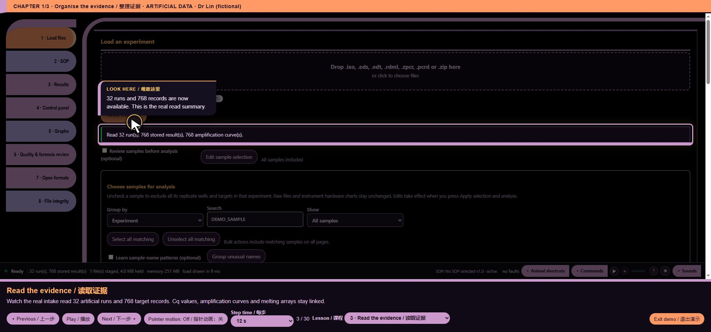

# readers/eds/signal_rows.js — function reference

## C05675 · edsSignalRows

- Ownership: MISSY first-party
- Module: readers/eds/signal_rows.js, line 1; script 8, script line 3280
- Form: FunctionDeclaration; parameters: ``
- AST classification: `current_matching_baseline_ast`
- R1 entry status: `not_observed_in_passing_scenario`
- Passing scenario observations: No passing R1 instrumented scenario observation
- R2 clean contract evidence: No separately linked clean contract assertion for this function
- Code SHA-256: `4dac4293e5a2f14b212172aee10ca9cb4042350d257660a630ed33cf52bdda88`
- [Complete exact function source](https://github.com/mihaiionitabio-alt/zpcrweb/blob/missy-public-offline-2026-10-20/documentation/releases/2026-10-31-full-wiki/code/functions/C05675.js)

```javascript
function edsSignalRows(){
  const out=[];
  RUNS.filter(r=>r.eds).forEach(r=>{
    const p=r.eds,named=new Set(p.plate.wells.filter(w=>w.sample).map(w=>w.i));
    p.plate.wells.forEach(w=>{
      if(!named.has(w.i)||!ssPositionIncluded(r,w.i))return;
      const mc=p.mc.signal[w.i]||{};
      for(let c=0;c<Math.max(p.mc.cycles,p.raw.cycles);c++){
        const row={experiment:runName(r),well:posToWell(w.i,p.plate.cols),sample:exportName(w.sample),cycle:c+1};
        p.mc.dyes.forEach(d=>row["multicomponent_"+d]=(mc[d]||[])[c]??"");
        p.raw.sets.forEach(s=>row["raw_"+s]=((p.raw.data[s]||[])[c]||[])[w.i]??"");
        out.push(row);
      }
    });
  });
  return out;
}
```

## C05676 · <callback@3282:14>

- Ownership: MISSY first-party
- Module: readers/eds/signal_rows.js, line 3; script 8, script line 3282
- Form: ArrowFunctionExpression; parameters: `r`
- AST classification: `current_matching_baseline_ast`
- R1 entry status: `not_observed_in_passing_scenario`
- Passing scenario observations: No passing R1 instrumented scenario observation
- R2 clean contract evidence: No separately linked clean contract assertion for this function
- Code SHA-256: `99f3718f2c43b4c846dc5c9ba330beb5ad12190b2b52f27f192873e55872579d`
- [Complete exact function source](https://github.com/mihaiionitabio-alt/zpcrweb/blob/missy-public-offline-2026-10-20/documentation/releases/2026-10-31-full-wiki/code/functions/C05676.js)

```javascript
r=>r.eds
```

## C05677 · <callback@3282:32>

- Ownership: MISSY first-party
- Module: readers/eds/signal_rows.js, line 3; script 8, script line 3282
- Form: ArrowFunctionExpression; parameters: `r`
- AST classification: `current_matching_baseline_ast`
- R1 entry status: `not_observed_in_passing_scenario`
- Passing scenario observations: No passing R1 instrumented scenario observation
- R2 clean contract evidence: No separately linked clean contract assertion for this function
- Code SHA-256: `d0eddec3afb0443f1e308a4471eb4bd8a819b12ccf5e916e1cf053d6e596f923`
- [Complete exact function source](https://github.com/mihaiionitabio-alt/zpcrweb/blob/missy-public-offline-2026-10-20/documentation/releases/2026-10-31-full-wiki/code/functions/C05677.js)

```javascript
r=>{
    const p=r.eds,named=new Set(p.plate.wells.filter(w=>w.sample).map(w=>w.i));
    p.plate.wells.forEach(w=>{
      if(!named.has(w.i)||!ssPositionIncluded(r,w.i))return;
      const mc=p.mc.signal[w.i]||{};
      for(let c=0;c<Math.max(p.mc.cycles,p.raw.cycles);c++){
        const row={experiment:runName(r),well:posToWell(w.i,p.plate.cols),sample:exportName(w.sample),cycle:c+1};
        p.mc.dyes.forEach(d=>row["multicomponent_"+d]=(mc[d]||[])[c]??"");
        p.raw.sets.forEach(s=>row["raw_"+s]=((p.raw.data[s]||[])[c]||[])[w.i]??"");
        out.push(row);
      }
    });
  }
```

## C05678 · <callback@3283:53>

- Ownership: MISSY first-party
- Module: readers/eds/signal_rows.js, line 4; script 8, script line 3283
- Form: ArrowFunctionExpression; parameters: `w`
- AST classification: `current_matching_baseline_ast`
- R1 entry status: `not_observed_in_passing_scenario`
- Passing scenario observations: No passing R1 instrumented scenario observation
- R2 clean contract evidence: No separately linked clean contract assertion for this function
- Code SHA-256: `4c84453b5538b86ac2a6d983f3f9a26125875f21e4143e9d214ffc1fa91a5c7d`
- [Complete exact function source](https://github.com/mihaiionitabio-alt/zpcrweb/blob/missy-public-offline-2026-10-20/documentation/releases/2026-10-31-full-wiki/code/functions/C05678.js)

```javascript
w=>w.sample
```

## C05679 · <callback@3283:70>

- Ownership: MISSY first-party
- Module: readers/eds/signal_rows.js, line 4; script 8, script line 3283
- Form: ArrowFunctionExpression; parameters: `w`
- AST classification: `current_matching_baseline_ast`
- R1 entry status: `not_observed_in_passing_scenario`
- Passing scenario observations: No passing R1 instrumented scenario observation
- R2 clean contract evidence: No separately linked clean contract assertion for this function
- Code SHA-256: `8ce7309aa677acb7452e3fc45f85d1050d89d337a50e60de1e428d9c395c984d`
- [Complete exact function source](https://github.com/mihaiionitabio-alt/zpcrweb/blob/missy-public-offline-2026-10-20/documentation/releases/2026-10-31-full-wiki/code/functions/C05679.js)

```javascript
w=>w.i
```

## C05680 · <callback@3284:26>

- Ownership: MISSY first-party
- Module: readers/eds/signal_rows.js, line 5; script 8, script line 3284
- Form: ArrowFunctionExpression; parameters: `w`
- AST classification: `current_matching_baseline_ast`
- R1 entry status: `not_observed_in_passing_scenario`
- Passing scenario observations: No passing R1 instrumented scenario observation
- R2 clean contract evidence: No separately linked clean contract assertion for this function
- Code SHA-256: `80518e5a29721087f2ca3cf0349722172523f5157a06bca18b2423f1a19925e1`
- [Complete exact function source](https://github.com/mihaiionitabio-alt/zpcrweb/blob/missy-public-offline-2026-10-20/documentation/releases/2026-10-31-full-wiki/code/functions/C05680.js)

```javascript
w=>{
      if(!named.has(w.i)||!ssPositionIncluded(r,w.i))return;
      const mc=p.mc.signal[w.i]||{};
      for(let c=0;c<Math.max(p.mc.cycles,p.raw.cycles);c++){
        const row={experiment:runName(r),well:posToWell(w.i,p.plate.cols),sample:exportName(w.sample),cycle:c+1};
        p.mc.dyes.forEach(d=>row["multicomponent_"+d]=(mc[d]||[])[c]??"");
        p.raw.sets.forEach(s=>row["raw_"+s]=((p.raw.data[s]||[])[c]||[])[w.i]??"");
        out.push(row);
      }
    }
```

## C05681 · <callback@3289:26>

- Ownership: MISSY first-party
- Module: readers/eds/signal_rows.js, line 10; script 8, script line 3289
- Form: ArrowFunctionExpression; parameters: `d`
- AST classification: `current_matching_baseline_ast`
- R1 entry status: `not_observed_in_passing_scenario`
- Passing scenario observations: No passing R1 instrumented scenario observation
- R2 clean contract evidence: No separately linked clean contract assertion for this function
- Code SHA-256: `18c854c7ec1582b0062dc866b8d07c8e0c4b2c1ad5bd77cd95a5e07dfa7106db`
- [Complete exact function source](https://github.com/mihaiionitabio-alt/zpcrweb/blob/missy-public-offline-2026-10-20/documentation/releases/2026-10-31-full-wiki/code/functions/C05681.js)

```javascript
d=>row["multicomponent_"+d]=(mc[d]||[])[c]??""
```

## C05682 · <callback@3290:27>

- Ownership: MISSY first-party
- Module: readers/eds/signal_rows.js, line 11; script 8, script line 3290
- Form: ArrowFunctionExpression; parameters: `s`
- AST classification: `current_matching_baseline_ast`
- R1 entry status: `not_observed_in_passing_scenario`
- Passing scenario observations: No passing R1 instrumented scenario observation
- R2 clean contract evidence: No separately linked clean contract assertion for this function
- Code SHA-256: `f832d75bb7b23a2783bbaf08ae4f2839b3c0208c16e3763561156593e95496fa`
- [Complete exact function source](https://github.com/mihaiionitabio-alt/zpcrweb/blob/missy-public-offline-2026-10-20/documentation/releases/2026-10-31-full-wiki/code/functions/C05682.js)

```javascript
s=>row["raw_"+s]=((p.raw.data[s]||[])[c]||[])[w.i]??""
```

[Wiki home](/p/zpcrweb/wiki/Home/)

## Illustrated interface context

File-intake presentation; the pictured demonstration uses artificial RDML, not a vendor-format validation. This is UI context, not proof of function-level correctness.



*Representative webpage view for readers/eds/signal_rows.js*

[Complete illustrated workflow and source mapping](https://github.com/mihaiionitabio-alt/zpcrweb/blob/missy-public-offline-2026-10-20/documentation/releases/2026-11-01-illustrated-wiki/pages/FunctionScreenshots.md)
