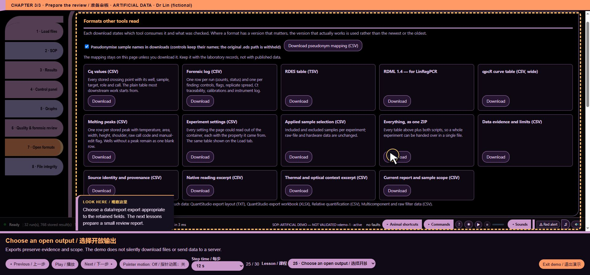

# variants/public/hooks/core/exports/catalogue.js — function reference

## C07342 · metadataId

- Ownership: MISSY first-party
- Module: variants/public/hooks/core/exports/catalogue.js, line 12; script 8, script line 8034
- Form: FunctionDeclaration; parameters: `run, index`
- AST classification: `current_matching_baseline_ast`
- R1 entry status: `observed_in_passing_scenario`
- Passing scenario observations: voice-demo, formats, training, clarification, chart-focus, guided-tour, precision, evidence-keyboard
- R2 clean contract evidence: No separately linked clean contract assertion for this function
- Code SHA-256: `cb5ce1c17d82ec549dff0d4248e61684191a237f0557fef8cbdd34f4bd15549f`
- [Complete exact function source](https://github.com/mihaiionitabio-alt/zpcrweb/blob/missy-public-offline-2026-10-20/documentation/releases/2026-10-31-full-wiki/code/functions/C07342.js)

```javascript
function metadataId(run,index){
  const key=sourceUidOf(run)||sourceSHA256Of(run)||run.file||String(index+1);
  return `#dataset-${encodeURIComponent(String(key).replace(/[^\w.-]+/g,"-"))}`;
}
```

## C07343 · outputDistribution

- Ownership: MISSY first-party
- Module: variants/public/hooks/core/exports/catalogue.js, line 16; script 8, script line 8038
- Form: FunctionDeclaration; parameters: `id, key, name, description, encodingFormat, conformsTo`
- AST classification: `current_matching_baseline_ast`
- R1 entry status: `observed_in_passing_scenario`
- Passing scenario observations: voice-demo, formats, training, clarification, chart-focus, guided-tour, precision, evidence-keyboard
- R2 clean contract evidence: No separately linked clean contract assertion for this function
- Code SHA-256: `1b4e98146dd67340f4936ccb48df374cfbf7f7243be5fa469c6ee41f3edcff7f`
- [Complete exact function source](https://github.com/mihaiionitabio-alt/zpcrweb/blob/missy-public-offline-2026-10-20/documentation/releases/2026-10-31-full-wiki/code/functions/C07343.js)

```javascript
function outputDistribution(id,key,name,description,encodingFormat,conformsTo){
  const out={"@id":`${id}/distribution/${key}`,"@type":["DataDownload","dcat:Distribution"],
    name,description,encodingFormat,
    "rdfs:comment":"Generated locally on demand. No public contentUrl is asserted because the experiment and export remain on the user's device."};
  if(conformsTo)out.conformsTo={"@id":conformsTo};
  return out;
}
```

## C07344 · distributionsFor

- Ownership: MISSY first-party
- Module: variants/public/hooks/core/exports/catalogue.js, line 23; script 8, script line 8045
- Form: FunctionDeclaration; parameters: `run, id`
- AST classification: `current_matching_baseline_ast`
- R1 entry status: `observed_in_passing_scenario`
- Passing scenario observations: voice-demo, formats, training, clarification, chart-focus, guided-tour, precision, evidence-keyboard
- R2 clean contract evidence: No separately linked clean contract assertion for this function
- Code SHA-256: `599fe61684789f0052c5b7183b37e73ffe092b8e051aa0fa7463f99bae807a1f`
- [Complete exact function source](https://github.com/mihaiionitabio-alt/zpcrweb/blob/missy-public-offline-2026-10-20/documentation/releases/2026-10-31-full-wiki/code/functions/C07344.js)

```javascript
function distributionsFor(run,id){
  const m=run.meta||{},source={
    "@id":`${id}/source`,"@type":["DataDownload","dcat:Distribution","prov:Entity"],
    name:run.file||m.name||"Original vendor file",
    description:run.eds?"Unmodified Applied Biosystems QuantStudio experiment document used as the provenance anchor."
      :"Unmodified Roche LightCycler 480 experiment container used as the provenance anchor.",
    encodingFormat:"application/octet-stream",
    contentSize:m.sourceBytes?`${m.sourceBytes} B`:undefined,
    "spdx:checksum":m.sourceSHA256?{"@type":"spdx:Checksum",
      "spdx:algorithm":{"@id":"spdx:checksumAlgorithm_sha256"},"spdx:checksumValue":m.sourceSHA256}:undefined,
    additionalProperty:{"@type":"PropertyValue",name:"Source container format",value:run.eds?".eds (QuantStudio experiment document, ZIP container)":".ixo (Roche LightCycler 480 experiment)"},
    identifier:[m.UID?`LightCycler experiment UID: ${m.UID}`:null,m.sourceCRC32?`CRC-32: ${m.sourceCRC32}`:null].filter(Boolean),
    "rdfs:comment":"The source filename is recorded, but a local filesystem path is deliberately not published in JSON-LD."
  };
  const out=[source,
    outputDistribution(id,"cq","Stored Cq values","One row per stored result with well, sample, target, role, call and provenance.","text/csv"),
    outputDistribution(id,"settings","Experiment settings","Traceable settings with the source part or property of the vendor container.","text/csv"),
    outputDistribution(id,"metadata","Dataset metadata","This machine-readable description of the application, catalog, datasets, provenance and distributions.","application/ld+json")
  ];
  if((run.wells||[]).some(w=>w.curve))out.push(
    outputDistribution(id,"rdml","RDML 1.4 experiment","Vendor-neutral qPCR exchange representation.","application/zip","https://rdml.org/"),
    outputDistribution(id,"qpcr","qpcR curve table","Wide CSV curve table with Cycles as the first column.","text/csv"),
    outputDistribution(id,"rdes","RDES long curve table","One fluorescence observation per cycle, well and analysis.","text/tab-separated-values")
  );
  if((run.tmWells||[]).length)out.push(
    outputDistribution(id,"melting","Stored melting peaks","One row per stored peak, with call and manual-edit metadata.","text/csv"));
  return out.map(x=>Object.fromEntries(Object.entries(x).filter(([,v])=>v!==undefined)));
}
```

## C07345 · <callback@8064:26>

- Ownership: MISSY first-party
- Module: variants/public/hooks/core/exports/catalogue.js, line 42; script 8, script line 8064
- Form: ArrowFunctionExpression; parameters: `w`
- AST classification: `current_matching_baseline_ast`
- R1 entry status: `observed_in_passing_scenario`
- Passing scenario observations: voice-demo, formats, training, clarification, chart-focus, guided-tour, evidence-keyboard
- R2 clean contract evidence: No separately linked clean contract assertion for this function
- Code SHA-256: `f17511d38576103962369daa37e6660c8152c91705161ef39d3ad0aebba0b814`
- [Complete exact function source](https://github.com/mihaiionitabio-alt/zpcrweb/blob/missy-public-offline-2026-10-20/documentation/releases/2026-10-31-full-wiki/code/functions/C07345.js)

```javascript
w=>w.curve
```

## C07346 · <callback@8071:17>

- Ownership: MISSY first-party
- Module: variants/public/hooks/core/exports/catalogue.js, line 49; script 8, script line 8071
- Form: ArrowFunctionExpression; parameters: `x`
- AST classification: `current_matching_baseline_ast`
- R1 entry status: `observed_in_passing_scenario`
- Passing scenario observations: voice-demo, formats, training, clarification, chart-focus, guided-tour, precision, evidence-keyboard
- R2 clean contract evidence: No separately linked clean contract assertion for this function
- Code SHA-256: `f24524b2c2a172bedfa8e4c20be190201764f2f39fd877efef0f4417ad24aa1e`
- [Complete exact function source](https://github.com/mihaiionitabio-alt/zpcrweb/blob/missy-public-offline-2026-10-20/documentation/releases/2026-10-31-full-wiki/code/functions/C07346.js)

```javascript
x=>Object.fromEntries(Object.entries(x).filter(([,v])=>v!==undefined))
```

## C07347 · <callback@8071:64>

- Ownership: MISSY first-party
- Module: variants/public/hooks/core/exports/catalogue.js, line 49; script 8, script line 8071
- Form: ArrowFunctionExpression; parameters: `[,v]`
- AST classification: `current_matching_baseline_ast`
- R1 entry status: `observed_in_passing_scenario`
- Passing scenario observations: voice-demo, formats, training, clarification, chart-focus, guided-tour, precision, evidence-keyboard
- R2 clean contract evidence: No separately linked clean contract assertion for this function
- Code SHA-256: `19a25413319751e5f6d46c93decb03f78f29afd553cde303769c65a3be05eede`
- [Complete exact function source](https://github.com/mihaiionitabio-alt/zpcrweb/blob/missy-public-offline-2026-10-20/documentation/releases/2026-10-31-full-wiki/code/functions/C07347.js)

```javascript
([,v])=>v!==undefined
```

## C07348 · variablesFor

- Ownership: MISSY first-party
- Module: variants/public/hooks/core/exports/catalogue.js, line 51; script 8, script line 8073
- Form: FunctionDeclaration; parameters: `run`
- AST classification: `current_matching_baseline_ast`
- R1 entry status: `observed_in_passing_scenario`
- Passing scenario observations: voice-demo, formats, training, clarification, chart-focus, guided-tour, precision, evidence-keyboard
- R2 clean contract evidence: No separately linked clean contract assertion for this function
- Code SHA-256: `c5d31118f5f59434a5b955b9a07b58175649b85a8d3ee0e35fbd9ea93f668a6f`
- [Complete exact function source](https://github.com/mihaiionitabio-alt/zpcrweb/blob/missy-public-offline-2026-10-20/documentation/releases/2026-10-31-full-wiki/code/functions/C07348.js)

```javascript
function variablesFor(run){
  const out=[];
  if((run.wells||[]).length)out.push({"@type":"PropertyValue",name:"Stored quantification cycle",propertyID:"Cq",unitText:"PCR cycle"},
    {"@type":"PropertyValue",name:"Instrument result call",propertyID:"Call"});
  if((run.wells||[]).some(w=>w.curve))out.push({"@type":"PropertyValue",name:"Raw fluorescence",propertyID:"Fluorescence",unitText:"instrument raw unit"});
  if((run.tmWells||[]).length)out.push({"@type":"PropertyValue",name:"Stored melting temperature",propertyID:"Tm",unitCode:"CEL"});
  return out;
}
```

## C07349 · <callback@8077:26>

- Ownership: MISSY first-party
- Module: variants/public/hooks/core/exports/catalogue.js, line 55; script 8, script line 8077
- Form: ArrowFunctionExpression; parameters: `w`
- AST classification: `current_matching_baseline_ast`
- R1 entry status: `observed_in_passing_scenario`
- Passing scenario observations: voice-demo, formats, training, clarification, chart-focus, guided-tour, evidence-keyboard
- R2 clean contract evidence: No separately linked clean contract assertion for this function
- Code SHA-256: `f17511d38576103962369daa37e6660c8152c91705161ef39d3ad0aebba0b814`
- [Complete exact function source](https://github.com/mihaiionitabio-alt/zpcrweb/blob/missy-public-offline-2026-10-20/documentation/releases/2026-10-31-full-wiki/code/functions/C07349.js)

```javascript
w=>w.curve
```

## C07350 · datasetMetadata

- Ownership: MISSY first-party
- Module: variants/public/hooks/core/exports/catalogue.js, line 59; script 8, script line 8081
- Form: FunctionDeclaration; parameters: `run, index`
- AST classification: `current_matching_baseline_ast`
- R1 entry status: `observed_in_passing_scenario`
- Passing scenario observations: voice-demo, formats, training, clarification, chart-focus, guided-tour, precision, evidence-keyboard
- R2 clean contract evidence: No separately linked clean contract assertion for this function
- Code SHA-256: `b4512c40720e79e49200caa37b62122e7ea92702c44a218395ee10c789776bca`
- [Complete exact function source](https://github.com/mihaiionitabio-alt/zpcrweb/blob/missy-public-offline-2026-10-20/documentation/releases/2026-10-31-full-wiki/code/functions/C07350.js)

```javascript
function datasetMetadata(run,index){
  const m=run.meta||{},id=metadataId(run,index),uid=sourceUidOf(run),sha=sourceSHA256Of(run),crc=sourceCRCOf(run),
    distributions=distributionsFor(run,id),start=m.StartTime||m.RunCreated||m.Created||"",end=m.EndTime||"",
    title=m.name||run.file||`qPCR experiment ${index+1}`,
    description=`Decoded ${run.platform||"LightCycler 480"} qPCR experiment with ${(run.wells||[]).length} stored quantification result(s), `
      +`${uniqueCurveCount(run)} result-linked amplification curve(s) and ${(run.tmWells||[]).length} melting result(s).`;
  const identifiers=[
    uid?{"@type":"PropertyValue",propertyID:"LightCycler experiment UID",value:uid}:null,
    sha?{"@type":"PropertyValue",propertyID:"SHA-256",value:sha}:null,
    crc?{"@type":"PropertyValue",propertyID:"CRC-32",value:crc}:null
  ].filter(Boolean);
  const counts=[
    ["Plate rows",run.rows],["Plate columns",run.cols],["Acquisition cycles",run.nCycles],
    ["Analyses",(run.analyses||[]).length],["Stored quantification results",(run.wells||[]).length],
    ["Result-linked curves",uniqueCurveCount(run)],["Acquired channel/well curves",acquiredCurveCount(run)],
    ["Melting results",(run.tmWells||[]).length]
  ].filter(([,v])=>v!==""&&v!=null).map(([name,value])=>({"@type":"PropertyValue",name,value}));
  const dataset={
    "@id":id,"@type":["Dataset","dcat:Dataset"],name:title,"dcterms:title":title,
    description,"dcterms:description":description,
    identifier:identifiers,"dcterms:identifier":identifiers.map(x=>x.value),
    includedInDataCatalog:{"@id":"#catalog"},measurementTechnique:"quantitative real-time PCR (qPCR)",
    keywords:["qPCR",run.platform||"LightCycler 480","primary instrument data","Cq","fluorescence","quality control","data integrity"],
    variableMeasured:variablesFor(run),additionalProperty:counts,
    distribution:distributions,"dcat:distribution":distributions.map(x=>({"@id":x["@id"]})),
    conformsTo:JSONLD_STANDARDS,"dcterms:conformsTo":JSONLD_STANDARDS.map(x=>({"@id":x["@id"]})),
    subjectOf:{"@id":"#metadata-profile"},
    conditionsOfAccess:"Processed locally from a user-selected file. Any downstream access conditions are determined by the responsible data steward.",
    "dcterms:rights":"No licence, consent, community authority or permission for future reuse is inferred by this software.",
    "prov:wasDerivedFrom":{"@id":`${id}/source`},
    "prov:wasGeneratedBy":{"@type":"prov:Activity",name:run.eds?"Read-only QuantStudio .eds decoding":"Read-only LightCycler 480 .ixo decoding",
      "prov:used":{"@id":`${id}/source`},"prov:wasAssociatedWith":{"@id":"#application"}},
    "pav:createdWith":{"@id":"#application"},
    "dcterms:provenance":"Decoded read-only from the unmodified vendor container; stored instrument values are preserved and derived review quantities remain labelled.",
    "rdfs:comment":"This Dataset record describes one locally selected experiment. It does not expose the local path or create a network endpoint."
  };
  if(m.Created)dataset.dateCreated=m.Created;
  if(m.LastModified&&!/^1899/.test(m.LastModified))dataset.dateModified=m.LastModified;
  if(start)dataset.temporalCoverage=end?`${start}/${end}`:start;
  if(m.SWVersion)dataset.softwareVersion=m.SWVersion;
  if(m.InstrumentName)dataset.instrument={"@type":"Thing",name:m.InstrumentName,
    identifier:m.InstrumentID||undefined,description:"qPCR instrument recorded in the source experiment"};
  if(operatorOf(run))dataset["prov:qualifiedAttribution"]={"@type":"prov:Attribution",
    "prov:agent":{"@type":"prov:Agent",name:operatorOf(run)},"dcterms:description":"Instrument operator recorded by the run"};
  return JSON.parse(JSON.stringify(dataset));
}
```

## C07351 · <callback@8097:11>

- Ownership: MISSY first-party
- Module: variants/public/hooks/core/exports/catalogue.js, line 75; script 8, script line 8097
- Form: ArrowFunctionExpression; parameters: `[,v]`
- AST classification: `current_matching_baseline_ast`
- R1 entry status: `observed_in_passing_scenario`
- Passing scenario observations: voice-demo, formats, training, clarification, chart-focus, guided-tour, precision, evidence-keyboard
- R2 clean contract evidence: No separately linked clean contract assertion for this function
- Code SHA-256: `890a67585d0d1b755fee560d93ef3c32aa128fb6dd32143a3835ff7615f85d52`
- [Complete exact function source](https://github.com/mihaiionitabio-alt/zpcrweb/blob/missy-public-offline-2026-10-20/documentation/releases/2026-10-31-full-wiki/code/functions/C07351.js)

```javascript
([,v])=>v!==""&&v!=null
```

## C07352 · <callback@8097:40>

- Ownership: MISSY first-party
- Module: variants/public/hooks/core/exports/catalogue.js, line 75; script 8, script line 8097
- Form: ArrowFunctionExpression; parameters: `[name,value]`
- AST classification: `current_matching_baseline_ast`
- R1 entry status: `observed_in_passing_scenario`
- Passing scenario observations: voice-demo, formats, training, clarification, chart-focus, guided-tour, precision, evidence-keyboard
- R2 clean contract evidence: No separately linked clean contract assertion for this function
- Code SHA-256: `cd3b596783f3e948d069972c6c32f4d8301298faa73275790b2226da0334cd1e`
- [Complete exact function source](https://github.com/mihaiionitabio-alt/zpcrweb/blob/missy-public-offline-2026-10-20/documentation/releases/2026-10-31-full-wiki/code/functions/C07352.js)

```javascript
([name,value])=>({"@type":"PropertyValue",name,value})
```

## C07353 · <callback@8101:64>

- Ownership: MISSY first-party
- Module: variants/public/hooks/core/exports/catalogue.js, line 79; script 8, script line 8101
- Form: ArrowFunctionExpression; parameters: `x`
- AST classification: `current_matching_baseline_ast`
- R1 entry status: `observed_in_passing_scenario`
- Passing scenario observations: formats, precision, evidence-keyboard
- R2 clean contract evidence: No separately linked clean contract assertion for this function
- Code SHA-256: `d02b718d616c0c2b853a7c281c9a1f398334be407bf71e00ab7a520cf8ffdf87`
- [Complete exact function source](https://github.com/mihaiionitabio-alt/zpcrweb/blob/missy-public-offline-2026-10-20/documentation/releases/2026-10-31-full-wiki/code/functions/C07353.js)

```javascript
x=>x.value
```

## C07354 · <callback@8105:69>

- Ownership: MISSY first-party
- Module: variants/public/hooks/core/exports/catalogue.js, line 83; script 8, script line 8105
- Form: ArrowFunctionExpression; parameters: `x`
- AST classification: `current_matching_baseline_ast`
- R1 entry status: `observed_in_passing_scenario`
- Passing scenario observations: voice-demo, formats, training, clarification, chart-focus, guided-tour, precision, evidence-keyboard
- R2 clean contract evidence: No separately linked clean contract assertion for this function
- Code SHA-256: `50a865cdef2b0f1533a1150b626b6ed8a0a6161235a3d3b9ae2980fdecbc3c49`
- [Complete exact function source](https://github.com/mihaiionitabio-alt/zpcrweb/blob/missy-public-offline-2026-10-20/documentation/releases/2026-10-31-full-wiki/code/functions/C07354.js)

```javascript
x=>({"@id":x["@id"]})
```

## C07355 · <callback@8106:74>

- Ownership: MISSY first-party
- Module: variants/public/hooks/core/exports/catalogue.js, line 84; script 8, script line 8106
- Form: ArrowFunctionExpression; parameters: `x`
- AST classification: `current_matching_baseline_ast`
- R1 entry status: `observed_in_passing_scenario`
- Passing scenario observations: voice-demo, formats, training, clarification, chart-focus, guided-tour, precision, evidence-keyboard
- R2 clean contract evidence: No separately linked clean contract assertion for this function
- Code SHA-256: `50a865cdef2b0f1533a1150b626b6ed8a0a6161235a3d3b9ae2980fdecbc3c49`
- [Complete exact function source](https://github.com/mihaiionitabio-alt/zpcrweb/blob/missy-public-offline-2026-10-20/documentation/releases/2026-10-31-full-wiki/code/functions/C07355.js)

```javascript
x=>({"@id":x["@id"]})
```

## C07356 · pastedDatasetMetadata

- Ownership: MISSY first-party
- Module: variants/public/hooks/core/exports/catalogue.js, line 105; script 8, script line 8127
- Form: FunctionDeclaration; parameters: ``
- AST classification: `current_matching_baseline_ast`
- R1 entry status: `observed_in_passing_scenario`
- Passing scenario observations: voice-demo, formats, training, voice-routing, voice-state, ack-queue, clarification, voice-bargein, command-finish, chart-focus, guided-tour, precision, quantstudio, evidence-keyboard
- R2 clean contract evidence: No separately linked clean contract assertion for this function
- Code SHA-256: `42672c8d704d809ae0cb7085c57f14a413b7f5b6706aa6afd71d2b845e573849`
- [Complete exact function source](https://github.com/mihaiionitabio-alt/zpcrweb/blob/missy-public-offline-2026-10-20/documentation/releases/2026-10-31-full-wiki/code/functions/C07356.js)

```javascript
function pastedDatasetMetadata(){
  if(!PASTED||!PASTED.rows||!PASTED.rows.length)return null;
  return {"@id":"#dataset-pasted-cq","@type":["Dataset","dcat:Dataset"],
    name:"Pasted Cq table",description:`Locally parsed Cq table with ${PASTED.rows.length} numeric row(s).`,
    includedInDataCatalog:{"@id":"#catalog"},measurementTechnique:"quantitative real-time PCR (qPCR)",
    variableMeasured:[{"@type":"PropertyValue",name:"Quantification cycle",propertyID:"Cq",unitText:"PCR cycle"}],
    distribution:[outputDistribution("#dataset-pasted-cq","cq","Parsed Cq values","Normalised local CSV representation.","text/csv")],
    subjectOf:{"@id":"#metadata-profile"},
    conditionsOfAccess:"Processed locally from user-pasted values. Any downstream access conditions are determined by the responsible data steward.",
    "dcterms:rights":"No creator, licence, consent, community authority or permission for future reuse is inferred by this software.",
    "rdfs:comment":"This record has no instrument-level provenance because it was created from pasted tabular values rather than an .ixo or .eds container."};
}
```

## C07357 · machineMetadataDocument

- Ownership: MISSY first-party
- Module: variants/public/hooks/core/exports/catalogue.js, line 117; script 8, script line 8139
- Form: FunctionDeclaration; parameters: ``
- AST classification: `current_matching_baseline_ast`
- R1 entry status: `observed_in_passing_scenario`
- Passing scenario observations: voice-demo, formats, training, voice-routing, voice-state, ack-queue, clarification, voice-bargein, command-finish, chart-focus, guided-tour, precision, quantstudio, evidence-keyboard
- R2 clean contract evidence: No separately linked clean contract assertion for this function
- Code SHA-256: `b687e08e8b5ac9a30b482a97b48ce229172bf13acd8d4e62be1ff02fc2f14b34`
- [Complete exact function source](https://github.com/mihaiionitabio-alt/zpcrweb/blob/missy-public-offline-2026-10-20/documentation/releases/2026-10-31-full-wiki/code/functions/C07357.js)

```javascript
function machineMetadataDocument(){
  const doc=clone(BASE_MACHINE_METADATA),graph=doc["@graph"],catalog=graph.find(x=>x["@id"]==="#catalog"),
    datasets=RUNS.map(datasetMetadata),pasted=pastedDatasetMetadata();
  const application=graph.find(x=>x["@id"]==="#application");
  if(application){application.softwareVersion=APP_VERSION;application.dateModified="2026-09-23";}
  if(pasted)datasets.push(pasted);
  catalog.dataset=datasets.map(x=>({"@id":x["@id"]}));
  catalog["dcat:dataset"]=catalog.dataset;
  catalog.numberOfItems=datasets.length;
  catalog.dateModified="2026-09-23";
  graph.push(...datasets);
  return doc;
}
```

## C07358 · <callback@8140:80>

- Ownership: MISSY first-party
- Module: variants/public/hooks/core/exports/catalogue.js, line 118; script 8, script line 8140
- Form: ArrowFunctionExpression; parameters: `x`
- AST classification: `current_matching_baseline_ast`
- R1 entry status: `observed_in_passing_scenario`
- Passing scenario observations: voice-demo, formats, training, voice-routing, voice-state, ack-queue, clarification, voice-bargein, command-finish, chart-focus, guided-tour, precision, quantstudio, evidence-keyboard
- R2 clean contract evidence: No separately linked clean contract assertion for this function
- Code SHA-256: `31a815ef3d9aa2f120708f25ea363484dd7903157109e51e2aafc08c71cbcc62`
- [Complete exact function source](https://github.com/mihaiionitabio-alt/zpcrweb/blob/missy-public-offline-2026-10-20/documentation/releases/2026-10-31-full-wiki/code/functions/C07358.js)

```javascript
x=>x["@id"]==="#catalog"
```

## C07359 · <callback@8142:31>

- Ownership: MISSY first-party
- Module: variants/public/hooks/core/exports/catalogue.js, line 120; script 8, script line 8142
- Form: ArrowFunctionExpression; parameters: `x`
- AST classification: `current_matching_baseline_ast`
- R1 entry status: `observed_in_passing_scenario`
- Passing scenario observations: voice-demo, formats, training, voice-routing, voice-state, ack-queue, clarification, voice-bargein, command-finish, chart-focus, guided-tour, precision, quantstudio, evidence-keyboard
- R2 clean contract evidence: No separately linked clean contract assertion for this function
- Code SHA-256: `b3dacd43eb42eec7bb75f5df622bd4a896c45658043beb1003bf228bd60b0241`
- [Complete exact function source](https://github.com/mihaiionitabio-alt/zpcrweb/blob/missy-public-offline-2026-10-20/documentation/releases/2026-10-31-full-wiki/code/functions/C07359.js)

```javascript
x=>x["@id"]==="#application"
```

## C07360 · <callback@8145:31>

- Ownership: MISSY first-party
- Module: variants/public/hooks/core/exports/catalogue.js, line 123; script 8, script line 8145
- Form: ArrowFunctionExpression; parameters: `x`
- AST classification: `current_matching_baseline_ast`
- R1 entry status: `observed_in_passing_scenario`
- Passing scenario observations: voice-demo, formats, training, clarification, chart-focus, guided-tour, precision, evidence-keyboard
- R2 clean contract evidence: No separately linked clean contract assertion for this function
- Code SHA-256: `50a865cdef2b0f1533a1150b626b6ed8a0a6161235a3d3b9ae2980fdecbc3c49`
- [Complete exact function source](https://github.com/mihaiionitabio-alt/zpcrweb/blob/missy-public-offline-2026-10-20/documentation/releases/2026-10-31-full-wiki/code/functions/C07360.js)

```javascript
x=>({"@id":x["@id"]})
```

## C07361 · machineMetadataJSON

- Ownership: MISSY first-party
- Module: variants/public/hooks/core/exports/catalogue.js, line 130; script 8, script line 8152
- Form: FunctionDeclaration; parameters: ``
- AST classification: `current_matching_baseline_ast`
- R1 entry status: `observed_in_passing_scenario`
- Passing scenario observations: voice-demo, formats, training, voice-routing, voice-state, ack-queue, clarification, voice-bargein, command-finish, chart-focus, guided-tour, precision, quantstudio, evidence-keyboard
- R2 clean contract evidence: No separately linked clean contract assertion for this function
- Code SHA-256: `d7036bc07708acca9a3944a9596c8055a0ec175877a321edd29365bb2949b6ca`
- [Complete exact function source](https://github.com/mihaiionitabio-alt/zpcrweb/blob/missy-public-offline-2026-10-20/documentation/releases/2026-10-31-full-wiki/code/functions/C07361.js)

```javascript
function machineMetadataJSON(){return JSON.stringify(machineMetadataDocument(),null,2)+"\n";}
```

## C07362 · renderMachineMetadata

- Ownership: MISSY first-party
- Module: variants/public/hooks/core/exports/catalogue.js, line 131; script 8, script line 8153
- Form: FunctionDeclaration; parameters: ``
- AST classification: `current_matching_baseline_ast`
- R1 entry status: `observed_in_passing_scenario`
- Passing scenario observations: voice-demo, formats, training, voice-routing, voice-state, ack-queue, clarification, voice-bargein, command-finish, chart-focus, guided-tour, precision, quantstudio, evidence-keyboard
- R2 clean contract evidence: No separately linked clean contract assertion for this function
- Code SHA-256: `e466e56e5fe9420afa99a38afe72b6f2ee19674a0d368e7277993ba6bceb769c`
- [Complete exact function source](https://github.com/mihaiionitabio-alt/zpcrweb/blob/missy-public-offline-2026-10-20/documentation/releases/2026-10-31-full-wiki/code/functions/C07362.js)

```javascript
function renderMachineMetadata(){
  const node=$("#machine-metadata");
  if(node)node.textContent=machineMetadataJSON();
}
```

## C07363 · exportCatalogueBase

- Ownership: MISSY first-party
- Module: variants/public/hooks/core/exports/catalogue.js, line 135; script 8, script line 8157
- Form: FunctionDeclaration; parameters: ``
- AST classification: `new_named`
- R1 entry status: `observed_in_passing_scenario`
- Passing scenario observations: voice-demo, guided-tour
- R2 clean contract evidence: No separately linked clean contract assertion for this function
- Code SHA-256: `35d0094b8776a2d7fc0e328b0727e127b5dd82ffeb2e4b81d43328a9f9d34581`
- [Complete exact function source](https://github.com/mihaiionitabio-alt/zpcrweb/blob/missy-public-offline-2026-10-20/documentation/releases/2026-10-31-full-wiki/code/functions/C07363.js)

```javascript
function exportCatalogueBase(){
  const items=exportCatalogueCore();
  items.push({title:"Applied sample selection (CSV)",note:"Included and excluded samples per experiment; raw-file and hardware data are unchanged.",ready:()=>RUNS.length>0,run:()=>{ssBuildRows();download("sample_selection.csv",csvOf(ssManifest()),"text/csv");}});
  items.splice(1,0,{
    title:"Forensic log (CSV)",
    note:"One row per run (counts, status) and one per finding: controls, flags, replicate spread, Ct traceability, calibrations and instrument log.",
    ready:()=>RUNS.length>0,run:()=>downloadForensicCSV()
  });
  items.splice(2,0,{
    title:"QuantStudio export layout (TXT)",
    note:"Header plus Sample Setup, Raw Data, Amplification Data, Multicomponent Data, analysis summaries and Results as tab-delimited sections (MAN0010409, chapter 3), with the columns and row order of the software's own export. For LIS/LIMS parsers that expect that layout.",
    ready:()=>RUNS.some(r=>r.eds&&r.eds.results.length),
    run:()=>RUNS.filter(r=>r.eds&&r.eds.results.length).forEach(r=>download(safeName(r.meta.name||r.file)+"_QuantStudio_export.txt",
      EDS.qsExport(r.eds,{pseudo:pseudoOn(),nameOf:exportName}),"text/plain"))
  });
  items.splice(3,0,{
    title:"QuantStudio export workbook (XLSX)",
    note:"The same sheets, columns and row order as the QuantStudio software's Excel export (Sample Setup, Raw Data, Amplification Data, Multicomponent Data, analysis summaries, Results, Reagent Information), rebuilt from the .eds using the export configuration saved inside it.",
    ready:()=>RUNS.some(r=>r.eds&&r.eds.results.length),
    run:()=>RUNS.filter(r=>r.eds&&r.eds.results.length).forEach(r=>download(safeName(r.meta.name||r.file)+"_QuantStudio_export.xlsx",
      qsWorkbook(r,{pseudo:pseudoOn(),nameOf:exportName}),"application/vnd.openxmlformats-officedocument.spreadsheetml.sheet"))
  });
  items.push({
    title:"Relative quantification (CSV)",
    note:"Stored relative-quantification results: ΔΔCt summaries with RQ and confidence limits from QuantStudio, pairing ratios from LightCycler.",
    ready:()=>rqRows().length>0,
    run:()=>{const rows=rqRows();download(baseName()+"_relative_quantification.csv",toCSV(Object.keys(rows[0]).map(k=>({key:k,label:k})),rows),"text/csv");}
  });
  items.push({
    title:"Multicomponent and raw filter data (CSV)",
    note:"QuantStudio only: per-dye multicomponent signal and every filter-set reading, one row per named well and cycle — the data under the stored Rn.",
    ready:()=>RUNS.some(r=>r.eds&&r.eds.raw.sets.length),
    run:()=>{const rows=edsSignalRows();if(rows.length)download(baseName()+"_multicomponent_raw.csv",toCSV(Object.keys(rows[0]).map(k=>({key:k,label:k})),rows),"text/csv");}
  });
  const bundle=items.find(it=>/one ZIP/.test(it.title));
  if(bundle){items.splice(items.indexOf(bundle),1);items.push(bundle);}
  return items.map(it=>Object.assign({},it,{run:()=>withExportNames(it.run)}));
}
```

## C07364 · ready

- Ownership: MISSY first-party
- Module: variants/public/hooks/core/exports/catalogue.js, line 137; script 8, script line 8159
- Form: ArrowFunctionExpression; parameters: ``
- AST classification: `current_matching_baseline_ast`
- R1 entry status: `observed_in_passing_scenario`
- Passing scenario observations: voice-demo, guided-tour
- R2 clean contract evidence: No separately linked clean contract assertion for this function
- Code SHA-256: `25094bcfe1a30bbfcee422a04d70edc47359e0f08caa1988d968110c9f222c7d`
- [Complete exact function source](https://github.com/mihaiionitabio-alt/zpcrweb/blob/missy-public-offline-2026-10-20/documentation/releases/2026-10-31-full-wiki/code/functions/C07364.js)

```javascript
()=>RUNS.length>0
```

## C07365 · run

- Ownership: MISSY first-party
- Module: variants/public/hooks/core/exports/catalogue.js, line 137; script 8, script line 8159
- Form: ArrowFunctionExpression; parameters: ``
- AST classification: `current_matching_baseline_ast`
- R1 entry status: `not_observed_in_passing_scenario`
- Passing scenario observations: No passing R1 instrumented scenario observation
- R2 clean contract evidence: No separately linked clean contract assertion for this function
- Code SHA-256: `95277d808df45f40b9c76b9b25192638bf5d94080c2869403398e5e62970f0fb`
- [Complete exact function source](https://github.com/mihaiionitabio-alt/zpcrweb/blob/missy-public-offline-2026-10-20/documentation/releases/2026-10-31-full-wiki/code/functions/C07365.js)

```javascript
()=>{ssBuildRows();download("sample_selection.csv",csvOf(ssManifest()),"text/csv");}
```

## C07366 · ready

- Ownership: MISSY first-party
- Module: variants/public/hooks/core/exports/catalogue.js, line 141; script 8, script line 8163
- Form: ArrowFunctionExpression; parameters: ``
- AST classification: `current_matching_baseline_ast`
- R1 entry status: `observed_in_passing_scenario`
- Passing scenario observations: voice-demo, guided-tour
- R2 clean contract evidence: No separately linked clean contract assertion for this function
- Code SHA-256: `25094bcfe1a30bbfcee422a04d70edc47359e0f08caa1988d968110c9f222c7d`
- [Complete exact function source](https://github.com/mihaiionitabio-alt/zpcrweb/blob/missy-public-offline-2026-10-20/documentation/releases/2026-10-31-full-wiki/code/functions/C07366.js)

```javascript
()=>RUNS.length>0
```

## C07367 · run

- Ownership: MISSY first-party
- Module: variants/public/hooks/core/exports/catalogue.js, line 141; script 8, script line 8163
- Form: ArrowFunctionExpression; parameters: ``
- AST classification: `current_matching_baseline_ast`
- R1 entry status: `not_observed_in_passing_scenario`
- Passing scenario observations: No passing R1 instrumented scenario observation
- R2 clean contract evidence: No separately linked clean contract assertion for this function
- Code SHA-256: `dd11f22f098b37f83c464eb3a28125fea4b2d3ff7778af7b80ddd97e34badc9c`
- [Complete exact function source](https://github.com/mihaiionitabio-alt/zpcrweb/blob/missy-public-offline-2026-10-20/documentation/releases/2026-10-31-full-wiki/code/functions/C07367.js)

```javascript
()=>downloadForensicCSV()
```

## C07368 · ready

- Ownership: MISSY first-party
- Module: variants/public/hooks/core/exports/catalogue.js, line 146; script 8, script line 8168
- Form: ArrowFunctionExpression; parameters: ``
- AST classification: `current_matching_baseline_ast`
- R1 entry status: `observed_in_passing_scenario`
- Passing scenario observations: voice-demo, guided-tour
- R2 clean contract evidence: No separately linked clean contract assertion for this function
- Code SHA-256: `ed6fb08c496cc5f515b4b95a78b07672aec33102ed5bfa85f00c6d40c7094680`
- [Complete exact function source](https://github.com/mihaiionitabio-alt/zpcrweb/blob/missy-public-offline-2026-10-20/documentation/releases/2026-10-31-full-wiki/code/functions/C07368.js)

```javascript
()=>RUNS.some(r=>r.eds&&r.eds.results.length)
```

## C07369 · <callback@8168:24>

- Ownership: MISSY first-party
- Module: variants/public/hooks/core/exports/catalogue.js, line 146; script 8, script line 8168
- Form: ArrowFunctionExpression; parameters: `r`
- AST classification: `current_matching_baseline_ast`
- R1 entry status: `observed_in_passing_scenario`
- Passing scenario observations: voice-demo, guided-tour
- R2 clean contract evidence: No separately linked clean contract assertion for this function
- Code SHA-256: `d930ec48ae30801b06576a7e6f1f5fb29ad3b091a8fe7c7b262266c8aa58c83c`
- [Complete exact function source](https://github.com/mihaiionitabio-alt/zpcrweb/blob/missy-public-offline-2026-10-20/documentation/releases/2026-10-31-full-wiki/code/functions/C07369.js)

```javascript
r=>r.eds&&r.eds.results.length
```

## C07370 · run

- Ownership: MISSY first-party
- Module: variants/public/hooks/core/exports/catalogue.js, line 147; script 8, script line 8169
- Form: ArrowFunctionExpression; parameters: ``
- AST classification: `current_matching_baseline_ast`
- R1 entry status: `not_observed_in_passing_scenario`
- Passing scenario observations: No passing R1 instrumented scenario observation
- R2 clean contract evidence: No separately linked clean contract assertion for this function
- Code SHA-256: `b31fe15e1af8778151a465df62850442cd51eee6c9726ddf7cd836bd6ca25d0b`
- [Complete exact function source](https://github.com/mihaiionitabio-alt/zpcrweb/blob/missy-public-offline-2026-10-20/documentation/releases/2026-10-31-full-wiki/code/functions/C07370.js)

```javascript
()=>RUNS.filter(r=>r.eds&&r.eds.results.length).forEach(r=>download(safeName(r.meta.name||r.file)+"_QuantStudio_export.txt",
      EDS.qsExport(r.eds,{pseudo:pseudoOn(),nameOf:exportName}),"text/plain"))
```

## C07371 · <callback@8169:24>

- Ownership: MISSY first-party
- Module: variants/public/hooks/core/exports/catalogue.js, line 147; script 8, script line 8169
- Form: ArrowFunctionExpression; parameters: `r`
- AST classification: `current_matching_baseline_ast`
- R1 entry status: `not_observed_in_passing_scenario`
- Passing scenario observations: No passing R1 instrumented scenario observation
- R2 clean contract evidence: No separately linked clean contract assertion for this function
- Code SHA-256: `d930ec48ae30801b06576a7e6f1f5fb29ad3b091a8fe7c7b262266c8aa58c83c`
- [Complete exact function source](https://github.com/mihaiionitabio-alt/zpcrweb/blob/missy-public-offline-2026-10-20/documentation/releases/2026-10-31-full-wiki/code/functions/C07371.js)

```javascript
r=>r.eds&&r.eds.results.length
```

## C07372 · <callback@8169:64>

- Ownership: MISSY first-party
- Module: variants/public/hooks/core/exports/catalogue.js, line 147; script 8, script line 8169
- Form: ArrowFunctionExpression; parameters: `r`
- AST classification: `current_matching_baseline_ast`
- R1 entry status: `not_observed_in_passing_scenario`
- Passing scenario observations: No passing R1 instrumented scenario observation
- R2 clean contract evidence: No separately linked clean contract assertion for this function
- Code SHA-256: `af0771b0d8650e760f655fea261b27af023efe1f7bba39a666b36fdfd88aa0d8`
- [Complete exact function source](https://github.com/mihaiionitabio-alt/zpcrweb/blob/missy-public-offline-2026-10-20/documentation/releases/2026-10-31-full-wiki/code/functions/C07372.js)

```javascript
r=>download(safeName(r.meta.name||r.file)+"_QuantStudio_export.txt",
      EDS.qsExport(r.eds,{pseudo:pseudoOn(),nameOf:exportName}),"text/plain")
```

## C07373 · ready

- Ownership: MISSY first-party
- Module: variants/public/hooks/core/exports/catalogue.js, line 153; script 8, script line 8175
- Form: ArrowFunctionExpression; parameters: ``
- AST classification: `current_matching_baseline_ast`
- R1 entry status: `observed_in_passing_scenario`
- Passing scenario observations: voice-demo, guided-tour
- R2 clean contract evidence: No separately linked clean contract assertion for this function
- Code SHA-256: `ed6fb08c496cc5f515b4b95a78b07672aec33102ed5bfa85f00c6d40c7094680`
- [Complete exact function source](https://github.com/mihaiionitabio-alt/zpcrweb/blob/missy-public-offline-2026-10-20/documentation/releases/2026-10-31-full-wiki/code/functions/C07373.js)

```javascript
()=>RUNS.some(r=>r.eds&&r.eds.results.length)
```

## C07374 · <callback@8175:24>

- Ownership: MISSY first-party
- Module: variants/public/hooks/core/exports/catalogue.js, line 153; script 8, script line 8175
- Form: ArrowFunctionExpression; parameters: `r`
- AST classification: `current_matching_baseline_ast`
- R1 entry status: `observed_in_passing_scenario`
- Passing scenario observations: voice-demo, guided-tour
- R2 clean contract evidence: No separately linked clean contract assertion for this function
- Code SHA-256: `d930ec48ae30801b06576a7e6f1f5fb29ad3b091a8fe7c7b262266c8aa58c83c`
- [Complete exact function source](https://github.com/mihaiionitabio-alt/zpcrweb/blob/missy-public-offline-2026-10-20/documentation/releases/2026-10-31-full-wiki/code/functions/C07374.js)

```javascript
r=>r.eds&&r.eds.results.length
```

## C07375 · run

- Ownership: MISSY first-party
- Module: variants/public/hooks/core/exports/catalogue.js, line 154; script 8, script line 8176
- Form: ArrowFunctionExpression; parameters: ``
- AST classification: `current_matching_baseline_ast`
- R1 entry status: `not_observed_in_passing_scenario`
- Passing scenario observations: No passing R1 instrumented scenario observation
- R2 clean contract evidence: No separately linked clean contract assertion for this function
- Code SHA-256: `b8347a34c558a443f44d451a5f5f7956a2e35dbc98bb0c71770e0815525041af`
- [Complete exact function source](https://github.com/mihaiionitabio-alt/zpcrweb/blob/missy-public-offline-2026-10-20/documentation/releases/2026-10-31-full-wiki/code/functions/C07375.js)

```javascript
()=>RUNS.filter(r=>r.eds&&r.eds.results.length).forEach(r=>download(safeName(r.meta.name||r.file)+"_QuantStudio_export.xlsx",
      qsWorkbook(r,{pseudo:pseudoOn(),nameOf:exportName}),"application/vnd.openxmlformats-officedocument.spreadsheetml.sheet"))
```

## C07376 · <callback@8176:24>

- Ownership: MISSY first-party
- Module: variants/public/hooks/core/exports/catalogue.js, line 154; script 8, script line 8176
- Form: ArrowFunctionExpression; parameters: `r`
- AST classification: `current_matching_baseline_ast`
- R1 entry status: `not_observed_in_passing_scenario`
- Passing scenario observations: No passing R1 instrumented scenario observation
- R2 clean contract evidence: No separately linked clean contract assertion for this function
- Code SHA-256: `d930ec48ae30801b06576a7e6f1f5fb29ad3b091a8fe7c7b262266c8aa58c83c`
- [Complete exact function source](https://github.com/mihaiionitabio-alt/zpcrweb/blob/missy-public-offline-2026-10-20/documentation/releases/2026-10-31-full-wiki/code/functions/C07376.js)

```javascript
r=>r.eds&&r.eds.results.length
```

## C07377 · <callback@8176:64>

- Ownership: MISSY first-party
- Module: variants/public/hooks/core/exports/catalogue.js, line 154; script 8, script line 8176
- Form: ArrowFunctionExpression; parameters: `r`
- AST classification: `current_matching_baseline_ast`
- R1 entry status: `not_observed_in_passing_scenario`
- Passing scenario observations: No passing R1 instrumented scenario observation
- R2 clean contract evidence: No separately linked clean contract assertion for this function
- Code SHA-256: `858550a3735abcbfdc9ca95d6382b112004d6cb41361835798d1a86adfb8c52c`
- [Complete exact function source](https://github.com/mihaiionitabio-alt/zpcrweb/blob/missy-public-offline-2026-10-20/documentation/releases/2026-10-31-full-wiki/code/functions/C07377.js)

```javascript
r=>download(safeName(r.meta.name||r.file)+"_QuantStudio_export.xlsx",
      qsWorkbook(r,{pseudo:pseudoOn(),nameOf:exportName}),"application/vnd.openxmlformats-officedocument.spreadsheetml.sheet")
```

## C07378 · ready

- Ownership: MISSY first-party
- Module: variants/public/hooks/core/exports/catalogue.js, line 160; script 8, script line 8182
- Form: ArrowFunctionExpression; parameters: ``
- AST classification: `current_matching_baseline_ast`
- R1 entry status: `observed_in_passing_scenario`
- Passing scenario observations: voice-demo, guided-tour
- R2 clean contract evidence: No separately linked clean contract assertion for this function
- Code SHA-256: `354c69c4868e32bcc752713f003094cc22b44b600aad370421e4d61f7800247b`
- [Complete exact function source](https://github.com/mihaiionitabio-alt/zpcrweb/blob/missy-public-offline-2026-10-20/documentation/releases/2026-10-31-full-wiki/code/functions/C07378.js)

```javascript
()=>rqRows().length>0
```

## C07379 · run

- Ownership: MISSY first-party
- Module: variants/public/hooks/core/exports/catalogue.js, line 161; script 8, script line 8183
- Form: ArrowFunctionExpression; parameters: ``
- AST classification: `current_matching_baseline_ast`
- R1 entry status: `not_observed_in_passing_scenario`
- Passing scenario observations: No passing R1 instrumented scenario observation
- R2 clean contract evidence: No separately linked clean contract assertion for this function
- Code SHA-256: `67b5c2f80c208b11c8ba2257af334c0b3f2243f0afe3df1c2905d28ed5e7d8d1`
- [Complete exact function source](https://github.com/mihaiionitabio-alt/zpcrweb/blob/missy-public-offline-2026-10-20/documentation/releases/2026-10-31-full-wiki/code/functions/C07379.js)

```javascript
()=>{const rows=rqRows();download(baseName()+"_relative_quantification.csv",toCSV(Object.keys(rows[0]).map(k=>({key:k,label:k})),rows),"text/csv");}
```

## C07380 · <callback@8183:115>

- Ownership: MISSY first-party
- Module: variants/public/hooks/core/exports/catalogue.js, line 161; script 8, script line 8183
- Form: ArrowFunctionExpression; parameters: `k`
- AST classification: `current_matching_baseline_ast`
- R1 entry status: `not_observed_in_passing_scenario`
- Passing scenario observations: No passing R1 instrumented scenario observation
- R2 clean contract evidence: No separately linked clean contract assertion for this function
- Code SHA-256: `91ac8a9cbe8453e082fbb56063fc2af5e0827e71f4c1adde20256e7e01f2729f`
- [Complete exact function source](https://github.com/mihaiionitabio-alt/zpcrweb/blob/missy-public-offline-2026-10-20/documentation/releases/2026-10-31-full-wiki/code/functions/C07380.js)

```javascript
k=>({key:k,label:k})
```

## C07381 · ready

- Ownership: MISSY first-party
- Module: variants/public/hooks/core/exports/catalogue.js, line 166; script 8, script line 8188
- Form: ArrowFunctionExpression; parameters: ``
- AST classification: `current_matching_baseline_ast`
- R1 entry status: `observed_in_passing_scenario`
- Passing scenario observations: voice-demo, guided-tour
- R2 clean contract evidence: No separately linked clean contract assertion for this function
- Code SHA-256: `45e47e23ee099b934ff642ad99b80bdc64131aeb0904d6135f54a2395a138248`
- [Complete exact function source](https://github.com/mihaiionitabio-alt/zpcrweb/blob/missy-public-offline-2026-10-20/documentation/releases/2026-10-31-full-wiki/code/functions/C07381.js)

```javascript
()=>RUNS.some(r=>r.eds&&r.eds.raw.sets.length)
```

## C07382 · <callback@8188:24>

- Ownership: MISSY first-party
- Module: variants/public/hooks/core/exports/catalogue.js, line 166; script 8, script line 8188
- Form: ArrowFunctionExpression; parameters: `r`
- AST classification: `current_matching_baseline_ast`
- R1 entry status: `observed_in_passing_scenario`
- Passing scenario observations: voice-demo, guided-tour
- R2 clean contract evidence: No separately linked clean contract assertion for this function
- Code SHA-256: `a2979288166fdb22551916637d3fbd1b7244712754b39ffd8c1e37b646f20d4c`
- [Complete exact function source](https://github.com/mihaiionitabio-alt/zpcrweb/blob/missy-public-offline-2026-10-20/documentation/releases/2026-10-31-full-wiki/code/functions/C07382.js)

```javascript
r=>r.eds&&r.eds.raw.sets.length
```

## C07383 · run

- Ownership: MISSY first-party
- Module: variants/public/hooks/core/exports/catalogue.js, line 167; script 8, script line 8189
- Form: ArrowFunctionExpression; parameters: ``
- AST classification: `current_matching_baseline_ast`
- R1 entry status: `not_observed_in_passing_scenario`
- Passing scenario observations: No passing R1 instrumented scenario observation
- R2 clean contract evidence: No separately linked clean contract assertion for this function
- Code SHA-256: `8896be14068653a4f132ae9fe4c00831b21c5eef1cd5286d0336c7a8d9e75b44`
- [Complete exact function source](https://github.com/mihaiionitabio-alt/zpcrweb/blob/missy-public-offline-2026-10-20/documentation/releases/2026-10-31-full-wiki/code/functions/C07383.js)

```javascript
()=>{const rows=edsSignalRows();if(rows.length)download(baseName()+"_multicomponent_raw.csv",toCSV(Object.keys(rows[0]).map(k=>({key:k,label:k})),rows),"text/csv");}
```

## C07384 · <callback@8189:132>

- Ownership: MISSY first-party
- Module: variants/public/hooks/core/exports/catalogue.js, line 167; script 8, script line 8189
- Form: ArrowFunctionExpression; parameters: `k`
- AST classification: `current_matching_baseline_ast`
- R1 entry status: `not_observed_in_passing_scenario`
- Passing scenario observations: No passing R1 instrumented scenario observation
- R2 clean contract evidence: No separately linked clean contract assertion for this function
- Code SHA-256: `91ac8a9cbe8453e082fbb56063fc2af5e0827e71f4c1adde20256e7e01f2729f`
- [Complete exact function source](https://github.com/mihaiionitabio-alt/zpcrweb/blob/missy-public-offline-2026-10-20/documentation/releases/2026-10-31-full-wiki/code/functions/C07384.js)

```javascript
k=>({key:k,label:k})
```

## C07385 · <callback@8191:26>

- Ownership: MISSY first-party
- Module: variants/public/hooks/core/exports/catalogue.js, line 169; script 8, script line 8191
- Form: ArrowFunctionExpression; parameters: `it`
- AST classification: `current_matching_baseline_ast`
- R1 entry status: `observed_in_passing_scenario`
- Passing scenario observations: voice-demo, guided-tour
- R2 clean contract evidence: No separately linked clean contract assertion for this function
- Code SHA-256: `8fe9ae5bd6ea70e09702230b07825ad322693a117d5ae93ee0a269b4d38d35d5`
- [Complete exact function source](https://github.com/mihaiionitabio-alt/zpcrweb/blob/missy-public-offline-2026-10-20/documentation/releases/2026-10-31-full-wiki/code/functions/C07385.js)

```javascript
it=>/one ZIP/.test(it.title)
```

## C07386 · <callback@8193:19>

- Ownership: MISSY first-party
- Module: variants/public/hooks/core/exports/catalogue.js, line 171; script 8, script line 8193
- Form: ArrowFunctionExpression; parameters: `it`
- AST classification: `current_matching_baseline_ast`
- R1 entry status: `observed_in_passing_scenario`
- Passing scenario observations: voice-demo, guided-tour
- R2 clean contract evidence: No separately linked clean contract assertion for this function
- Code SHA-256: `d3a7465446543b028ff74147cf9e62d40220f4efb402d70b2edb1929987f088a`
- [Complete exact function source](https://github.com/mihaiionitabio-alt/zpcrweb/blob/missy-public-offline-2026-10-20/documentation/releases/2026-10-31-full-wiki/code/functions/C07386.js)

```javascript
it=>Object.assign({},it,{run:()=>withExportNames(it.run)})
```

## C07387 · run

- Ownership: MISSY first-party
- Module: variants/public/hooks/core/exports/catalogue.js, line 171; script 8, script line 8193
- Form: ArrowFunctionExpression; parameters: ``
- AST classification: `current_matching_baseline_ast`
- R1 entry status: `not_observed_in_passing_scenario`
- Passing scenario observations: No passing R1 instrumented scenario observation
- R2 clean contract evidence: No separately linked clean contract assertion for this function
- Code SHA-256: `1b3f724c53caa1bf88c6f1bff022f3650b1f734daf5b072799a4fa8b47ab6f78`
- [Complete exact function source](https://github.com/mihaiionitabio-alt/zpcrweb/blob/missy-public-offline-2026-10-20/documentation/releases/2026-10-31-full-wiki/code/functions/C07387.js)

```javascript
()=>withExportNames(it.run)
```

## C07388 · exportCatalogue

- Ownership: MISSY first-party
- Module: variants/public/hooks/core/exports/catalogue.js, line 173; script 8, script line 8195
- Form: FunctionDeclaration; parameters: `...args`
- AST classification: `changed_same_unique_name`
- R1 entry status: `observed_in_passing_scenario`
- Passing scenario observations: voice-demo, guided-tour
- R2 clean contract evidence: No separately linked clean contract assertion for this function
- Code SHA-256: `208790b8d95ce8674ae2f5073d5da0b76c331eda952a923fab8ed82f67ef61db`
- [Complete exact function source](https://github.com/mihaiionitabio-alt/zpcrweb/blob/missy-public-offline-2026-10-20/documentation/releases/2026-10-31-full-wiki/code/functions/C07388.js)

```javascript
function exportCatalogue(...args){return MISSY_HOOKS.invoke("exportCatalogue",this,args,exportCatalogueBase);}
```

## C07389 · downloadExportFiles

- Ownership: MISSY first-party
- Module: variants/public/hooks/core/exports/catalogue.js, line 177; script 8, script line 8199
- Form: FunctionDeclaration; parameters: `kind, files`
- AST classification: `current_matching_baseline_ast`
- R1 entry status: `not_observed_in_passing_scenario`
- Passing scenario observations: No passing R1 instrumented scenario observation
- R2 clean contract evidence: No separately linked clean contract assertion for this function
- Code SHA-256: `eab3eab9b9b3b41d005c45dfa9ac6979ad413f69de5c24183e12c7beb3d0cf61`
- [Complete exact function source](https://github.com/mihaiionitabio-alt/zpcrweb/blob/missy-public-offline-2026-10-20/documentation/releases/2026-10-31-full-wiki/code/functions/C07389.js)

```javascript
function downloadExportFiles(kind,files){
  if(!files.length)throw new Error("No files were generated for "+kind);
  if(files.length===1){const f=files[0];download(f.name,f.data,f.mime);return;}
  const used=new Set(),entries=[];
  files.forEach(f=>{
    const original=String(f.name),dot=original.lastIndexOf("."),stem=dot>0?original.slice(0,dot):original,ext=dot>0?original.slice(dot):"";
    let name=original,n=2;while(used.has(name))name=stem+"_"+(n++)+ext;
    used.add(name);entries.push({name,data:f.data});
  });
  const manifest=entries.map(e=>{const bytes=bytesFrom(e.data);return {name:e.name,bytes:bytes.length,sha256:sha256Hex(bytes)};});
  // Reserve metadata names so they cannot collide with exported data filenames.
  let manifestName="export_manifest.json";while(used.has(manifestName))manifestName="_"+manifestName;
  entries.push({name:manifestName,data:JSON.stringify({format:kind,fileCount:manifest.length,files:manifest},null,2)+"\n"});
  download(baseName()+"_"+kind+".zip",makeStoredZip(entries),"application/zip");
}
```

[Wiki home](/p/zpcrweb/wiki/Home/)

## Illustrated interface context

Export scope and available outputs. This is UI context, not proof of function-level correctness.



*Representative webpage view for variants/public/hooks/core/exports/catalogue.js*

[Complete illustrated workflow and source mapping](https://github.com/mihaiionitabio-alt/zpcrweb/blob/missy-public-offline-2026-10-20/documentation/releases/2026-11-01-illustrated-wiki/pages/FunctionScreenshots.md)
