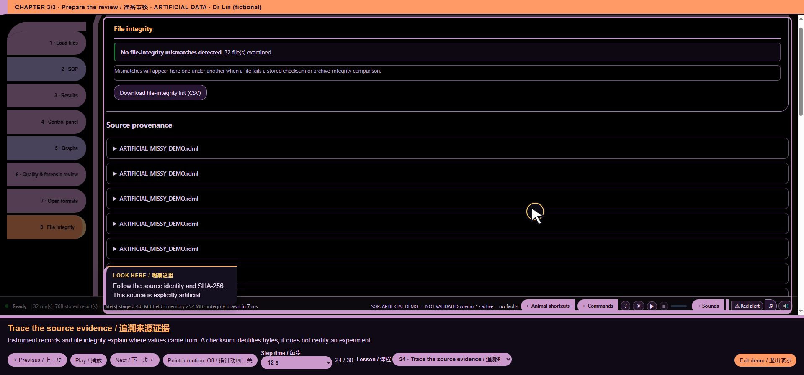

# variants/public/integrity.js — function reference

## C05563 · integrityLabel

- Ownership: MISSY first-party
- Module: variants/public/integrity.js, line 1; script 8, script line 3018
- Form: FunctionDeclaration; parameters: `run`
- AST classification: `current_matching_baseline_ast`
- R1 entry status: `observed_in_passing_scenario`
- Passing scenario observations: voice-demo, formats, training, chart-focus, guided-tour, precision, evidence-keyboard
- R2 clean contract evidence: No separately linked clean contract assertion for this function
- Code SHA-256: `675288f76f569d4729f92a9c8922ebe383b4b4d5448d039abc2f1c2d2b4ae04c`
- [Complete exact function source](https://github.com/mihaiionitabio-alt/zpcrweb/blob/missy-public-offline-2026-10-20/documentation/releases/2026-10-31-full-wiki/code/functions/C05563.js)

```javascript
function integrityLabel(run){
  const g=run&&run.integrity;if(!g)return "not checked";
  if(g.kind==="eds")return `${g.zipCrcOk?"CRC-32 valid":"CRC-32 FAILED"}; ${g.ok===true?"Tamper MD5 matches":g.ok===false?"Tamper MD5 MISMATCH":"no Tamper record"}`;
  return g.ok===true?"container checksum matches":g.ok===false?"container checksum MISMATCH":"no container checksum";
}
```

## C05564 · integrityEvents

- Ownership: MISSY first-party
- Module: variants/public/integrity.js, line 6; script 8, script line 3023
- Form: FunctionDeclaration; parameters: `run, push`
- AST classification: `changed_same_unique_name`
- R1 entry status: `not_observed_in_passing_scenario`
- Passing scenario observations: No passing R1 instrumented scenario observation
- R2 clean contract evidence: No separately linked clean contract assertion for this function
- Code SHA-256: `18dd7841b7b2a964d0afba210ad717c45498ccb204cd9a11bb08e431a7b8a2d0`
- [Complete exact function source](https://github.com/mihaiionitabio-alt/zpcrweb/blob/missy-public-offline-2026-10-20/documentation/releases/2026-10-31-full-wiki/code/functions/C05564.js)

```javascript
function integrityEvents(run,push){
  const g=run.integrity;if(!g)return;
  if(g.kind==="ixo"){
    if(g.ok===true)push("info","Integrity","Container checksum matches the object stream",g.computed);
    else if(g.ok===false)push("error","Integrity","Container checksum does not match — the file was changed after the software sealed it",
      `stored ${g.stored}; recomputed ${g.computed}`);
    else push("review","Integrity","No container checksum could be verified",g.note||"");
    return;
  }
  if(!['ixo','eds'].includes(g.kind)){
    if(run.meta?.sourceSHA256)push('info','Integrity','Source SHA-256 recorded; identifies bytes, not vendor authenticity',run.meta.sourceSHA256);
    if(g.crcVerified===true||g.zipCrcOk===true)push('info','Integrity','Archive CRC-32 verified',g.verifiedScope||'Decoded ZIP members');
    else push('review','Integrity','No archive verification available',run.pcrdLocked?'Encrypted payload remains unavailable':'No verified archive evidence for this source');
    push('review','Integrity','Vendor signature/seal verification unavailable','No qualification or authenticity verdict inferred');return;
  }
  if(g.zipCrcOk)push("info","Integrity",`ZIP CRC-32 valid for all ${g.entries} entries`,"");
  else push("error","Integrity","ZIP CRC-32 failed",(g.zipCrcBad||[]).join(", "));
  if(g.ok===true)push("info","Integrity","Tamper MD5 matches the stored value",g.computed);
  else if(g.ok===false)push("error","Integrity","Tamper MD5 does not match — the file was changed after the software sealed it",
    `stored ${g.stored}; recomputed ${g.computed}`);
  else push(run.isTemplate?"info":"review","Integrity","No Tamper record in the container",run.isTemplate?"expected for a template":"");
}
```

[Wiki home](/p/zpcrweb/wiki/Home/)

## Illustrated interface context

Source/integrity review. This picture does not demonstrate cryptographic correctness. This is UI context, not proof of function-level correctness.



*Representative webpage view for variants/public/integrity.js*

[Complete illustrated workflow and source mapping](https://github.com/mihaiionitabio-alt/zpcrweb/blob/missy-public-offline-2026-10-20/documentation/releases/2026-11-01-illustrated-wiki/pages/FunctionScreenshots.md)
