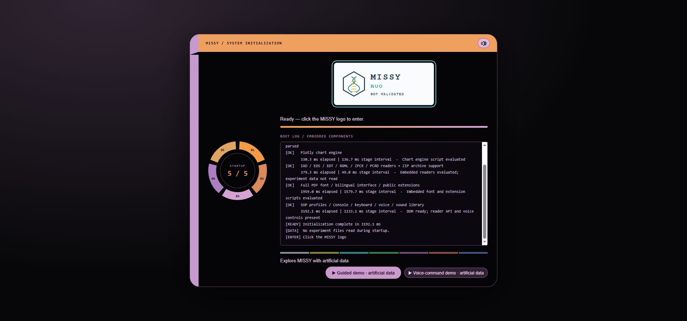

# MISSY illustrated documentation

Current build: **2026.10.31.demolabels1**. Captured 1 November 2026. Pictures below are actual browser screenshots with artificial data, not report images.

*MISSY startup — both built-in demonstrations explicitly labelled artificial data*

- [Thirty-lesson guided walkthrough](https://github.com/mihaiionitabio-alt/zpcrweb/blob/missy-public-offline-2026-10-20/documentation/releases/2026-11-01-illustrated-wiki/pages/IllustratedWalkthrough.md)
- [Voice workflow: all 69 command/action and answer steps](https://github.com/mihaiionitabio-alt/zpcrweb/blob/missy-public-offline-2026-10-20/documentation/releases/2026-11-01-illustrated-wiki/pages/IllustratedVoiceWorkflow.md)
- [Ten audio demonstration parts, with text in place of audio](https://github.com/mihaiionitabio-alt/zpcrweb/blob/missy-public-offline-2026-10-20/documentation/releases/2026-11-01-illustrated-wiki/pages/TenAudioDemos.md)
- [Screenshots beside functions and source modules](https://github.com/mihaiionitabio-alt/zpcrweb/blob/missy-public-offline-2026-10-20/documentation/releases/2026-11-01-illustrated-wiki/pages/FunctionScreenshots.md)

The ten-part images/transcripts are historical Calm V1 material, separately labelled. The two built-in demo captures are from the current live build. Screenshot presence does not imply clinical or laboratory validation.

SourceForge currently blocks editing with “Page create/edit rate limit exceeded”; the prepared wiki pages are available here on GitHub pending permitted publication.
