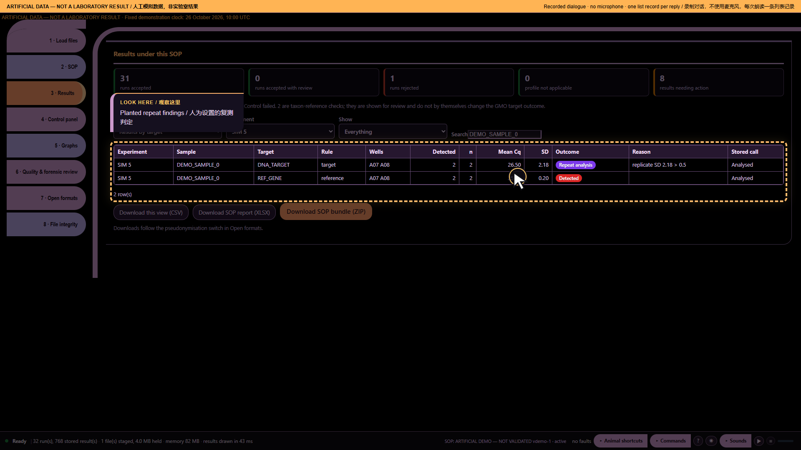

# Ten audio demonstrations — part 1: A repeat that needs review

Artificial demonstration data; not laboratory results. Research use only. MISSY is not validated.

This is the existing **Calm V1 ten-part recording**, preserved as a historical illustrated transcript. Its screenshots and answers were not newly recorded against the current build. Commands and numbers below describe that artificial-data recording. They are not current laboratory findings.

**Main command:** Computer which samples should I repeat

**Recorded full answer:** 3 current sample-target groups have the exact Repeat outcome under ARTIFICIAL DEMO — NOT VALIDATED. Other review or invalid outcomes are not counted as Repeat. SIM 5; DEMO_SAMPLE_0; DNA_TARGET; rule target: DNA_TARGET; replicate SD 2.18 > 0.5. 2 more. Say Computer more.

*Part 1: A repeat that needs review — actual archived webpage screenshot*

## Spoken sequence

**Operator:** These are artificial data, not laboratory results.

**Operator:** One sample needs a closer look.

**Operator:** I open Missy and enter the workspace.

**Operator:** I load the artificial data and the profile.

**Operator:** The files are ready for review.

**Operator:** Computer which samples should I repeat

**MISSY:** SIM 5; DEMO_SAMPLE_0; DNA_TARGET; rule target: DNA_TARGET; replicate SD 2.18 > 0.5. 2 more.

Chinese subtitle: SIM 5；DEMO_SAMPLE_0；DNA_TARGET。根据靶标规则，重复间标准差 2.18 大于限值 0.5。还有两项。

**MISSY:** Say Computer more.

Chinese subtitle: 请说 Computer more。

**Operator:** I keep this finding for review.

## Source record

[Original structured script](https://raw.githubusercontent.com/mihaiionitabio-alt/zpcrweb/missy-public-offline-2026-10-20/documentation/releases/2026-11-01-illustrated-wiki/records/MISSY_Part_01.json). The displayed spoken excerpt may be shorter than the recorded full answer, as declared in that script.
