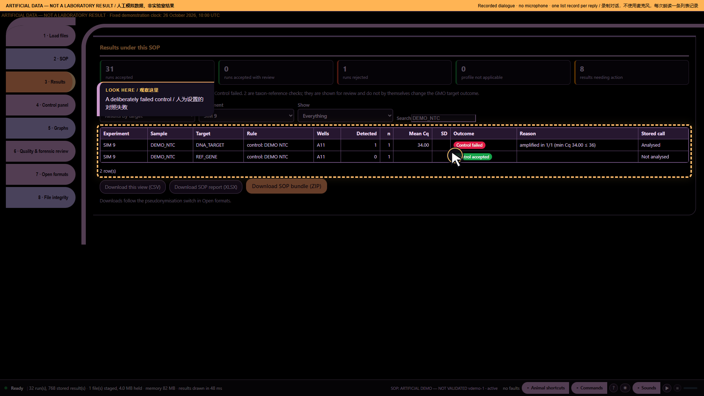

# Ten audio demonstrations — part 4: The negative control has a signal

Artificial demonstration data; not laboratory results. Research use only. MISSY is not validated.

This is the existing **Calm V1 ten-part recording**, preserved as a historical illustrated transcript. Its screenshots and answers were not newly recorded against the current build. Commands and numbers below describe that artificial-data recording. They are not current laboratory findings.

**Main command:** Computer did any control fail

**Recorded full answer:** 128 evaluated control groups; 1 groups have the exact Control fail outcome. 0 control-presence criteria need review. This is not a run pass. SIM 9; DEMO NTC; DNA_TARGET; Control fail; rule control: DEMO NTC; amplified in 1/1 (min Cq 34.00 ≤ 36). End of list.

*Part 4: The negative control has a signal — actual archived webpage screenshot*

## Spoken sequence

**Operator:** These are artificial data, not laboratory results.

**Operator:** I must check the controls before the samples.

**Operator:** I open Missy and enter the workspace.

**Operator:** I load the artificial data and the profile.

**Operator:** The files are ready for review.

**Operator:** Computer did any control fail

**MISSY:** SIM 9; DEMO NTC; DNA_TARGET; Control fail; rule control: DEMO NTC; signal detected in 1/1 (min threshold cycle 34.00 ≤ 36).

Chinese subtitle: SIM 9 的 DEMO NTC 阴性对照在 DNA_TARGET 上判定为对照失败。根据该对照规则，1 个反应中有 1 个扩增；最低 Cq 为 34.00，不大于 36。

**MISSY:** End of list.

Chinese subtitle: 列表结束。

**Operator:** I review the control before using the results.

## Source record

[Original structured script](https://raw.githubusercontent.com/mihaiionitabio-alt/zpcrweb/missy-public-offline-2026-10-20/documentation/releases/2026-11-01-illustrated-wiki/records/MISSY_Part_04.json). The displayed spoken excerpt may be shorter than the recorded full answer, as declared in that script.
