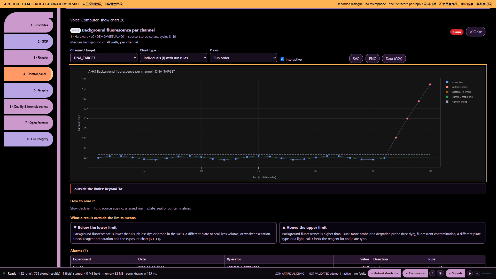

# Ten audio demonstrations — part 5: A history that drifts

Artificial demonstration data; not laboratory results. Research use only. MISSY is not validated.

This is the existing **Calm V1 ten-part recording**, preserved as a historical illustrated transcript. Its screenshots and answers were not newly recorded against the current build. Commands and numbers below describe that artificial-data recording. They are not current laboratory findings.

**Main command:** Computer how many outliers

**Recorded full answer:** A-H3 Background fluorescence per channel. 30 assessed points; 4 beyond available limits; 4 points with recorded flags. 0 missing or non-finite points; 0 before baseline. 30 points have available limits. Recorded flags: beyond 3σ.

*Part 5: A history that drifts — actual archived webpage screenshot*

## Spoken sequence

**Operator:** These are artificial data, not laboratory results.

**Operator:** A change appears across several runs.

**Operator:** I open Missy and enter the workspace.

**Operator:** I load the artificial data and the profile.

**Operator:** The files are ready for review.

**Operator:** Computer how many outliers

**MISSY:** A-H3 Background fluorescence per channel. 30 assessed points; 4 beyond available limits; 4 points with recorded flags. 0 missing or non-finite points; 0 before baseline. 30 points have available limits.

Chinese subtitle: A-H3：各通道背景荧光。已评估 30 个点；4 个超出可用限值，4 个有标记。缺失或非有限值 0 个，基线之前 0 个。30 个点有可用限值。

**MISSY:** Recorded flags: beyond 3σ.

Chinese subtitle: 记录标记：超出三倍标准差。

**Operator:** I review the drift without guessing its cause.

## Source record

[Original structured script](https://raw.githubusercontent.com/mihaiionitabio-alt/zpcrweb/missy-public-offline-2026-10-20/documentation/releases/2026-11-01-illustrated-wiki/records/MISSY_Part_05.json). The displayed spoken excerpt may be shorter than the recorded full answer, as declared in that script.
