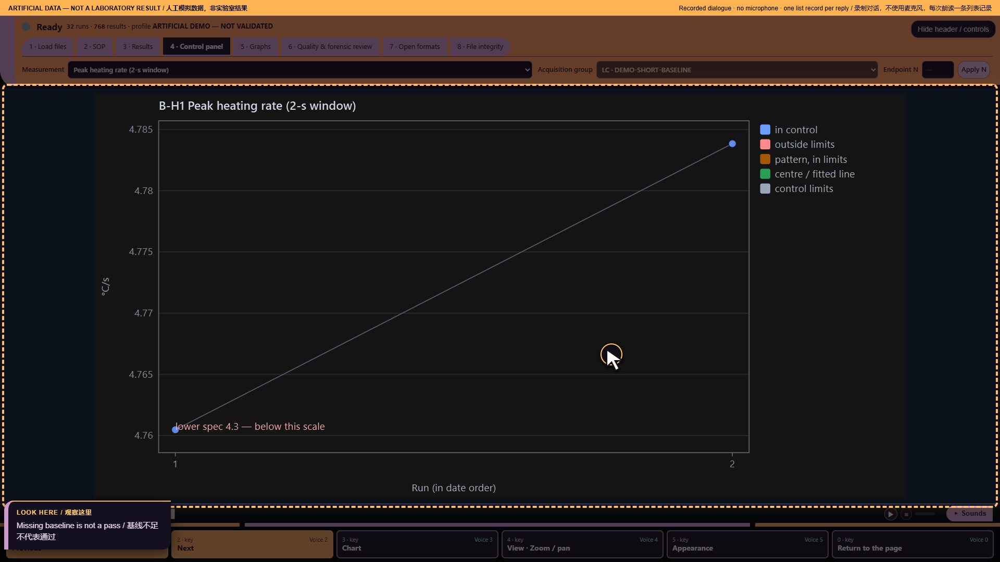

# Ten audio demonstrations — part 6: No ready baseline

Artificial demonstration data; not laboratory results. Research use only. MISSY is not validated.

This is the existing **Calm V1 ten-part recording**, preserved as a historical illustrated transcript. Its screenshots and answers were not newly recorded against the current build. Commands and numbers below describe that artificial-data recording. They are not current laboratory findings.

**Main command:** Computer why has this chart no limits

**Recorded full answer:** B-H1 Peak heating rate (2-s window). 2 assessed points; 0 beyond available limits; 0 points with recorded flags. 0 missing or non-finite points; 0 before baseline. 2 points have available limits. Control baseline is not ready. No recorded flags. This is not proof that all data are nominal.

*Part 6: No ready baseline — actual archived webpage screenshot*

## Spoken sequence

**Operator:** These are artificial data, not laboratory results.

**Operator:** I need more data.

**Operator:** I open Missy and enter the workspace.

**Operator:** I load the artificial data and the profile.

**Operator:** The files are ready for review.

**Operator:** Computer why has this chart no limits

**MISSY:** B-H1 Peak heating rate (2-s window). 2 assessed points; 0 beyond available limits; 0 points with recorded flags. 0 missing or non-finite points; 0 before baseline. 2 points have available limits.

Chinese subtitle: B-H1：峰值升温速率，两秒窗口。已评估 2 个点；超出限值 0 个，有标记 0 个。缺失或非有限值 0 个，基线之前 0 个。2 个点有可用限值。

**MISSY:** Control baseline is not ready.

Chinese subtitle: 控制基线尚未准备就绪。

**MISSY:** No recorded flags.

Chinese subtitle: 没有记录标记。

**MISSY:** This is not proof that all data are nominal.

Chinese subtitle: 这不证明所有数据都正常。

**Operator:** I need more evidence before calling this normal.

## Source record

[Original structured script](https://raw.githubusercontent.com/mihaiionitabio-alt/zpcrweb/missy-public-offline-2026-10-20/documentation/releases/2026-11-01-illustrated-wiki/records/MISSY_Part_06.json). The displayed spoken excerpt may be shorter than the recorded full answer, as declared in that script.
