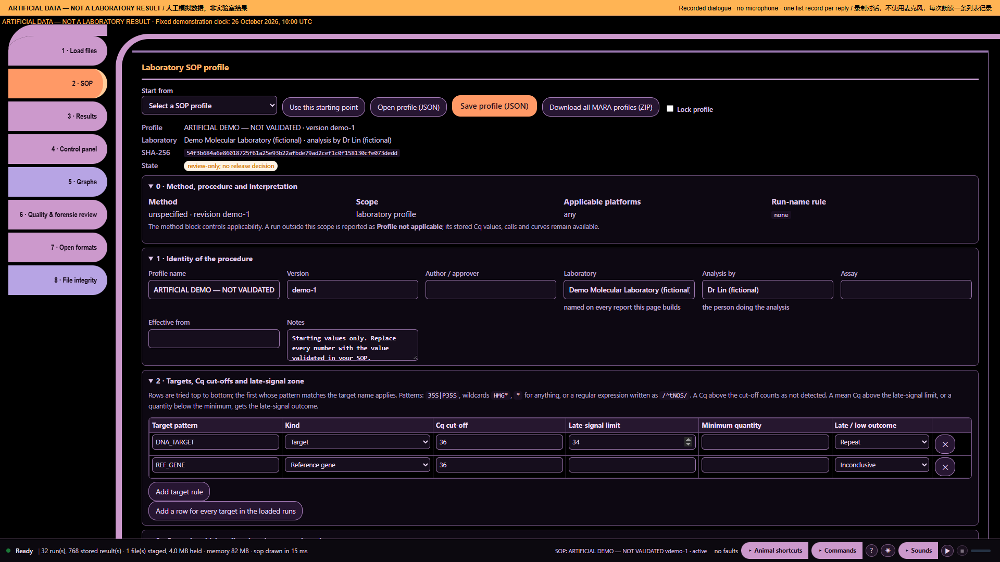

# Ten audio demonstrations — part 7: Compare the right histories

Artificial demonstration data; not laboratory results. Research use only. MISSY is not validated.

This is the existing **Calm V1 ten-part recording**, preserved as a historical illustrated transcript. Its screenshots and answers were not newly recorded against the current build. Commands and numbers below describe that artificial-data recording. They are not current laboratory findings.

**Main command:** Computer are these runs comparable

**Recorded full answer:** 2 distinct recorded platform/instrument labels; 1 decoded protocol signatures; 0 run views lack an instrument identifier and 0 lack a decoded protocol. The loaded records include different cohorts. Select one instrument, protocol and acquisition context before comparing control charts.

*Part 7: Compare the right histories — actual archived webpage screenshot*

## Spoken sequence

**Operator:** These are artificial data, not laboratory results.

**Operator:** These histories may not belong together.

**Operator:** I open Missy and enter the workspace.

**Operator:** I load the artificial data and the profile.

**Operator:** The files are ready for review.

**Operator:** Computer are these runs comparable

**MISSY:** 2 distinct recorded platform/instrument labels; 1 decoded protocol signatures; 0 run views lack an instrument identifier and 0 lack a decoded protocol.

Chinese subtitle: 记录中有两个不同的平台或仪器标签，一个已解码的方案签名。缺少仪器标识的运行 0 个；缺少已解码方案的运行 0 个。

**MISSY:** The loaded records include different cohorts.

Chinese subtitle: 已加载记录包含不同的数据组。

**MISSY:** Select one instrument, protocol and acquisition context before comparing control charts.

Chinese subtitle: 比较控制图前，请选择相同的仪器、方案及采集条件。

**Operator:** I compare one matching group at a time.

## Source record

[Original structured script](https://raw.githubusercontent.com/mihaiionitabio-alt/zpcrweb/missy-public-offline-2026-10-20/documentation/releases/2026-11-01-illustrated-wiki/records/MISSY_Part_07.json). The displayed spoken excerpt may be shorter than the recorded full answer, as declared in that script.
