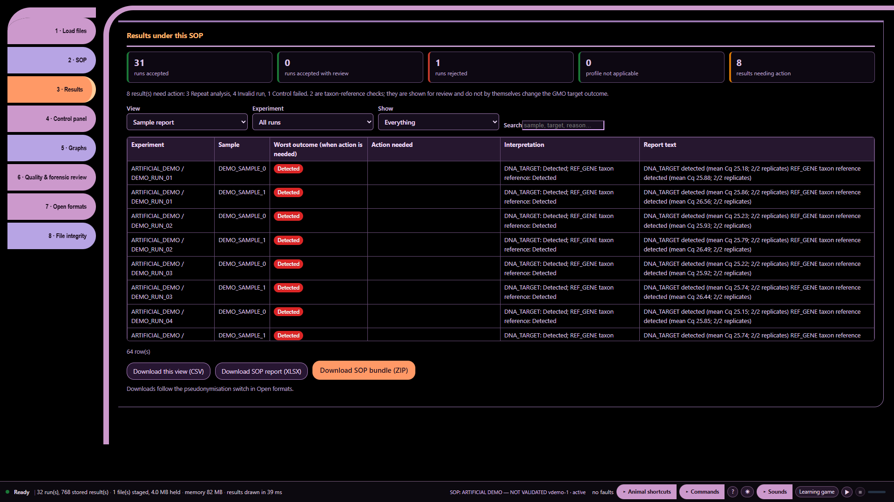

# Ten audio demonstrations — part 8: A missing protocol

Artificial demonstration data; not laboratory results. Research use only. MISSY is not validated.

This is the existing **Calm V1 ten-part recording**, preserved as a historical illustrated transcript. Its screenshots and answers were not newly recorded against the current build. Commands and numbers below describe that artificial-data recording. They are not current laboratory findings.

**Main command:** Computer what protocol was used

**Recorded full answer:** Decoded protocol signatures for all loaded run views. Missing signatures are stated; no protocol name is inferred. Run 1; ARTIFICIAL_DEMO / DEMO_RUN_01; (protocol not decoded); Run 2; ARTIFICIAL_DEMO / DEMO_RUN_02; (protocol not decoded); Run 3; ARTIFICIAL_DEMO / DEMO_RUN_03; (protocol not decoded); Run 4; ARTIFICIAL_DEMO / DEMO_RUN_04; (protocol not decoded); Run 5; ARTIFICIAL_DEMO / DEMO_RUN_05; (protocol not decoded); Run 6; ARTIFICIAL_DEMO / DEMO_RUN_06; (protocol not decoded); Run 7; ARTIFICIAL_DEMO / DEMO_RUN_07; (protocol not decoded); Run 8; ARTIFICIAL_DEMO / DEMO_RUN_08; (protocol not decoded). 24 more. Say Computer more.

*Part 8: A missing protocol — actual archived webpage screenshot*

## Spoken sequence

**Operator:** These are artificial data, not laboratory results.

**Operator:** The values alone do not describe the method.

**Operator:** I open Missy and enter the workspace.

**Operator:** I load the artificial data and the profile.

**Operator:** The files are ready for review.

**Operator:** Computer what protocol was used

**MISSY:** Decoded protocol signatures for all loaded run views.

Chinese subtitle: 以下为全部已加载运行的已解码方案签名。

**MISSY:** Missing signatures are stated; no protocol name is inferred.

Chinese subtitle: 缺失签名会明确说明，不推断方案名称。

**MISSY:** Run 1; ARTIFICIAL_DEMO / DEMO_RUN_01; (protocol not decoded).

Chinese subtitle: 运行 1：ARTIFICIAL_DEMO / DEMO_RUN_01；方案未解码。

**Operator:** I record the missing method information.

## Source record

[Original structured script](https://raw.githubusercontent.com/mihaiionitabio-alt/zpcrweb/missy-public-offline-2026-10-20/documentation/releases/2026-11-01-illustrated-wiki/records/MISSY_Part_08.json). The displayed spoken excerpt may be shorter than the recorded full answer, as declared in that script.
