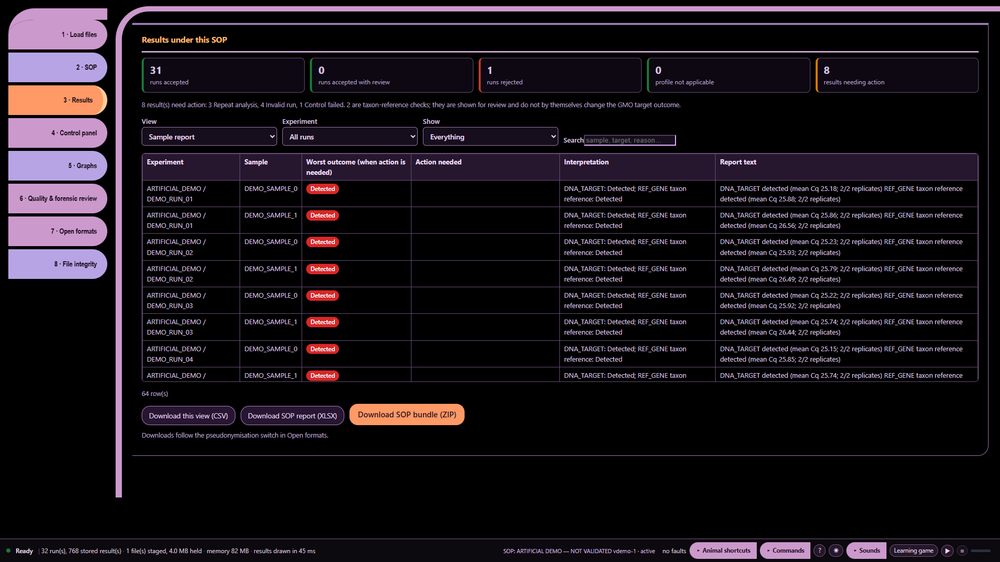

# Ten audio demonstrations — part 9: A duration I cannot verify

Artificial demonstration data; not laboratory results. Research use only. MISSY is not validated.

This is the existing **Calm V1 ten-part recording**, preserved as a historical illustrated transcript. Its screenshots and answers were not newly recorded against the current build. Commands and numbers below describe that artificial-data recording. They are not current laboratory findings.

**Main command:** Computer how long did run one take

**Recorded full answer:** Run 1 has no usable recorded start-to-end duration.

*Part 9: A duration I cannot verify — actual archived webpage screenshot*

## Spoken sequence

**Operator:** These are artificial data, not laboratory results.

**Operator:** I check the duration.

**Operator:** I open Missy and enter the workspace.

**Operator:** I load the artificial data and the profile.

**Operator:** The files are ready for review.

**Operator:** Computer how long did run one take

**MISSY:** Run 1 has no usable recorded start-to-end duration.

Chinese subtitle: 运行 1 没有可用的已记录开始至结束时长。

**Operator:** I leave the duration as unavailable.

## Source record

[Original structured script](https://raw.githubusercontent.com/mihaiionitabio-alt/zpcrweb/missy-public-offline-2026-10-20/documentation/releases/2026-11-01-illustrated-wiki/records/MISSY_Part_09.json). The displayed spoken excerpt may be shorter than the recorded full answer, as declared in that script.
