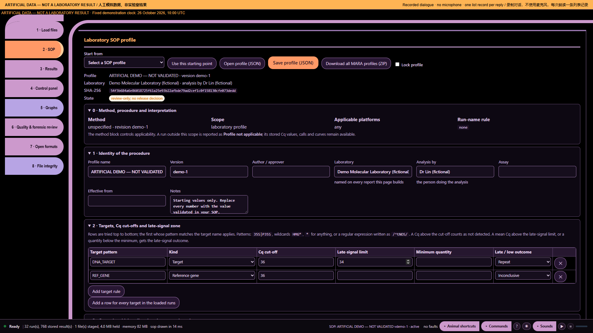

# Ten audio demonstrations — part 10: Findings are not validation

Artificial demonstration data; not laboratory results. Research use only. MISSY is not validated.

This is the existing **Calm V1 ten-part recording**, preserved as a historical illustrated transcript. Its screenshots and answers were not newly recorded against the current build. Commands and numbers below describe that artificial-data recording. They are not current laboratory findings.

**Main command:** Computer are these results validated

**Recorded full answer:** This is a research-use tool, not a laboratory validation certificate. You can review the method configuration and documentation for your own validation process.

*Part 10: Findings are not validation — actual archived webpage screenshot*

## Spoken sequence

**Operator:** These are artificial data, not laboratory results.

**Operator:** A report does not make results validated.

**Operator:** I open Missy and enter the workspace.

**Operator:** I load the artificial data and the profile.

**Operator:** The files are ready for review.

**Operator:** Computer are these results validated

**MISSY:** This is a research-use tool, not a laboratory validation certificate.

Chinese subtitle: 这是研究用工具，不是实验室验证证书。

**MISSY:** You can review the method configuration and documentation for your own validation process.

Chinese subtitle: 您可审核方法配置和文档，用于自己的验证流程。

**Operator:** The laboratory remains responsible for release decisions.

## Source record

[Original structured script](https://raw.githubusercontent.com/mihaiionitabio-alt/zpcrweb/missy-public-offline-2026-10-20/documentation/releases/2026-11-01-illustrated-wiki/records/MISSY_Part_10.json). The displayed spoken excerpt may be shorter than the recorded full answer, as declared in that script.
