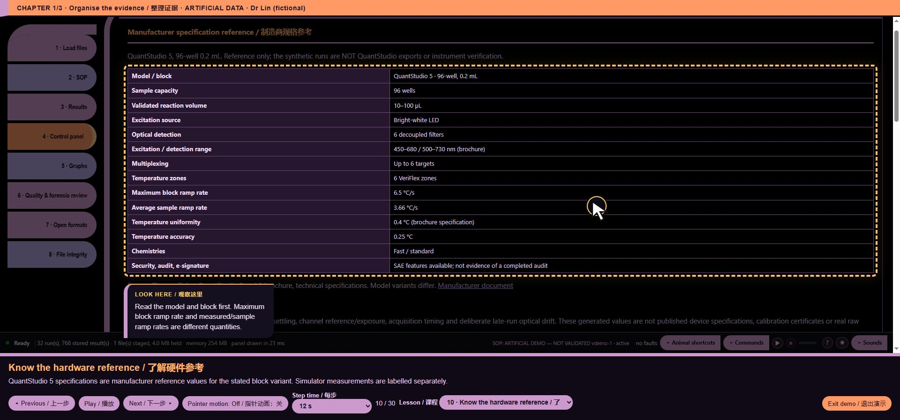
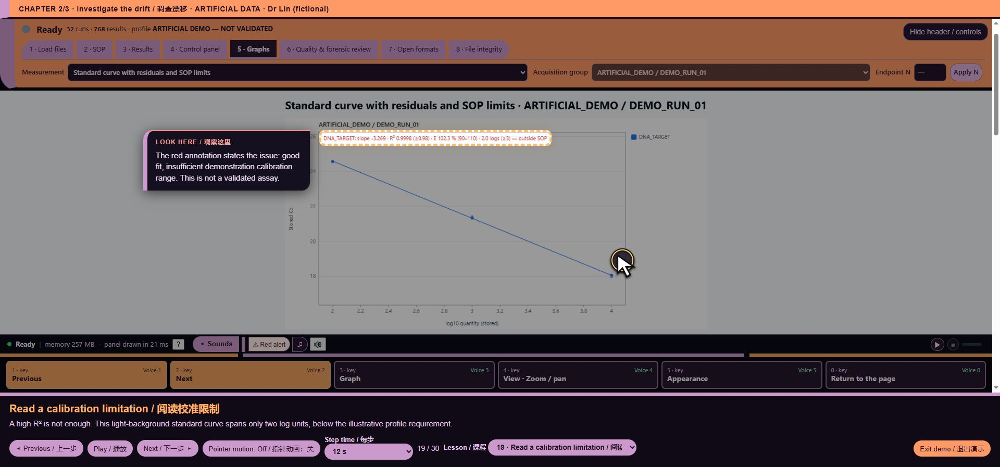
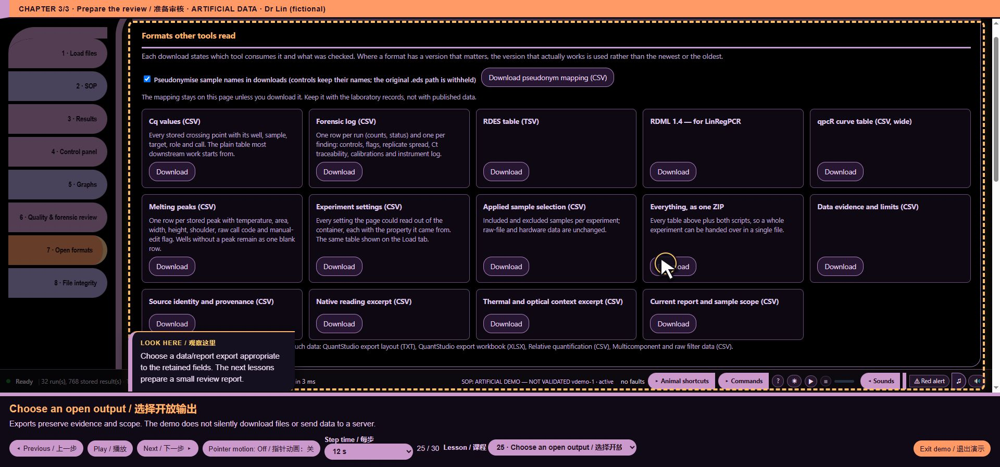
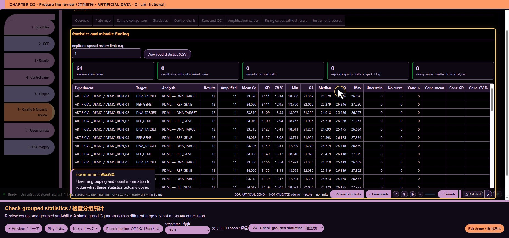
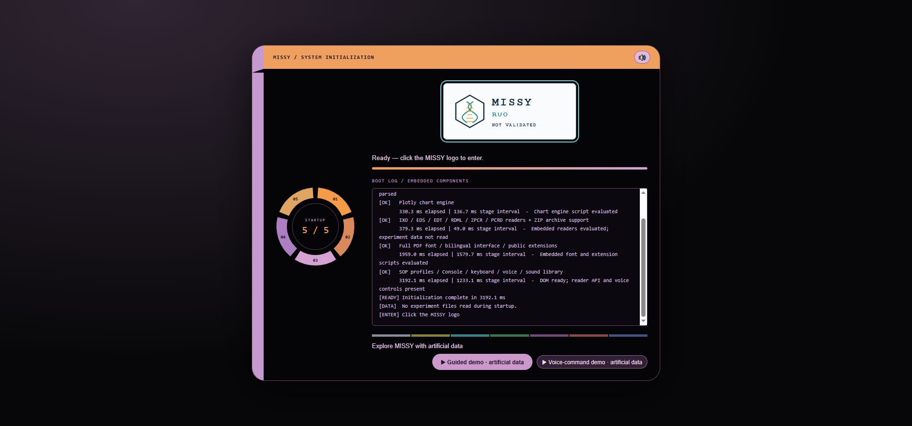
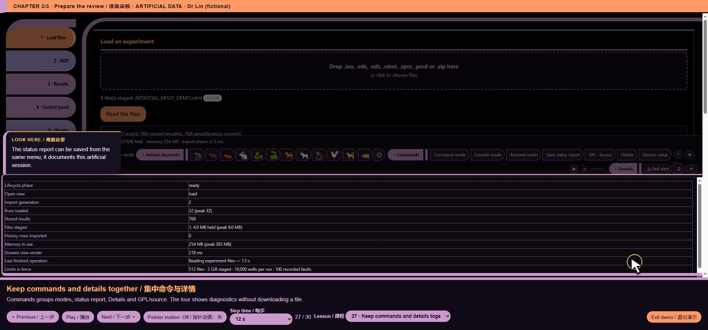
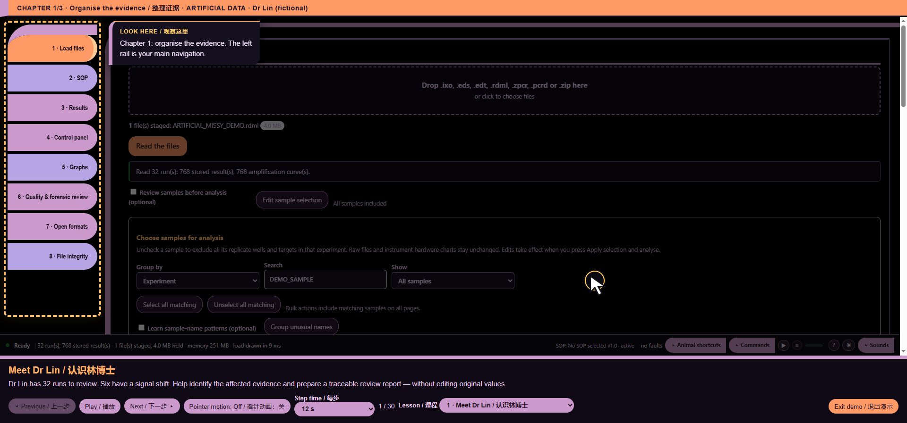
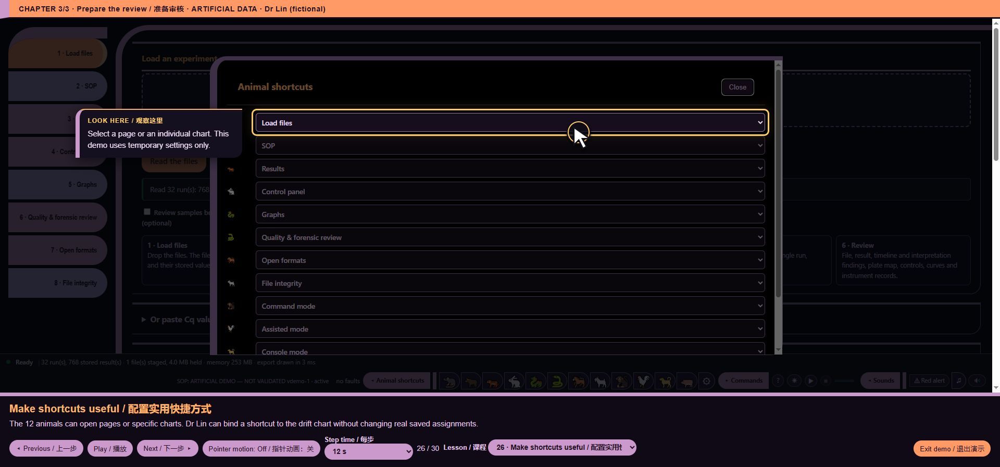

# Functions and their visible interface context

Artificial demonstration data; not laboratory results. Research use only. MISSY is not validated.

Screenshots illustrate UI context. They are **not** a claim that every function is tested, nor a function-level execution trace. Several functions share a screen. Internal algorithms and dependencies remain linked to their exact source without a fabricated screenshot.

## core/advisory/engine.js

157 function entries. No unique screen is attributed to this internal/support module; see its exact source and validation record.

Code chapters: [Code-001-01](https://github.com/mihaiionitabio-alt/zpcrweb/blob/missy-public-offline-2026-10-20/documentation/releases/2026-10-31-full-wiki/pages/Code-001-01.md), [Code-001-02](https://github.com/mihaiionitabio-alt/zpcrweb/blob/missy-public-offline-2026-10-20/documentation/releases/2026-10-31-full-wiki/pages/Code-001-02.md), [Code-001-03](https://github.com/mihaiionitabio-alt/zpcrweb/blob/missy-public-offline-2026-10-20/documentation/releases/2026-10-31-full-wiki/pages/Code-001-03.md).

## core/advisory/panel.js

148 function entries. No unique screen is attributed to this internal/support module; see its exact source and validation record.

Code chapters: [Code-002-01](https://github.com/mihaiionitabio-alt/zpcrweb/blob/missy-public-offline-2026-10-20/documentation/releases/2026-10-31-full-wiki/pages/Code-002-01.md), [Code-002-02](https://github.com/mihaiionitabio-alt/zpcrweb/blob/missy-public-offline-2026-10-20/documentation/releases/2026-10-31-full-wiki/pages/Code-002-02.md), [Code-002-03](https://github.com/mihaiionitabio-alt/zpcrweb/blob/missy-public-offline-2026-10-20/documentation/releases/2026-10-31-full-wiki/pages/Code-002-03.md).

## core/analysis/loaded_overview.js

58 function entries. No unique screen is attributed to this internal/support module; see its exact source and validation record.

Code chapters: [Code-003-01](https://github.com/mihaiionitabio-alt/zpcrweb/blob/missy-public-offline-2026-10-20/documentation/releases/2026-10-31-full-wiki/pages/Code-003-01.md), [Code-003-02](https://github.com/mihaiionitabio-alt/zpcrweb/blob/missy-public-offline-2026-10-20/documentation/releases/2026-10-31-full-wiki/pages/Code-003-02.md).

## core/analysis/pcrd_independent.js

105 function entries. No unique screen is attributed to this internal/support module; see its exact source and validation record.

Code chapters: [Code-004-01](https://github.com/mihaiionitabio-alt/zpcrweb/blob/missy-public-offline-2026-10-20/documentation/releases/2026-10-31-full-wiki/pages/Code-004-01.md), [Code-004-02](https://github.com/mihaiionitabio-alt/zpcrweb/blob/missy-public-offline-2026-10-20/documentation/releases/2026-10-31-full-wiki/pages/Code-004-02.md).

## core/biorad/cfx_rdml_views.js

64 function entries. Chart user-interface context. Synthetic RDML does not demonstrate native Bio-Rad decoding.

Code chapters: [Code-005-01](https://github.com/mihaiionitabio-alt/zpcrweb/blob/missy-public-offline-2026-10-20/documentation/releases/2026-10-31-full-wiki/pages/Code-005-01.md), [Code-005-02](https://github.com/mihaiionitabio-alt/zpcrweb/blob/missy-public-offline-2026-10-20/documentation/releases/2026-10-31-full-wiki/pages/Code-005-02.md).

*Illustrative UI context: core/biorad/cfx_rdml_views.js*

## core/biorad/graph_viewport.js

7 function entries. Chart user-interface context. Synthetic RDML does not demonstrate native Bio-Rad decoding.

Code chapters: [Code-006-01](https://github.com/mihaiionitabio-alt/zpcrweb/blob/missy-public-offline-2026-10-20/documentation/releases/2026-10-31-full-wiki/pages/Code-006-01.md).

*Illustrative UI context: core/biorad/graph_viewport.js*

## core/biorad/legacy_view_adapter.js

34 function entries. Chart user-interface context. Synthetic RDML does not demonstrate native Bio-Rad decoding.

Code chapters: [Code-007-01](https://github.com/mihaiionitabio-alt/zpcrweb/blob/missy-public-offline-2026-10-20/documentation/releases/2026-10-31-full-wiki/pages/Code-007-01.md).

*Illustrative UI context: core/biorad/legacy_view_adapter.js*

## core/biorad/lifecycle.js

4 function entries. Chart user-interface context. Synthetic RDML does not demonstrate native Bio-Rad decoding.

Code chapters: [Code-008-01](https://github.com/mihaiionitabio-alt/zpcrweb/blob/missy-public-offline-2026-10-20/documentation/releases/2026-10-31-full-wiki/pages/Code-008-01.md).

*Illustrative UI context: core/biorad/lifecycle.js*

## core/biorad/pcrd_views.js

177 function entries. Chart user-interface context. Synthetic RDML does not demonstrate native Bio-Rad decoding.

Code chapters: [Code-009-01](https://github.com/mihaiionitabio-alt/zpcrweb/blob/missy-public-offline-2026-10-20/documentation/releases/2026-10-31-full-wiki/pages/Code-009-01.md), [Code-009-02](https://github.com/mihaiionitabio-alt/zpcrweb/blob/missy-public-offline-2026-10-20/documentation/releases/2026-10-31-full-wiki/pages/Code-009-02.md), [Code-009-03](https://github.com/mihaiionitabio-alt/zpcrweb/blob/missy-public-offline-2026-10-20/documentation/releases/2026-10-31-full-wiki/pages/Code-009-03.md), [Code-009-04](https://github.com/mihaiionitabio-alt/zpcrweb/blob/missy-public-offline-2026-10-20/documentation/releases/2026-10-31-full-wiki/pages/Code-009-04.md).

*Illustrative UI context: core/biorad/pcrd_views.js*

## core/biorad/reference_console_style.js

2 function entries. Chart user-interface context. Synthetic RDML does not demonstrate native Bio-Rad decoding.

Code chapters: [Code-010-01](https://github.com/mihaiionitabio-alt/zpcrweb/blob/missy-public-offline-2026-10-20/documentation/releases/2026-10-31-full-wiki/pages/Code-010-01.md).

*Illustrative UI context: core/biorad/reference_console_style.js*

## core/biorad/unified_shell.js

52 function entries. Chart user-interface context. Synthetic RDML does not demonstrate native Bio-Rad decoding.

Code chapters: [Code-011-01](https://github.com/mihaiionitabio-alt/zpcrweb/blob/missy-public-offline-2026-10-20/documentation/releases/2026-10-31-full-wiki/pages/Code-011-01.md), [Code-011-02](https://github.com/mihaiionitabio-alt/zpcrweb/blob/missy-public-offline-2026-10-20/documentation/releases/2026-10-31-full-wiki/pages/Code-011-02.md).

*Illustrative UI context: core/biorad/unified_shell.js*

## core/biorad/zpcr_compact_report.js

80 function entries. Report preparation in the webpage; not a PDF screenshot.

Code chapters: [Code-012-01](https://github.com/mihaiionitabio-alt/zpcrweb/blob/missy-public-offline-2026-10-20/documentation/releases/2026-10-31-full-wiki/pages/Code-012-01.md), [Code-012-02](https://github.com/mihaiionitabio-alt/zpcrweb/blob/missy-public-offline-2026-10-20/documentation/releases/2026-10-31-full-wiki/pages/Code-012-02.md).

*Illustrative UI context: core/biorad/zpcr_compact_report.js*

## core/biorad/zpcr_comparative_modes.js

45 function entries. Chart user-interface context. Synthetic RDML does not demonstrate native Bio-Rad decoding.

Code chapters: [Code-013-01](https://github.com/mihaiionitabio-alt/zpcrweb/blob/missy-public-offline-2026-10-20/documentation/releases/2026-10-31-full-wiki/pages/Code-013-01.md).

*Illustrative UI context: core/biorad/zpcr_comparative_modes.js*

## core/biorad/zpcr_control_charts.js

22 function entries. Chart user-interface context. Synthetic RDML does not demonstrate native Bio-Rad decoding.

Code chapters: [Code-014-01](https://github.com/mihaiionitabio-alt/zpcrweb/blob/missy-public-offline-2026-10-20/documentation/releases/2026-10-31-full-wiki/pages/Code-014-01.md).

*Illustrative UI context: core/biorad/zpcr_control_charts.js*

## core/biorad/zpcr_gates_dark.js

46 function entries. Chart user-interface context. Synthetic RDML does not demonstrate native Bio-Rad decoding.

Code chapters: [Code-015-01](https://github.com/mihaiionitabio-alt/zpcrweb/blob/missy-public-offline-2026-10-20/documentation/releases/2026-10-31-full-wiki/pages/Code-015-01.md).

*Illustrative UI context: core/biorad/zpcr_gates_dark.js*

## core/biorad/zpcr_guide_charts.js

19 function entries. Chart user-interface context. Synthetic RDML does not demonstrate native Bio-Rad decoding.

Code chapters: [Code-016-01](https://github.com/mihaiionitabio-alt/zpcrweb/blob/missy-public-offline-2026-10-20/documentation/releases/2026-10-31-full-wiki/pages/Code-016-01.md).

*Illustrative UI context: core/biorad/zpcr_guide_charts.js*

## core/biorad/zpcr_manual_endpoint.js

46 function entries. Chart user-interface context. Synthetic RDML does not demonstrate native Bio-Rad decoding.

Code chapters: [Code-017-01](https://github.com/mihaiionitabio-alt/zpcrweb/blob/missy-public-offline-2026-10-20/documentation/releases/2026-10-31-full-wiki/pages/Code-017-01.md).

*Illustrative UI context: core/biorad/zpcr_manual_endpoint.js*

## core/biorad/zpcr_modes_reports.js

60 function entries. Report preparation in the webpage; not a PDF screenshot.

Code chapters: [Code-018-01](https://github.com/mihaiionitabio-alt/zpcrweb/blob/missy-public-offline-2026-10-20/documentation/releases/2026-10-31-full-wiki/pages/Code-018-01.md), [Code-018-02](https://github.com/mihaiionitabio-alt/zpcrweb/blob/missy-public-offline-2026-10-20/documentation/releases/2026-10-31-full-wiki/pages/Code-018-02.md).

*Illustrative UI context: core/biorad/zpcr_modes_reports.js*

## core/biorad/zpcr_single_measurement.js

77 function entries. Chart user-interface context. Synthetic RDML does not demonstrate native Bio-Rad decoding.

Code chapters: [Code-019-01](https://github.com/mihaiionitabio-alt/zpcrweb/blob/missy-public-offline-2026-10-20/documentation/releases/2026-10-31-full-wiki/pages/Code-019-01.md), [Code-019-02](https://github.com/mihaiionitabio-alt/zpcrweb/blob/missy-public-offline-2026-10-20/documentation/releases/2026-10-31-full-wiki/pages/Code-019-02.md).

*Illustrative UI context: core/biorad/zpcr_single_measurement.js*

## core/charts/catalogue.js

62 function entries. Chart user-interface context. Synthetic RDML does not demonstrate native Bio-Rad decoding.

Code chapters: [Code-020-01](https://github.com/mihaiionitabio-alt/zpcrweb/blob/missy-public-offline-2026-10-20/documentation/releases/2026-10-31-full-wiki/pages/Code-020-01.md), [Code-020-02](https://github.com/mihaiionitabio-alt/zpcrweb/blob/missy-public-offline-2026-10-20/documentation/releases/2026-10-31-full-wiki/pages/Code-020-02.md).

*Illustrative UI context: core/charts/catalogue.js*

## core/charts/thermal.js

32 function entries. Instrument/hardware reference context, distinct from measured performance.

Code chapters: [Code-021-01](https://github.com/mihaiionitabio-alt/zpcrweb/blob/missy-public-offline-2026-10-20/documentation/releases/2026-10-31-full-wiki/pages/Code-021-01.md).

*Illustrative UI context: core/charts/thermal.js*

## core/container_metadata.js

55 function entries. No unique screen is attributed to this internal/support module; see its exact source and validation record.

Code chapters: [Code-022-01](https://github.com/mihaiionitabio-alt/zpcrweb/blob/missy-public-offline-2026-10-20/documentation/releases/2026-10-31-full-wiki/pages/Code-022-01.md), [Code-022-02](https://github.com/mihaiionitabio-alt/zpcrweb/blob/missy-public-offline-2026-10-20/documentation/releases/2026-10-31-full-wiki/pages/Code-022-02.md).

## core/efficiency.js

14 function entries. Calibration limitation example.

Code chapters: [Code-023-01](https://github.com/mihaiionitabio-alt/zpcrweb/blob/missy-public-offline-2026-10-20/documentation/releases/2026-10-31-full-wiki/pages/Code-023-01.md).

*Illustrative UI context: core/efficiency.js*

## core/exports/open_formats.js

42 function entries. Export scope and available outputs.

Code chapters: [Code-024-01](https://github.com/mihaiionitabio-alt/zpcrweb/blob/missy-public-offline-2026-10-20/documentation/releases/2026-10-31-full-wiki/pages/Code-024-01.md).

*Illustrative UI context: core/exports/open_formats.js*

## core/forensic_events.js

1 function entries. Quality-review context and sample mapping.

Code chapters: [Code-025-01](https://github.com/mihaiionitabio-alt/zpcrweb/blob/missy-public-offline-2026-10-20/documentation/releases/2026-10-31-full-wiki/pages/Code-025-01.md).

*Illustrative UI context: core/forensic_events.js*

## core/helpers.js

13 function entries. No unique screen is attributed to this internal/support module; see its exact source and validation record.

Code chapters: [Code-026-01](https://github.com/mihaiionitabio-alt/zpcrweb/blob/missy-public-offline-2026-10-20/documentation/releases/2026-10-31-full-wiki/pages/Code-026-01.md).

## core/hooks.js

12 function entries. No unique screen is attributed to this internal/support module; see its exact source and validation record.

Code chapters: [Code-027-01](https://github.com/mihaiionitabio-alt/zpcrweb/blob/missy-public-offline-2026-10-20/documentation/releases/2026-10-31-full-wiki/pages/Code-027-01.md).

## core/i18n/english_scientific_wording.js

1 function entries. No unique screen is attributed to this internal/support module; see its exact source and validation record.

Code chapters: [Code-028-01](https://github.com/mihaiionitabio-alt/zpcrweb/blob/missy-public-offline-2026-10-20/documentation/releases/2026-10-31-full-wiki/pages/Code-028-01.md).

## core/i18n/report_chinese.js

23 function entries. Report preparation in the webpage; not a PDF screenshot.

Code chapters: [Code-029-01](https://github.com/mihaiionitabio-alt/zpcrweb/blob/missy-public-offline-2026-10-20/documentation/releases/2026-10-31-full-wiki/pages/Code-029-01.md).

*Illustrative UI context: core/i18n/report_chinese.js*

## core/i18n/zh_coverage.js

34 function entries. No unique screen is attributed to this internal/support module; see its exact source and validation record.

Code chapters: [Code-030-01](https://github.com/mihaiionitabio-alt/zpcrweb/blob/missy-public-offline-2026-10-20/documentation/releases/2026-10-31-full-wiki/pages/Code-030-01.md), [Code-030-02](https://github.com/mihaiionitabio-alt/zpcrweb/blob/missy-public-offline-2026-10-20/documentation/releases/2026-10-31-full-wiki/pages/Code-030-02.md).

## core/i18n/zh_manual_terminology.js

6 function entries. No unique screen is attributed to this internal/support module; see its exact source and validation record.

Code chapters: [Code-031-01](https://github.com/mihaiionitabio-alt/zpcrweb/blob/missy-public-offline-2026-10-20/documentation/releases/2026-10-31-full-wiki/pages/Code-031-01.md).

## core/i18n/zh_terminology_review_r2.js

4 function entries. Quality-review context and sample mapping.

Code chapters: [Code-032-01](https://github.com/mihaiionitabio-alt/zpcrweb/blob/missy-public-offline-2026-10-20/documentation/releases/2026-10-31-full-wiki/pages/Code-032-01.md).

*Illustrative UI context: core/i18n/zh_terminology_review_r2.js*

## core/mara_engine.js

104 function entries. SOP editor context. Artificial demo rules are not MARA validation evidence.

Code chapters: [Code-033-01](https://github.com/mihaiionitabio-alt/zpcrweb/blob/missy-public-offline-2026-10-20/documentation/releases/2026-10-31-full-wiki/pages/Code-033-01.md), [Code-033-02](https://github.com/mihaiionitabio-alt/zpcrweb/blob/missy-public-offline-2026-10-20/documentation/releases/2026-10-31-full-wiki/pages/Code-033-02.md), [Code-033-03](https://github.com/mihaiionitabio-alt/zpcrweb/blob/missy-public-offline-2026-10-20/documentation/releases/2026-10-31-full-wiki/pages/Code-033-03.md).

*Illustrative UI context: core/mara_engine.js*

## core/mara_results.js

105 function entries. SOP editor context. Artificial demo rules are not MARA validation evidence.

Code chapters: [Code-034-01](https://github.com/mihaiionitabio-alt/zpcrweb/blob/missy-public-offline-2026-10-20/documentation/releases/2026-10-31-full-wiki/pages/Code-034-01.md), [Code-034-02](https://github.com/mihaiionitabio-alt/zpcrweb/blob/missy-public-offline-2026-10-20/documentation/releases/2026-10-31-full-wiki/pages/Code-034-02.md), [Code-034-03](https://github.com/mihaiionitabio-alt/zpcrweb/blob/missy-public-offline-2026-10-20/documentation/releases/2026-10-31-full-wiki/pages/Code-034-03.md).

*Illustrative UI context: core/mara_results.js*

## core/mara1012_profiles.js

27 function entries. SOP editor context. Artificial demo rules are not MARA validation evidence.

Code chapters: [Code-035-01](https://github.com/mihaiionitabio-alt/zpcrweb/blob/missy-public-offline-2026-10-20/documentation/releases/2026-10-31-full-wiki/pages/Code-035-01.md).

*Illustrative UI context: core/mara1012_profiles.js*

## core/md5.js

5 function entries. Source/integrity review. This picture does not demonstrate cryptographic correctness.

Code chapters: [Code-036-01](https://github.com/mihaiionitabio-alt/zpcrweb/blob/missy-public-offline-2026-10-20/documentation/releases/2026-10-31-full-wiki/pages/Code-036-01.md).

*Illustrative UI context: core/md5.js*

## core/pseudonyms.js

16 function entries. Export scope and available outputs.

Code chapters: [Code-037-01](https://github.com/mihaiionitabio-alt/zpcrweb/blob/missy-public-offline-2026-10-20/documentation/releases/2026-10-31-full-wiki/pages/Code-037-01.md).

*Illustrative UI context: core/pseudonyms.js*

## core/readers_registry.js

17 function entries. File-intake presentation; the pictured demonstration uses artificial RDML, not a vendor-format validation.

Code chapters: [Code-038-01](https://github.com/mihaiionitabio-alt/zpcrweb/blob/missy-public-offline-2026-10-20/documentation/releases/2026-10-31-full-wiki/pages/Code-038-01.md).

*Illustrative UI context: core/readers_registry.js*

## core/roles.js

4 function entries. No unique screen is attributed to this internal/support module; see its exact source and validation record.

Code chapters: [Code-039-01](https://github.com/mihaiionitabio-alt/zpcrweb/blob/missy-public-offline-2026-10-20/documentation/releases/2026-10-31-full-wiki/pages/Code-039-01.md).

## core/rq_rows.js

4 function entries. No unique screen is attributed to this internal/support module; see its exact source and validation record.

Code chapters: [Code-040-01](https://github.com/mihaiionitabio-alt/zpcrweb/blob/missy-public-offline-2026-10-20/documentation/releases/2026-10-31-full-wiki/pages/Code-040-01.md).

## core/run_model.js

8 function entries. File-intake presentation; the pictured demonstration uses artificial RDML, not a vendor-format validation.

Code chapters: [Code-041-01](https://github.com/mihaiionitabio-alt/zpcrweb/blob/missy-public-offline-2026-10-20/documentation/releases/2026-10-31-full-wiki/pages/Code-041-01.md).

*Illustrative UI context: core/run_model.js*

## core/statistics.js

18 function entries. Grouped statistics presentation.

Code chapters: [Code-042-01](https://github.com/mihaiionitabio-alt/zpcrweb/blob/missy-public-offline-2026-10-20/documentation/releases/2026-10-31-full-wiki/pages/Code-042-01.md).

*Illustrative UI context: core/statistics.js*

## core/test_surface.js

7 function entries. No unique screen is attributed to this internal/support module; see its exact source and validation record.

Code chapters: [Code-043-01](https://github.com/mihaiionitabio-alt/zpcrweb/blob/missy-public-offline-2026-10-20/documentation/releases/2026-10-31-full-wiki/pages/Code-043-01.md).

## core/ui/build_identity.js

3 function entries. Startup status and build context.

Code chapters: [Code-044-01](https://github.com/mihaiionitabio-alt/zpcrweb/blob/missy-public-offline-2026-10-20/documentation/releases/2026-10-31-full-wiki/pages/Code-044-01.md).

*Illustrative UI context: core/ui/build_identity.js*

## core/ui/calibration_metadata.js

17 function entries. Calibration limitation example.

Code chapters: [Code-045-01](https://github.com/mihaiionitabio-alt/zpcrweb/blob/missy-public-offline-2026-10-20/documentation/releases/2026-10-31-full-wiki/pages/Code-045-01.md).

*Illustrative UI context: core/ui/calibration_metadata.js*

## core/ui/computer_sound_events.js

14 function entries. Audio controls in the Console walkthrough; a still image cannot prove audibility.

Code chapters: [Code-046-01](https://github.com/mihaiionitabio-alt/zpcrweb/blob/missy-public-offline-2026-10-20/documentation/releases/2026-10-31-full-wiki/pages/Code-046-01.md).

*Illustrative UI context: core/ui/computer_sound_events.js*

## core/ui/console_layout.js

5 function entries. Chart user-interface context. Synthetic RDML does not demonstrate native Bio-Rad decoding.

Code chapters: [Code-047-01](https://github.com/mihaiionitabio-alt/zpcrweb/blob/missy-public-offline-2026-10-20/documentation/releases/2026-10-31-full-wiki/pages/Code-047-01.md).

*Illustrative UI context: core/ui/console_layout.js*

## core/ui/console_voice.js

188 function entries. Voice navigation and Console presentation; dynamic answers are documented in the dialogue page.

Code chapters: [Code-048-01](https://github.com/mihaiionitabio-alt/zpcrweb/blob/missy-public-offline-2026-10-20/documentation/releases/2026-10-31-full-wiki/pages/Code-048-01.md), [Code-048-02](https://github.com/mihaiionitabio-alt/zpcrweb/blob/missy-public-offline-2026-10-20/documentation/releases/2026-10-31-full-wiki/pages/Code-048-02.md), [Code-048-03](https://github.com/mihaiionitabio-alt/zpcrweb/blob/missy-public-offline-2026-10-20/documentation/releases/2026-10-31-full-wiki/pages/Code-048-03.md), [Code-048-04](https://github.com/mihaiionitabio-alt/zpcrweb/blob/missy-public-offline-2026-10-20/documentation/releases/2026-10-31-full-wiki/pages/Code-048-04.md), [Code-048-05](https://github.com/mihaiionitabio-alt/zpcrweb/blob/missy-public-offline-2026-10-20/documentation/releases/2026-10-31-full-wiki/pages/Code-048-05.md).

*Illustrative UI context: core/ui/console_voice.js*

## core/ui/evidence_a11y.js

5 function entries. No unique screen is attributed to this internal/support module; see its exact source and validation record.

Code chapters: [Code-049-01](https://github.com/mihaiionitabio-alt/zpcrweb/blob/missy-public-offline-2026-10-20/documentation/releases/2026-10-31-full-wiki/pages/Code-049-01.md).

## core/ui/evidence_guide.js

6 function entries. No unique screen is attributed to this internal/support module; see its exact source and validation record.

Code chapters: [Code-050-01](https://github.com/mihaiionitabio-alt/zpcrweb/blob/missy-public-offline-2026-10-20/documentation/releases/2026-10-31-full-wiki/pages/Code-050-01.md).

## core/ui/evidence_summary.js

30 function entries. No unique screen is attributed to this internal/support module; see its exact source and validation record.

Code chapters: [Code-051-01](https://github.com/mihaiionitabio-alt/zpcrweb/blob/missy-public-offline-2026-10-20/documentation/releases/2026-10-31-full-wiki/pages/Code-051-01.md).

## core/ui/experiment_sop_editor.js

20 function entries. SOP editor context. Artificial demo rules are not MARA validation evidence.

Code chapters: [Code-052-01](https://github.com/mihaiionitabio-alt/zpcrweb/blob/missy-public-offline-2026-10-20/documentation/releases/2026-10-31-full-wiki/pages/Code-052-01.md).

*Illustrative UI context: core/ui/experiment_sop_editor.js*

## core/ui/export_dictionary.js

11 function entries. Export scope and available outputs.

Code chapters: [Code-053-01](https://github.com/mihaiionitabio-alt/zpcrweb/blob/missy-public-offline-2026-10-20/documentation/releases/2026-10-31-full-wiki/pages/Code-053-01.md).

*Illustrative UI context: core/ui/export_dictionary.js*

## core/ui/footer_command_menu.js

24 function entries. Expanding command menu.

Code chapters: [Code-054-01](https://github.com/mihaiionitabio-alt/zpcrweb/blob/missy-public-offline-2026-10-20/documentation/releases/2026-10-31-full-wiki/pages/Code-054-01.md).

*Illustrative UI context: core/ui/footer_command_menu.js*

## core/ui/guided_demo.js

151 function entries. Guided demo controller and highlighted evidence.

Code chapters: [Code-055-01](https://github.com/mihaiionitabio-alt/zpcrweb/blob/missy-public-offline-2026-10-20/documentation/releases/2026-10-31-full-wiki/pages/Code-055-01.md), [Code-055-02](https://github.com/mihaiionitabio-alt/zpcrweb/blob/missy-public-offline-2026-10-20/documentation/releases/2026-10-31-full-wiki/pages/Code-055-02.md), [Code-055-03](https://github.com/mihaiionitabio-alt/zpcrweb/blob/missy-public-offline-2026-10-20/documentation/releases/2026-10-31-full-wiki/pages/Code-055-03.md).

*Illustrative UI context: core/ui/guided_demo.js*

## core/ui/instrument_context.js

36 function entries. Instrument/hardware reference context, distinct from measured performance.

Code chapters: [Code-056-01](https://github.com/mihaiionitabio-alt/zpcrweb/blob/missy-public-offline-2026-10-20/documentation/releases/2026-10-31-full-wiki/pages/Code-056-01.md).

*Illustrative UI context: core/ui/instrument_context.js*

## core/ui/learning_game.js

34 function entries. No unique screen is attributed to this internal/support module; see its exact source and validation record.

Code chapters: [Code-057-01](https://github.com/mihaiionitabio-alt/zpcrweb/blob/missy-public-offline-2026-10-20/documentation/releases/2026-10-31-full-wiki/pages/Code-057-01.md).

## core/ui/learning_report.js

10 function entries. Report preparation in the webpage; not a PDF screenshot.

Code chapters: [Code-058-01](https://github.com/mihaiionitabio-alt/zpcrweb/blob/missy-public-offline-2026-10-20/documentation/releases/2026-10-31-full-wiki/pages/Code-058-01.md).

*Illustrative UI context: core/ui/learning_report.js*

## core/ui/learning_workspace.js

207 function entries. No unique screen is attributed to this internal/support module; see its exact source and validation record.

Code chapters: [Code-059-01](https://github.com/mihaiionitabio-alt/zpcrweb/blob/missy-public-offline-2026-10-20/documentation/releases/2026-10-31-full-wiki/pages/Code-059-01.md), [Code-059-02](https://github.com/mihaiionitabio-alt/zpcrweb/blob/missy-public-offline-2026-10-20/documentation/releases/2026-10-31-full-wiki/pages/Code-059-02.md), [Code-059-03](https://github.com/mihaiionitabio-alt/zpcrweb/blob/missy-public-offline-2026-10-20/documentation/releases/2026-10-31-full-wiki/pages/Code-059-03.md), [Code-059-04](https://github.com/mihaiionitabio-alt/zpcrweb/blob/missy-public-offline-2026-10-20/documentation/releases/2026-10-31-full-wiki/pages/Code-059-04.md).

## core/ui/local_password.js

9 function entries. No unique screen is attributed to this internal/support module; see its exact source and validation record.

Code chapters: [Code-060-01](https://github.com/mihaiionitabio-alt/zpcrweb/blob/missy-public-offline-2026-10-20/documentation/releases/2026-10-31-full-wiki/pages/Code-060-01.md).

## core/ui/mara_evidence_editor.js

16 function entries. SOP editor context. Artificial demo rules are not MARA validation evidence.

Code chapters: [Code-061-01](https://github.com/mihaiionitabio-alt/zpcrweb/blob/missy-public-offline-2026-10-20/documentation/releases/2026-10-31-full-wiki/pages/Code-061-01.md).

*Illustrative UI context: core/ui/mara_evidence_editor.js*

## core/ui/mara_sop_editor.js

16 function entries. SOP editor context. Artificial demo rules are not MARA validation evidence.

Code chapters: [Code-062-01](https://github.com/mihaiionitabio-alt/zpcrweb/blob/missy-public-offline-2026-10-20/documentation/releases/2026-10-31-full-wiki/pages/Code-062-01.md).

*Illustrative UI context: core/ui/mara_sop_editor.js*

## core/ui/mascot_controls.js

35 function entries. Animal shortcut controls.

Code chapters: [Code-063-01](https://github.com/mihaiionitabio-alt/zpcrweb/blob/missy-public-offline-2026-10-20/documentation/releases/2026-10-31-full-wiki/pages/Code-063-01.md).

*Illustrative UI context: core/ui/mascot_controls.js*

## core/ui/method_narratives.js

19 function entries. SOP editor context. Artificial demo rules are not MARA validation evidence.

Code chapters: [Code-064-01](https://github.com/mihaiionitabio-alt/zpcrweb/blob/missy-public-offline-2026-10-20/documentation/releases/2026-10-31-full-wiki/pages/Code-064-01.md).

*Illustrative UI context: core/ui/method_narratives.js*

## core/ui/native_inspector.js

45 function entries. Quality-review context and sample mapping.

Code chapters: [Code-065-01](https://github.com/mihaiionitabio-alt/zpcrweb/blob/missy-public-offline-2026-10-20/documentation/releases/2026-10-31-full-wiki/pages/Code-065-01.md), [Code-065-02](https://github.com/mihaiionitabio-alt/zpcrweb/blob/missy-public-offline-2026-10-20/documentation/releases/2026-10-31-full-wiki/pages/Code-065-02.md).

*Illustrative UI context: core/ui/native_inspector.js*

## core/ui/navigation_tones.js

10 function entries. Audio controls in the Console walkthrough; a still image cannot prove audibility.

Code chapters: [Code-066-01](https://github.com/mihaiionitabio-alt/zpcrweb/blob/missy-public-offline-2026-10-20/documentation/releases/2026-10-31-full-wiki/pages/Code-066-01.md).

*Illustrative UI context: core/ui/navigation_tones.js*

## core/ui/provenance_details.js

31 function entries. Source/integrity review. This picture does not demonstrate cryptographic correctness.

Code chapters: [Code-067-01](https://github.com/mihaiionitabio-alt/zpcrweb/blob/missy-public-offline-2026-10-20/documentation/releases/2026-10-31-full-wiki/pages/Code-067-01.md).

*Illustrative UI context: core/ui/provenance_details.js*

## core/ui/reader_inventory.js

12 function entries. File-intake presentation; the pictured demonstration uses artificial RDML, not a vendor-format validation.

Code chapters: [Code-068-01](https://github.com/mihaiionitabio-alt/zpcrweb/blob/missy-public-offline-2026-10-20/documentation/releases/2026-10-31-full-wiki/pages/Code-068-01.md).

*Illustrative UI context: core/ui/reader_inventory.js*

## core/ui/release_checksum.js

4 function entries. No unique screen is attributed to this internal/support module; see its exact source and validation record.

Code chapters: [Code-069-01](https://github.com/mihaiionitabio-alt/zpcrweb/blob/missy-public-offline-2026-10-20/documentation/releases/2026-10-31-full-wiki/pages/Code-069-01.md).

## core/ui/render.js

23 function entries. No unique screen is attributed to this internal/support module; see its exact source and validation record.

Code chapters: [Code-070-01](https://github.com/mihaiionitabio-alt/zpcrweb/blob/missy-public-offline-2026-10-20/documentation/releases/2026-10-31-full-wiki/pages/Code-070-01.md).

## core/ui/report_workflow.js

41 function entries. Report preparation in the webpage; not a PDF screenshot.

Code chapters: [Code-071-01](https://github.com/mihaiionitabio-alt/zpcrweb/blob/missy-public-offline-2026-10-20/documentation/releases/2026-10-31-full-wiki/pages/Code-071-01.md).

*Illustrative UI context: core/ui/report_workflow.js*

## core/ui/scope_snapshot.js

26 function entries. No unique screen is attributed to this internal/support module; see its exact source and validation record.

Code chapters: [Code-072-01](https://github.com/mihaiionitabio-alt/zpcrweb/blob/missy-public-offline-2026-10-20/documentation/releases/2026-10-31-full-wiki/pages/Code-072-01.md).

## core/ui/session_setup.js

15 function entries. No unique screen is attributed to this internal/support module; see its exact source and validation record.

Code chapters: [Code-073-01](https://github.com/mihaiionitabio-alt/zpcrweb/blob/missy-public-offline-2026-10-20/documentation/releases/2026-10-31-full-wiki/pages/Code-073-01.md).

## core/ui/sop_results_gallery.js

551 function entries. SOP editor context. Artificial demo rules are not MARA validation evidence.

Code chapters: [Code-074-01](https://github.com/mihaiionitabio-alt/zpcrweb/blob/missy-public-offline-2026-10-20/documentation/releases/2026-10-31-full-wiki/pages/Code-074-01.md), [Code-074-02](https://github.com/mihaiionitabio-alt/zpcrweb/blob/missy-public-offline-2026-10-20/documentation/releases/2026-10-31-full-wiki/pages/Code-074-02.md), [Code-074-03](https://github.com/mihaiionitabio-alt/zpcrweb/blob/missy-public-offline-2026-10-20/documentation/releases/2026-10-31-full-wiki/pages/Code-074-03.md), [Code-074-04](https://github.com/mihaiionitabio-alt/zpcrweb/blob/missy-public-offline-2026-10-20/documentation/releases/2026-10-31-full-wiki/pages/Code-074-04.md), [Code-074-05](https://github.com/mihaiionitabio-alt/zpcrweb/blob/missy-public-offline-2026-10-20/documentation/releases/2026-10-31-full-wiki/pages/Code-074-05.md), [Code-074-06](https://github.com/mihaiionitabio-alt/zpcrweb/blob/missy-public-offline-2026-10-20/documentation/releases/2026-10-31-full-wiki/pages/Code-074-06.md), [Code-074-07](https://github.com/mihaiionitabio-alt/zpcrweb/blob/missy-public-offline-2026-10-20/documentation/releases/2026-10-31-full-wiki/pages/Code-074-07.md), [Code-074-08](https://github.com/mihaiionitabio-alt/zpcrweb/blob/missy-public-offline-2026-10-20/documentation/releases/2026-10-31-full-wiki/pages/Code-074-08.md), [Code-074-09](https://github.com/mihaiionitabio-alt/zpcrweb/blob/missy-public-offline-2026-10-20/documentation/releases/2026-10-31-full-wiki/pages/Code-074-09.md), [Code-074-10](https://github.com/mihaiionitabio-alt/zpcrweb/blob/missy-public-offline-2026-10-20/documentation/releases/2026-10-31-full-wiki/pages/Code-074-10.md), [Code-074-11](https://github.com/mihaiionitabio-alt/zpcrweb/blob/missy-public-offline-2026-10-20/documentation/releases/2026-10-31-full-wiki/pages/Code-074-11.md).

*Illustrative UI context: core/ui/sop_results_gallery.js*

## core/ui/sop_selection.js

2 function entries. SOP editor context. Artificial demo rules are not MARA validation evidence.

Code chapters: [Code-075-01](https://github.com/mihaiionitabio-alt/zpcrweb/blob/missy-public-offline-2026-10-20/documentation/releases/2026-10-31-full-wiki/pages/Code-075-01.md).

*Illustrative UI context: core/ui/sop_selection.js*

## core/ui/sound_settings.js

27 function entries. Audio controls in the Console walkthrough; a still image cannot prove audibility.

Code chapters: [Code-076-01](https://github.com/mihaiionitabio-alt/zpcrweb/blob/missy-public-offline-2026-10-20/documentation/releases/2026-10-31-full-wiki/pages/Code-076-01.md).

*Illustrative UI context: core/ui/sound_settings.js*

## core/ui/source_matches.js

15 function entries. Source/integrity review. This picture does not demonstrate cryptographic correctness.

Code chapters: [Code-077-01](https://github.com/mihaiionitabio-alt/zpcrweb/blob/missy-public-offline-2026-10-20/documentation/releases/2026-10-31-full-wiki/pages/Code-077-01.md).

*Illustrative UI context: core/ui/source_matches.js*

## core/ui/state.js

11 function entries. No unique screen is attributed to this internal/support module; see its exact source and validation record.

Code chapters: [Code-078-01](https://github.com/mihaiionitabio-alt/zpcrweb/blob/missy-public-offline-2026-10-20/documentation/releases/2026-10-31-full-wiki/pages/Code-078-01.md).

## core/ui/voice_demo.js

98 function entries. Voice navigation and Console presentation; dynamic answers are documented in the dialogue page.

Code chapters: [Code-079-01](https://github.com/mihaiionitabio-alt/zpcrweb/blob/missy-public-offline-2026-10-20/documentation/releases/2026-10-31-full-wiki/pages/Code-079-01.md), [Code-079-02](https://github.com/mihaiionitabio-alt/zpcrweb/blob/missy-public-offline-2026-10-20/documentation/releases/2026-10-31-full-wiki/pages/Code-079-02.md), [Code-079-03](https://github.com/mihaiionitabio-alt/zpcrweb/blob/missy-public-offline-2026-10-20/documentation/releases/2026-10-31-full-wiki/pages/Code-079-03.md).

*Illustrative UI context: core/ui/voice_demo.js*

## core/ui/workspace_entry.js

14 function entries. No unique screen is attributed to this internal/support module; see its exact source and validation record.

Code chapters: [Code-080-01](https://github.com/mihaiionitabio-alt/zpcrweb/blob/missy-public-offline-2026-10-20/documentation/releases/2026-10-31-full-wiki/pages/Code-080-01.md).

## core/xlsx.js

7 function entries. Report preparation in the webpage; not a PDF screenshot.

Code chapters: [Code-081-01](https://github.com/mihaiionitabio-alt/zpcrweb/blob/missy-public-offline-2026-10-20/documentation/releases/2026-10-31-full-wiki/pages/Code-081-01.md).

*Illustrative UI context: core/xlsx.js*

## readers/eds/cc_extract.js

8 function entries. File-intake presentation; the pictured demonstration uses artificial RDML, not a vendor-format validation.

Code chapters: [Code-082-01](https://github.com/mihaiionitabio-alt/zpcrweb/blob/missy-public-offline-2026-10-20/documentation/releases/2026-10-31-full-wiki/pages/Code-082-01.md).

*Illustrative UI context: readers/eds/cc_extract.js*

## readers/eds/parse_1_utilities.js

21 function entries. File-intake presentation; the pictured demonstration uses artificial RDML, not a vendor-format validation.

Code chapters: [Code-083-01](https://github.com/mihaiionitabio-alt/zpcrweb/blob/missy-public-offline-2026-10-20/documentation/releases/2026-10-31-full-wiki/pages/Code-083-01.md).

*Illustrative UI context: readers/eds/parse_1_utilities.js*

## readers/eds/records.js

90 function entries. File-intake presentation; the pictured demonstration uses artificial RDML, not a vendor-format validation.

Code chapters: [Code-084-01](https://github.com/mihaiionitabio-alt/zpcrweb/blob/missy-public-offline-2026-10-20/documentation/releases/2026-10-31-full-wiki/pages/Code-084-01.md), [Code-084-02](https://github.com/mihaiionitabio-alt/zpcrweb/blob/missy-public-offline-2026-10-20/documentation/releases/2026-10-31-full-wiki/pages/Code-084-02.md).

*Illustrative UI context: readers/eds/records.js*

## readers/eds/signal_rows.js

8 function entries. File-intake presentation; the pictured demonstration uses artificial RDML, not a vendor-format validation.

Code chapters: [Code-085-01](https://github.com/mihaiionitabio-alt/zpcrweb/blob/missy-public-offline-2026-10-20/documentation/releases/2026-10-31-full-wiki/pages/Code-085-01.md).

*Illustrative UI context: readers/eds/signal_rows.js*

## readers/eds/workbook.js

5 function entries. File-intake presentation; the pictured demonstration uses artificial RDML, not a vendor-format validation.

Code chapters: [Code-086-01](https://github.com/mihaiionitabio-alt/zpcrweb/blob/missy-public-offline-2026-10-20/documentation/releases/2026-10-31-full-wiki/pages/Code-086-01.md).

*Illustrative UI context: readers/eds/workbook.js*

## readers/ixo/cc_extract.js

7 function entries. File-intake presentation; the pictured demonstration uses artificial RDML, not a vendor-format validation.

Code chapters: [Code-087-01](https://github.com/mihaiionitabio-alt/zpcrweb/blob/missy-public-offline-2026-10-20/documentation/releases/2026-10-31-full-wiki/pages/Code-087-01.md).

*Illustrative UI context: readers/ixo/cc_extract.js*

## readers/ixo/decode.js

169 function entries. File-intake presentation; the pictured demonstration uses artificial RDML, not a vendor-format validation.

Code chapters: [Code-088-01](https://github.com/mihaiionitabio-alt/zpcrweb/blob/missy-public-offline-2026-10-20/documentation/releases/2026-10-31-full-wiki/pages/Code-088-01.md), [Code-088-02](https://github.com/mihaiionitabio-alt/zpcrweb/blob/missy-public-offline-2026-10-20/documentation/releases/2026-10-31-full-wiki/pages/Code-088-02.md), [Code-088-03](https://github.com/mihaiionitabio-alt/zpcrweb/blob/missy-public-offline-2026-10-20/documentation/releases/2026-10-31-full-wiki/pages/Code-088-03.md), [Code-088-04](https://github.com/mihaiionitabio-alt/zpcrweb/blob/missy-public-offline-2026-10-20/documentation/releases/2026-10-31-full-wiki/pages/Code-088-04.md).

*Illustrative UI context: readers/ixo/decode.js*

## readers/ixo/integrity.js

2 function entries. Source/integrity review. This picture does not demonstrate cryptographic correctness.

Code chapters: [Code-089-01](https://github.com/mihaiionitabio-alt/zpcrweb/blob/missy-public-offline-2026-10-20/documentation/releases/2026-10-31-full-wiki/pages/Code-089-01.md).

*Illustrative UI context: readers/ixo/integrity.js*

## readers/pcrd/reader.js

33 function entries. File-intake presentation; the pictured demonstration uses artificial RDML, not a vendor-format validation.

Code chapters: [Code-090-01](https://github.com/mihaiionitabio-alt/zpcrweb/blob/missy-public-offline-2026-10-20/documentation/releases/2026-10-31-full-wiki/pages/Code-090-01.md).

*Illustrative UI context: readers/pcrd/reader.js*

## readers/rdml/cfx_adapter.js

17 function entries. File-intake presentation; the pictured demonstration uses artificial RDML, not a vendor-format validation.

Code chapters: [Code-091-01](https://github.com/mihaiionitabio-alt/zpcrweb/blob/missy-public-offline-2026-10-20/documentation/releases/2026-10-31-full-wiki/pages/Code-091-01.md).

*Illustrative UI context: readers/rdml/cfx_adapter.js*

## readers/register_public.js

15 function entries. File-intake presentation; the pictured demonstration uses artificial RDML, not a vendor-format validation.

Code chapters: [Code-092-01](https://github.com/mihaiionitabio-alt/zpcrweb/blob/missy-public-offline-2026-10-20/documentation/releases/2026-10-31-full-wiki/pages/Code-092-01.md).

*Illustrative UI context: readers/register_public.js*

## readers/zpcr/reader.js

75 function entries. File-intake presentation; the pictured demonstration uses artificial RDML, not a vendor-format validation.

Code chapters: [Code-093-01](https://github.com/mihaiionitabio-alt/zpcrweb/blob/missy-public-offline-2026-10-20/documentation/releases/2026-10-31-full-wiki/pages/Code-093-01.md), [Code-093-02](https://github.com/mihaiionitabio-alt/zpcrweb/blob/missy-public-offline-2026-10-20/documentation/releases/2026-10-31-full-wiki/pages/Code-093-02.md).

*Illustrative UI context: readers/zpcr/reader.js*

## readers/zpcr/to_run_model.js

13 function entries. File-intake presentation; the pictured demonstration uses artificial RDML, not a vendor-format validation.

Code chapters: [Code-094-01](https://github.com/mihaiionitabio-alt/zpcrweb/blob/missy-public-offline-2026-10-20/documentation/releases/2026-10-31-full-wiki/pages/Code-094-01.md).

*Illustrative UI context: readers/zpcr/to_run_model.js*

## shell/public_browser_guard.html

2 function entries. No unique screen is attributed to this internal/support module; see its exact source and validation record.

Code chapters: [Code-095-01](https://github.com/mihaiionitabio-alt/zpcrweb/blob/missy-public-offline-2026-10-20/documentation/releases/2026-10-31-full-wiki/pages/Code-095-01.md).

## shell/public_calm_voice.html

12 function entries. Voice navigation and Console presentation; dynamic answers are documented in the dialogue page.

Code chapters: [Code-096-01](https://github.com/mihaiionitabio-alt/zpcrweb/blob/missy-public-offline-2026-10-20/documentation/releases/2026-10-31-full-wiki/pages/Code-096-01.md).

*Illustrative UI context: shell/public_calm_voice.html*

## shell/public_legal_zh.html

1 function entries. No unique screen is attributed to this internal/support module; see its exact source and validation record.

Code chapters: [Code-097-01](https://github.com/mihaiionitabio-alt/zpcrweb/blob/missy-public-offline-2026-10-20/documentation/releases/2026-10-31-full-wiki/pages/Code-097-01.md).

## shell/public_startup_sound.html

78 function entries. Audio controls in the Console walkthrough; a still image cannot prove audibility.

Code chapters: [Code-098-01](https://github.com/mihaiionitabio-alt/zpcrweb/blob/missy-public-offline-2026-10-20/documentation/releases/2026-10-31-full-wiki/pages/Code-098-01.md), [Code-098-02](https://github.com/mihaiionitabio-alt/zpcrweb/blob/missy-public-offline-2026-10-20/documentation/releases/2026-10-31-full-wiki/pages/Code-098-02.md).

*Illustrative UI context: shell/public_startup_sound.html*

## variants/public/core/sop.js

228 function entries. SOP editor context. Artificial demo rules are not MARA validation evidence.

Code chapters: [Code-099-01](https://github.com/mihaiionitabio-alt/zpcrweb/blob/missy-public-offline-2026-10-20/documentation/releases/2026-10-31-full-wiki/pages/Code-099-01.md), [Code-099-02](https://github.com/mihaiionitabio-alt/zpcrweb/blob/missy-public-offline-2026-10-20/documentation/releases/2026-10-31-full-wiki/pages/Code-099-02.md), [Code-099-03](https://github.com/mihaiionitabio-alt/zpcrweb/blob/missy-public-offline-2026-10-20/documentation/releases/2026-10-31-full-wiki/pages/Code-099-03.md), [Code-099-04](https://github.com/mihaiionitabio-alt/zpcrweb/blob/missy-public-offline-2026-10-20/documentation/releases/2026-10-31-full-wiki/pages/Code-099-04.md), [Code-099-05](https://github.com/mihaiionitabio-alt/zpcrweb/blob/missy-public-offline-2026-10-20/documentation/releases/2026-10-31-full-wiki/pages/Code-099-05.md).

*Illustrative UI context: variants/public/core/sop.js*

## variants/public/hooks/core/charts/extract.js

105 function entries. Chart user-interface context. Synthetic RDML does not demonstrate native Bio-Rad decoding.

Code chapters: [Code-100-01](https://github.com/mihaiionitabio-alt/zpcrweb/blob/missy-public-offline-2026-10-20/documentation/releases/2026-10-31-full-wiki/pages/Code-100-01.md), [Code-100-02](https://github.com/mihaiionitabio-alt/zpcrweb/blob/missy-public-offline-2026-10-20/documentation/releases/2026-10-31-full-wiki/pages/Code-100-02.md).

*Illustrative UI context: variants/public/hooks/core/charts/extract.js*

## variants/public/hooks/core/charts/panel.js

271 function entries. Chart user-interface context. Synthetic RDML does not demonstrate native Bio-Rad decoding.

Code chapters: [Code-101-01](https://github.com/mihaiionitabio-alt/zpcrweb/blob/missy-public-offline-2026-10-20/documentation/releases/2026-10-31-full-wiki/pages/Code-101-01.md), [Code-101-02](https://github.com/mihaiionitabio-alt/zpcrweb/blob/missy-public-offline-2026-10-20/documentation/releases/2026-10-31-full-wiki/pages/Code-101-02.md), [Code-101-03](https://github.com/mihaiionitabio-alt/zpcrweb/blob/missy-public-offline-2026-10-20/documentation/releases/2026-10-31-full-wiki/pages/Code-101-03.md), [Code-101-04](https://github.com/mihaiionitabio-alt/zpcrweb/blob/missy-public-offline-2026-10-20/documentation/releases/2026-10-31-full-wiki/pages/Code-101-04.md), [Code-101-05](https://github.com/mihaiionitabio-alt/zpcrweb/blob/missy-public-offline-2026-10-20/documentation/releases/2026-10-31-full-wiki/pages/Code-101-05.md), [Code-101-06](https://github.com/mihaiionitabio-alt/zpcrweb/blob/missy-public-offline-2026-10-20/documentation/releases/2026-10-31-full-wiki/pages/Code-101-06.md).

*Illustrative UI context: variants/public/hooks/core/charts/panel.js*

## variants/public/hooks/core/exports/catalogue.js

95 function entries. Export scope and available outputs.

Code chapters: [Code-102-01](https://github.com/mihaiionitabio-alt/zpcrweb/blob/missy-public-offline-2026-10-20/documentation/releases/2026-10-31-full-wiki/pages/Code-102-01.md), [Code-102-02](https://github.com/mihaiionitabio-alt/zpcrweb/blob/missy-public-offline-2026-10-20/documentation/releases/2026-10-31-full-wiki/pages/Code-102-02.md).

*Illustrative UI context: variants/public/hooks/core/exports/catalogue.js*

## variants/public/hooks/core/flatten.js

22 function entries. File-intake presentation; the pictured demonstration uses artificial RDML, not a vendor-format validation.

Code chapters: [Code-103-01](https://github.com/mihaiionitabio-alt/zpcrweb/blob/missy-public-offline-2026-10-20/documentation/releases/2026-10-31-full-wiki/pages/Code-103-01.md).

*Illustrative UI context: variants/public/hooks/core/flatten.js*

## variants/public/hooks/core/i18n_constants.js

11 function entries. No unique screen is attributed to this internal/support module; see its exact source and validation record.

Code chapters: [Code-104-01](https://github.com/mihaiionitabio-alt/zpcrweb/blob/missy-public-offline-2026-10-20/documentation/releases/2026-10-31-full-wiki/pages/Code-104-01.md).

## variants/public/hooks/core/review.js

444 function entries. Quality-review context and sample mapping.

Code chapters: [Code-105-01](https://github.com/mihaiionitabio-alt/zpcrweb/blob/missy-public-offline-2026-10-20/documentation/releases/2026-10-31-full-wiki/pages/Code-105-01.md), [Code-105-02](https://github.com/mihaiionitabio-alt/zpcrweb/blob/missy-public-offline-2026-10-20/documentation/releases/2026-10-31-full-wiki/pages/Code-105-02.md), [Code-105-03](https://github.com/mihaiionitabio-alt/zpcrweb/blob/missy-public-offline-2026-10-20/documentation/releases/2026-10-31-full-wiki/pages/Code-105-03.md), [Code-105-04](https://github.com/mihaiionitabio-alt/zpcrweb/blob/missy-public-offline-2026-10-20/documentation/releases/2026-10-31-full-wiki/pages/Code-105-04.md), [Code-105-05](https://github.com/mihaiionitabio-alt/zpcrweb/blob/missy-public-offline-2026-10-20/documentation/releases/2026-10-31-full-wiki/pages/Code-105-05.md), [Code-105-06](https://github.com/mihaiionitabio-alt/zpcrweb/blob/missy-public-offline-2026-10-20/documentation/releases/2026-10-31-full-wiki/pages/Code-105-06.md), [Code-105-07](https://github.com/mihaiionitabio-alt/zpcrweb/blob/missy-public-offline-2026-10-20/documentation/releases/2026-10-31-full-wiki/pages/Code-105-07.md), [Code-105-08](https://github.com/mihaiionitabio-alt/zpcrweb/blob/missy-public-offline-2026-10-20/documentation/releases/2026-10-31-full-wiki/pages/Code-105-08.md), [Code-105-09](https://github.com/mihaiionitabio-alt/zpcrweb/blob/missy-public-offline-2026-10-20/documentation/releases/2026-10-31-full-wiki/pages/Code-105-09.md), [Code-105-10](https://github.com/mihaiionitabio-alt/zpcrweb/blob/missy-public-offline-2026-10-20/documentation/releases/2026-10-31-full-wiki/pages/Code-105-10.md).

*Illustrative UI context: variants/public/hooks/core/review.js*

## variants/public/hooks/core/ui/console_views.js

178 function entries. Chart user-interface context. Synthetic RDML does not demonstrate native Bio-Rad decoding.

Code chapters: [Code-106-01](https://github.com/mihaiionitabio-alt/zpcrweb/blob/missy-public-offline-2026-10-20/documentation/releases/2026-10-31-full-wiki/pages/Code-106-01.md), [Code-106-02](https://github.com/mihaiionitabio-alt/zpcrweb/blob/missy-public-offline-2026-10-20/documentation/releases/2026-10-31-full-wiki/pages/Code-106-02.md), [Code-106-03](https://github.com/mihaiionitabio-alt/zpcrweb/blob/missy-public-offline-2026-10-20/documentation/releases/2026-10-31-full-wiki/pages/Code-106-03.md), [Code-106-04](https://github.com/mihaiionitabio-alt/zpcrweb/blob/missy-public-offline-2026-10-20/documentation/releases/2026-10-31-full-wiki/pages/Code-106-04.md).

*Illustrative UI context: variants/public/hooks/core/ui/console_views.js*

## variants/public/hooks/core/ui/console.js

111 function entries. Chart user-interface context. Synthetic RDML does not demonstrate native Bio-Rad decoding.

Code chapters: [Code-107-01](https://github.com/mihaiionitabio-alt/zpcrweb/blob/missy-public-offline-2026-10-20/documentation/releases/2026-10-31-full-wiki/pages/Code-107-01.md), [Code-107-02](https://github.com/mihaiionitabio-alt/zpcrweb/blob/missy-public-offline-2026-10-20/documentation/releases/2026-10-31-full-wiki/pages/Code-107-02.md), [Code-107-03](https://github.com/mihaiionitabio-alt/zpcrweb/blob/missy-public-offline-2026-10-20/documentation/releases/2026-10-31-full-wiki/pages/Code-107-03.md).

*Illustrative UI context: variants/public/hooks/core/ui/console.js*

## variants/public/hooks/core/ui/report_command_modes.js

259 function entries. Report preparation in the webpage; not a PDF screenshot.

Code chapters: [Code-108-01](https://github.com/mihaiionitabio-alt/zpcrweb/blob/missy-public-offline-2026-10-20/documentation/releases/2026-10-31-full-wiki/pages/Code-108-01.md), [Code-108-02](https://github.com/mihaiionitabio-alt/zpcrweb/blob/missy-public-offline-2026-10-20/documentation/releases/2026-10-31-full-wiki/pages/Code-108-02.md), [Code-108-03](https://github.com/mihaiionitabio-alt/zpcrweb/blob/missy-public-offline-2026-10-20/documentation/releases/2026-10-31-full-wiki/pages/Code-108-03.md), [Code-108-04](https://github.com/mihaiionitabio-alt/zpcrweb/blob/missy-public-offline-2026-10-20/documentation/releases/2026-10-31-full-wiki/pages/Code-108-04.md), [Code-108-05](https://github.com/mihaiionitabio-alt/zpcrweb/blob/missy-public-offline-2026-10-20/documentation/releases/2026-10-31-full-wiki/pages/Code-108-05.md), [Code-108-06](https://github.com/mihaiionitabio-alt/zpcrweb/blob/missy-public-offline-2026-10-20/documentation/releases/2026-10-31-full-wiki/pages/Code-108-06.md).

*Illustrative UI context: variants/public/hooks/core/ui/report_command_modes.js*

## variants/public/hooks/core/wiring.js

29 function entries. No unique screen is attributed to this internal/support module; see its exact source and validation record.

Code chapters: [Code-109-01](https://github.com/mihaiionitabio-alt/zpcrweb/blob/missy-public-offline-2026-10-20/documentation/releases/2026-10-31-full-wiki/pages/Code-109-01.md).

## variants/public/intake.js

20 function entries. File-intake presentation; the pictured demonstration uses artificial RDML, not a vendor-format validation.

Code chapters: [Code-110-01](https://github.com/mihaiionitabio-alt/zpcrweb/blob/missy-public-offline-2026-10-20/documentation/releases/2026-10-31-full-wiki/pages/Code-110-01.md).

*Illustrative UI context: variants/public/intake.js*

## variants/public/integrity.js

2 function entries. Source/integrity review. This picture does not demonstrate cryptographic correctness.

Code chapters: [Code-111-01](https://github.com/mihaiionitabio-alt/zpcrweb/blob/missy-public-offline-2026-10-20/documentation/releases/2026-10-31-full-wiki/pages/Code-111-01.md).

*Illustrative UI context: variants/public/integrity.js*

## variants/public/processing_state.js

16 function entries. No unique screen is attributed to this internal/support module; see its exact source and validation record.

Code chapters: [Code-112-01](https://github.com/mihaiionitabio-alt/zpcrweb/blob/missy-public-offline-2026-10-20/documentation/releases/2026-10-31-full-wiki/pages/Code-112-01.md).

## variants/public/readers/eds/parse_2_container.js

131 function entries. File-intake presentation; the pictured demonstration uses artificial RDML, not a vendor-format validation.

Code chapters: [Code-113-01](https://github.com/mihaiionitabio-alt/zpcrweb/blob/missy-public-offline-2026-10-20/documentation/releases/2026-10-31-full-wiki/pages/Code-113-01.md), [Code-113-02](https://github.com/mihaiionitabio-alt/zpcrweb/blob/missy-public-offline-2026-10-20/documentation/releases/2026-10-31-full-wiki/pages/Code-113-02.md), [Code-113-03](https://github.com/mihaiionitabio-alt/zpcrweb/blob/missy-public-offline-2026-10-20/documentation/releases/2026-10-31-full-wiki/pages/Code-113-03.md).

*Illustrative UI context: variants/public/readers/eds/parse_2_container.js*

## variants/public/readers/eds/to_run_model.js

39 function entries. File-intake presentation; the pictured demonstration uses artificial RDML, not a vendor-format validation.

Code chapters: [Code-114-01](https://github.com/mihaiionitabio-alt/zpcrweb/blob/missy-public-offline-2026-10-20/documentation/releases/2026-10-31-full-wiki/pages/Code-114-01.md).

*Illustrative UI context: variants/public/readers/eds/to_run_model.js*

## variants/public/readers/rdml/reader.js

32 function entries. File-intake presentation; the pictured demonstration uses artificial RDML, not a vendor-format validation.

Code chapters: [Code-115-01](https://github.com/mihaiionitabio-alt/zpcrweb/blob/missy-public-offline-2026-10-20/documentation/releases/2026-10-31-full-wiki/pages/Code-115-01.md), [Code-115-02](https://github.com/mihaiionitabio-alt/zpcrweb/blob/missy-public-offline-2026-10-20/documentation/releases/2026-10-31-full-wiki/pages/Code-115-02.md).

*Illustrative UI context: variants/public/readers/rdml/reader.js*

## variants/public/startup_head.html

12 function entries. Startup status and build context.

Code chapters: [Code-116-01](https://github.com/mihaiionitabio-alt/zpcrweb/blob/missy-public-offline-2026-10-20/documentation/releases/2026-10-31-full-wiki/pages/Code-116-01.md).

*Illustrative UI context: variants/public/startup_head.html*

## variants/public/zip.js

14 function entries. File-intake presentation; the pictured demonstration uses artificial RDML, not a vendor-format validation.

Code chapters: [Code-117-01](https://github.com/mihaiionitabio-alt/zpcrweb/blob/missy-public-offline-2026-10-20/documentation/releases/2026-10-31-full-wiki/pages/Code-117-01.md).

*Illustrative UI context: variants/public/zip.js*

## vendor/html2canvas.js

529 function entries. Dependency internals have no independent user-interface screen.

Code chapters: [Code-118-01](https://github.com/mihaiionitabio-alt/zpcrweb/blob/missy-public-offline-2026-10-20/documentation/releases/2026-10-31-full-wiki/pages/Code-118-01.md), [Code-118-02](https://github.com/mihaiionitabio-alt/zpcrweb/blob/missy-public-offline-2026-10-20/documentation/releases/2026-10-31-full-wiki/pages/Code-118-02.md), [Code-118-03](https://github.com/mihaiionitabio-alt/zpcrweb/blob/missy-public-offline-2026-10-20/documentation/releases/2026-10-31-full-wiki/pages/Code-118-03.md), [Code-118-04](https://github.com/mihaiionitabio-alt/zpcrweb/blob/missy-public-offline-2026-10-20/documentation/releases/2026-10-31-full-wiki/pages/Code-118-04.md), [Code-118-05](https://github.com/mihaiionitabio-alt/zpcrweb/blob/missy-public-offline-2026-10-20/documentation/releases/2026-10-31-full-wiki/pages/Code-118-05.md), [Code-118-06](https://github.com/mihaiionitabio-alt/zpcrweb/blob/missy-public-offline-2026-10-20/documentation/releases/2026-10-31-full-wiki/pages/Code-118-06.md), [Code-118-07](https://github.com/mihaiionitabio-alt/zpcrweb/blob/missy-public-offline-2026-10-20/documentation/releases/2026-10-31-full-wiki/pages/Code-118-07.md), [Code-118-08](https://github.com/mihaiionitabio-alt/zpcrweb/blob/missy-public-offline-2026-10-20/documentation/releases/2026-10-31-full-wiki/pages/Code-118-08.md), [Code-118-09](https://github.com/mihaiionitabio-alt/zpcrweb/blob/missy-public-offline-2026-10-20/documentation/releases/2026-10-31-full-wiki/pages/Code-118-09.md), [Code-118-10](https://github.com/mihaiionitabio-alt/zpcrweb/blob/missy-public-offline-2026-10-20/documentation/releases/2026-10-31-full-wiki/pages/Code-118-10.md), [Code-118-11](https://github.com/mihaiionitabio-alt/zpcrweb/blob/missy-public-offline-2026-10-20/documentation/releases/2026-10-31-full-wiki/pages/Code-118-11.md).

## vendor/plotly-basic.html

5023 function entries. Dependency internals have no independent user-interface screen.

Code chapters: [Code-119-01](https://github.com/mihaiionitabio-alt/zpcrweb/blob/missy-public-offline-2026-10-20/documentation/releases/2026-10-31-full-wiki/pages/Code-119-01.md), [Code-119-02](https://github.com/mihaiionitabio-alt/zpcrweb/blob/missy-public-offline-2026-10-20/documentation/releases/2026-10-31-full-wiki/pages/Code-119-02.md), [Code-119-03](https://github.com/mihaiionitabio-alt/zpcrweb/blob/missy-public-offline-2026-10-20/documentation/releases/2026-10-31-full-wiki/pages/Code-119-03.md), [Code-119-04](https://github.com/mihaiionitabio-alt/zpcrweb/blob/missy-public-offline-2026-10-20/documentation/releases/2026-10-31-full-wiki/pages/Code-119-04.md), [Code-119-05](https://github.com/mihaiionitabio-alt/zpcrweb/blob/missy-public-offline-2026-10-20/documentation/releases/2026-10-31-full-wiki/pages/Code-119-05.md), [Code-119-06](https://github.com/mihaiionitabio-alt/zpcrweb/blob/missy-public-offline-2026-10-20/documentation/releases/2026-10-31-full-wiki/pages/Code-119-06.md), [Code-119-07](https://github.com/mihaiionitabio-alt/zpcrweb/blob/missy-public-offline-2026-10-20/documentation/releases/2026-10-31-full-wiki/pages/Code-119-07.md), [Code-119-08](https://github.com/mihaiionitabio-alt/zpcrweb/blob/missy-public-offline-2026-10-20/documentation/releases/2026-10-31-full-wiki/pages/Code-119-08.md), [Code-119-09](https://github.com/mihaiionitabio-alt/zpcrweb/blob/missy-public-offline-2026-10-20/documentation/releases/2026-10-31-full-wiki/pages/Code-119-09.md), [Code-119-10](https://github.com/mihaiionitabio-alt/zpcrweb/blob/missy-public-offline-2026-10-20/documentation/releases/2026-10-31-full-wiki/pages/Code-119-10.md), [Code-119-11](https://github.com/mihaiionitabio-alt/zpcrweb/blob/missy-public-offline-2026-10-20/documentation/releases/2026-10-31-full-wiki/pages/Code-119-11.md), [Code-119-12](https://github.com/mihaiionitabio-alt/zpcrweb/blob/missy-public-offline-2026-10-20/documentation/releases/2026-10-31-full-wiki/pages/Code-119-12.md), [Code-119-13](https://github.com/mihaiionitabio-alt/zpcrweb/blob/missy-public-offline-2026-10-20/documentation/releases/2026-10-31-full-wiki/pages/Code-119-13.md), [Code-119-14](https://github.com/mihaiionitabio-alt/zpcrweb/blob/missy-public-offline-2026-10-20/documentation/releases/2026-10-31-full-wiki/pages/Code-119-14.md), [Code-119-15](https://github.com/mihaiionitabio-alt/zpcrweb/blob/missy-public-offline-2026-10-20/documentation/releases/2026-10-31-full-wiki/pages/Code-119-15.md), [Code-119-16](https://github.com/mihaiionitabio-alt/zpcrweb/blob/missy-public-offline-2026-10-20/documentation/releases/2026-10-31-full-wiki/pages/Code-119-16.md), [Code-119-17](https://github.com/mihaiionitabio-alt/zpcrweb/blob/missy-public-offline-2026-10-20/documentation/releases/2026-10-31-full-wiki/pages/Code-119-17.md), [Code-119-18](https://github.com/mihaiionitabio-alt/zpcrweb/blob/missy-public-offline-2026-10-20/documentation/releases/2026-10-31-full-wiki/pages/Code-119-18.md), [Code-119-19](https://github.com/mihaiionitabio-alt/zpcrweb/blob/missy-public-offline-2026-10-20/documentation/releases/2026-10-31-full-wiki/pages/Code-119-19.md), [Code-119-20](https://github.com/mihaiionitabio-alt/zpcrweb/blob/missy-public-offline-2026-10-20/documentation/releases/2026-10-31-full-wiki/pages/Code-119-20.md), [Code-119-21](https://github.com/mihaiionitabio-alt/zpcrweb/blob/missy-public-offline-2026-10-20/documentation/releases/2026-10-31-full-wiki/pages/Code-119-21.md), [Code-119-22](https://github.com/mihaiionitabio-alt/zpcrweb/blob/missy-public-offline-2026-10-20/documentation/releases/2026-10-31-full-wiki/pages/Code-119-22.md), [Code-119-23](https://github.com/mihaiionitabio-alt/zpcrweb/blob/missy-public-offline-2026-10-20/documentation/releases/2026-10-31-full-wiki/pages/Code-119-23.md), [Code-119-24](https://github.com/mihaiionitabio-alt/zpcrweb/blob/missy-public-offline-2026-10-20/documentation/releases/2026-10-31-full-wiki/pages/Code-119-24.md), [Code-119-25](https://github.com/mihaiionitabio-alt/zpcrweb/blob/missy-public-offline-2026-10-20/documentation/releases/2026-10-31-full-wiki/pages/Code-119-25.md), [Code-119-26](https://github.com/mihaiionitabio-alt/zpcrweb/blob/missy-public-offline-2026-10-20/documentation/releases/2026-10-31-full-wiki/pages/Code-119-26.md), [Code-119-27](https://github.com/mihaiionitabio-alt/zpcrweb/blob/missy-public-offline-2026-10-20/documentation/releases/2026-10-31-full-wiki/pages/Code-119-27.md), [Code-119-28](https://github.com/mihaiionitabio-alt/zpcrweb/blob/missy-public-offline-2026-10-20/documentation/releases/2026-10-31-full-wiki/pages/Code-119-28.md), [Code-119-29](https://github.com/mihaiionitabio-alt/zpcrweb/blob/missy-public-offline-2026-10-20/documentation/releases/2026-10-31-full-wiki/pages/Code-119-29.md), [Code-119-30](https://github.com/mihaiionitabio-alt/zpcrweb/blob/missy-public-offline-2026-10-20/documentation/releases/2026-10-31-full-wiki/pages/Code-119-30.md), [Code-119-31](https://github.com/mihaiionitabio-alt/zpcrweb/blob/missy-public-offline-2026-10-20/documentation/releases/2026-10-31-full-wiki/pages/Code-119-31.md), [Code-119-32](https://github.com/mihaiionitabio-alt/zpcrweb/blob/missy-public-offline-2026-10-20/documentation/releases/2026-10-31-full-wiki/pages/Code-119-32.md), [Code-119-33](https://github.com/mihaiionitabio-alt/zpcrweb/blob/missy-public-offline-2026-10-20/documentation/releases/2026-10-31-full-wiki/pages/Code-119-33.md), [Code-119-34](https://github.com/mihaiionitabio-alt/zpcrweb/blob/missy-public-offline-2026-10-20/documentation/releases/2026-10-31-full-wiki/pages/Code-119-34.md), [Code-119-35](https://github.com/mihaiionitabio-alt/zpcrweb/blob/missy-public-offline-2026-10-20/documentation/releases/2026-10-31-full-wiki/pages/Code-119-35.md), [Code-119-36](https://github.com/mihaiionitabio-alt/zpcrweb/blob/missy-public-offline-2026-10-20/documentation/releases/2026-10-31-full-wiki/pages/Code-119-36.md), [Code-119-37](https://github.com/mihaiionitabio-alt/zpcrweb/blob/missy-public-offline-2026-10-20/documentation/releases/2026-10-31-full-wiki/pages/Code-119-37.md), [Code-119-38](https://github.com/mihaiionitabio-alt/zpcrweb/blob/missy-public-offline-2026-10-20/documentation/releases/2026-10-31-full-wiki/pages/Code-119-38.md), [Code-119-39](https://github.com/mihaiionitabio-alt/zpcrweb/blob/missy-public-offline-2026-10-20/documentation/releases/2026-10-31-full-wiki/pages/Code-119-39.md), [Code-119-40](https://github.com/mihaiionitabio-alt/zpcrweb/blob/missy-public-offline-2026-10-20/documentation/releases/2026-10-31-full-wiki/pages/Code-119-40.md), [Code-119-41](https://github.com/mihaiionitabio-alt/zpcrweb/blob/missy-public-offline-2026-10-20/documentation/releases/2026-10-31-full-wiki/pages/Code-119-41.md), [Code-119-42](https://github.com/mihaiionitabio-alt/zpcrweb/blob/missy-public-offline-2026-10-20/documentation/releases/2026-10-31-full-wiki/pages/Code-119-42.md), [Code-119-43](https://github.com/mihaiionitabio-alt/zpcrweb/blob/missy-public-offline-2026-10-20/documentation/releases/2026-10-31-full-wiki/pages/Code-119-43.md), [Code-119-44](https://github.com/mihaiionitabio-alt/zpcrweb/blob/missy-public-offline-2026-10-20/documentation/releases/2026-10-31-full-wiki/pages/Code-119-44.md), [Code-119-45](https://github.com/mihaiionitabio-alt/zpcrweb/blob/missy-public-offline-2026-10-20/documentation/releases/2026-10-31-full-wiki/pages/Code-119-45.md), [Code-119-46](https://github.com/mihaiionitabio-alt/zpcrweb/blob/missy-public-offline-2026-10-20/documentation/releases/2026-10-31-full-wiki/pages/Code-119-46.md), [Code-119-47](https://github.com/mihaiionitabio-alt/zpcrweb/blob/missy-public-offline-2026-10-20/documentation/releases/2026-10-31-full-wiki/pages/Code-119-47.md), [Code-119-48](https://github.com/mihaiionitabio-alt/zpcrweb/blob/missy-public-offline-2026-10-20/documentation/releases/2026-10-31-full-wiki/pages/Code-119-48.md), [Code-119-49](https://github.com/mihaiionitabio-alt/zpcrweb/blob/missy-public-offline-2026-10-20/documentation/releases/2026-10-31-full-wiki/pages/Code-119-49.md), [Code-119-50](https://github.com/mihaiionitabio-alt/zpcrweb/blob/missy-public-offline-2026-10-20/documentation/releases/2026-10-31-full-wiki/pages/Code-119-50.md), [Code-119-51](https://github.com/mihaiionitabio-alt/zpcrweb/blob/missy-public-offline-2026-10-20/documentation/releases/2026-10-31-full-wiki/pages/Code-119-51.md), [Code-119-52](https://github.com/mihaiionitabio-alt/zpcrweb/blob/missy-public-offline-2026-10-20/documentation/releases/2026-10-31-full-wiki/pages/Code-119-52.md), [Code-119-53](https://github.com/mihaiionitabio-alt/zpcrweb/blob/missy-public-offline-2026-10-20/documentation/releases/2026-10-31-full-wiki/pages/Code-119-53.md), [Code-119-54](https://github.com/mihaiionitabio-alt/zpcrweb/blob/missy-public-offline-2026-10-20/documentation/releases/2026-10-31-full-wiki/pages/Code-119-54.md), [Code-119-55](https://github.com/mihaiionitabio-alt/zpcrweb/blob/missy-public-offline-2026-10-20/documentation/releases/2026-10-31-full-wiki/pages/Code-119-55.md), [Code-119-56](https://github.com/mihaiionitabio-alt/zpcrweb/blob/missy-public-offline-2026-10-20/documentation/releases/2026-10-31-full-wiki/pages/Code-119-56.md), [Code-119-57](https://github.com/mihaiionitabio-alt/zpcrweb/blob/missy-public-offline-2026-10-20/documentation/releases/2026-10-31-full-wiki/pages/Code-119-57.md), [Code-119-58](https://github.com/mihaiionitabio-alt/zpcrweb/blob/missy-public-offline-2026-10-20/documentation/releases/2026-10-31-full-wiki/pages/Code-119-58.md), [Code-119-59](https://github.com/mihaiionitabio-alt/zpcrweb/blob/missy-public-offline-2026-10-20/documentation/releases/2026-10-31-full-wiki/pages/Code-119-59.md), [Code-119-60](https://github.com/mihaiionitabio-alt/zpcrweb/blob/missy-public-offline-2026-10-20/documentation/releases/2026-10-31-full-wiki/pages/Code-119-60.md), [Code-119-61](https://github.com/mihaiionitabio-alt/zpcrweb/blob/missy-public-offline-2026-10-20/documentation/releases/2026-10-31-full-wiki/pages/Code-119-61.md), [Code-119-62](https://github.com/mihaiionitabio-alt/zpcrweb/blob/missy-public-offline-2026-10-20/documentation/releases/2026-10-31-full-wiki/pages/Code-119-62.md), [Code-119-63](https://github.com/mihaiionitabio-alt/zpcrweb/blob/missy-public-offline-2026-10-20/documentation/releases/2026-10-31-full-wiki/pages/Code-119-63.md), [Code-119-64](https://github.com/mihaiionitabio-alt/zpcrweb/blob/missy-public-offline-2026-10-20/documentation/releases/2026-10-31-full-wiki/pages/Code-119-64.md), [Code-119-65](https://github.com/mihaiionitabio-alt/zpcrweb/blob/missy-public-offline-2026-10-20/documentation/releases/2026-10-31-full-wiki/pages/Code-119-65.md), [Code-119-66](https://github.com/mihaiionitabio-alt/zpcrweb/blob/missy-public-offline-2026-10-20/documentation/releases/2026-10-31-full-wiki/pages/Code-119-66.md), [Code-119-67](https://github.com/mihaiionitabio-alt/zpcrweb/blob/missy-public-offline-2026-10-20/documentation/releases/2026-10-31-full-wiki/pages/Code-119-67.md), [Code-119-68](https://github.com/mihaiionitabio-alt/zpcrweb/blob/missy-public-offline-2026-10-20/documentation/releases/2026-10-31-full-wiki/pages/Code-119-68.md), [Code-119-69](https://github.com/mihaiionitabio-alt/zpcrweb/blob/missy-public-offline-2026-10-20/documentation/releases/2026-10-31-full-wiki/pages/Code-119-69.md), [Code-119-70](https://github.com/mihaiionitabio-alt/zpcrweb/blob/missy-public-offline-2026-10-20/documentation/releases/2026-10-31-full-wiki/pages/Code-119-70.md), [Code-119-71](https://github.com/mihaiionitabio-alt/zpcrweb/blob/missy-public-offline-2026-10-20/documentation/releases/2026-10-31-full-wiki/pages/Code-119-71.md), [Code-119-72](https://github.com/mihaiionitabio-alt/zpcrweb/blob/missy-public-offline-2026-10-20/documentation/releases/2026-10-31-full-wiki/pages/Code-119-72.md), [Code-119-73](https://github.com/mihaiionitabio-alt/zpcrweb/blob/missy-public-offline-2026-10-20/documentation/releases/2026-10-31-full-wiki/pages/Code-119-73.md), [Code-119-74](https://github.com/mihaiionitabio-alt/zpcrweb/blob/missy-public-offline-2026-10-20/documentation/releases/2026-10-31-full-wiki/pages/Code-119-74.md), [Code-119-75](https://github.com/mihaiionitabio-alt/zpcrweb/blob/missy-public-offline-2026-10-20/documentation/releases/2026-10-31-full-wiki/pages/Code-119-75.md), [Code-119-76](https://github.com/mihaiionitabio-alt/zpcrweb/blob/missy-public-offline-2026-10-20/documentation/releases/2026-10-31-full-wiki/pages/Code-119-76.md), [Code-119-77](https://github.com/mihaiionitabio-alt/zpcrweb/blob/missy-public-offline-2026-10-20/documentation/releases/2026-10-31-full-wiki/pages/Code-119-77.md), [Code-119-78](https://github.com/mihaiionitabio-alt/zpcrweb/blob/missy-public-offline-2026-10-20/documentation/releases/2026-10-31-full-wiki/pages/Code-119-78.md), [Code-119-79](https://github.com/mihaiionitabio-alt/zpcrweb/blob/missy-public-offline-2026-10-20/documentation/releases/2026-10-31-full-wiki/pages/Code-119-79.md), [Code-119-80](https://github.com/mihaiionitabio-alt/zpcrweb/blob/missy-public-offline-2026-10-20/documentation/releases/2026-10-31-full-wiki/pages/Code-119-80.md), [Code-119-81](https://github.com/mihaiionitabio-alt/zpcrweb/blob/missy-public-offline-2026-10-20/documentation/releases/2026-10-31-full-wiki/pages/Code-119-81.md), [Code-119-82](https://github.com/mihaiionitabio-alt/zpcrweb/blob/missy-public-offline-2026-10-20/documentation/releases/2026-10-31-full-wiki/pages/Code-119-82.md), [Code-119-83](https://github.com/mihaiionitabio-alt/zpcrweb/blob/missy-public-offline-2026-10-20/documentation/releases/2026-10-31-full-wiki/pages/Code-119-83.md), [Code-119-84](https://github.com/mihaiionitabio-alt/zpcrweb/blob/missy-public-offline-2026-10-20/documentation/releases/2026-10-31-full-wiki/pages/Code-119-84.md), [Code-119-85](https://github.com/mihaiionitabio-alt/zpcrweb/blob/missy-public-offline-2026-10-20/documentation/releases/2026-10-31-full-wiki/pages/Code-119-85.md), [Code-119-86](https://github.com/mihaiionitabio-alt/zpcrweb/blob/missy-public-offline-2026-10-20/documentation/releases/2026-10-31-full-wiki/pages/Code-119-86.md), [Code-119-87](https://github.com/mihaiionitabio-alt/zpcrweb/blob/missy-public-offline-2026-10-20/documentation/releases/2026-10-31-full-wiki/pages/Code-119-87.md), [Code-119-88](https://github.com/mihaiionitabio-alt/zpcrweb/blob/missy-public-offline-2026-10-20/documentation/releases/2026-10-31-full-wiki/pages/Code-119-88.md), [Code-119-89](https://github.com/mihaiionitabio-alt/zpcrweb/blob/missy-public-offline-2026-10-20/documentation/releases/2026-10-31-full-wiki/pages/Code-119-89.md), [Code-119-90](https://github.com/mihaiionitabio-alt/zpcrweb/blob/missy-public-offline-2026-10-20/documentation/releases/2026-10-31-full-wiki/pages/Code-119-90.md), [Code-119-91](https://github.com/mihaiionitabio-alt/zpcrweb/blob/missy-public-offline-2026-10-20/documentation/releases/2026-10-31-full-wiki/pages/Code-119-91.md), [Code-119-92](https://github.com/mihaiionitabio-alt/zpcrweb/blob/missy-public-offline-2026-10-20/documentation/releases/2026-10-31-full-wiki/pages/Code-119-92.md), [Code-119-93](https://github.com/mihaiionitabio-alt/zpcrweb/blob/missy-public-offline-2026-10-20/documentation/releases/2026-10-31-full-wiki/pages/Code-119-93.md), [Code-119-94](https://github.com/mihaiionitabio-alt/zpcrweb/blob/missy-public-offline-2026-10-20/documentation/releases/2026-10-31-full-wiki/pages/Code-119-94.md), [Code-119-95](https://github.com/mihaiionitabio-alt/zpcrweb/blob/missy-public-offline-2026-10-20/documentation/releases/2026-10-31-full-wiki/pages/Code-119-95.md), [Code-119-96](https://github.com/mihaiionitabio-alt/zpcrweb/blob/missy-public-offline-2026-10-20/documentation/releases/2026-10-31-full-wiki/pages/Code-119-96.md), [Code-119-97](https://github.com/mihaiionitabio-alt/zpcrweb/blob/missy-public-offline-2026-10-20/documentation/releases/2026-10-31-full-wiki/pages/Code-119-97.md), [Code-119-98](https://github.com/mihaiionitabio-alt/zpcrweb/blob/missy-public-offline-2026-10-20/documentation/releases/2026-10-31-full-wiki/pages/Code-119-98.md), [Code-119-99](https://github.com/mihaiionitabio-alt/zpcrweb/blob/missy-public-offline-2026-10-20/documentation/releases/2026-10-31-full-wiki/pages/Code-119-99.md), [Code-119-100](https://github.com/mihaiionitabio-alt/zpcrweb/blob/missy-public-offline-2026-10-20/documentation/releases/2026-10-31-full-wiki/pages/Code-119-100.md), [Code-119-101](https://github.com/mihaiionitabio-alt/zpcrweb/blob/missy-public-offline-2026-10-20/documentation/releases/2026-10-31-full-wiki/pages/Code-119-101.md), [Code-119-102](https://github.com/mihaiionitabio-alt/zpcrweb/blob/missy-public-offline-2026-10-20/documentation/releases/2026-10-31-full-wiki/pages/Code-119-102.md), [Code-119-103](https://github.com/mihaiionitabio-alt/zpcrweb/blob/missy-public-offline-2026-10-20/documentation/releases/2026-10-31-full-wiki/pages/Code-119-103.md), [Code-119-104](https://github.com/mihaiionitabio-alt/zpcrweb/blob/missy-public-offline-2026-10-20/documentation/releases/2026-10-31-full-wiki/pages/Code-119-104.md), [Code-119-105](https://github.com/mihaiionitabio-alt/zpcrweb/blob/missy-public-offline-2026-10-20/documentation/releases/2026-10-31-full-wiki/pages/Code-119-105.md), [Code-119-106](https://github.com/mihaiionitabio-alt/zpcrweb/blob/missy-public-offline-2026-10-20/documentation/releases/2026-10-31-full-wiki/pages/Code-119-106.md).

