# Voice-command workflow — screenshots and complete dialogue

Artificial demonstration data; not laboratory results. Research use only. MISSY is not validated.

All **69 steps** below were replayed against the live **2026.10.31.demolabels1** demo. Text is the returned command/action and answer. Commands were emulated as text; this is not microphone or speaker validation. The 32 screenshot checkpoints show the actual page. Audio is represented by text between pictures.

## 1. Chapter 1

**Scripted action:** Chapter 1. Setup and intake.

**MISSY:** ARTIFICIAL DATA — NOT A LABORATORY RESULT. The operator is Dr Lin in a fictional laboratory. Commands are supplied as text; no microphone is being tested.

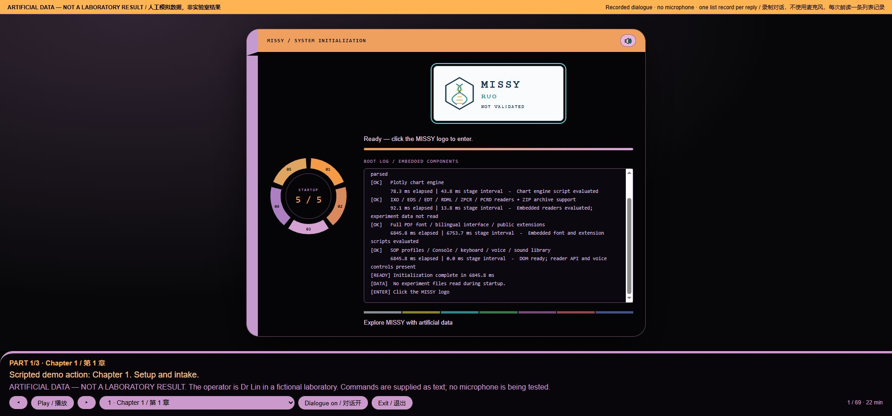

*Voice workflow step 1: Chapter 1*

Intent: `None`. Loaded runs: 0. Recorded audio payload: 99482 bytes.

## 2. Open MISSY

**Scripted action:** I click the MISSY logo to enter.

**MISSY:** MISSY / SESSION SETUP

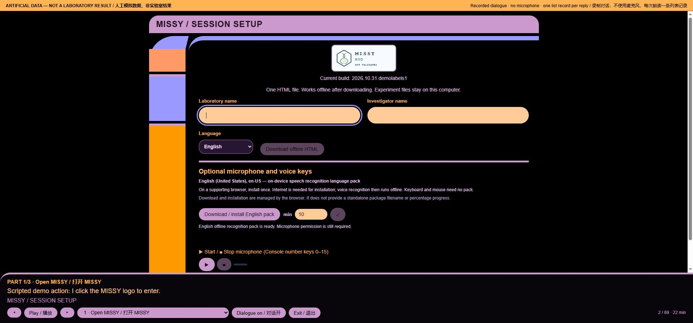

*Voice workflow step 2: Open MISSY*

Intent: `None`. Loaded runs: 0. Recorded audio payload: 29578 bytes.

## 3. Enter a fictional identity

**Scripted action:** I enter a fictional laboratory and investigator.

**MISSY:** Operator record. Investigator field: Dr Lin (fictional). This field does not authenticate a person.

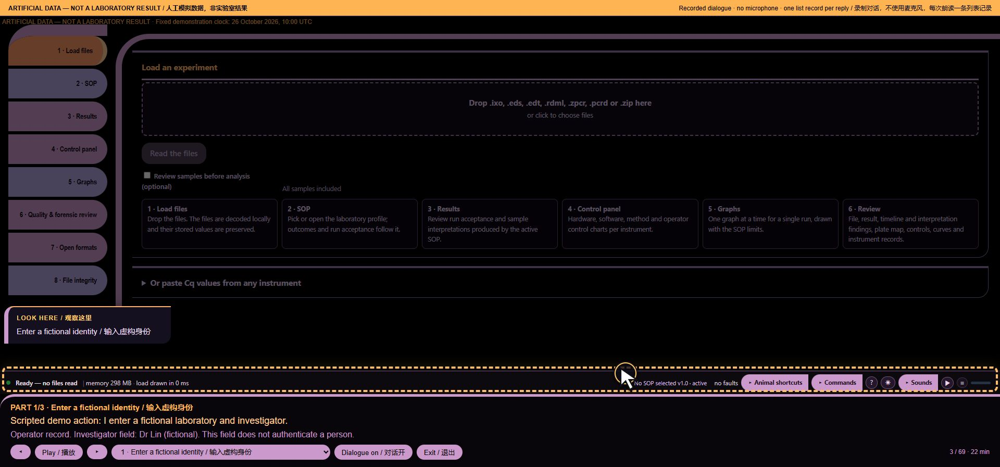

*Voice workflow step 3: Enter a fictional identity*

Intent: `None`. Loaded runs: 0. Recorded audio payload: 78087 bytes.

## 4. Who is speaking?

**Operator command:** Computer who am I

**MISSY:** Operator record. Investigator field: Dr Lin (fictional). This field does not authenticate a person.

Intent: `q:operator`. Loaded runs: 0. Recorded audio payload: 70956 bytes.

## 5. Demonstration clock

**Operator command:** Computer what time is it

**MISSY:** Device clock. 26/10/2026, 10:00:00. Device local time.

Intent: `f:clock`. Loaded runs: 0. Recorded audio payload: 68684 bytes.

## 6. Current publication

**Operator command:** Computer what build is this

**MISSY:** Build identification. Current publication: 2026.10.31.demolabels1. One offline HTML file. Publication identity is recorded separately in the release documentation.

Intent: `q:build`. Loaded runs: 0. Recorded audio payload: 119073 bytes.

## 7. Language and recognition

**Operator command:** Computer what language are you speaking

**MISSY:** The interface language is English. Recognition uses the English offline pack. Speech output requires an installed local voice for the selected language.

Intent: `q:lang`. Loaded runs: 0. Recorded audio payload: 87752 bytes.

## 8. Supported formats

**Operator command:** Computer what formats do you read

**MISSY:** Supported inputs. IXO, EDS, EDT, RDML, ZPCR and PCRD experiment files, plus ZIP archives. Available data depends on the source file.

Intent: `q:formats`. Loaded runs: 0. Recorded audio payload: 106456 bytes.

## 9. Choose embedded data

**Scripted action:** I select the embedded artificial file. File selection is a scripted demo action.

**MISSY:** 1 file(s) staged: ARTIFICIAL_MISSY_DEMO.rdml 4.0 MB

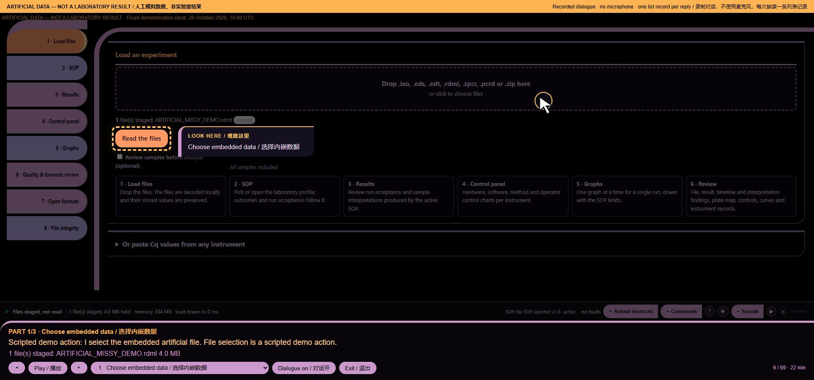

*Voice workflow step 9: Choose embedded data*

Intent: `None`. Loaded runs: 0. Recorded audio payload: 83312 bytes.

## 10. Ready to read

**Operator command:** Computer what are you doing

**MISSY:** Files selected. Ready to read.

Intent: `q:status`. Loaded runs: 0. Recorded audio payload: 34959 bytes.

## 11. Read artificial runs

**Scripted action:** I press Read files. This is a scripted demo action.

**MISSY:** Read 32 run(s): 768 stored result(s), 768 amplification curve(s).

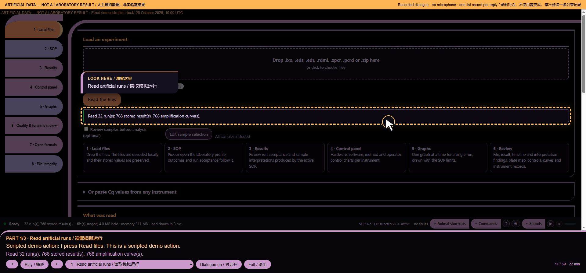

*Voice workflow step 11: Read artificial runs*

Intent: `None`. Loaded runs: 32. Recorded audio payload: 85950 bytes.

## 12. Count runs and records

**Operator command:** Computer how many runs

**MISSY:** 32 runs loaded. 768 stored result rows. This count does not include separate melting or relative-quantity tables.

Intent: `q:counts`. Loaded runs: 32. Recorded audio payload: 80960 bytes.

## 13. Source files and run views

**Operator command:** Computer how many files

**MISSY:** 1 distinct recorded source filenames; 32 decoded runs. File names may be unavailable or shared by several runs.

Intent: `f:files`. Loaded runs: 32. Recorded audio payload: 73359 bytes.

## 14. Identify one run

**Operator command:** Computer identify run three

**MISSY:** Run 3. SIM 3. 24 stored result rows; 2 recorded targets.

Intent: `o:identify run:three`. Loaded runs: 32. Recorded audio payload: 62361 bytes.

## 15. Find the latest recorded run

**Operator command:** Computer which run is newest

**MISSY:** Newest available timestamp; 0 run views have no usable timestamp. Ties are listed; this is not the time files were read. Run 32; SIM 32; 2026-02-01T09:00:00.000Z; recorded run start. End of list.

Intent: `data:newest`. Loaded runs: 32. Recorded audio payload: 172599 bytes.

## 16. Recorded instruments

**Operator command:** Computer how many instruments

**MISSY:** 2 distinct recorded platform/instrument labels; 0 run views have no recorded instrument identifier. Labels are not independently verified device identities. LC · DEMO-VIRTUAL-001. 1 more. Say Computer more.

Intent: `data:instruments`. Loaded runs: 32. Recorded audio payload: 137411 bytes.

## 17. Compare compatible histories

**Operator command:** Computer are these runs comparable

**MISSY:** Comparison scope. 2 distinct recorded platform/instrument labels; 1 decoded protocol signatures; 0 run views lack an instrument identifier and 0 lack a decoded protocol. The loaded records include different cohorts. Select one instrument, protocol and acquisition context before comparing control charts.

Intent: `data:cohort`. Loaded runs: 32. Recorded audio payload: 166642 bytes.

## 18. Recorded evidence, not damage diagnosis

**Operator command:** Computer damage report

**MISSY:** Damage report. Recorded evidence: 0 recorded integrity mismatch findings; 0 software faults; 0 locked PCRD views. Counts are findings and views, not files. No new scan was run. Unchecked records are not declared intact. This is not a hardware diagnosis.

Intent: `ship:damage`. Loaded runs: 32. Recorded audio payload: 167295 bytes.

## 19. Chapter 2

**Scripted action:** Chapter 2. Follow the evidence.

**MISSY:** ARTIFICIAL DATA — NOT A LABORATORY RESULT. We will examine planted repeat findings, a failed control, optical drift and an incomplete baseline.

Intent: `None`. Loaded runs: 32. Recorded audio payload: 90208 bytes.

## 20. Create a review-only profile

**Scripted action:** I create a fictional review-only method. Profile editing is a scripted demo action.

**MISSY:** Method identification. Active profile: ARTIFICIAL DEMO — NOT VALIDATED. Version: demo-1.

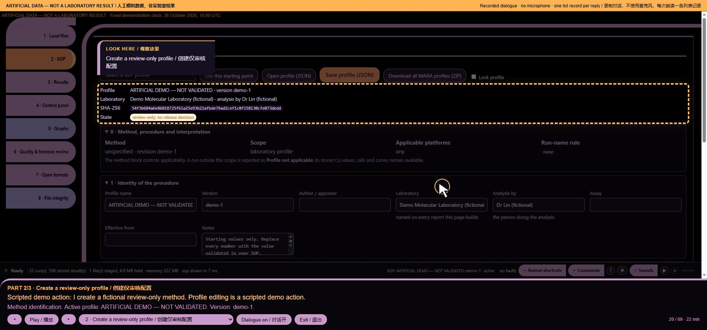

*Voice workflow step 20: Create a review-only profile*

Intent: `None`. Loaded runs: 32. Recorded audio payload: 91462 bytes.

## 21. Active method

**Operator command:** Computer which profile is active

**MISSY:** Method identification. Active profile: ARTIFICIAL DEMO — NOT VALIDATED. Version: demo-1.

Intent: `q:profile`. Loaded runs: 32. Recorded audio payload: 75919 bytes.

## 22. Reference assignment

**Operator command:** Computer which target is the reference

**MISSY:** Reference assignments. Profile-declared reference rules: 1. This is an assignment, not proof of detection. REF_GENE; match: REF_GENE. End of list.

Intent: `data:references`. Loaded runs: 32. Recorded audio payload: 115024 bytes.

## 23. Loaded targets

**Operator command:** Computer what targets are loaded

**MISSY:** 2 distinct recorded target labels across all loaded stored result rows. This does not count uncollected channels. DNA_TARGET. 1 more. Say Computer more.

Intent: `data:targets`. Loaded runs: 32. Recorded audio payload: 102590 bytes.

## 24. Read real profile summaries

**Operator command:** Computer read the results

**MISSY:** Read the results. 64 current sample-level profile summaries. Samples are grouped within each run and current selection. This is not a count of raw reactions. 59; Positive. 2 more. Say Computer more.

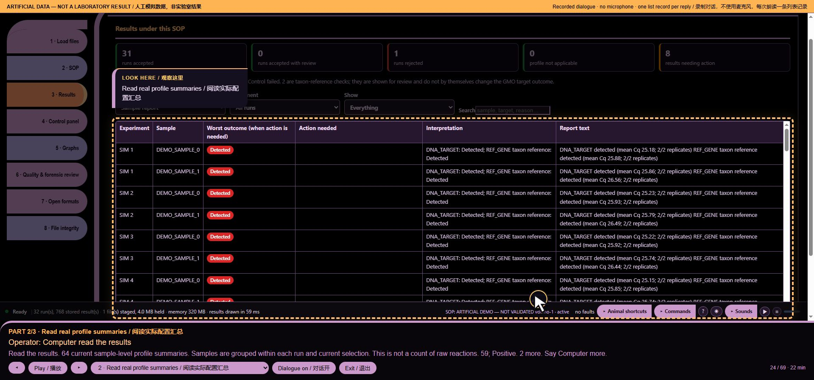

*Voice workflow step 24: Read real profile summaries*

Intent: `data:results`. Loaded runs: 32. Recorded audio payload: 135504 bytes.

## 25. Planted repeat findings

**Operator command:** Computer which samples should I repeat

**MISSY:** 3 current sample-target groups have the exact Repeat outcome under ARTIFICIAL DEMO — NOT VALIDATED. Other review or invalid outcomes are not counted as Repeat. SIM 5; DEMO_SAMPLE_0; DNA_TARGET; rule target: DNA_TARGET; replicate SD 2.18 > 0.5. 2 more. Say Computer more.

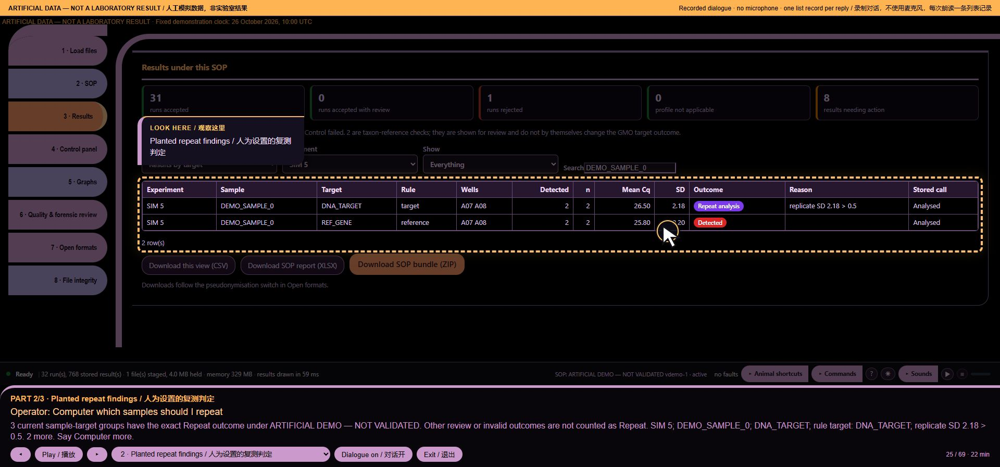

*Voice workflow step 25: Planted repeat findings*

Intent: `data:repeat`. Loaded runs: 32. Recorded audio payload: 186678 bytes.

## 26. Read the next repeat finding

**Operator command:** Computer more

**MISSY:** SIM 13; DEMO_SAMPLE_0; DNA_TARGET; rule target: DNA_TARGET; replicate SD 2.26 > 0.5. 1 more. Say Computer more.

Intent: `f:more`. Loaded runs: 32. Recorded audio payload: 110662 bytes.

## 27. Finish the repeat list

**Operator command:** Computer more

**MISSY:** SIM 19; DEMO_SAMPLE_0; DNA_TARGET; rule target: DNA_TARGET; replicate SD 2.25 > 0.5. End of list.

Intent: `f:more`. Loaded runs: 32. Recorded audio payload: 99533 bytes.

## 28. A deliberately failed control

**Operator command:** Computer did any control fail

**MISSY:** 128 evaluated control groups; 1 groups have the exact Control fail outcome. 0 control-presence criteria need review. This is not a run pass. SIM 9; DEMO NTC; DNA_TARGET; Control fail; rule control: DEMO NTC; amplified in 1/1 (min Cq 34.00 ≤ 36). End of list.

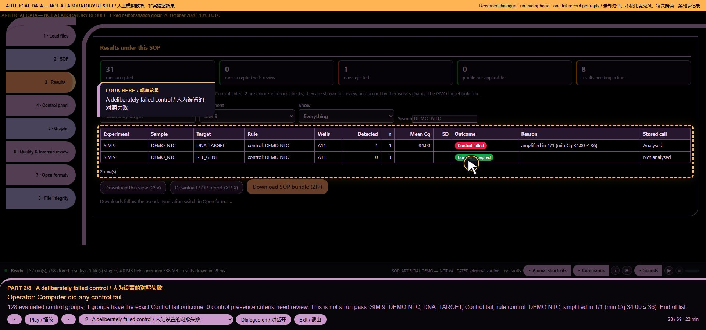

*Voice workflow step 28: A deliberately failed control*

Intent: `data:controlfail`. Loaded runs: 32. Recorded audio payload: 217398 bytes.

## 29. Assigned standards, not calibration approval

**Operator command:** Computer how many standards

**MISSY:** 384 included stored result rows have the exact Standard role, across 32 run views. This counts rows, not distinct concentrations or calibration curves.

Intent: `data:standards`. Loaded runs: 32. Recorded audio payload: 97706 bytes.

## 30. Hardware reference

**Scripted action:** I open the hardware reference. Manufacturer specifications and artificial measurements are different.

**MISSY:** Manufacturer specification reference / 制造商规格参考

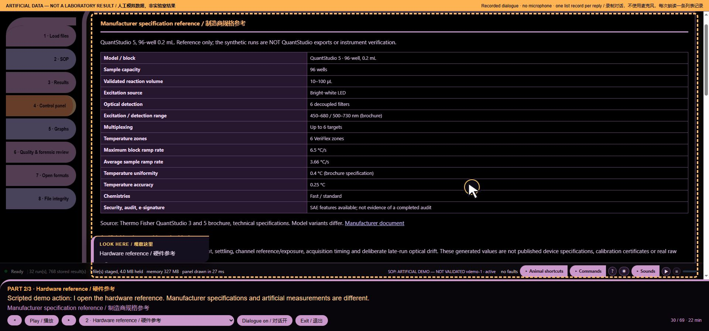

*Voice workflow step 30: Hardware reference*

Intent: `None`. Loaded runs: 32. Recorded audio payload: 56746 bytes.

## 31. Chart by its number

**Operator command:** Computer show chart 1

**MISSY:** Display chart 1. Chart 1. B-H1 Peak heating rate (2-s window).

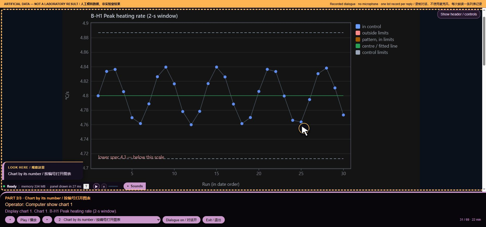

*Voice workflow step 31: Chart by its number*

Intent: `chart:1`. Loaded runs: 32. Recorded audio payload: 61029 bytes.

## 32. Chart inventory

**Operator command:** Computer run diagnostic on module charts

**MISSY:** 110 registered chart definitions. This is an inventory, not a diagnostic test.

Intent: `o:run diagnostic on module:charts`. Loaded runs: 32. Recorded audio payload: 66698 bytes.

## 33. Identify the current chart

**Operator command:** Computer which chart is this

**MISSY:** Chart 1 of 110. Peak heating rate (2-s window).

Intent: `data:chart`. Loaded runs: 32. Recorded audio payload: 50162 bytes.

## 34. Open the optical history

**Operator command:** Computer show chart 26

**MISSY:** Display chart 26. Chart 26. A-H3 Background fluorescence per channel.

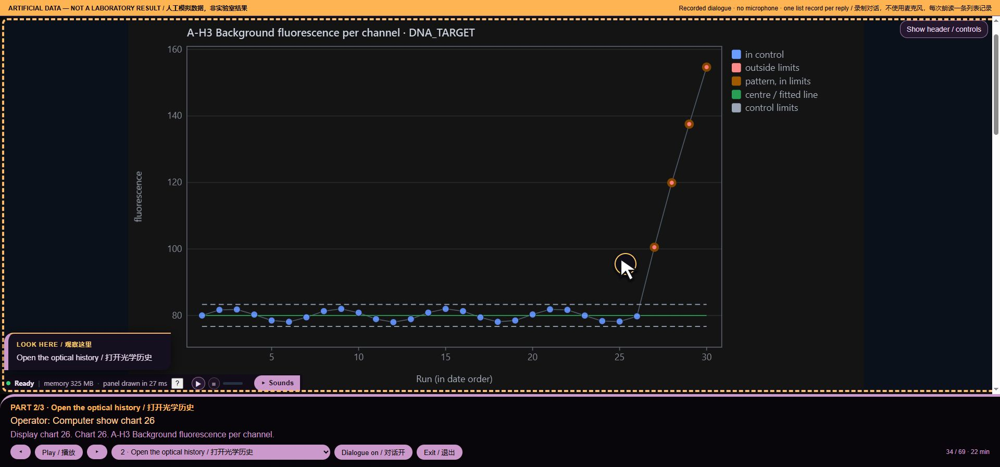

*Voice workflow step 34: Open the optical history*

Intent: `chart:26`. Loaded runs: 32. Recorded audio payload: 69676 bytes.

## 35. Measure the planted drift

**Operator command:** Computer how many outliers

**MISSY:** Chart review. A-H3 Background fluorescence per channel. 30 assessed points; 4 beyond available limits; 4 points with recorded flags. 0 missing or non-finite points; 0 before baseline. 30 points have available limits. Recorded flags: beyond 3σ.

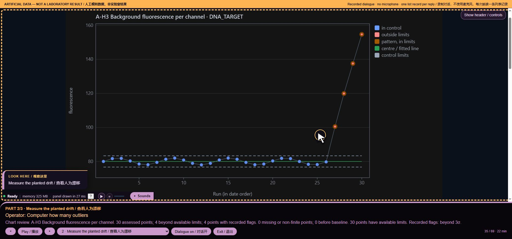

*Voice workflow step 35: Measure the planted drift*

Intent: `q:analyse`. Loaded runs: 32. Recorded audio payload: 164030 bytes.

## 36. Read the current magnification

**Operator command:** Computer what is the magnification

**MISSY:** Console chart zoom 100 percent; horizontal pan 0; vertical pan 0.

Intent: `o:zoom`. Loaded runs: 32. Recorded audio payload: 55831 bytes.

## 37. Zoom without changing values

**Operator command:** Computer zoom in

**MISSY:** Zoom in. Console command applied. Zoom 125 percent.

Intent: `nav:zoom in`. Loaded runs: 32. Recorded audio payload: 56746 bytes.

## 38. Confirm the zoom

**Operator command:** Computer what is the magnification

**MISSY:** Console chart zoom 125 percent; horizontal pan 0; vertical pan 0.

Intent: `o:zoom`. Loaded runs: 32. Recorded audio payload: 61317 bytes.

## 39. Reset the view

**Operator command:** Computer reset the view

**MISSY:** Reset view. Console command applied. Zoom 100 percent.

Intent: `nav:zoom reset`. Loaded runs: 32. Recorded audio payload: 53611 bytes.

## 40. White chart background

**Operator command:** Computer white background

**MISSY:** Light chart background. Chart background changed.

Intent: `theme:light`. Loaded runs: 32. Recorded audio payload: 43527 bytes.

## 41. Dark chart background

**Operator command:** Computer dark background

**MISSY:** Dark chart background. Chart background changed.

Intent: `theme:dark`. Loaded runs: 32. Recorded audio payload: 43841 bytes.

## 42. Label this as a drill

**Operator command:** Computer this is a drill

**MISSY:** Drill label enabled. Subsequent manual alert changes are tagged drill in the separate, in-memory interface log. Scientific records and exports are unchanged.

Intent: `ship:drill:1`. Loaded runs: 32. Recorded audio payload: 90443 bytes.

## 43. Manual alarm for the scenario

**Operator command:** Computer red alert

**MISSY:** Manual red alert requested. Sound depends on browser audio availability. Say Computer cancel red alert to stop it. This does not indicate a detected data or instrument fault.

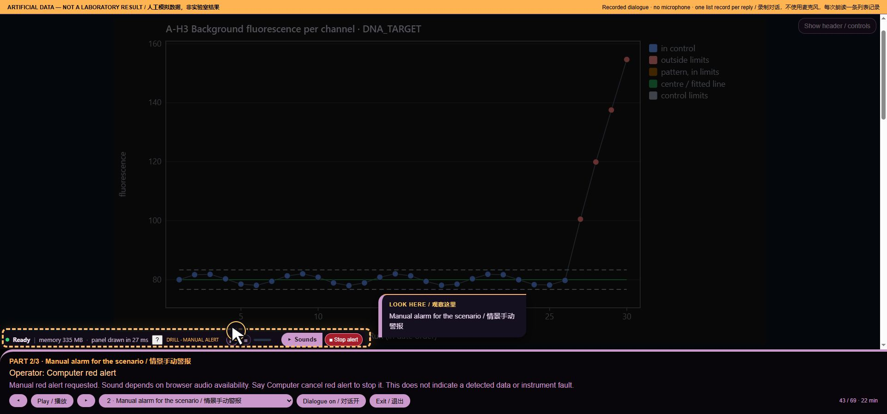

*Voice workflow step 43: Manual alarm for the scenario*

Intent: `ship:red`. Loaded runs: 32. Recorded audio payload: 99403 bytes.

## 44. Stop the manual alarm

**Operator command:** Computer cancel red alert

**MISSY:** Manual red alert stopped; drill label cleared. This is not a green or passing scientific verdict.

Intent: `ship:standdown`. Loaded runs: 32. Recorded audio payload: 61761 bytes.

## 45. Switch to the short history

**Scripted action:** I select the second artificial instrument. It has only two run views.

**MISSY:** Chart 1 of 110. Peak heating rate (2-s window).

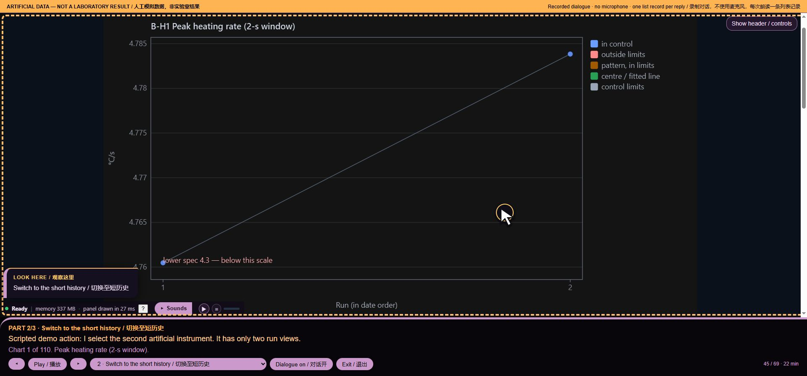

*Voice workflow step 45: Switch to the short history*

Intent: `None`. Loaded runs: 32. Recorded audio payload: 64242 bytes.

## 46. Missing baseline is not a pass

**Operator command:** Computer why has this chart no limits

**MISSY:** Chart review. B-H1 Peak heating rate (2-s window). 2 assessed points; 0 beyond available limits; 0 points with recorded flags. 0 missing or non-finite points; 0 before baseline. 2 points have available limits. Control baseline is not ready. No recorded flags. This is not proof that all data are nominal.

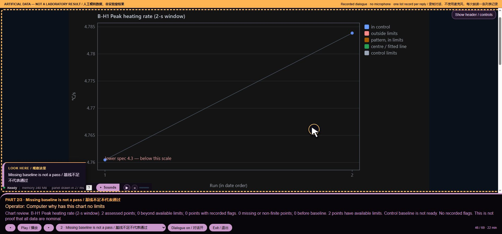

*Voice workflow step 46: Missing baseline is not a pass*

Intent: `q:analyse`. Loaded runs: 32. Recorded audio payload: 199609 bytes.

## 47. Open amplification data

**Operator command:** Computer show chart 85

**MISSY:** Display chart 85. Chart 85. Amplification curves coloured by SOP outcome.

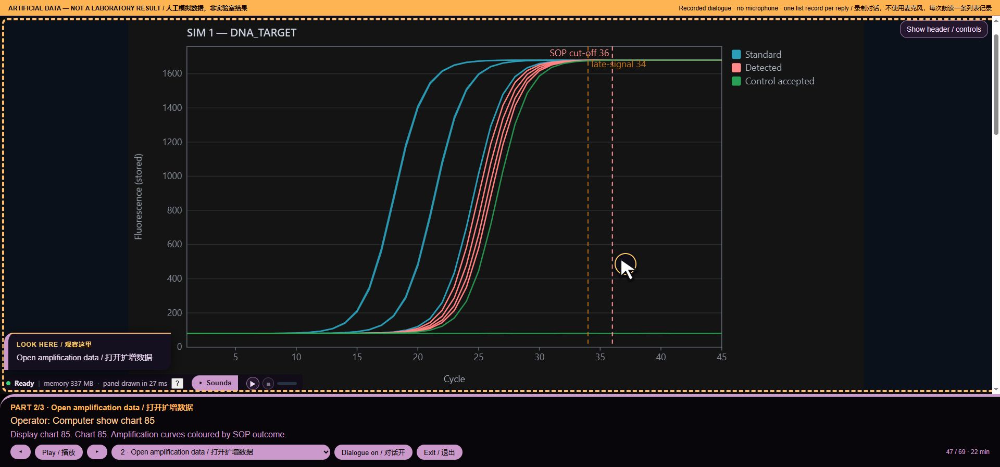

*Voice workflow step 47: Open amplification data*

Intent: `chart:85`. Loaded runs: 32. Recorded audio payload: 65653 bytes.

## 48. Summarise this single run

**Operator command:** Computer summarise the run

**MISSY:** Run summary. Run 1; SIM 1. 24 stored result rows; 24 included rows. Existing profile status: Accepted. This is not release approval.

Intent: `data:summary`. Loaded runs: 32. Recorded audio payload: 111446 bytes.

## 49. Trace the source

**Operator command:** Computer where did this run come from

**MISSY:** Source records. Run 1; source filename ARTIFICIAL_MISSY_DEMO.rdml; instrument label LC · DEMO-VIRTUAL-001; software version DEMO GENERATOR 1. Fields are recorded metadata, not independent verification.

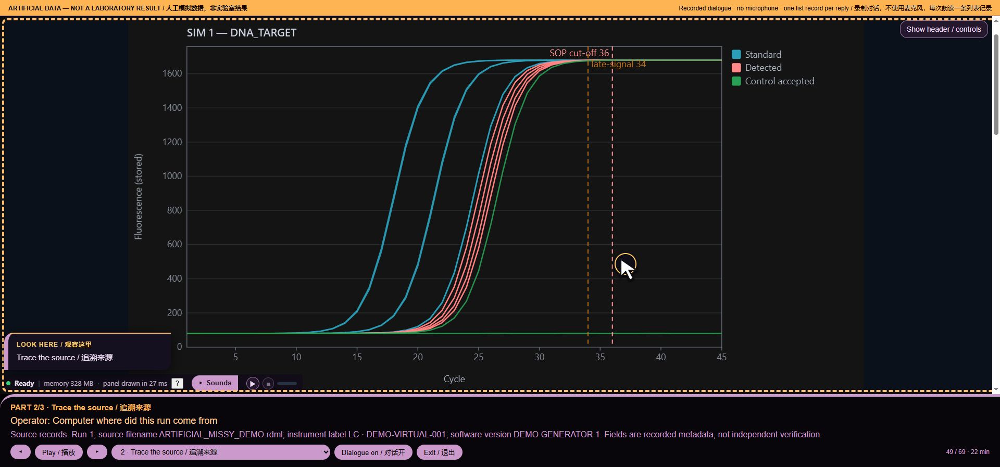

*Voice workflow step 49: Trace the source*

Intent: `data:origin`. Loaded runs: 32. Recorded audio payload: 138640 bytes.

## 50. Inspect the plate mapping

**Operator command:** Computer show chart 86

**MISSY:** Display chart 86. Chart 86. Plate heat map.

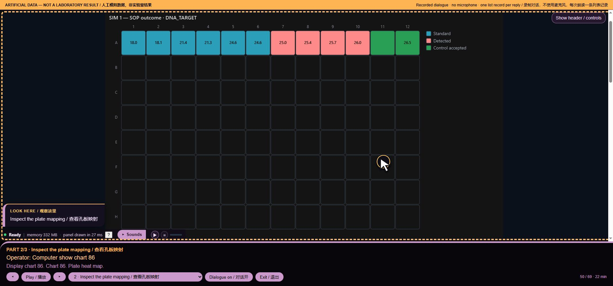

*Voice workflow step 50: Inspect the plate mapping*

Intent: `chart:86`. Loaded runs: 32. Recorded audio payload: 55674 bytes.

## 51. Open review

**Operator command:** Computer stations

**MISSY:** Review stations. Opened Quality and forensic review. The previous view is saved; say Computer as you were to return. This does not establish that every issue has been found.

*Voice workflow step 51: Open review*

Intent: `ship:stations`. Loaded runs: 32. Recorded audio payload: 99299 bytes.

## 52. Return to the saved view

**Operator command:** Computer as you were

**MISSY:** Restored the saved review-navigation view. Data, profile and downloads were not reverted.

Intent: `ship:restore`. Loaded runs: 32. Recorded audio payload: 56013 bytes.

## 53. Chapter 3

**Scripted action:** Chapter 3. Prepare the report.

**MISSY:** ARTIFICIAL DATA — NOT A LABORATORY RESULT. We will review provenance, prepare a real report from artificial data, and show the limits of this tool.

Intent: `None`. Loaded runs: 32. Recorded audio payload: 87883 bytes.

## 54. Open formats with a numbered command

**Operator command:** Computer seven

**MISSY:** Control 7. Workspace. Open formats.

Intent: `7`. Loaded runs: 32. Recorded audio payload: 47419 bytes.

## 55. Identify the view

**Operator command:** Computer where am I

**MISSY:** Current station. Workspace. Open formats.

Intent: `q:where`. Loaded runs: 32. Recorded audio payload: 47498 bytes.

## 56. Export scope

**Operator command:** Computer what will the export contain

**MISSY:** Export contents. Export scope depends on the specific export. Graph CSV uses the current graph data; interpreted result exports use the active profile and current selection; complete raw-value exports have their own scope. I have not started a download. Review Open formats and the export dictionary for the selected export.

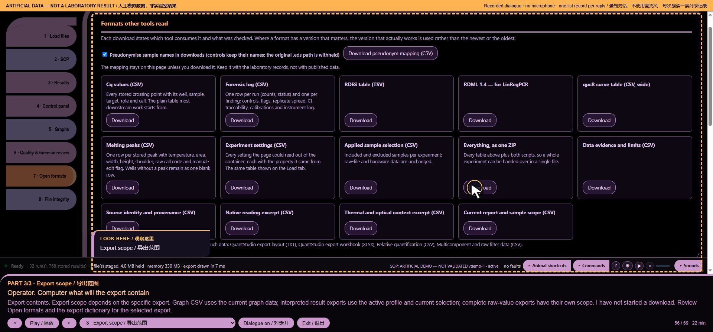

*Voice workflow step 56: Export scope*

Intent: `data:exportscope`. Loaded runs: 32. Recorded audio payload: 170822 bytes.

## 57. Name disclosure settings

**Operator command:** Computer security alert

**MISSY:** Integrity review. Identifier disclosure status: export pseudonymisation is on. That setting applies only to exports that implement it. Spoken sample names remain original, as you requested. No security or intrusion scan was performed; no export was started.

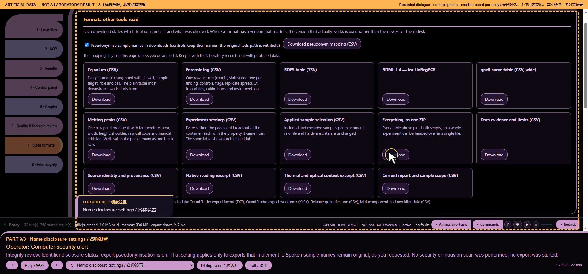

*Voice workflow step 57: Name disclosure settings*

Intent: `ship:security`. Loaded runs: 32. Recorded audio payload: 148069 bytes.

## 58. Open integrity

**Operator command:** Computer eight

**MISSY:** Control 8. Workspace. File integrity.

Intent: `8`. Loaded runs: 32. Recorded audio payload: 45773 bytes.

## 59. Read the status, with coverage limits

**Operator command:** Computer status report

**MISSY:** Status report. 32 runs; 768 stored result rows. Active profile ARTIFICIAL DEMO — NOT VALIDATED, version demo-1. 0 recorded software faults; these are not sample failures. No chart is open. Say Computer full report for the remaining observations. Unavailable checks are not evidence of a pass.

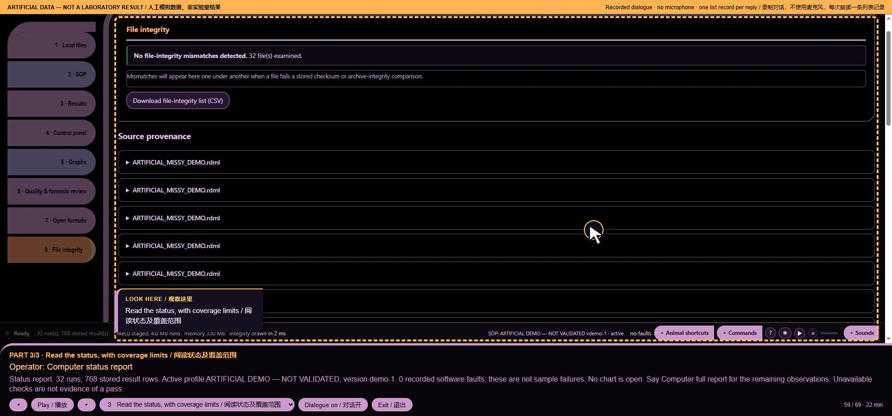

*Voice workflow step 59: Read the status, with coverage limits*

Intent: `f:report`. Loaded runs: 32. Recorded audio payload: 189578 bytes.

## 60. Animal shortcuts

**Scripted action:** I open the animal shortcuts. These are mouse actions in this demonstration.

**MISSY:** Available functions. Choose or drop experiment files, read them, and review sample selection.

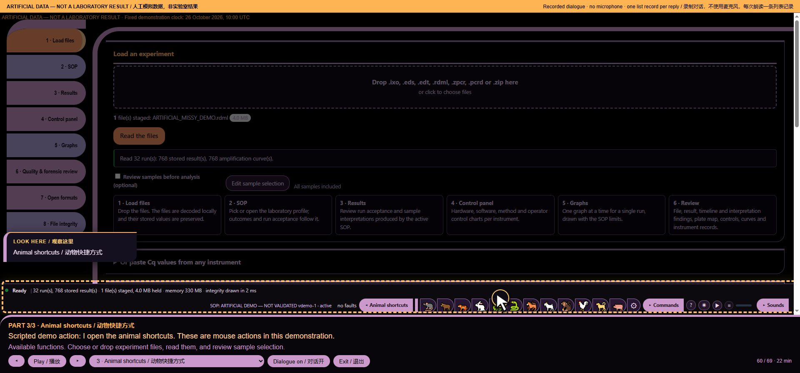

*Voice workflow step 60: Animal shortcuts*

Intent: `None`. Loaded runs: 32. Recorded audio payload: 78165 bytes.

## 61. Command mode

**Scripted action:** I open Command mode.

**MISSY:** Current station. Command mode. Load files.

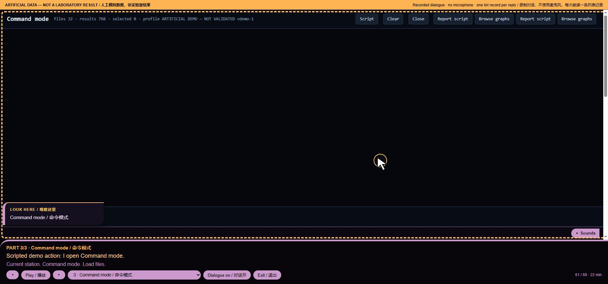

*Voice workflow step 61: Command mode*

Intent: `None`. Loaded runs: 32. Recorded audio payload: 46688 bytes.

## 62. Research-use boundary

**Operator command:** Computer are these results validated

**MISSY:** This is a research-use tool, not a laboratory validation certificate. You can review the method configuration and documentation for your own validation process.

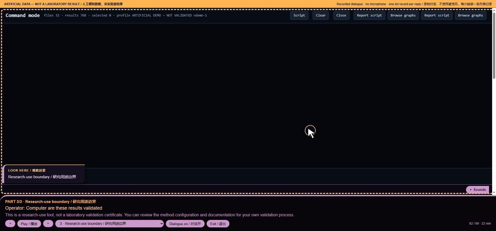

*Voice workflow step 62: Research-use boundary*

Intent: `refuse:validation`. Loaded runs: 32. Recorded audio payload: 86342 bytes.

## 63. No cause inferred from a curve

**Operator command:** Computer is this sample contaminated

**MISSY:** I do not infer contamination or inhibition from a curve. You can inspect recorded control results and the active method rules in Results and SOP.

*Voice workflow step 63: No cause inferred from a curve*

Intent: `refuse:cause`. Loaded runs: 32. Recorded audio payload: 78374 bytes.

## 64. Rules cannot be overridden by voice

**Operator command:** Computer override the profile

**MISSY:** Unable to comply. Voice does not override method rules. Review the active profile in the SOP view.

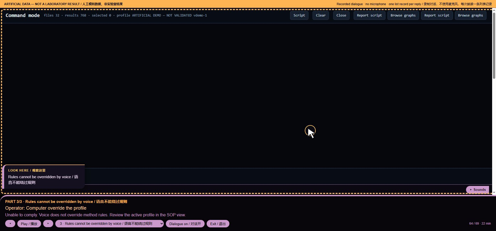

*Voice workflow step 64: Rules cannot be overridden by voice*

Intent: `o:override`. Loaded runs: 32. Recorded audio payload: 68083 bytes.

## 65. Release is a laboratory decision

**Operator command:** Computer approve this run for release

**MISSY:** Unable to comply. Release is a laboratory decision under your SOP. You can review the profile findings in Results; this page does not authorise release.

Intent: `refuse:release`. Loaded runs: 32. Recorded audio payload: 90861 bytes.

## 66. Assisted report selection

**Scripted action:** I select the drift and heating figures in Assisted mode. Report creation is a scripted demo action.

**MISSY:** Current station. Assisted mode. Load files.

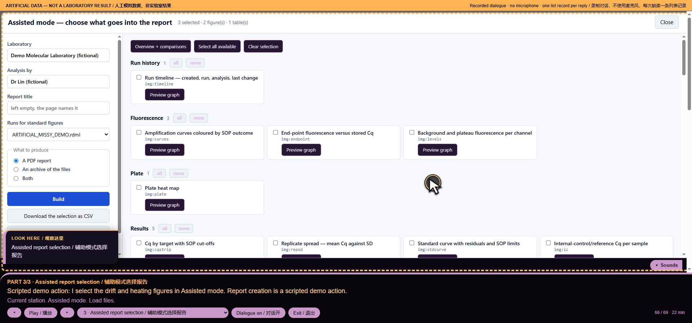

*Voice workflow step 66: Assisted report selection*

Intent: `None`. Loaded runs: 32. Recorded audio payload: 68396 bytes.

## 67. Build a real artificial-data report

**Scripted action:** I build the report locally. This does not approve laboratory results.

**MISSY:** Artificial-data report is ready in memory. Use Preview report to inspect the actual PDF.

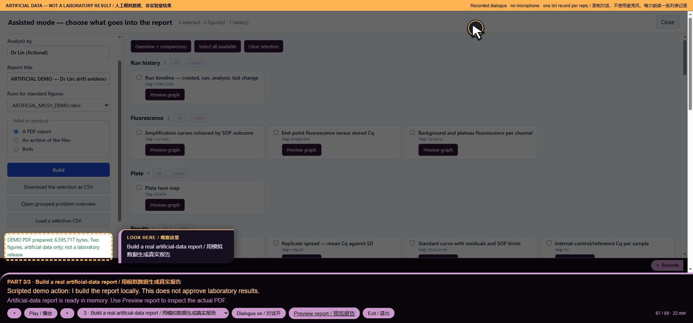

*Voice workflow step 67: Build a real artificial-data report*

Intent: `None`. Loaded runs: 32. Recorded audio payload: 71949 bytes.

## 68. Stand down

**Operator command:** Computer stand down

**MISSY:** Manual red alert stopped; drill label cleared. This is not a green or passing scientific verdict.

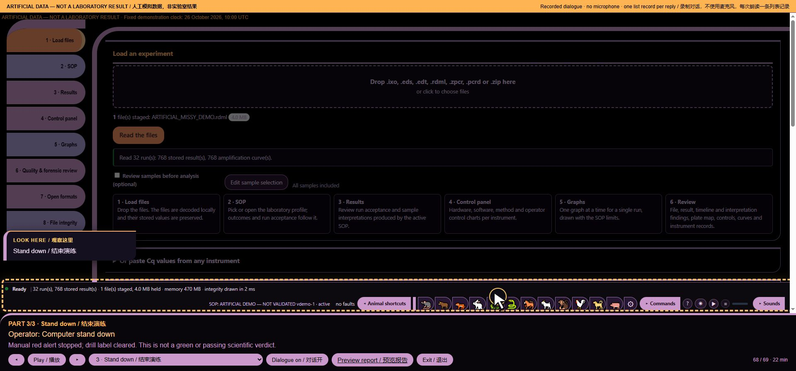

*Voice workflow step 68: Stand down*

Intent: `ship:standdown`. Loaded runs: 32. Recorded audio payload: 60298 bytes.

## 69. Stop the interface audio

**Operator command:** Computer all stop

**MISSY:** Voice, manual alert and background sounds stopped. File intake, rendering and instrument acquisition were not halted. Loaded run views remain.

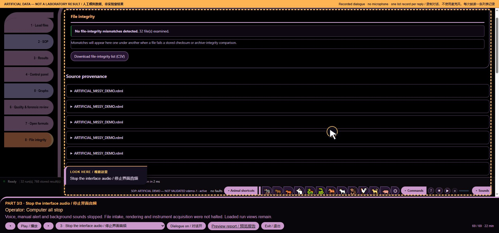

*Voice workflow step 69: Stop the interface audio*

Intent: `ship:stop`. Loaded runs: 32. Recorded audio payload: 85663 bytes.

