# Guided walkthrough — 30 illustrated lessons

Artificial demonstration data; not laboratory results. Research use only. MISSY is not validated.

Captured from the public **2026.10.31.demolabels1** page on 1 November 2026. All 30 lesson descriptions are taken from the running demo. Screenshots show the webpage, not PDF reports.

## 1. Meet Dr Lin

Dr Lin has 32 runs to review. Six have a signal shift. Help identify the affected evidence and prepare a traceable review report — without editing original values.

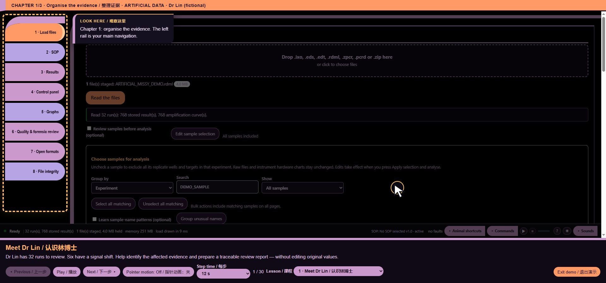

*Walkthrough lesson 1: Meet Dr Lin*

## 2. Stage the embedded file

Start with one embedded, explicitly artificial RDML file. No laboratory files or internet are needed.

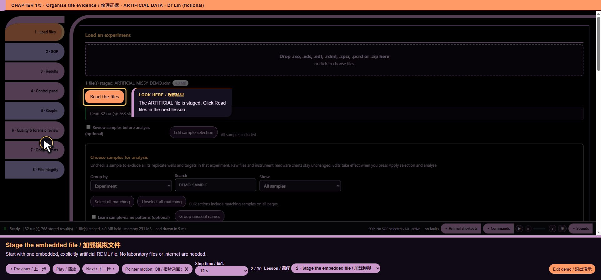

*Walkthrough lesson 2: Stage the embedded file*

## 3. Read the evidence

Watch the real intake read 32 artificial runs and 768 target records. Cq values, amplification curves and melting arrays stay linked.

*Walkthrough lesson 3: Read the evidence*

## 4. Narrow the sample scope

Dr Lin filters sample names before interpretation. Filtering is a view/selection step; it does not rewrite measurements.

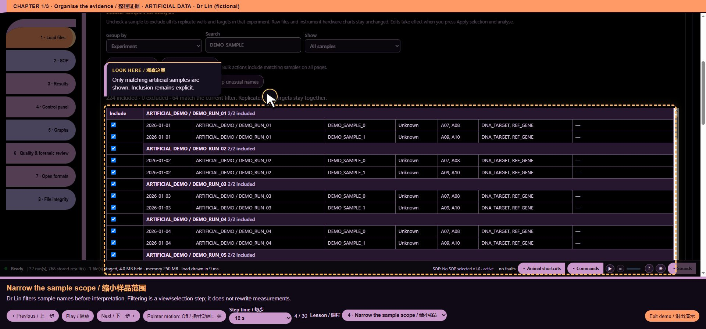

*Walkthrough lesson 4: Narrow the sample scope*

## 5. Create a review-only SOP

A named SOP makes rules and report identity traceable. This fictional profile is not a validated method.

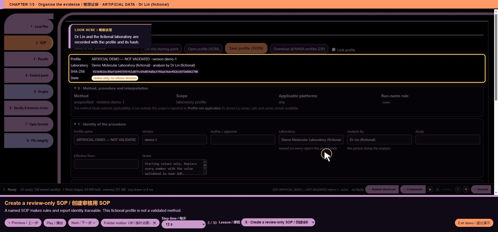

*Walkthrough lesson 5: Create a review-only SOP*

## 6. Specify targets and controls

Make thresholds and controls explicit. Absolute, relative and melting configuration fields are also available; a template alone is not a validated calculation method.

*Walkthrough lesson 6: Specify targets and controls*

## 7. Read the sample outcome

Inspect one run first. Cq, replicate counts, outcome and reason remain visible together. All values here are artificial.

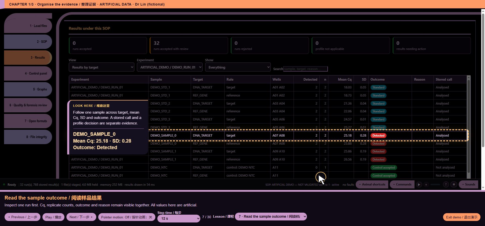

*Walkthrough lesson 7: Read the sample outcome*

## 8. Find one run and sample

Use the experiment selector and text search together. Dr Lin isolates DEMO_SAMPLE_0 instead of reading hundreds of rows.

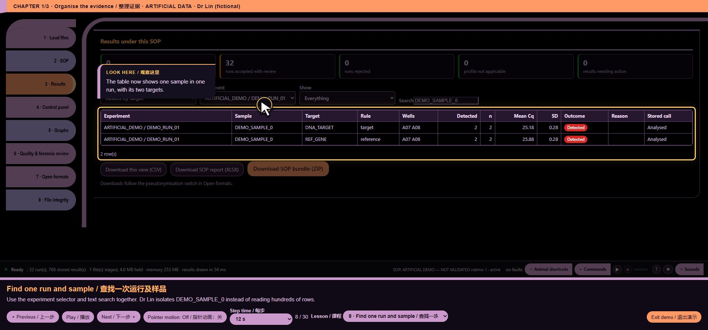

*Walkthrough lesson 8: Find one run and sample*

## 9. See the history at a glance

The Control panel separates hardware, software, method and operator signals. Thirty-two compatible artificial runs support a baseline.

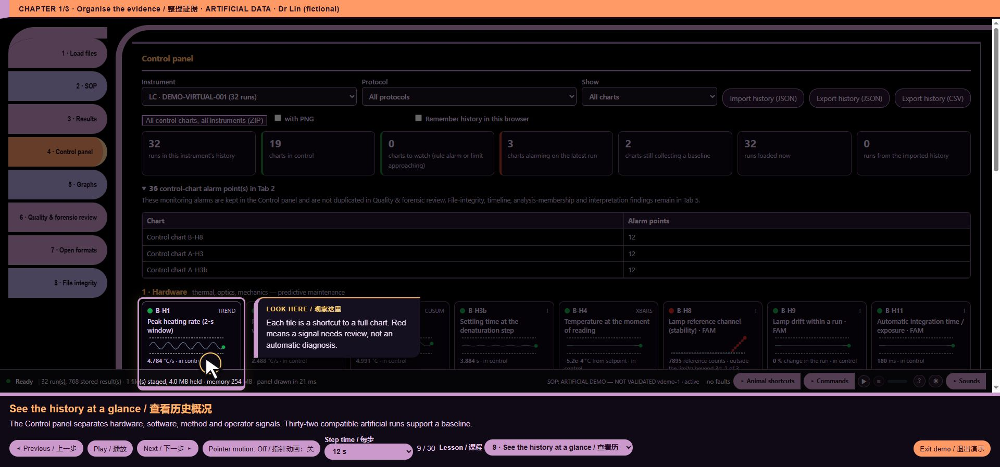

*Walkthrough lesson 9: See the history at a glance*

## 10. Know the hardware reference

QuantStudio 5 specifications are manufacturer reference values for the stated block variant. Simulator measurements are labelled separately.

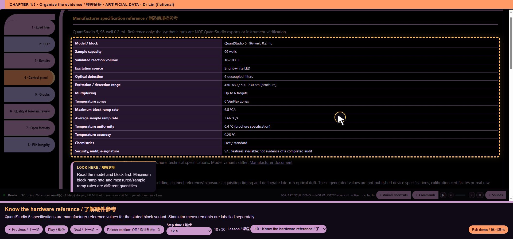

*Walkthrough lesson 10: Know the hardware reference*

## 11. Check heating stability

Chapter 2: investigate the shift. The dark chart makes the stable artificial heating history easy to see.

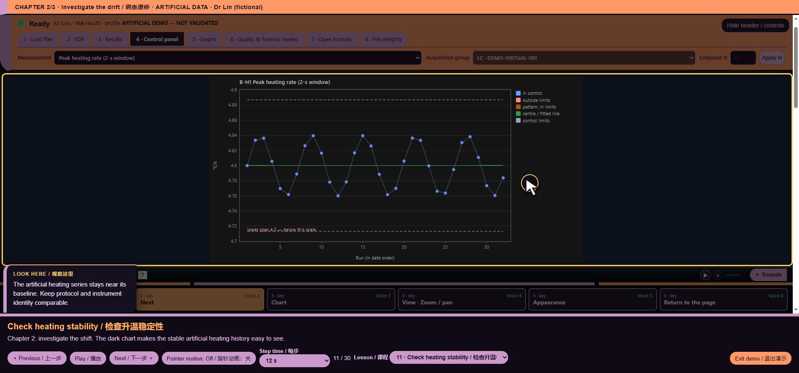

*Walkthrough lesson 11: Check heating stability*

## 12. Check cooling independently

Cooling can change independently of heating. This light-background example shows the same chart controls and readable limits.

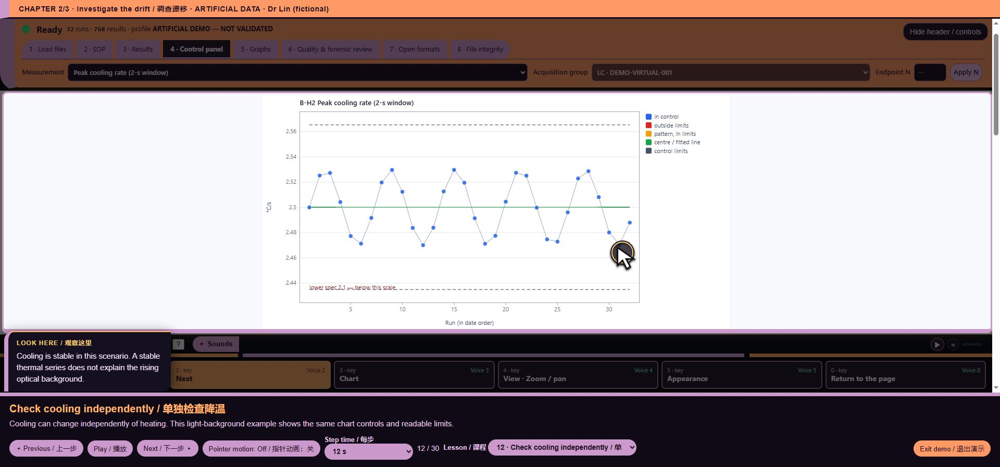

*Walkthrough lesson 12: Check cooling independently*

## 13. Locate the six drifting runs

The last six runs show a deliberately increasing background. Look at the highlighted red points, not the entire page.

*Walkthrough lesson 13: Locate the six drifting runs*

## 14. Call attention to the drift

The tour presses the real Red alert for this artificial scenario. This scripted click does not add an automatic production alarm rule.

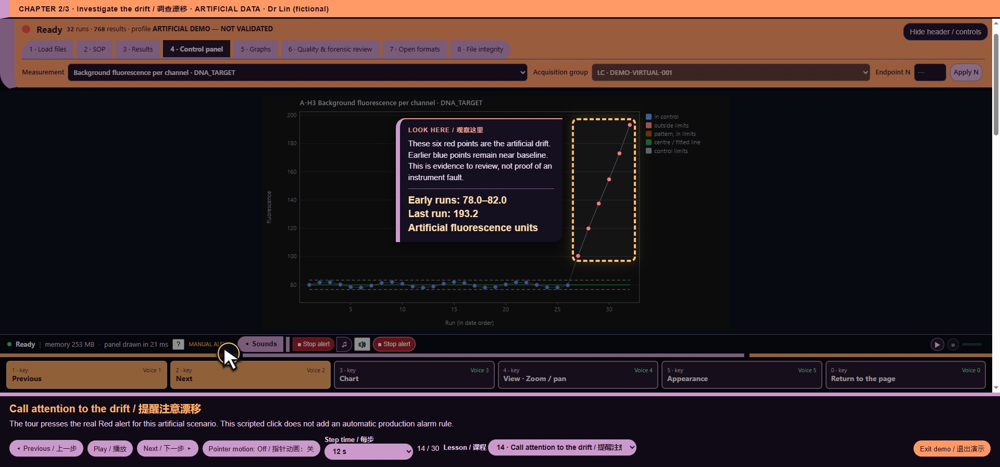

*Walkthrough lesson 14: Call attention to the drift*

## 15. Stop, then try voice Next

Stop remains available even with Sounds collapsed. Then the transcript “two” selects Next chart; no microphone is used.

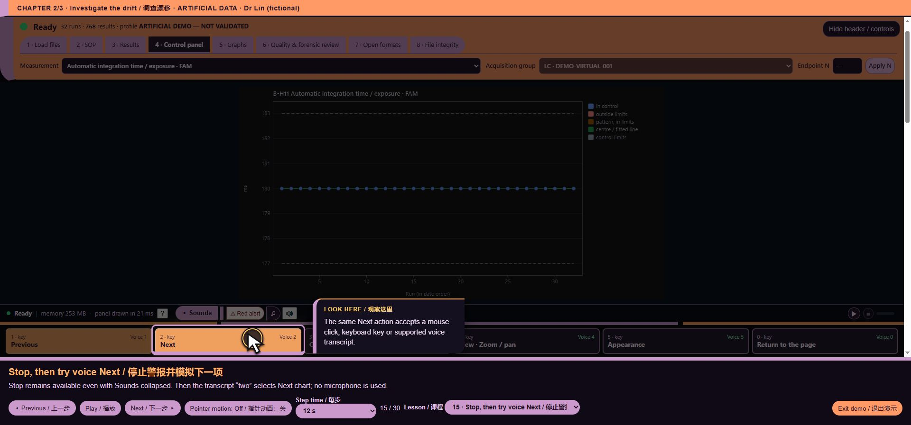

*Walkthrough lesson 15: Stop, then try voice Next*

## 16. Open the voice menu

The transcript “four” opens View. Numbered choices change with the active menu, matching the displayed keys.

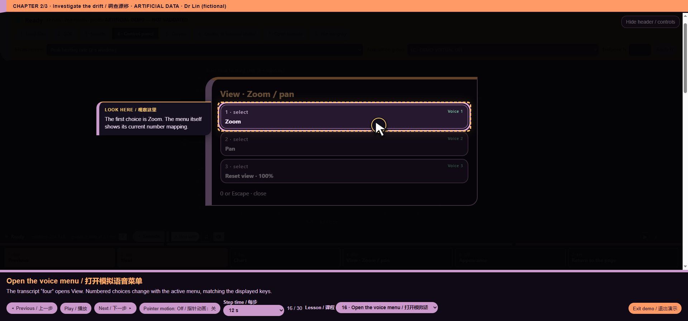

*Walkthrough lesson 16: Open the voice menu*

## 17. Zoom using two choices

Emulated “one”, then “two” chooses Zoom and Zoom in. The data values do not change.

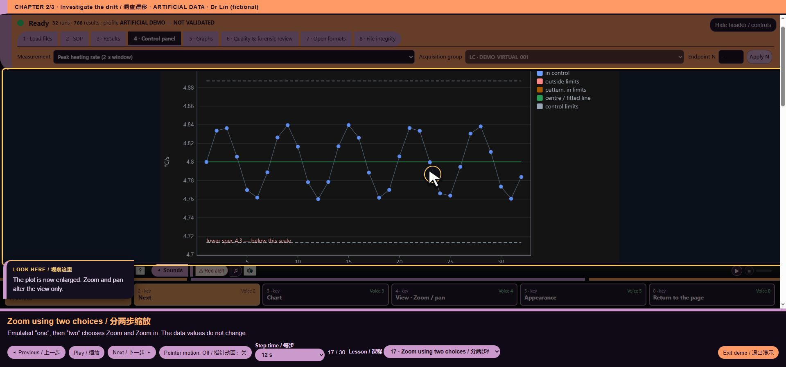

*Walkthrough lesson 17: Zoom using two choices*

## 18. Inspect amplification

Compare the artificial sigmoid rises and the flat NTC. Stored Cq and traces stay linked to their sample and channel.

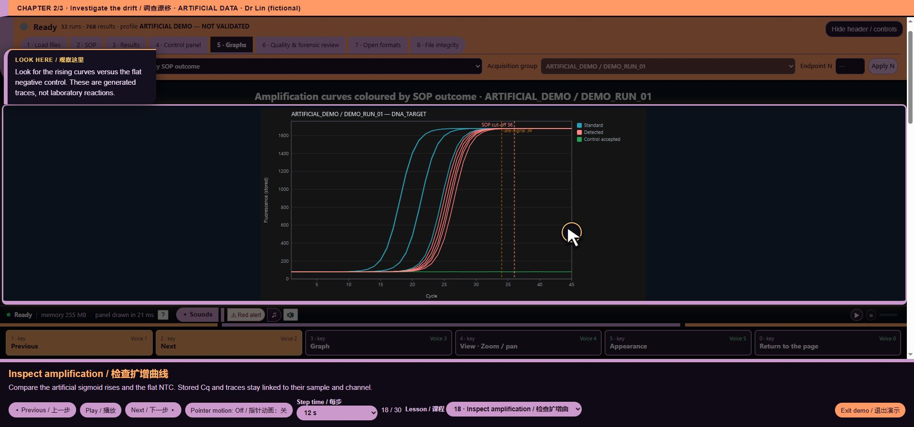

*Walkthrough lesson 18: Inspect amplification*

## 19. Read a calibration limitation

A high R² is not enough. This light-background standard curve spans only two log units, below the illustrative profile requirement.

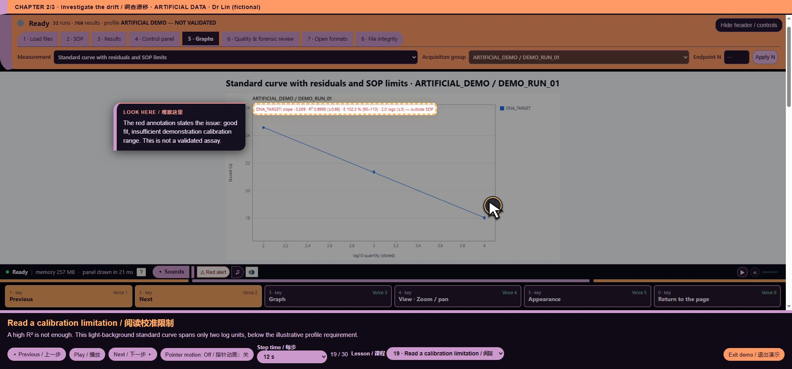

*Walkthrough lesson 19: Read a calibration limitation*

## 20. Compare melting evidence

Two artificial products have supplied Tm values near 78 and 82 °C. The dark preview shows the retained fluorescence arrays.

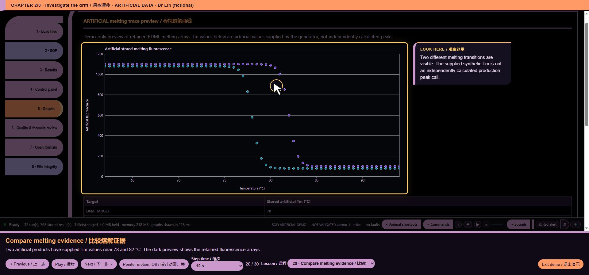

*Walkthrough lesson 20: Compare melting evidence*

## 21. Verify the plate layout

Chapter 3: prepare traceable evidence. Check positions, roles and channels before selecting report figures.

*Walkthrough lesson 21: Verify the plate layout*

## 22. Compare samples

Dr Lin compares compatible samples and replicates rather than mixing targets or protocols.

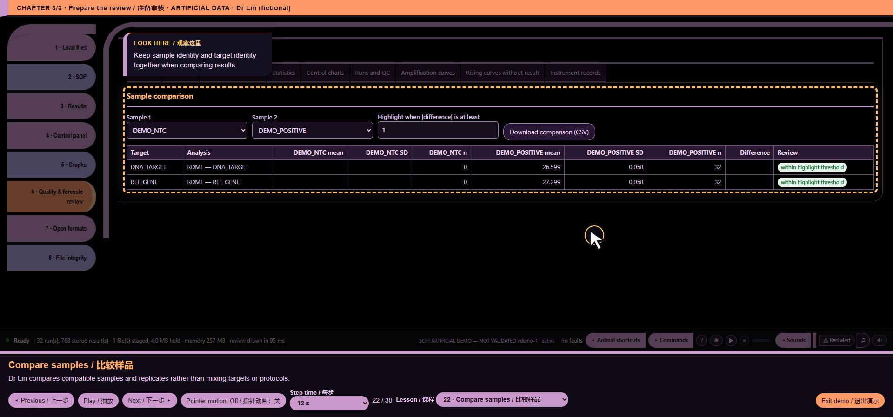

*Walkthrough lesson 22: Compare samples*

## 23. Check grouped statistics

Review counts and grouped variability. A single grand Cq mean across different targets is not an assay conclusion.

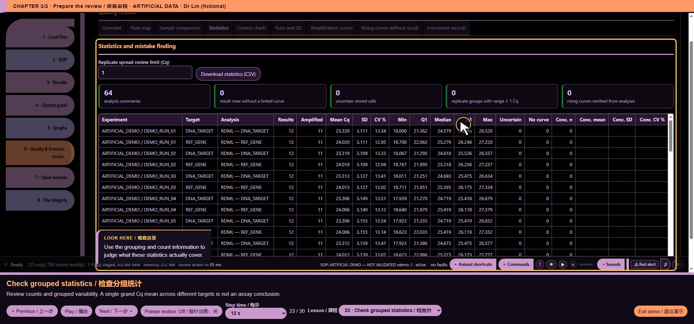

*Walkthrough lesson 23: Check grouped statistics*

## 24. Trace the source evidence

Instrument records and file integrity explain where values came from. A checksum identifies bytes; it does not certify an experiment.

*Walkthrough lesson 24: Trace the source evidence*

## 25. Choose an open output

Exports preserve evidence and scope. The demo does not silently download files or send data to a server.

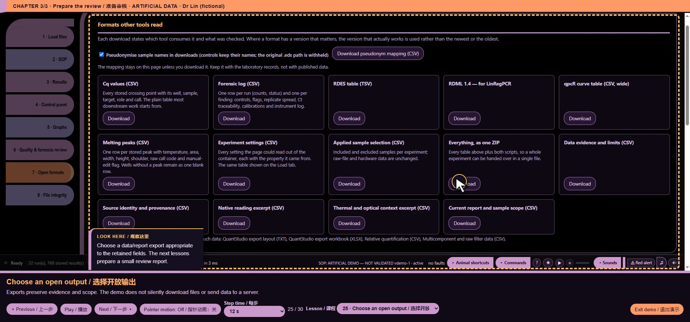

*Walkthrough lesson 25: Choose an open output*

## 26. Make shortcuts useful

The 12 animals can open pages or specific charts. Dr Lin can bind a shortcut to the drift chart without changing real saved assignments.

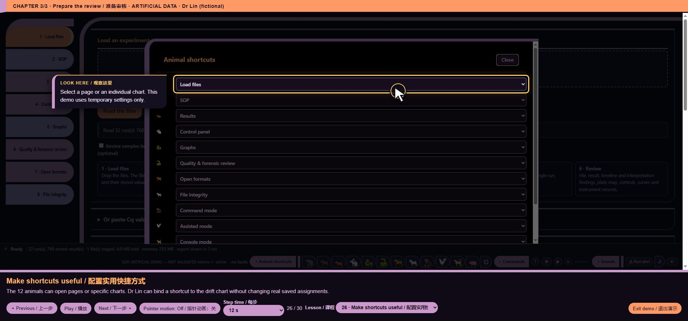

*Walkthrough lesson 26: Make shortcuts useful*

## 27. Keep commands and details together

Commands groups modes, status report, Details and GPL/source. The tour shows diagnostics without downloading a file.

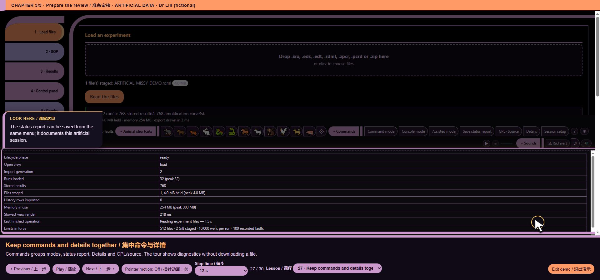

*Walkthrough lesson 27: Keep commands and details together*

## 28. Use Command mode

The actual typed workflow supports explicit report selections. The tour does not run a script or trigger a download.

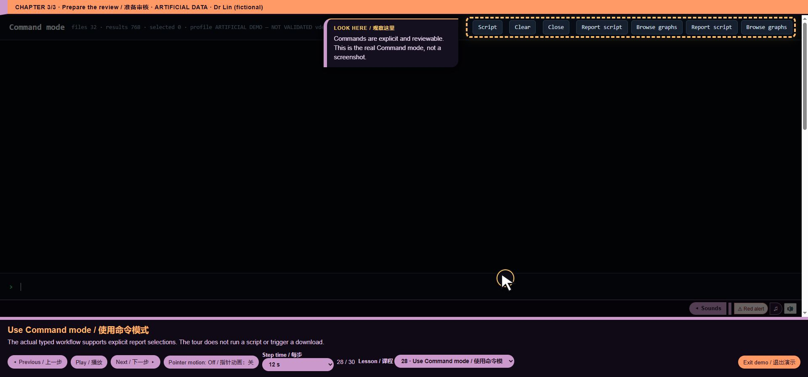

*Walkthrough lesson 28: Use Command mode*

## 29. Work in Console

The dark Console keeps charts large. Mouse, keyboard and optional local voice reach the same navigation and appearance controls.

*Walkthrough lesson 29: Work in Console*

## 30. Prepare the evidence, not a release

Dr Lin has isolated the drift and prepares two relevant figures for review. The actual PDF is built locally from artificial data. This does not approve results or repair hardware.

*Walkthrough lesson 30: Prepare the evidence, not a release*

